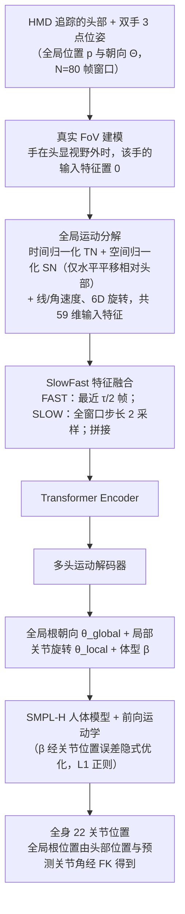

# EgoPoser

**EgoPoser: Robust Real-Time Egocentric Pose Estimation from Sparse and Intermittent Observations Everywhere** 收录于 [Robot Learning Paper Notebooks](https://imchong.github.io/Robot_Learning_Paper_Notebooks/index.html)（分类：14_Human_Motion），深读笔记已完成。本页是 **笔记摘要**：要点编译自深读笔记，细节以笔记原文与论文 PDF 为准。

## 一句话定义

仅用头与手位姿做全身第一视角姿态估计是头显平台驱动化身的活跃方向，但现有方法过度依赖室内动捕空间（数据录制环境），且假设关节连续跟踪与统一体型。EgoPoser 在更真实的设定下做到鲁棒：手部位置/朝向只有进入头显视野（FoV）时才被跟踪——即稀疏且间歇的观测。它还有三点关键贡献：① 在间歇手部跟踪下仍鲁棒建模全身姿态；② 全局运动分解——独立于全局位置预测全身姿态；③ 高效的 SlowFast 模块设计，在捕捉更长运动时序的同时保持算力高效；并能跨不同用户体型泛化。ECCV 2024。

## 英文缩写速查

| 缩写 | 含义 |
|---|---|
| Egocentric | 第一视角（头显） |
| Intermittent | 间歇（手出视野则丢跟踪） |
| FoV | Field of View，头显视野 |
| Global Motion Decomposition | 全局运动分解（独立于全局位置） |
| SlowFast | 慢-快双路时序模块 |
| Body Shape Generalization | 跨体型泛化 |

## 为什么重要

- **"间歇/缺失观测下鲁棒"是真实部署的关键**，与人形状态估计在传感缺失时的鲁棒诉求一致；
- **全局运动分解**对全身状态估计的泛化有借鉴（呼应 AvatarPoser、FRAME）；
- **SlowFast 长时序 + 高效**是实时全身估计的实用结构；
- 稀疏感知驱动全身，对人形遥操作/化身有直接价值。

## 流程总览

图依据：论文 §3.1–3.5、Fig. 2。

## 解决什么问题

现有第一视角全身姿态估计**假设太理想**： - 依赖**室内动捕空间**、**连续**关节跟踪、**统一体型**； - 真实中手**常出视野**→**间歇**观测； - 全局位置变化影响稳定。

EgoPoser 要：在**稀疏间歇**观测、**任意场景、任意体型**下鲁棒实时估计全身姿态。

## 核心机制

1. **间歇观测鲁棒**：手出视野也能稳健估全身姿态；
2. **全局运动分解**：独立于全局位置预测，提升泛化；
3. **SlowFast 模块**：长时序 + 算力高效；
4. **跨体型泛化**：摆脱统一体型假设（ECCV 2024）。

方法拆解（深读笔记小节）：间歇手部观测下的鲁棒建模；全局运动分解（独立于全局位置）；SlowFast 模块（长时序 + 高效）；跨体型泛化；🧭 整体流程（mermaid）。

## 核心信息

| 字段 | 内容 |
|------|------|
| 分类 | 14_Human_Motion |
| 深读笔记 | <https://imchong.github.io/Robot_Learning_Paper_Notebooks/papers/14_Human_Motion/EgoPoser__Robust_Real-Time_Egocentric_Pose_Estimation_from_Sparse_Sensors/EgoPoser__Robust_Real-Time_Egocentric_Pose_Estimation_from_Sparse_Sensors.html> |
| arXiv | <https://arxiv.org/abs/2308.06493> |
| 作者 | Jiaxi Jiang、Paul Streli、Manuel Meier、Christian Holz（ETH Zürich SIPLAB） |
| 发表 | 2023 年 8 月（ECCV 2024） |
| 项目主页 | [siplab.org/projects/EgoPoser](https://siplab.org/projects/EgoPoser) · [code](https://github.com/eth-siplab/EgoPoser) |
| 笔记阅读日期 | 2026-06-21 |

## 实验与评测

- 本页是深读笔记的摘要，没有搬运原文的量化结果；量化 benchmark、消融与实机指标以 **深读笔记与论文 PDF** 为准（链接见 [参考来源](#参考来源)）。

## 结论

**EgoPoser 一次性拆掉了第一视角姿态估计的三条理想假设——连续跟踪、室内动捕场地、统一体型——真正的价值是让「手出视野」这种常态不再是失效条件。**

- 三个机制各对应一条假设：间歇观测建模应对手部丢跟踪，**全局运动分解**让姿态预测不依赖全局位置（因而不绑定录制场地），跨体型泛化摆脱统一体型前提。
- SlowFast 是「时序长度 vs 算力」的折中：观测缺口要靠更长的运动历史来补，又不能牺牲实时性——这是它能做到实时的结构性原因。
- 适用边界要认清：输入始终只有头与手的稀疏位姿，下肢没有任何直接观测，腿部姿态本质上是先验驱动的推断，遮挡时长与运动异常度都会侵蚀它。
- 对人形的迁移价值在**传感缺失下的鲁棒状态估计**与遥操作/化身链路；全局运动分解这一点可与 AvatarPoser、FRAME 对照着看。
- 已开源（项目主页 + code，ECCV 2024）；量化指标与消融本页未展开，以深读笔记与论文 PDF 为准（见 [参考来源](#参考来源)）。

## 与其他页面的关系

- 分类父节点：[paper-notebook-category-14-human-motion](../overview/paper-notebook-category-14-human-motion.md)
- 总索引：[humanoid-paper-notebooks-index.md](../overview/humanoid-paper-notebooks-index.md)

## 参考来源

- [humanoid_pnb_egoposer.md](../../sources/papers/humanoid_pnb_egoposer.md)
- 深读笔记：<https://imchong.github.io/Robot_Learning_Paper_Notebooks/papers/14_Human_Motion/EgoPoser__Robust_Real-Time_Egocentric_Pose_Estimation_from_Sparse_Sensors/EgoPoser__Robust_Real-Time_Egocentric_Pose_Estimation_from_Sparse_Sensors.html>
- 论文：<https://arxiv.org/abs/2308.06493>
- [arXiv PDF](https://arxiv.org/pdf/2308.06493)：已通读方法部分（实验与附录以略读为准）：§3.1 概述、§3.2 真实 FoV 建模、§3.3 全局运动分解、§3.4 SlowFast 特征融合、§3.5 体型感知姿态优化

## 推荐继续阅读

- [机器人论文阅读笔记：EgoPoser](https://imchong.github.io/Robot_Learning_Paper_Notebooks/papers/14_Human_Motion/EgoPoser__Robust_Real-Time_Egocentric_Pose_Estimation_from_Sparse_Sensors/EgoPoser__Robust_Real-Time_Egocentric_Pose_Estimation_from_Sparse_Sensors.html)
