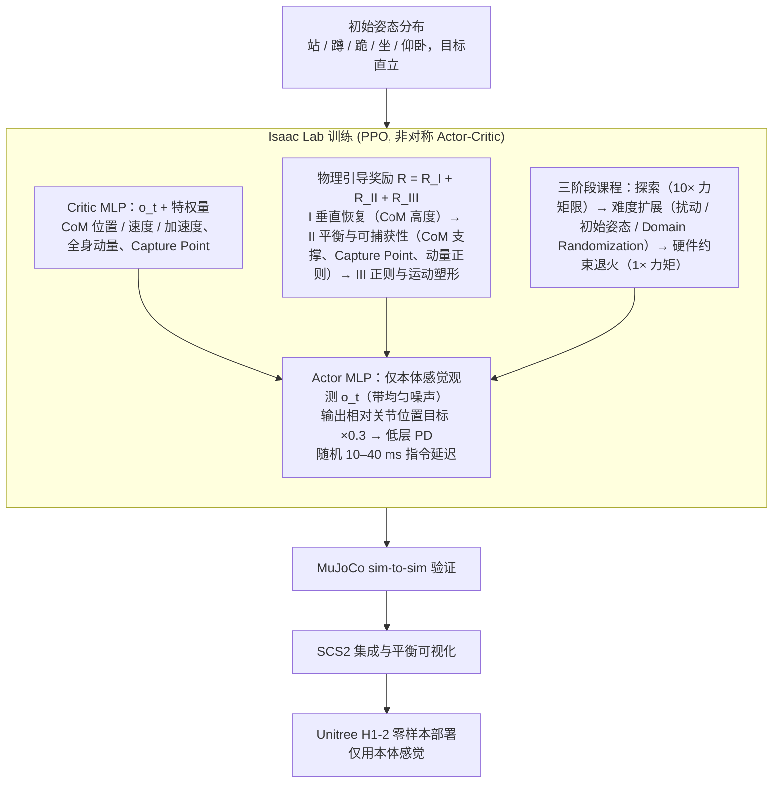

# Embedding Classical Balance Control Principles in Reinforcement Learning for Humanoid Recovery

**Embedding Classical Balance Control Principles in Reinforcement Learning for Humanoid Recovery**（arXiv:2603.08619，Poddar 等，IHMC / University of West Florida，2026 年 3 月）用 PPO 训练一个统一的人形跌倒恢复策略：把 Capture Point、CoM 状态和质心动量作为训练期 **特权 critic 输入** 与 **奖励塑形信号**，而部署时 actor 只用本体感觉，从而在 Unitree H1-2 上零样本上机。

本页原为 Paper Notebooks 策展清单的索引实体，本次 ingest 已通读 arXiv 原文全文（8 页，正文 + 参考文献，无附录）并据此补全。深读笔记见 [参考来源](#参考来源)。

## 英文缩写速查

| 缩写 | 英文全称 | 在本文中的含义 |
|------|----------|----------------|
| RL | Reinforcement Learning | 以 MDP 形式学习跌倒恢复策略 |
| PPO | Proximal Policy Optimization | 训练所用的 on-policy actor-critic 算法（clip ε = 0.2） |
| MDP | Markov Decision Process | 状态 $s_t$、动作 $a_t$、奖励 $r_t$ 的形式化设定 |
| CoM | Center of Mass | 质心位置、速度与加速度，作为特权观测输入 critic |
| CP | Capture Point | LIP 下使机器人停住所需的落脚点 $\xi$，用于 $r_{\text{CP}}$ 与 $r_{\text{CoM}}$ 相关奖励 |
| LIP | Linear Inverted Pendulum | CP 公式所依据的简化模型 |
| PD | Proportional-Derivative | 低层关节控制器，跟踪 actor 输出的关节位置目标 |
| MLP | Multilayer Perceptron | actor 与 critic 均为隐藏层 [512, 256, 128]、ELU 激活的 MLP |
| DR | Domain Randomization | 随机化质量、摩擦、电枢惯量等参数以提升 sim-to-real 鲁棒性 |
| ONNX | Open Neural Network Exchange | 训练后导出策略、部署到真机 OpenCV DNN 推理的格式 |

## 为什么重要

- 人形机器人跌倒后的恢复是接触丰富、非周期、强依赖状态的问题。已有工作要么依赖预定义起身序列 [4, 5]，要么依赖参考运动或接触调度 [6, 7]，泛化到意外接触与扰动时较弱。
- 大多数 RL 恢复方法把稳定性当作任务奖励的隐含结果，critic 只能从奖励历史推断"离不可恢复还有多远"（论文 §I）。
- 论文主张经典平衡量（CP、CoM 状态、质心动量）本身紧凑、可解释，且仿真中可直接获得、硬件上可估计，却很少被用来结构化学习策略（论文 §I）。本文把它们同时放进非对称 critic 与奖励项，是本页最值得记住的设计动机。

## 核心原理

**输入 / 输出。** actor 只接收可在真机测得的观测：base 角速度、projected gravity、相对关节位置与速度、上一步动作 $a_{t-1}$（论文 §III-C）。训练时对这些输入加均匀噪声（base 角速度 ±0.5 rad/s、projected gravity ±0.15、关节位置 ±0.1 rad、关节速度 ±0.5 rad/s）。critic 额外接收仿真特权量 $s_t^{\text{priv}}$：CoM 位置/速度/加速度、全身线动量与角动量、Capture Point。输出为所有驱动关节的相对位置目标，乘以 0.3 后由 PD 跟踪，每个 episode 随机固定 10–40 ms 指令延迟（论文 §III-D）。

**奖励分解。** 总奖励 $R = R_I + R_{II} + R_{III}$，三组分别对应"垂直恢复 → 动态平衡 → 运动正则"（论文 §III-E）：

- **组 I 垂直恢复**：高度跟踪 $r_{\text{height}}$、上升塑形 $r_{\text{rise}}$、下落惩罚 $r_{\text{fall}}$、稳定带 $r_{\text{stab}}$。
- **组 II 平衡与可捕获性**：静态稳定 $r_{\text{CoM}}$、动态可捕获 $r_{\text{CP}}$、动量正则 $r_{\text{mom}}$。
- **组 III 正则与运动塑形**：力矩与关节限位安全 $r_{\text{torque}}$、躯干朝向 $r_{\text{orient}}$、高度门控的手/肘接触 $r_{\text{contact}}$、存活与提前终止 $r_{\text{alive}}$。

关键公式（符号按原文，$h_c$ 为 CoM 高度，$h^*$ 为目标直立高度）：

$$
\xi = p_{c,xy} + \frac{\dot p_{c,xy}}{\sqrt{g/h_c}}
$$

$$
r_{\text{height}} = \exp\!\left(-\frac{(h_c - h^*)^2}{\sigma_h^2}\right),\qquad
r_{\text{rise}} = \alpha_r \max(\dot h_c, 0)\, \mathbb{I}[h_c < h^*]
$$

$$
r_{\text{CoM}} = \exp\!\left(-\frac{d_{\text{CoM}}^2}{\sigma_c^2}\right),\qquad
r_{\text{CP}} = \exp\!\left(-\frac{d_{\text{CP}}^2}{\sigma_\xi^2}\right)
$$

$$
r_{\text{mom}} = -\alpha_\ell \lVert F_{\text{net}}\rVert_2^2 - \alpha_L \lVert \tau_{\text{net}}\rVert_2^2
$$

其中 $d_{\text{CoM}}$、$d_{\text{CP}}$ 为 CoM 投影、CP 到支撑凸包边界的有符号距离（内负外正）。论文正文对 $r_{\text{fall}}$ 的表述是对向下速度做二次惩罚。

注：按原文写法 $d_{\text{CP}}$ 以平方进入指数，符号信息在平方后丢失，即 CP 深入支撑区内部时奖励同样下降。原文是否通过其他项区分这一情况（未核实）需以代码或补充材料确认。

**课程与域随机化。** 三阶段课程（论文 §III-F）：(1) 探索期，关节力矩限放宽到 10×，允许发现手辅助撑起等多接触行为；(2) 难度扩展，逐步加入外力扰动、站 / 蹲 / 跪 / 坐 / 仰卧的随机初始姿态与 DR（质量分布、摩擦、惯量、电枢惯量）；一旦站直即施加大冲量诱发完整跌倒-恢复循环；(3) 硬件约束退火，力矩限降到 1×、位置限缩放到 0.9×。DR 细节见论文 §III-G（刚度/阻尼 ×[0.75, 1.25]、关节摩擦 [0.5, 4.0]、电枢惯量 ×[0.5, 1.6]、接触摩擦 $\mu_s\in[0.3,1.6]$、初始位姿与关节偏置噪声、躯干冲量 50–300 N 持续 0.1–0.2 s）。

**流程总览。**

图依据：论文 §III（Fig. 2 端到端流程；III-B 学习架构、III-E 物理引导奖励、III-F 课程、III-G Domain Randomization）

## 方法栈与实现细节

- **算法**：on-policy PPO（clip ε 0.2，折扣 γ 0.99，GAE λ 0.95，学习率 1e-3，target KL 0.01，熵系数 0.005），训练 50,000 次迭代，每环境每次更新 24 步 rollout（论文 Table II）。
- **仿真器**：Isaac Lab，Unitree H1-2 模型，建模全身动力学、接触、关节限位与摩擦（论文 §III-B）。
- **网络**：actor 与 critic 同为 MLP [512, 256, 128]、ELU，策略初始动作噪声 σ = 1.0。
- **参考依赖**：无参考轨迹、无 keyframe、无脚本化接触调度（论文 §I、§II-C）。

## 实验与评测

- **仿真恢复率**：在 Isaac Lab 中跨多种初始姿态（含蹲、跪、坐、仰卧）共 10,000 次试验，恢复成功率 93.4%，平均恢复时间 5 s。失败主要源于陷入局部接触构型，无法在 episode 内完成站起（论文 §IV-A.1）。
- **扰动分级**：站立时施加外推，50–100 N 由踝部策略吸收，100–200 N 触发髋部调整，200–300 N 触发踏步恢复，≥300 N 切换为手撑的多接触恢复（论文 §IV-A.2）。Fig. 3 展示 CP 在恢复过程中被拉回支撑凸包的轨迹。
- **MuJoCo sim-to-sim**：五种初始姿态（站、蹲、跪、仰卧、坐），四个横向方向施加 0–500 N 外力。成功判据为 CoM 高于 0.85 m 并保持至少 1 s、竖直速度低于 0.1 m/s、躯干倾角在竖直方向 72° 以内。无扰动时五种姿态均 100% 恢复。扰动下，站立与蹲姿在 200 N 时恢复率仍高于 50%；仰卧与坐姿超过 100 N 后低于 25%。推力作用高度越低恢复率越高。恢复时间随力增大，仰卧高力时可达 9 s（论文 §IV-A.3）。
- **消融实验**：移除特权 critic 输入、CP 奖励与课程（单一合并消融）后，策略无法离地站起，Stuck-low 终止率从 0.067 升至 1.000，平均奖励从 +379.2 降至 −115.3，Timeout 率从 0.934 降至 0.000（论文 Table V）。
- **实机**：策略导出为 ONNX，经 OpenCV DNN Java API 以 50 Hz 推理，关节级控制律为 $\tau = k_p(q_{\text{ref}} - q) - k_d \dot q$，部署时不改策略与控制结构。10 次从仰卧、坐姿、跪姿、蹲姿初始化的试验全部成功站起；其中 3 次出现瞬时高频关节振荡，操作员进行了保守的安全干预（论文 §IV-C）。作者将其归因于仿真与实机阻尼特性的残余差异，并表示正通过改进训练中的动作平滑来处理。

## 与其他工作对比

- 论文 Table I 按 HoF（高自由度人形）、Fall（跌倒恢复）、MP（多姿态初始化）、MT（多地形）、Ref（使用运动参考）、EB（显式平衡指标）、AC（非对称 critic）七个维度比较 FRASA [8]、HumanUP [7]、HoST [5]、HiFAR [10] 与本文。本文在该表中的自述为：不使用运动参考（Ref ✗）、具备 EB 与 AC。其余单元格未逐格核对（未核实，见原表）。
- 与 [HoST](paper-host-humanoid-standingup.md) 相比，两者都做无参考的多姿态起身，但 HoST 以多 critic PPO 与地形课程为主，本文则把 CP、CoM 与动量显式写进奖励与 critic 观测。
- 与基于优化的多接触规划（论文 §II-B，如 Crocoddyl、contact-implicit MPC）相比，本文不做在线优化，而是把平衡量用于训练期塑形。论文同时指出这类 ZMP / CP / 凸包假设在非周期、强接触场景中会失效。
- 与经典 [capture point / DCM](../concepts/capture-point-dcm.md) 控制器相比，本文仅把 CP 当作学习信号，而非直接的步位控制器。

## 结论

**这篇工作的核心取舍是「经典平衡控制的物理量只进训练、不进部署」：Capture Point、CoM 状态与质心动量用来塑形学习过程，推理时 actor 仍然只依赖本体感觉。**

1. **非对称 critic 是落地前提** — 特权量只给 critic，部署时 actor 不依赖难以在线估计的 CoM 与 CP 状态，因为论文指出多接触状态估计在跌倒中漂移严重（§III-C）。
2. **平衡量是学习信号而非装饰** — 消融显示去掉该结构后策略完全学不会站起（Stuck-low 1.0 vs 0.067），这是本文最有说服力的单点证据。
3. **统一策略覆盖行为链** — 同一策略展示了踝、髋、踏步、手撑四级扰动响应，且无需脚本化接触，这是相对 [HoST](paper-host-humanoid-standingup.md) 一类工作的主要叙事。
4. **数字读法要保守** — 93.4% 来自仿真 10,000 次试验；实机只有 10 次试验，且 3 次出现振荡需要保守干预，不能外推为稳定可靠的实机率。
5. **消融未拆分** — 特权 critic、CP 奖励与课程是合并移除的，论文自己也说明单项贡献留待后续工作（§IV-B）。

## 局限与风险

- **适用边界**：支撑判据基于凸包，假设接触共面；论文承认扩展到非平面需要换成 wrench-space 可行性判据（§V）。
- **任务边界**：论文把"平衡结构能否推广到操作（外载下）与复杂地形行走"列为开放问题（§V），本文的实验只覆盖跌倒恢复。
- **硬件证据有限**：实机仅 10 次试验，且实机振荡问题仍在处理中。
- **仿真依赖**：训练与评测主要在 Isaac Lab；sim-to-sim 只到 MuJoCo，未做其他仿真器对比。
- **指标表述**：CP 公式按原文以平方进入指数，有符号信息丢失，见「核心原理」注记（未核实原文是否有其他补偿）。
- **引用与细节**：正文同时出现 Isaac Lab 的两个引用（intro 为 [16]，§III-B 为 [37]，后者在参考文献中是 Orbit），属于引用不一致（未核实是否为笔误）。
- **工程复现**：未找到官方代码或项目页（见「工程实践」）。

## 工程实践

| 项目 | 内容 |
|------|------|
| 训练栈 | Isaac Lab + PPO；H1-2 模型；非对称 actor-critic，特权观测仅给 critic（论文 §III-B） |
| 关键超参数 | 50,000 迭代；24 步 rollout/env；clip 0.2；γ 0.99；GAE λ 0.95；lr 1e-3；target KL 0.01；熵 0.005（Table II） |
| 动作与延迟 | 相对关节位置目标 ×0.3；PD 跟踪；每 episode 固定随机 10–40 ms 指令延迟（§III-D） |
| 课程调度 | 力矩限 10× → 1×，位置限 0.9×；扰动冲量 50–300 N（§III-F、§III-G） |
| 调试指标 | 恢复成功率、stuck-low 与 timeout 终止率、CoM 高度与 CP 轨迹（Fig. 3）、扰动分级恢复率（Fig. 4） |
| 部署 | 训练后导出 ONNX，OpenCV DNN（Java）以 50 Hz 推理，控制律 $\tau = k_p(q_{\text{ref}} - q) - k_d\dot q$ |
| 开源状态 | 截至本次核查（2026-11-06）：arXiv 摘要页与 PDF 均未列代码或数据链接；未找到论文官方项目页。唯一外部链接为第三方策展的 Paper Notebooks 深读笔记。**未开源（截至核查，未核实作者后续是否发布）** |
| 源码运行时序图 | **不适用**（无官方可运行代码，见上条） |

## 关联页面

- 分类父节点：[paper-notebook-category-04-loco-manipulation-and-wbc](../overview/paper-notebook-category-04-loco-manipulation-and-wbc.md)
- 总索引：[humanoid-paper-notebooks-index.md](../overview/humanoid-paper-notebooks-index.md)
- 概念：[Capture Point / DCM](../concepts/capture-point-dcm.md)、[Privileged Training](../concepts/privileged-training.md)、[Curriculum Learning](../concepts/curriculum-learning.md)、[Domain Randomization](../concepts/domain-randomization.md)、[Centroidal Dynamics](../concepts/centroidal-dynamics.md)
- 方法：[PPO](../methods/ppo.md)
- 平台与工具：[Isaac Lab](isaac-lab.md)、[unitree-mujoco](unitree-mujoco.md)、[humanoid-robot](humanoid-robot.md)
- 同类起身 / 跌倒恢复工作：[HoST](paper-host-humanoid-standingup.md)、[RISE](paper-rise-humanoid-fall-recovery.md)、[统一跌倒安全策略笔记](paper-notebook-unified-humanoid-fall-safety-policy-from-a-few-d.md)

## 参考来源

- [humanoid_pnb_embedding-classical-balance-control-principles-i.md](../../sources/papers/humanoid_pnb_embedding-classical-balance-control-principles-i.md)
- 论文原文（arXiv PDF，本次已通读全文）：<https://arxiv.org/pdf/2603.08619>，arXiv:2603.08619v1 [cs.RO]，2026-03-09
- 论文摘要页：<https://arxiv.org/abs/2603.08619>
- 深读笔记（第三方策展，非论文官方项目页）：<https://imchong.github.io/Robot_Learning_Paper_Notebooks/papers/04_Loco-Manipulation_and_WBC/Embedding_Classical_Balance_Control_Principles_in_RL_for_Humanoid_Recovery/Embedding_Classical_Balance_Control_Principles_in_RL_for_Humanoid_Recovery.html>

## 推荐继续阅读

- [arXiv PDF：Embedding Classical Balance Control Principles in Reinforcement Learning for Humanoid Recovery](https://arxiv.org/pdf/2603.08619)（含 Table I–V 与 Fig. 2–4 的原图）
- [机器人论文阅读笔记：Embedding Classical Balance Control Principles in Reinforcement Learning for Humanoid Recovery](https://imchong.github.io/Robot_Learning_Paper_Notebooks/papers/04_Loco-Manipulation_and_WBC/Embedding_Classical_Balance_Control_Principles_in_RL_for_Humanoid_Recovery/Embedding_Classical_Balance_Control_Principles_in_RL_for_Humanoid_Recovery.html)
