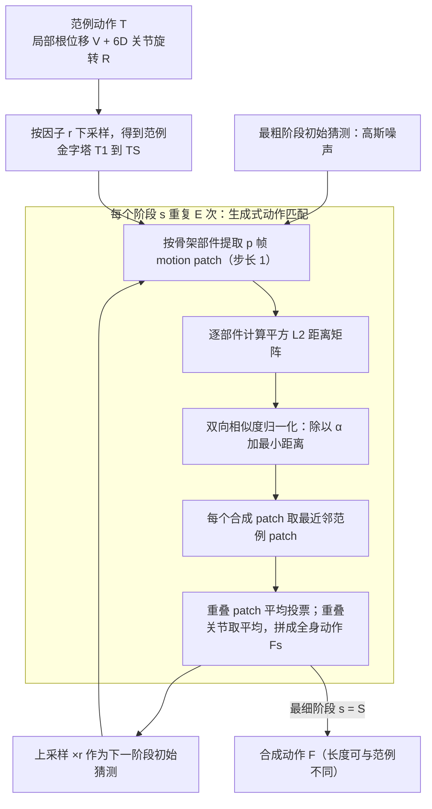

# Example-based Motion Synthesis via Generative Motion Matching

**Example-based Motion Synthesis via Generative Motion Matching** 收录于 [Robot Learning Paper Notebooks](https://imchong.github.io/Robot_Learning_Paper_Notebooks/index.html)（分类：14_Human_Motion），深读笔记已完成。本页依据 **原文 arXiv PDF 正文**（SIGGRAPH 2023 / ACM TOG 版本的同一论文，arXiv:2306.00378v1）整理，并以深读笔记作为交叉参照。

## 一句话定义

GenMM 是一个生成模型，从单段或少量范例序列中"挖（mine）"出尽可能多样的动作。与现有数据驱动方法（通常需长时离线训练、易出视觉伪影、在大型复杂骨架上易失败）形成鲜明对比，GenMM 继承了知名 Motion Matching 方法的免训练特性与卓越质量。框架还可扩展到动作补全、关键帧引导生成、无限循环、动作重组等场景。核心是一个生成式动作匹配模块，用双向视觉相似度作代价函数，配多阶段框架从随机初始化逐步细化。它能在几分之一秒内合成高质量动作、处理复杂大型骨架、从极少范例生成多样动作。

## 英文缩写速查

| 缩写 | 含义 |
|---|---|
| GenMM | Generative Motion Matching 的缩写，本文提出的生成式动作匹配模型 |
| Motion Matching | 工业界经典的免训练动作合成方法：在大型动作库中搜索最贴合当前上下文的动作片段 |
| Motion patch | 动作片段：从范例中按 $p$ 帧滑窗（步长 1）截取的子序列，是匹配与拼接的基本单元 |
| Bidirectional similarity | 双向视觉相似度（借自图像合成）：同时约束"合成结果的 patch 都来自范例"与"范例的 patch 都出现在合成结果中" |
| 6D rotation | 6D 旋转表示：每个关节的旋转用 6 个数表示，作为本文的关节旋转特征（$Q=6$） |
| IK | 逆运动学（Inverse Kinematics）：本文用于根据足接触标签做后处理，减少脚部漂浮 |
| GANimator | 对比基线：基于单样本 patch GAN 的动作生成方法（Li et al. 2022） |

## 为什么重要

- **免训练范例驱动**对快速生成参考动作很实用：不需要大数据集，也不需要长时间离线训练（论文报告单段动作约 0.2 秒在 M1 CPU 上生成）。
- **双向相似度**把"既要多样又不能有伪影"转化为一个可计算的代价，是可迁移的动作质量度量思路。
- **从少范例挖多样**契合人形等骨架与风格稀缺动作数据的扩增需求。
- 动作补全、关键帧约束、循环与重组等应用，可为人形技能库和动画制作提供多样的参考动作。

## 方法：核心原理

### 输入、机制与输出

- **输入**：一段（或少量）范例动作。每帧把根关节的全局位移换成局部根位移 $V$（相邻帧之差，与时间平移无关），关节旋转 $R$ 使用父关节坐标系下的 6D 旋转表示；可选地为足部附加接触标签（按速度阈值得到），用于 IK 后处理。
- **机制**：先构造范例金字塔 $T_1,\dots,T_S$（逐级按因子 $r$ 下采样），从最粗阶段开始由高斯噪声出发，每个阶段内做 $E$ 次"生成式动作匹配"，再上采样作为下一阶段的初始猜测。
- **输出**：长度 $F$ 可与范例不同的新动作序列。

### 流程总览

图依据：论文 §3.1 至 §3.3 与 Fig.2 至 Fig.4（单范例设定）。

### 公式直觉

对第 $b$ 个骨架部件，合成结果的 patch 集合为 $X^b$，范例的 patch 集合为 $Y^b$，两者的平方 L2 距离为

$$
D^b_{i,j} = \lVert X^b_i - Y^b_j \rVert_2^2
$$

双向相似度通过按范例 patch 归一化来实现：每个范例 patch $j$ 的距离被其"与合成结果中最近 patch 的距离"加上下界 $\alpha$ 归一化，

$$
\bar D^b_{i,j} = \frac{D^b_{i,j}}{\alpha + \min_{\ell} D^b_{\ell,j}}
$$

然后每个合成 patch 取归一化距离最小的范例 patch 作为匹配。这里的公式结构依据 PDF 文本提取整理，个别下标写法未逐字核对（未核实）。直觉是：稀有的范例 patch（最小距离大）会被放大，从而鼓励"完整性"（每个范例 patch 都被用到）；$\alpha$ 越小，完整性约束越强。

### 方法拆解（与深读笔记互参）

1. **生成式动作匹配（单阶段）**：在每个阶段，对当前初始猜测提取 patch，与范例 patch 做匹配，再用平均投票把重叠 patch 融合回动作序列。
2. **骨架感知 patch 提取**：用户把骨架划分为若干有重叠关节的骨架部件，分别提取 patch。这让同一段范例可以在"空间维度"上产生变化（例如只挥一只手）。
3. **多阶段粗到细合成**：粗阶段的 patch 感受野大、决定整体结构，细阶段补充细节；感受野由 patch 大小 $p$ 与参数 $K$ 共同决定。
4. **多场景扩展**：固定某些帧或某些骨架部件，即可做动作补全、关键帧引导生成、无限循环（首尾姿态相同）和异构骨架的动作重组。

## 工程实践

### 关键参数（论文默认值）

| 参数 | 含义 | 论文默认 / 结论 |
|---|---|---|
| $p$ | motion patch 帧数 | 11（$p$ 越小，感受野越小，局部连贯性下降） |
| $K$ | 粗阶段 $T_1$ 长度与 patch 大小之比 | 4（$K$ 越大，结果越多样但越偏离范例） |
| $\alpha$ | 完整性控制旋钮 | 0.01（过大覆盖率不足，过小如 0 会导致覆盖率骤降，见评测） |
| $E$ | 每阶段迭代次数 | 5 |
| $r$ | 相邻阶段下采样因子 | 论文消融测试 2、4、8；默认值正文未明确（未核实） |

### 运行与资源

- 无需训练：实现以 Python 为主，另有 Blender 插件。
- 论文报告：约 1000 帧动作在 Apple M1 CPU 上约 0.2 秒，在 NVIDIA V100 上约 0.05 秒；压力测试中 10 万帧约 3 秒（65 关节骨架，32GB 显存），时间与显存随帧数近似线性增长。
- 调试指标：论文使用覆盖率（Coverage）、集合多样性（Set Diversity）、局部与全局 patch 距离（Local / Global Patch Dist.）。

### 实现注意

- **接触标签**：遇到大根位移范例时可能出现足部滑动，可用速度阈值生成接触标签并在 IK 中避免漂浮脚；论文称该设计不是必需的，仅用于罕见情况的改进。
- **多范例**：所有范例的 patch 合并进同一匹配集合，此时 $\alpha$ 对覆盖所有范例起关键作用。
- **异构骨架**：不同生物的骨架可通过手动划分重叠骨架部件进行组合（论文中的"Frankenstein"示例）。
- **超长范例**：归一化相似度矩阵会随长度急剧增大，论文承认在超长序列上需要近似最近邻搜索（如 PatchMatch）来缓解。

### 源码与开源状态（步骤 2.5 核查）

| 项目 | 核查结论 |
|---|---|
| 论文承诺 | 正文称 "Code and data will be released"（作者宣称，待核实） |
| 项目页 | arXiv 摘要页给出 <https://wyysf-98.github.io/GenMM/>；抓取时返回 GitHub Pages "Site not found"（截至 2026-11-06 未能打开） |
| 官方仓库 | 未核实到可访问的官方代码或数据仓库；论文还提到已开发网页界面与 Blender 插件，公开发布状态未核实 |
| 源码运行时序图 | **不适用**（代码与可运行入口未核实到，按规则不写 `sequenceDiagram`） |

## 评测

主要指标与论文 Table 1 一致（单范例、65 关节角色、约 500 帧范例、合成两倍长度的序列，原文报告，未独立复现）：

| 方法 | Coverage ↑ | Set Div. ↑ | Global Patch Dist. ↓ | Local Patch Dist. ↓ | 训练时间 | 推理时间 |
|---|---|---|---|---|---|---|
| MotionTexture [2002] | 84.12 | 0.05 | 1.12 | 1.13 | 32.3 s | 0.03 s |
| MotionTexture (Single) | 100.00 | 0.01 | 0.45 | 0.44 | 0.08 s | 0.07 s |
| acRNN [2018] | 5.13 | 0.75 | 13.62 | 13.55 | 25 h | 0.21 s |
| GANimator [2022] | 49.07 | 0.24 | 2.18 | 2.08 | 6 h | 0.12 s |
| **GenMM（本文）** | **99.89** | 0.28 | **0.22** | **0.18** | 无 | 0.08 s |

注：表中数值由 PDF 版式文本提取得到，列对齐已与原文核对；MotionTexture (Single) 一行的训练时间（0.08 s）为原表数值。

其他结果（原文报告）：

- **多范例覆盖率**（Table 2，2 至 5 个范例）：GenMM 为 99.71 / 99.95 / 99.91 / 99.64；GANimator 为 63.55 / 23.90 / 17.30 / 16.22；MotionTexture 为 100 / 29.19 / 10.03 / 27.69；acRNN 为 7.34 / 4.02 / 1.38 / 0.41。
- **骨架复杂度**（Table 3，24 / 65 / 433 关节）：GenMM 覆盖率为 97.82 / 99.84 / 86.90；GANimator 为 92.10 / 44.10 / 2.38。
- **超参数消融**（Table 4，节选）：$\alpha$ 取 0 时覆盖率仅 36.78，取 0.005 时覆盖率 99.96 但局部距离升至 0.23；$K=20$ 时覆盖率 87.74，$K=10$ 时为 96.07；$p$ 与 $r$ 在所测范围内对覆盖率影响较小。
- **定性对比**：MotionTexture 在相邻纹理（texton）间出现不自然过渡；acRNN 易过拟合，只能稳定生成有限帧数；GANimator 在复杂骨架上易出现抖动或过度平滑。

## 对比

- 相对 **Motion Matching**：保留了免训练和动作质量，但从"在动作库中搜索"转为"在范例中生成多样拼接"，并覆盖补全、关键帧、循环与重组等任务。
- 相对 **GANimator**（同为单样本生成）：GenMM 使用离散的 patch 分布，而 GANimator 学习连续分布，因此 GANimator 的新姿态泛化能力更强；GenMM 的优势在于覆盖率、复杂骨架稳定性和无需训练。
- 相对 **神经网络方法（acRNN）与纹理模型（MotionTexture）**：GenMM 在单样本设定下的质量与覆盖率更高，训练开销为零；但论文也承认其生成多样性低于 GANimator。

## 结论

**GenMM 的关键取舍是「不训练」：用一个双向相似度代价加多阶段细化的搜索过程，换掉数据驱动生成模型的长时离线训练，以及随之而来的视觉伪影与复杂骨架失败。**

- 真正起作用的机制是把 Motion Matching 的匹配质量改造成生成式模块：以双向视觉相似度为代价函数，从随机初始化多阶段逐步细化，这同时压住伪影并稳住大型复杂骨架。
- 免训练带来的直接收益是效率与样本量：论文报告约 1000 帧动作在 0.05 至 0.2 秒内生成，单段或极少范例即可挖出多样动作。
- 覆盖面来自同一框架的复用而非新增模块：动作补全、关键帧引导生成、无限循环、动作重组都是同一套匹配—细化流程的变体。
- 边界也由此界定：它是"从范例里挖"，多样性建立在给定范例之上，且关键帧不能偏离范例姿态太远；它不是习得范例之外新姿态的生成模型。
- 对人形的意义主要在数据侧：可用于扩增稀缺的动作参考数据，但论文中的实验对象是动画角色而非真实人形机器人，迁移到物理人形需要另行验证（未核实）。

## 局限与风险

- **离散 patch 分布**：只能拼接范例中已有的 patch，难以产生范例之外的新姿态。作者认为这种"泛化"在动作合成中反而不利，因为由新姿态组成的序列常出现肉眼可见的伪影。
- **多样性低于 GANimator**：论文承认其生成多样性不及连续分布的 GAN 方法，作者把"既多样又高质量"列为后续方向（可能结合离散神经表示学习）。
- **依赖周期性**：偏好具有足够内在周期性的范例；单一姿态变化的范例难以产生有意义的时间变化。
- **关键帧约束**：手动关键帧不能与范例姿态差异过大，否则生成结果可能无法遵循约束。
- **长序列**：超长范例会使归一化相似度矩阵过大，需要近似最近邻搜索。
- **运动学方法**：方法是运动学层面的 patch 拼接，不含动力学与物理约束；直接用于人形机器人控制前，需要重定向、物理可行性检查与仿真验证（未在本文中验证）。
- **开源状态未核实**：作者宣称将发布代码与数据，但截至入库核查，项目页不可打开且未找到官方仓库，复现需以论文描述为准。

## 与其他页面的关系

- 分类父节点：[paper-notebook-category-14-human-motion](../overview/paper-notebook-category-14-human-motion.md)
- 总索引：[humanoid-paper-notebooks-index.md](../overview/humanoid-paper-notebooks-index.md)
- 扩散式动作生成对照：[diffusion-motion-generation](../methods/diffusion-motion-generation.md)（同为从数据生成动作，但 GenMM 免训练、基于 patch 匹配）
- 动作数据质量维度：[motion-data-quality](../concepts/motion-data-quality.md)（范例质量与覆盖度直接决定 GenMM 的输出多样性）
- 动画创作工具对照：[generative-motion-rig](../entities/generative-motion-rig.md)（同属生成式动画制作方向，面向 DCC 工作流）

## 参考来源

- [humanoid_pnb_example-based-motion-synthesis-via-generative-mo.md](../../sources/papers/humanoid_pnb_example-based-motion-synthesis-via-generative-mo.md)
- 深读笔记：<https://imchong.github.io/Robot_Learning_Paper_Notebooks/papers/14_Human_Motion/Example-based_Motion_Synthesis_via_Generative_Motion_Matching/Example-based_Motion_Synthesis_via_Generative_Motion_Matching.html>
- arXiv 摘要页：<https://arxiv.org/abs/2306.00378>（页内给出项目页与视频链接）
- [arXiv PDF](https://arxiv.org/pdf/2306.00378)：已通读正文全文（摘要、§1 至 §5、结论与局限，含 Table 1 至 Table 4 与图 1 至图 12）；补充材料（supplementary，超参数的详细讨论）未包含在 arXiv PDF 中，未读
- 项目页：<https://wyysf-98.github.io/GenMM/>（核查时返回 GitHub Pages "Site not found"，未能打开）
- ACM DOI：<https://doi.org/10.1145/3592395>（ACM Trans. Graph. 42(4), Article 1, 2023；未在本次核查中打开）

## 推荐继续阅读

- [机器人论文阅读笔记：Example-based Motion Synthesis via Generative Motion Matching](https://imchong.github.io/Robot_Learning_Paper_Notebooks/papers/14_Human_Motion/Example-based_Motion_Synthesis_via_Generative_Motion_Matching/Example-based_Motion_Synthesis_via_Generative_Motion_Matching.html)
- [arXiv:2306.00378 原文 PDF](https://arxiv.org/pdf/2306.00378)
