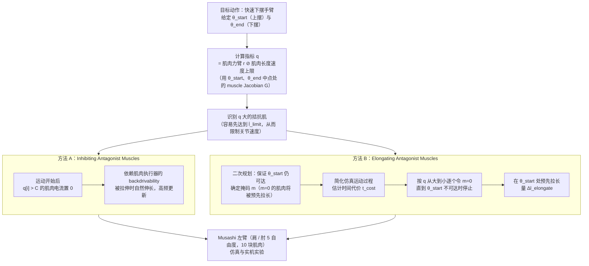

# Exceeding the Maximum Speed Limit of the Joint Angle for the Redundant Tendon-driven Structures of Musculoskeletal Humanoids

**Exceeding the Maximum Speed Limit of the Joint Angle for the Redundant Tendon-driven Structures of Musculoskeletal Humanoids** 已列入 [Robot Learning Paper Notebooks](https://imchong.github.io/Robot_Learning_Paper_Notebooks/index.html) 的 **PROGRESS.md 待深读** 清单（分类：12_Hardware_Design）。本页 **还没有深读笔记**：只给出这篇论文的分类位置与原文入口，方法细节与数据请直接看原文。

## 一句话定义

Exceeding the Maximum Speed Limit of the Joint Angle for the Redundant Tendon-driven Structures of Musculoskeletal Humanoids 的人形机器人学习论文条目，当前处于 Paper Notebooks 阅读进度（待深读）阶段。

## 英文缩写速查

| 缩写 | 英文全称 | 简要说明 |
|------|----------|----------|
| RL | Reinforcement Learning | 通过与环境交互最大化长期回报来学习策略 |
| WBC | Whole-Body Control | 协调全身关节满足多任务/约束的控制基础设施 |
| Sim2Real | Simulation to Real | 把仿真中学到的策略迁移落地真机的工程主线 |

## 为什么重要

- 这篇已排进 Paper Notebooks 的待读清单，可以从 [机器人学习论文笔记总索引](../overview/humanoid-paper-notebooks-index.md) 与分类页找到同一批工作。
- 在深读笔记写出来之前，这里只保留分类位置与原文入口，不给方法结论；论文方法部分的模块与数据流见下方「流程总览」。

## 流程总览

图依据：论文 §II-B 问题定义、§III-A Method Inhibiting Antagonist Muscles、§III-B Method Elongating Antagonist Muscles、§IV-A 实验设置。

## 核心信息

| 字段 | 内容 |
|------|------|
| 分类 | 12_Hardware_Design |
| 深读状态 | 待撰写（[PROGRESS.md](https://github.com/ImChong/Robot_Learning_Paper_Notebooks/blob/main/papers/PROGRESS.md)） |
| 计划文件夹 | `papers/12_Hardware_Design/exceeding-the-maximum-speed-limit-of-the-joint-a` |
| arXiv | <https://arxiv.org/abs/2502.12808> |

## 实验与评测

- 深读笔记尚未完成；量化 benchmark、消融与实机指标待笔记撰写后补充。

## 结论

**本页目前只能支撑一个结论：这是一条已进入 12_Hardware_Design 深读队列、但尚未产出笔记的条目，它现在的价值只是可检索，而不是内容。**

- 页面能确证的信息仅限分类（12_Hardware_Design）、arXiv 编号与计划文件夹路径；冗余腱驱结构如何突破关节角速度上限，见「流程总览」（依据论文方法部分），其余本页无依据。
- 因此本页 **不可作为技术判断依据**：机制与指标应回到论文原文，或等 PROGRESS.md 追踪的深读笔记完成后再引用。
- 定位是 **待读条目**，方便你按分类找到它；笔记完成后应补成完整摘要，并重写本节为面向内容的结论。

## 与其他页面的关系

- 分类页：[paper-notebook-category-12-hardware-design](../overview/paper-notebook-category-12-hardware-design.md)
- 总索引：[humanoid-paper-notebooks-index.md](../overview/humanoid-paper-notebooks-index.md)

## 参考来源

- [humanoid_pnb_exceeding-the-maximum-speed-limit-of-the-joint-a.md](../../sources/papers/humanoid_pnb_exceeding-the-maximum-speed-limit-of-the-joint-a.md)
- [Robot Learning Paper Notebooks · PROGRESS.md](https://github.com/ImChong/Robot_Learning_Paper_Notebooks/blob/main/papers/PROGRESS.md)
- 论文：<https://arxiv.org/abs/2502.12808>
- [arXiv PDF](https://arxiv.org/pdf/2502.12808)：已通读方法部分（实验与附录以略读为准）：§II 肌骨人形结构与问题、§III 两种方法、§IV-A 实验设置，§IV-C/D 略读

## 推荐继续阅读

- [Paper Notebooks 阅读进度（PROGRESS.md）](https://github.com/ImChong/Robot_Learning_Paper_Notebooks/blob/main/papers/PROGRESS.md)
