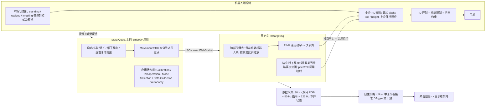

# Fauna Sprout

**Fauna Sprout: A lightweight, approachable, developer-ready humanoid robot**（arXiv:2601.18963，Fauna Robotics 团队，2026-01）收录于 [Robot Learning Paper Notebooks](https://imchong.github.io/Robot_Learning_Paper_Notebooks/index.html)（分类：12_Hardware_Design）。本页已依据 arXiv 原文全文（正文、Table I/II 与参考文献）通读整理；附录类补充图表（论文中提及的 Supplementary Figure 11/12 等）未在所获 PDF 中核对到，相关细节标注为（未核实）。

## 一句话定义

Sprout 把"在共享人类空间里安全、表达丰富、上手即用"放在硬件设计的最前面：用 22.7 kg / 107 cm 的轻量身体 + 软外壳 + 顺应电机 + 受限关节扭矩，配上 VR 遥操作 + Isaac Lab 训练的全身 RL 策略 + 面部 LED 阵列与电动眉毛，做成一台"开箱即开发"的人形机器人。

## 英文缩写速查

| 缩写 | 英文全称 | 简要说明 |
|------|----------|----------|
| RL | Reinforcement Learning | 正文中各控制模式（站立、行走、跪地）的策略均由 RL 训练，并在 Isaac Lab 中完成 |
| VR | Virtual Reality | Meta Quest 头显与手柄承载 Embody 遥操作应用，采集身体姿态关键点 |
| EKF | Extended Kalman Filter | 融合立体相机、IMU、学习得到的速度估计与回环约束，输出 50 Hz 位姿与速度 |
| TSDF | Truncated Signed Distance Field | 建图模块用截断符号距离场对深度图做融合，构成稠密地图的基础表示 |
| DAgger | Dataset Aggregation | 自主策略执行时由操作者接管纠正，把接管片段并入数据集重训练，缓解协变量偏移 |
| IMU | Inertial Measurement Unit | 机载惯性测量单元，是 EKF 里的惯性输入之一 |
| ToF | Time of Flight | 4 个 VL53L8CX 飞行时间传感器，用于近距离障碍物监测（安全子系统的一部分） |
| MCP | Model Context Protocol | 机器人侧提供给 LLM 智能体调用的工具协议，可切换运动模式、查询导航位置、设定导航目标 |
| ASR / TTS | Automatic Speech Recognition / Text-to-Speech | 语音输入与语音输出，正文中唤醒词之后依次经过 ASR、LLM 推理与 TTS 回复 |

## 为什么重要

- 论文的出发点是：当前学习型控制与基础模型发展很快，但缺少能在人群附近长期安全运行的物理平台；闭源工业人形难以获取，学术原型又难以部署和操作（论文 §I–II）。
- Sprout 把"安全、可表达、可编程"三者作为硬件约束的一部分，而不是事后加的软件限位，因此对 **教育、设计、人机交互** 等非机器人专家群体的门槛较低。
- 对做人形控制的研究者，它示范了一种 **模块化** 软件栈：控制以有限状态机组织多个独立训练的 RL 策略，服务间通过显式 API 与容器隔离，而不是单一端到端策略。
- 论文同时把 **遥操作采数 → DAgger 式接管 → 重训练** 的数据闭环写进了平台本身，适合作为"平台即数据工厂"的参考案例。

## 流程总览

图依据：论文 §V-A（Fig. 5）、§V-B（Fig. 6）。

## 核心原理

**输入 → 机制 → 输出** 三段式理解：

1. **硬件安全三层**（§III）：
   - 机械/电气层：轻量化（整机 22.7 kg，身高 107 cm）降低动能；软质外壳、减少夹点；可反驱电机与保守的关节扭矩上限。
   - 嵌入式软件层：独立于应用计算栈的安全子系统，负责实时监控与系统级约束（含 ToF 障碍物传感器集成）。
   - 策略层：顺应性电机控制策略限制交互力，视觉系统支持安全导航。
   - 夹爪为单自由度，指尖夹持力由软件限制在 12 N。
2. **运动控制**（§V-A）：
   - 控制以有限状态机组织离散模式（站立、行走、跪地、爬行等）。每个模式由一个或多个 RL 策略实现，策略输入为短历史本体观测、惯性测量与上一步动作，输出中间控制目标。
   - 策略输出再经 PD 控制、电流限制与功率约束这些下层机制约束，使学习行为始终受硬件安全层包裹。策略输入的本体观测与 IMU 惯性测量同样来自下层。
   - **模式切换** 作为独立组件处理：过渡本身是用模仿学习训练的跟踪控制器，训练数据来自人体动捕与动画轨迹，并以宽分布采样初始化以提高鲁棒性。
   - 行走模式的命令接口包括：基座线速度、偏航角速度、根部 roll/pitch、根部高度与上身关节目标。
3. **全身遥操作**（§V-B）：
   - Embody 应用通过启动时的校准估计操作者臂长、躯干高度与可用垂直活动范围，再把手腕关键点从骨盆系映射到机器人系并按比例缩放。
   - 全身策略跟踪 **投影重力** 作为 roll/pitch 指令（相对重力而非绝对姿态），高度指令对应躯干到地面距离。
   - 逆运动学由 PINK 求解，代价函数含位置、姿态与正则项，用于避开奇异点。
4. **数据与干预闭环**：记录 30 Hz 双目 RGB、50 Hz 指令与 125 Hz 本体状态，支持按按钮标注片段；策略自主运行时操作者可接管，接管片段与自主轨迹一并记录，并支持从暂停点以"幽灵"控制器对齐后继续采集。
5. **软件架构**（§IV）：组件化、以 Docker 容器部署的服务，服务间以 ROS 2 为主、高带宽数据用共享内存或零拷贝；ROS 2 中间件采用 RMW Zenoh；MCM 用 CBOR over Ethernet；遥操作头显用 JSON over WebSocket 与 WebRTC 音视频；可视化用 Foxglove WebSocket。
6. **建图与导航**（§V-C）：里程计由 EKF 融合立体相机、IMU、学习得到的速度估计与回环约束，以 50 Hz 输出位姿与速度；自研 Volumetric Mapping 用多个刚性 maplet 做局部 TSDF 融合，并以 GTSAM 后端的分层位姿图做全局优化；导航为占据栅格上的 Hybrid A* 全局/局部规划加纯追踪，局部规划默认周期为 10 Hz。
7. **人机交互与智能体**（§V-D、§V-E）：分层行为树按槽位（LED、音频、身体与头部目标）合并输出，支持叠加、选一与后写覆盖三种合并策略；平台本身不提供端到端对话智能体，而是通过 MCP 服务暴露运动模式切换、表情行为与导航工具，由外部 LLM 智能体编排。

## 核心信息

| 字段 | 内容 |
|------|------|
| 分类 | 12_Hardware_Design |
| 深读笔记 | <https://imchong.github.io/Robot_Learning_Paper_Notebooks/papers/12_Hardware_Design/Fauna_Sprout_A_lightweight_approachable_developer-ready_humanoid_robot/Fauna_Sprout_A_lightweight_approachable_developer-ready_humanoid_robot.html> |
| arXiv | <https://arxiv.org/abs/2601.18963>（v1，2026-01-26） |
| 本体规格（Table I） | 身高 107 cm，宽 45 cm，厚 21 cm，整机 22.7 kg；29 自由度（含 2 个眉毛）；Jetson AGX Orin 64GB；ZED2i RGB-D 立体相机；4 × VL53L8CX ToF；9 轴 IMU；4 麦克风阵列；46.8 V 标称直流系统；5000 / 10000 mAh 电池，续航 3–3.5 h；E-Stop；仅限室内 |
| 单臂负载（Table II，理论最大值） | 前平举 3.7 kg（<10 s）、侧平举 5.6 kg（<10 s）、屈肘 11.2 kg（<10 s）；名义值与连续额定值另列，侧平举不建议长时间保持 |

## 实验与评测

论文以 **系统描述与工程论证** 为主，未给出可对比的策略成功率或与其他机器人的定量基准。可引用的定量内容如下：

- **规格与负载**：Table I、Table II 给出本体质量、自由度、续航与单臂负载（见上表）。
- **CPU 占用**（Fig. 4）：论文以快照方式报告核心服务的 CPU 占用，建图与定位在约三分之一单核的量级（论文表述为 typically a third of a single core，原图数值未逐条核对）。
- **建图对比**：作者的内部基准称 Volumetric Mapping 在重建与回环一致性上优于 RTAB-Map，同时计算量约为后者的 30%（内部基准，数据集与指标细节未在正文给出，（未核实））。
- **实机展示**（Fig. 1）：站立注视、高五互动、跪地搭积木、弯腰拾物、被小孩握手、搭配灯光与眉毛的舞蹈等定性演示；未报告量化成功率。

## 结论

**一句话总判：Sprout 的价值在于"可接近、可编程的安全平台"，而非运动性能或任务成功率；论文不提供与其他人形的定量对比，评价应以工程可用性为准。**

1. **安全靠本体设计，不靠事后限位** — 轻量化、软外壳、可反驱电机与保守扭矩上限把风险前移到结构层；软件层再加独立安全子系统，属于纵深防御。
2. **模块化优先，端到端为可选** — 控制以状态机组织多个可独立训练替换的 RL 策略，模式切换也单独建模，牺牲了一部分"单策略全覆盖"的简洁性，换来可替换、可验证的边界。
3. **遥操作与干预是数据闭环的一部分** — VR 遥操作采集、DAgger 式接管、暂停点"幽灵"对齐续录，三者串成一条可迭代的数据回路。
4. **开发者接口是产品的一部分** — ROS 2 消息定义、Python/C++ 示例、容器化部署、Foxglove 可视化与 MCP 工具共同降低二次开发门槛。
5. **取舍是显性的** — 单自由度夹爪、无腕部相机、身高低于成人、室内使用、续航约 3–3.5 h；论文明确把它定位为可接近的平台而非灵巧操作标杆。

## 方法 / 评测 / 对比

本页的方法栈见 **核心原理** 与 **流程总览**；评测与规格见 **实验与评测**；与其他工作的横向比较见下节。

## 与其他工作的对比

论文 §I–II 给出的是定性比较，未做同场景实验：

- **开源学术平台**：ToddlerBot、OP3、Berkeley Humanoid、ARTEMIS 被论文视为"可复现但难以长期贴近人群、难以让非专家上手"的代表。
- **工业与商业平台**：Boston Dynamics、Tesla、Agility、Figure、XPENG 等多为大型或未向独立开发者开放的平台；1X Neo 面向家庭。
- **中国厂商**：Unitree（G1、R1）与 Booster（T1、K1）被论文认为在美国学生与研究者中普及最广，原因是体积紧凑、可靠性与成本较好。
- **头部设计**：多数工业人形采用无表情的光滑外壳；论文用灯光与眉毛（非屏幕）表达，与 Reachy Mini 更接近。
- **控制架构**：论文把 VLA 类单体策略（如 RT-1、Gemini Robotics、π0.5、GEN-0）与模块化语言接口（如 GR00T N1、Helix）并列讨论，并主张平台应同时支持两类方法。

## 局限与风险

- **不是性能平台**：指尖 12 N 的软件限幅、单自由度夹爪、受限扭矩与轻量化都意味着负载与爆发力的让步；原文承认难以完成灵巧操作与高动态任务。
- **室内与环境边界**：标称仅限室内使用，工作温度 10–30 °C，存储温度 5–35 °C，湿度 10%–90% RH 无凝露（Table I）。
- **续航有限**：标称续航 3–3.5 h，需要关注换电与任务规划。
- **评测信息不足**：无策略成功率、泛化或长期可靠性的定量结果；建图的内部基准数据未公开到足以复现。
- **附录缺失**：正文引用的 Supplementary Figure 11（电子板）与 Supplementary Figure 12（安全子系统相关）未在所获 PDF 中核对到，相关细节以原文补充材料为准（未核实）。
- **视觉与交互能力依赖外部服务**：ASR 与 TTS 的最紧密集成为 Deepgram Flux 与 ElevenLabs v2，本地方案为 NVIDIA Riva；论文本身不提供端到端对话智能体。
- **开源边界未确认**：论文说明提供 SDK（ROS 2 消息与示例）、zeroing 规范与 URDF/MJCF/USD 描述格式，但正文未给出代码仓库地址；项目页见下文工程实践。
- **宣传措辞需谨慎**："开箱即开发"与"面向人类环境"是作者定位，实际部署边界（场地、人群、任务）需以实测为准。

## 工程实践

| 项目 | 内容 |
|------|------|
| 部署形态 | 每个服务以 Docker 容器运行，可单独或成组启动；提供 GUI 管理服务组（如语音识别 + 语音合成） |
| 开发接口 | ROS 2 消息定义与 Python/C++ 示例；容器模板用于打包自定义服务；非 ROS 接口与更多语言绑定为"后续版本"计划 |
| 运动控制接口 | 状态机 API 请求模式切换，模式内置安全检查；行走模式接收速度、偏航、根姿态、高度与上身关节命令 |
| 仿真与模型 | 策略在 Isaac Sim 中用 Isaac Lab 训练；提供 USD、URDF、MJCF 描述；标定资料（零位规范）随 SDK 发布 |
| 数据采集 | 30 Hz 双目 RGB、50 Hz 指令、125 Hz 本体状态；支持按钮标注与回放；DAgger 式接管片段与自主轨迹一并存储 |
| 遥操作 | Quest 上的 Embody（Unity）；启动校准；全身、上身、坐姿三种模式；WebSocket 控制与 WebRTC 视频 |
| 建图与导航 | EKF 里程计；Volumetric Mapping（TSDF + maplet + GTSAM 位姿图）；Hybrid A* 规划；纯追踪控制；局部规划默认 10 Hz |
| 调试 | Foxglove 可视化与结构化日志（同步遥测、事件、传感器流）用于离线检查与回放 |
| 源码开放状态 | **未核实**。静态抓取项目页 faunarobotics.com 未找到 GitHub 或 Hugging Face 链接（页面可能为前端渲染，未能确认）；论文提到 SDK 与 zeroing 规范，但未给仓库地址。截至 2026-11-06 **不将其计为已开源** |
| 源码运行时序图 | **不适用**（未在论文或静态项目页找到可运行的官方仓库；SDK 公开状态未核实） |

## 与其他页面的关系

- 分类父节点：[paper-notebook-category-12-hardware-design](../overview/paper-notebook-category-12-hardware-design.md)
- 总索引：[humanoid-paper-notebooks-index.md](../overview/humanoid-paper-notebooks-index.md)
- 相关概念：[全身控制 Whole-Body Control](../concepts/whole-body-control.md)、[Sim2Real](../concepts/sim2real.md)、[阻抗控制 Impedance Control](../concepts/impedance-control.md)
- 相关平台与方法：[Isaac Lab](../entities/isaac-lab.md)、[人形机器人 Humanoid Robot](../entities/humanoid-robot.md)、[DAgger](../methods/dagger.md)、[ROS 2 基础](../concepts/ros2-basics.md)

## 参考来源

- [humanoid_pnb_fauna-sprout-a-lightweight-approachable-develope.md](../../sources/papers/humanoid_pnb_fauna-sprout-a-lightweight-approachable-develope.md)（arXiv 链接与 Paper Notebooks 策展归档）
- 深读笔记：<https://imchong.github.io/Robot_Learning_Paper_Notebooks/papers/12_Hardware_Design/Fauna_Sprout_A_lightweight_approachable_developer-ready_humanoid_robot/Fauna_Sprout_A_lightweight_approachable_developer-ready_humanoid_robot.html>
- 论文摘要页：<https://arxiv.org/abs/2601.18963>
- 论文全文：[arXiv PDF](https://arxiv.org/pdf/2601.18963)，已通读正文 §I–§VI、Table I/II 与参考文献；附录补充图表未核对到（见局限与风险）
- 项目页：<https://faunarobotics.com>（视频与产品信息；静态抓取未见代码链接）

## 推荐继续阅读

- [arXiv PDF：Fauna Sprout 原文](https://arxiv.org/pdf/2601.18963)（方法与 Table I/II 必读）
- [机器人论文阅读笔记：Fauna Sprout](https://imchong.github.io/Robot_Learning_Paper_Notebooks/papers/12_Hardware_Design/Fauna_Sprout_A_lightweight_approachable_developer-ready_humanoid_robot/Fauna_Sprout_A_lightweight_approachable_developer-ready_humanoid_robot.html)
- [Isaac Lab: A GPU-Accelerated Simulation Framework（arXiv:2511.04831）](https://arxiv.org/abs/2511.04831)，论文训练所用仿真框架
- [ToddlerBot（arXiv:2502.00893）](https://arxiv.org/abs/2502.00893)，论文对比的开源人形平台之一
