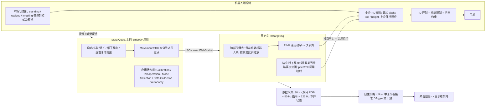

# Fauna Sprout

**Fauna Sprout: A lightweight, approachable, developer-ready humanoid robot** 收录于 [Robot Learning Paper Notebooks](https://imchong.github.io/Robot_Learning_Paper_Notebooks/index.html)（分类：12_Hardware_Design）。本页为 **清单索引实体**，链向深读笔记与原始论文；详细机制待从笔记消化后补充。

## 一句话定义

Sprout 把"在共享人类空间里安全、表达丰富、上手即用"放在硬件设计的最前面：用 22.7 kg / 107 cm 的轻量身体 + 软外壳 + 顺应电机 + 受限关节扭矩，配上 VR 遥操作 + Isaac Lab 训练的全身 RL 策略 + 360° 面部 LED 表情头，做成一台"开箱即开发"的人形机器人。

## 英文缩写速查

| 缩写 | 英文全称 | 简要说明 |
|------|----------|----------|
| RL | Reinforcement Learning | 通过与环境交互最大化长期回报来学习策略 |
| WBC | Whole-Body Control | 协调全身关节满足多任务/约束的控制基础设施 |
| Sim2Real | Simulation to Real | 把仿真中学到的策略迁移落地真机的工程主线 |

## 为什么重要

- 列入 Paper Notebooks 策展清单，便于与全库 [机器人学习论文笔记总索引](../overview/humanoid-paper-notebooks-index.md) 及分类父节点交叉检索。
- 深读笔记提供比摘要更贴近实现的阅读路径，适合作为后续 ingest 深化起点。

## 流程总览

图依据：论文 §V-A（Fig. 5）、§V-B（Fig. 6）。

## 核心信息

| 字段 | 内容 |
|------|------|
| 分类 | 12_Hardware_Design |
| 深读笔记 | <https://imchong.github.io/Robot_Learning_Paper_Notebooks/papers/12_Hardware_Design/Fauna_Sprout_A_lightweight_approachable_developer-ready_humanoid_robot/Fauna_Sprout_A_lightweight_approachable_developer-ready_humanoid_robot.html> |
| arXiv | <https://arxiv.org/abs/2601.18963> |

## 实验与评测

- 本页为 **策展清单索引** 摘要；量化 benchmark、消融与实机指标以 **深读笔记与论文 PDF** 为准（链接见 [参考来源](#参考来源)）。

## 结论

**Sprout 把硬件设计的顺序倒了过来：先锁死「在共享人类空间里安全、可接近」，再在这个约束下配齐开发者需要的软件栈，绝对性能退居其次。**

- 安全不是靠软件兜底，而是写进本体：**22.7 kg / 107 cm** 的轻量身体 + 软外壳 + 顺应电机 + **受限关节扭矩**，属于结构层面的本质安全，而非事后加限位。
- 「开箱即开发」由配套软件栈定义：**VR 遥操作** 负责采数据、**Isaac Lab** 训练的全身 RL 策略负责控制，**360° 面部 LED 表情头** 承担人机交互的表达层。
- 取舍是显性的：受限扭矩与轻量化本身就是对负载与爆发能力的让步——它的目标是一台可接近的开发平台，不是性能标杆。
- 本页为策展笔记摘要，具体规格、评测与实机指标以深读笔记与论文 PDF 为准。

## 与其他页面的关系

- 分类父节点：[paper-notebook-category-12-hardware-design](../overview/paper-notebook-category-12-hardware-design.md)
- 总索引：[humanoid-paper-notebooks-index.md](../overview/humanoid-paper-notebooks-index.md)

## 参考来源

- [humanoid_pnb_fauna-sprout-a-lightweight-approachable-develope.md](../../sources/papers/humanoid_pnb_fauna-sprout-a-lightweight-approachable-develope.md)
- 深读笔记：<https://imchong.github.io/Robot_Learning_Paper_Notebooks/papers/12_Hardware_Design/Fauna_Sprout_A_lightweight_approachable_developer-ready_humanoid_robot/Fauna_Sprout_A_lightweight_approachable_developer-ready_humanoid_robot.html>
- 论文：<https://arxiv.org/abs/2601.18963>
- [arXiv PDF](https://arxiv.org/pdf/2601.18963)：已通读方法部分（实验与附录以略读为准）：§III 硬件设计、§IV 软件架构、§V-A 运动控制、§V-B 全身遥操作

## 推荐继续阅读

- [机器人论文阅读笔记：Fauna Sprout](https://imchong.github.io/Robot_Learning_Paper_Notebooks/papers/12_Hardware_Design/Fauna_Sprout_A_lightweight_approachable_developer-ready_humanoid_robot/Fauna_Sprout_A_lightweight_approachable_developer-ready_humanoid_robot.html)
