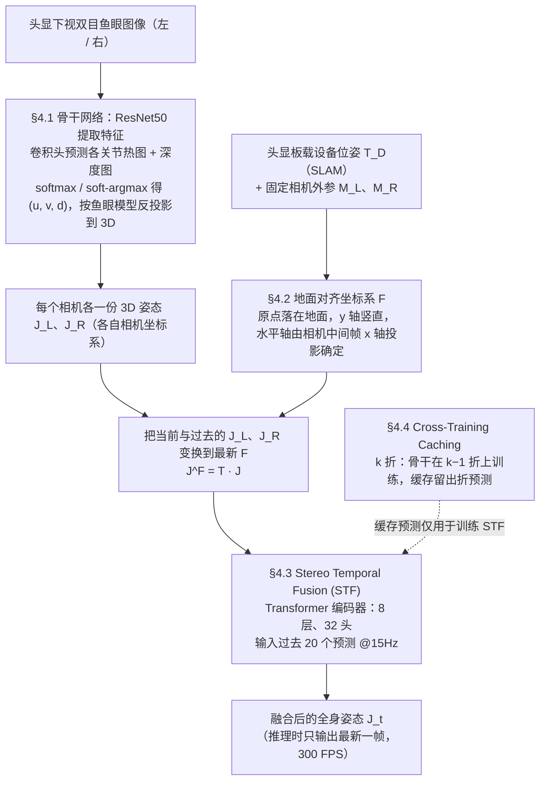

# FRAME

**FRAME: Floor-aligned Representation for Avatar Motion from Egocentric Video** 收录于 [Robot Learning Paper Notebooks](https://imchong.github.io/Robot_Learning_Paper_Notebooks/index.html)（分类：14_Human_Motion），深读笔记已完成。本页是 **笔记摘要**：要点编译自深读笔记，细节以笔记原文与论文 PDF 为准。

## 一句话定义

用头戴、朝身立体相机做第一视角动捕对 VR/AR 至关重要，但面临严重遮挡与真实标注数据稀缺。作者开发了一套轻量 VR 数据采集装置，带实时 6D 位姿跟踪，为朝身相机建立大规模数据集；并提出 FRAME，几何一致地融合设备位姿与相机画面做身体姿态预测，在现代硬件上以 300 FPS 运行。FRAME 达 SOTA，消除以往方法的常见伪影，尤其在真实场景下下肢预测表现更优。

## 英文缩写速查

| 缩写 | 含义 |
|---|---|
| FRAME | Floor-aligned Representation（本文方法） |
| Egocentric | 第一视角（头戴相机） |
| 6D Pose | 设备 6 自由度位姿 |
| Body-facing Stereo | 朝身立体相机 |
| Floor-aligned | 地面对齐表示 |
| FPS | 帧率（300 FPS） |

## 为什么重要

- **设备位姿 + 视觉融合**对第一视角姿态估计很关键，呼应人形 egocentric 控制（ZeroWBC 等）需要的状态估计；
- **地面对齐表示**对全身姿态/重心一致性有益；
- **实时高帧率**是机器人闭环所需；
- 第一视角全身姿态是"从人类视频学全身控制"的上游感知。

## 流程总览

图依据：论文 §4.1–§4.4（Fig. 3、Fig. 4、Fig. 5）

## 解决什么问题

头戴朝身相机第一视角动捕难： - **严重遮挡**（自遮挡）； - **真实标注数据稀缺**； - 要**实时**且融合**设备位姿**做准确身体姿态。

FRAME 要：地面对齐 + 设备位姿与相机融合，实时高精度地预测全身姿态。

## 核心机制

1. **轻量 VR 采集 + 6D 跟踪数据集**：缓解第一视角标注稀缺；
2. **FRAME 地面对齐融合**：几何一致融合设备位姿 + 相机；
3. **300 FPS 实时 SOTA**：消除伪影、下肢更准；
4. **面向 VR/AR**：实用的第一视角动捕。

方法拆解（深读笔记小节）：轻量 VR 采集 + 实时 6D 跟踪；几何一致融合设备位姿 + 相机；实时 + 新训练策略；结果；🧭 整体流程（mermaid）。

## 核心信息

| 字段 | 内容 |
|------|------|
| 分类 | 14_Human_Motion |
| 深读笔记 | <https://imchong.github.io/Robot_Learning_Paper_Notebooks/papers/14_Human_Motion/FRAME__Floor-aligned_Representation_for_Avatar_Motion_from_Egocentric_Video/FRAME__Floor-aligned_Representation_for_Avatar_Motion_from_Egocentric_Video.html> |
| arXiv | <https://arxiv.org/abs/2503.23094> |
| 作者 | Andrea Boscolo Camiletto、Jian Wang、Rishabh Dabral、Thabo Beeler、Marc Habermann、Christian Theobalt（MPI / Google） |
| 发表 | 2025 年 3 月 |
| 笔记阅读日期 | 2026-06-21 |

## 实验与评测

- 本页是深读笔记的摘要，没有搬运原文的量化结果；量化 benchmark、消融与实机指标以 **深读笔记与论文 PDF** 为准（链接见 [参考来源](#参考来源)）。

## 结论

**FRAME 的关键不是又一个姿态估计网络，而是把设备 6D 位姿当成与图像同等的几何输入，用地面对齐表示把二者一致地融合起来。**

- 数据与方法是配套交付的：轻量 VR 采集装置 + 实时 6D 跟踪先补上 **朝身相机真实标注稀缺**，几何一致融合再对付 **自遮挡** 下的姿态预测——缺任一半都不成立。
- 收益集中在两处：**300 FPS 实时**，以及消除以往方法的常见伪影、真实场景下 **下肢预测** 更优；后者恰是朝身相机遮挡最重的部位，也是这套表示最该被检验的地方。
- 适用边界：本页把 FRAME 定位为面向 **VR/AR 的第一视角动捕**，对机器人而言它是上游感知，不是控制策略。
- 与人形的连接点在状态估计——本页把它与 ZeroWBC 等 egocentric 控制所需的状态估计放在同一条链的上游，也是「从人类视频学全身控制」的前置件。
- 本页为深读笔记编译的笔记摘要，SOTA 对比的具体 benchmark 与数值以深读笔记与论文 PDF 为准。

## 与其他页面的关系

- 分类父节点：[paper-notebook-category-14-human-motion](../overview/paper-notebook-category-14-human-motion.md)
- 总索引：[humanoid-paper-notebooks-index.md](../overview/humanoid-paper-notebooks-index.md)

## 参考来源

- [humanoid_pnb_frame.md](../../sources/papers/humanoid_pnb_frame.md)
- 深读笔记：<https://imchong.github.io/Robot_Learning_Paper_Notebooks/papers/14_Human_Motion/FRAME__Floor-aligned_Representation_for_Avatar_Motion_from_Egocentric_Video/FRAME__Floor-aligned_Representation_for_Avatar_Motion_from_Egocentric_Video.html>
- 论文：<https://arxiv.org/abs/2503.23094>
- [arXiv PDF](https://arxiv.org/pdf/2503.23094)：已通读方法部分（实验与附录以略读为准）：§4 方法（4.1 鱼眼姿态估计、4.2 坐标系对齐、4.3 Stereo Temporal Fusion、4.4 Cross-Training Caching）；§3 数据集与 §5 实验、消融仅略读

## 推荐继续阅读

- [机器人论文阅读笔记：FRAME](https://imchong.github.io/Robot_Learning_Paper_Notebooks/papers/14_Human_Motion/FRAME__Floor-aligned_Representation_for_Avatar_Motion_from_Egocentric_Video/FRAME__Floor-aligned_Representation_for_Avatar_Motion_from_Egocentric_Video.html)
