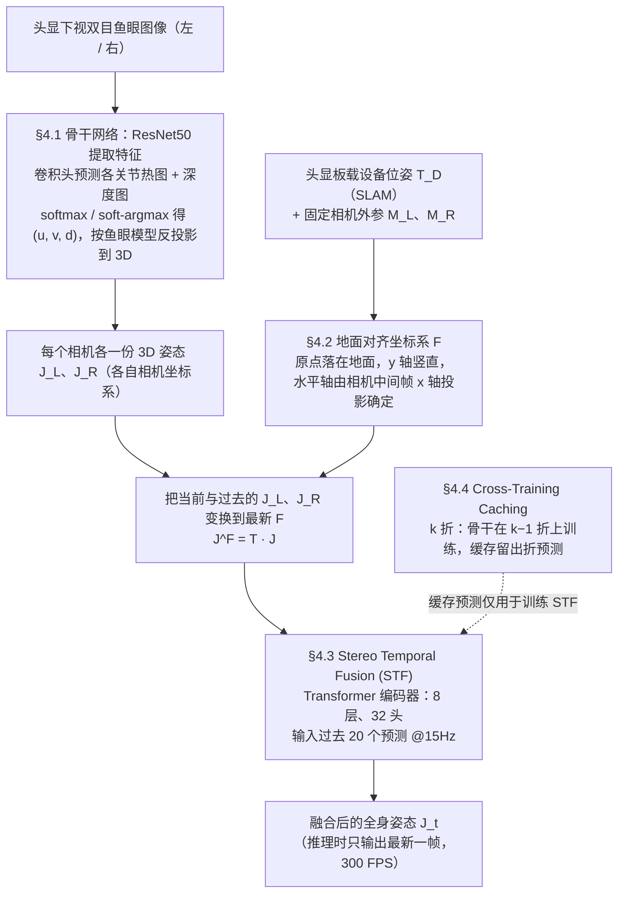

# FRAME

**FRAME: Floor-aligned Representation for Avatar Motion from Egocentric Video** 收录于 [Robot Learning Paper Notebooks](https://imchong.github.io/Robot_Learning_Paper_Notebooks/index.html)（分类：14_Human_Motion）。本页在 2026-11-06 通读 arXiv 原文正文后补全；补充材料未能获取，见 [局限与风险](#局限与风险)。

## 一句话定义

FRAME 是一种面向 VR/AR 的第一视角（Egocentric）全身动捕方法：用头显板载的 6D 设备位姿，把头戴朝下双目鱼眼相机预测的关节统一到地面对齐坐标系，再用 Transformer 做立体时序融合输出全身骨架；论文同时构建了一套带 VR 位姿真值、约 1.6M 帧的真实数据集。

## 英文缩写速查

| 缩写 | 含义 |
|---|---|
| FRAME | Floor-aligned Representation for Avatar Motion from Egocentric Video，本文方法名 |
| Egocentric | 第一视角（头戴、朝身相机视角） |
| FPS | 帧率；论文称推理可达 300 FPS（NVIDIA RTX 3090） |
| SLAM | 头显内置的设备位姿跟踪（论文使用 Quest 3 内部 SLAM 给出 6D 头部位姿） |
| ArUco | 采集时粘在头显上的标记板，仅用于标定真值，推理时不用 |
| STF | Stereo Temporal Fusion，立体时序融合模块（8 层 Transformer 编码器） |
| CT | Cross-Training Caching，k 折交叉训练缓存策略 |
| MPJPE | Mean Per Joint Position Error，平均关节位置误差（mm，越低越好） |
| PA-MPJPE | Procrustes 对齐后的 MPJPE |
| NPP | Non-Penetration Percentage，不穿地帧的比例（越高越好） |
| FS | Foot Sliding，脚滑速度（越低越好） |

## 为什么重要

- 朝身（body-facing）相机的俯视视角能看到身体、衣物和褶皱细节，对真实感头像很关键，但**自遮挡严重**、**真实标注数据少**（论文 §1）。
- 既有方法大多依赖合成数据预训练，真实场景下泛化差，常见伪影包括**脚穿地（body-floor penetration）**与**脚滑（foot skating）**，下肢最难（§2）。
- 论文的核心主张：设备位姿（SLAM 给出）是现成的几何信息，应**显式用于对齐坐标系**，而不是让网络从数据里隐式学习它与骨架的关系（§1、§4.2）。
- 与机器人的关系：论文本身未讨论机器人应用，本页的理解是它属于“从人类第一视角视频估计全身姿态”的上游感知，可与 [ZeroWBC](./paper-notebook-zerowbc.md) 等 egocentric 全身控制工作放在同一条链上（本页推断，未核实论文是否有此意图）。

## 流程总览

图依据：论文 §4.1–§4.4（Fig. 3、Fig. 4、Fig. 5）。

## 解决什么问题

头戴朝身相机做第一视角全身动捕的难点：

- **严重遮挡**（自遮挡）与**自接触**；
- **真实标注数据稀缺**，合成数据存在域差；
- 需要**实时**，并希望融合设备位姿获得准确的身体姿态与足部接触。

FRAME 的回答是：用地面对齐坐标系把单视角预测统一起来，再用时序模块平滑并修正，同时用一套新采集的真实数据训练与评测。

## 核心机制

**输入与输出。** 输入为头显下视双目鱼眼图像（采集分辨率 640×480，30 Hz；送入网络前缩放到 256×256）、头显板载设备位姿 $T_D$、以及左右相机相对头显的固定外参 $M_L$、$M_R$。输出为每帧 15 个关键点的全身骨架 $J_t$。

**三步走。**

1. **单视角 3D 估计（§4.1）。** ResNet50 提取两路特征（去掉最后一个残差块以提高空间分辨率），卷积头为每个相机、每个关节预测热图和深度图；热图经 softmax（带可学习温度）后用 soft-argmax 得到像素坐标 $(u_i, v_i)$，深度 $d_i$ 为深度图在热图分布下的加权和；再按鱼眼相机模型反投影得到相机坐标系下的 $J_L$、$J_R$。
2. **地面对齐（§4.2）。** 由 $T_L = T_D \cdot M_L$、$T_R = T_D \cdot M_R$ 得到两相机的全局位姿，再定义地面坐标系 $F$：原点在地面，$y$ 轴竖直，水平轴方向由中间帧 $M$ 的 $x$ 轴投影到水平面确定。各相机预测统一变换为 $J^F = {}^{F}T \cdot J$（论文记号 $J^F_L = {}^{F}T_L J_L$），把过去与当前的预测对齐到最新的 $F$。论文认为这样可以借助重力方向修正穿地与浮脚，并在与历史一致时保留姿态。
3. **立体时序融合（§4.3）。** STF 是 8 层、前馈维度 512、32 头的 Transformer 编码器，输入最近 20 个左右相机预测对（15 Hz），输出融合序列；训练时预测整段序列，推理时只输出最新一帧。

**训练策略：Cross-Training Caching（§4.4）。** 骨干网络在训练集上越训越准，导致 STF 若直接用其预测训练，在真实误差分布下泛化差。做法是把训练集分成 $k$ 份（图 5 示例 $k=3$），每次用 $k-1$ 份训练骨干、缓存留出份的预测；全部折完成后得到覆盖整个训练集的“像真实误差”的预测，**只用于训练 STF**；最终骨干仍在全训练集上训练。

**训练超参（§5）。** 骨干：AdamW，batch 16，学习率 $3\times10^{-5}$，weight decay $10^{-5}$，6 个 epoch，对相机坐标系下的预测使用 L2 损失。STF：学习率 $3\times10^{-4}$，weight decay $10^{-4}$，2 个 epoch，在全局（地面对齐）坐标下训练。

## 核心信息

| 字段 | 内容 |
|------|------|
| 分类 | 14_Human_Motion |
| 深读笔记 | <https://imchong.github.io/Robot_Learning_Paper_Notebooks/papers/14_Human_Motion/FRAME__Floor-aligned_Representation_for_Avatar_Motion_from_Egocentric_Video/FRAME__Floor-aligned_Representation_for_Avatar_Motion_from_Egocentric_Video.html> |
| arXiv | <https://arxiv.org/abs/2503.23094>（v1，2025-03-29） |
| 项目页 | <https://vcai.mpi-inf.mpg.de/projects/FRAME/>（页面标注 CVPR 2025 Highlight） |
| 作者 | Andrea Boscolo Camiletto、Jian Wang、Eduardo Alvarado、Rishabh Dabral、Thabo Beeler、Marc Habermann、Christian Theobalt（MPI-INF / Saarland Informatics Campus；Google） |
| 发表 | 2025 年 3 月（arXiv） |
| 笔记阅读日期 | 2026-06-21 |
| 原文通读 | 2026-11-06：arXiv PDF 正文（方法、实验、消融、局限、结论）已通读；补充材料未能获取 |

## 实验与评测

**设置。** 论文在自建 SELF 数据集上评测（见 [工程实践](#工程实践)）。训练时排除 14 名受试者中的两名（一男一女）以评测泛化；所有基线（UnrealEgo、EgoGlass、EgoPoseFormer）都在该数据集上按原文设定重训，并把输出改为相机坐标系（因为根相对姿态需要真值根位置才能评测）。身体预测不与真值做对齐，遵循 EgoWholeBody / EgoScene 的惯例。骨架为 15 关键点（与 EgoScene 一致）。

**主结果（Table 2，论文表格，数值如下）。**

| 方法 | 推理 (ms) ↓ | MPJPE (mm) ↓ | PA-MPJPE (mm) ↓ | 3D-PCK@10cm (%) ↑ | Jitter (mm) ↓ | NPP (%) ↑ | MPE (mm) ↓ | FS (cm/s) ↓ |
|---|---|---|---|---|---|---|---|---|
| EgoGlass [53] | 8.97 | 105.56 | 74.11 | 61.38 | 12.60 | 52.11 | 48.16 | 12.34 |
| UnrealEgo [1] | 6.87 | 104.81 | 68.10 | 61.22 | 11.77 | 58.03 | 48.19 | 10.71 |
| EgoPoseFormer [47] | 14.36 | 69.18 | 41.29 | 78.98 | 9.98 | 49.45 | 47.97 | 9.29 |
| FRAME（本文） | 2.68 | 47.53 | 35.86 | 92.56 | 4.96 | 100.0 | 0.00 | 3.47 |

要点：FRAME 在表中所有指标上最优；NPP 为 100% 且 MPE 为 0，说明地面对齐基本消除了穿地；FS 与 Jitter 下降说明时序融合让运动更平滑（论文归因于 STF）。

**消融（Table 3，MPJPE，mm，逐项累加）。**

| 配置 | MPJPE (mm) |
|---|---|
| 仅左相机（w/o stereo） | 87.94 |
| 双目预测取平均（w/ avg，在中间帧 M） | 84.31 |
| 学习式融合 MLP（w/ MLP） | 82.19 |
| MLP + 平均对齐 | 81.69 |
| + 共享头 SH | 74.13 |
| + 可学习 softargmax LSA | 71.31 |
| + 地面对齐 F（Frame Alignment） | 59.53 |
| + 交叉训练缓存 CT | 54.08 |
| + 时序融合 STF（完整 FRAME） | 47.53 |

地面对齐是降幅最大的单项（71.31 → 59.53 mm）；CT 与 STF 分别贡献约 5.5 mm 与 6.6 mm。

**地面对齐对其他方法的泛化（Table 4）。** 把单目的 EgoWholeBody（仅左相机）在不同坐标系下训练/细化：相机系 L 为 85.63 mm，中间帧 M 为 84.06 mm，地面对齐 F 为 76.43 mm，说明该坐标系设计可迁移到其他方法。

**定性与误差分布。** 图 6 显示在困难输入上，FRAME 对足部接触和下肢的预测优于 UnrealEgo、EgoPoseFormer、EgoGlass；图 7 显示下肢（脚踝、膝）误差在地面对齐与时序融合后明显下降。

**数据集对比（Table 1）。** 本文数据集 1.6M 帧、7.4 小时、14 名参与者、有 VR 头显位姿；对比 UnrealEgo-RW（260k 帧，1.4 小时）与 EgoGlass（173k 帧，1.6 小时）规模明显更大。

## 与其他工作的对比

- **相机位姿 vs 骨盆相对 vs 地面对齐。** 既有方法通常在相机坐标系或骨盆相对坐标系估计姿态：前者缺少重力与地面信息，后者需要额外估计骨盆在全局系的位置。FRAME 先在相机系预测，再旋转平移到地面对齐系精修（§2）。
- **单目 vs 双目。** 单目鱼眼方法（xR-EgoPose、Mo2Cap2、EgoWholeBody 等）缺乏深度上下文；双目方法（EgoGlass、UnrealEgo、EgoPoseFormer）是主要对照组。FRAME 属于双目并额外利用设备位姿。
- **合成数据 vs 真实数据。** UnrealEgo 系列依赖合成数据（UnrealEgo2 为 2.5M 图像），FRAME 直接用真实同步数据训练，不需要合成数据预训练（§1、§2）。
- 论文自述 MPJPE 比 SOTA 提升 **28%**；按表 2 相对 EgoPoseFormer（69.18 → 47.53 mm）约为 31%，两者口径差异未核实。

## 结论

**一句总判：FRAME 的主要收益来自把设备 6D 位姿当作几何输入，用地面对齐与时序融合显式利用它，而不是来自更大的网络；数据集与采集装置是这一方法成立的配套前提。**

1. **地面对齐是最值得借鉴的一步** — 消融中把 MPJPE 从 71.31 mm 降到 59.53 mm，是单项降幅最大的设计；它同时把穿地率推到 100%（NPP），对下肢最明显。
2. **训练分布要对齐推理误差** — CT（k 折缓存，只用于训练 STF）把 MPJPE 从 59.53 降到 54.08 mm，说明时序模块若用过于干净的骨干预测训练，会学不到真实误差。
3. **推理只输出最新帧，代价在训练** — 论文报告推理 2.68 ms（RTX 3090），但训练需要骨干 k 折加 STF 两阶段；复现成本主要在这里。
4. **真值来自 120 台工作室相机，不来自头显** — 头显只提供位姿输入；若要在自己的平台复现，需要的是同步的高质量动捕真值，这是数据成本所在。
5. **适用边界清楚** — 论文自述未利用环境网格、外向相机、眼动与手柄手部姿态；严重遮挡与自接触仍是失败模式。
6. **对机器人是上游感知** — 本页判断它给出的是人体姿态估计，不是控制策略；与机器人控制的接口需要另外的重定向或策略学习环节（本页推断）。

## 工程实践

| 项 | 说明 |
|---|---|
| 数据集（SELF，论文 §3） | 14 名参与者，各 2 次 session（不同服装）；每 session 先做 1 分钟标定，再做 50 个动作（每个 20 秒，间隔 4 秒停顿）；约 1.6M 帧、7 小时以上；另有两名额外参与者录制的约 1 小时测试集（两者对应关系论文未明确，未核实） |
| 采集装置 | Meta Quest 3；下视双目鱼眼相机 640×480 @30 Hz；头显 6D 位姿由板载 SLAM 给出；推理时不需要 ArUco 板 |
| 真值 | 120 台 4K 同步工作室相机做无标记动捕；头显位姿与工作室坐标系通过 ArUco 标定与优化对齐（论文式 (1)(2)） |
| 训练 | 骨干 AdamW，lr $3\times10^{-5}$，6 epoch；STF lr $3\times10^{-4}$，2 epoch；CT 的 $k$（图示 $k=3$）为论文超参，正文未给出最终取值 |
| 输入预处理 | 图像缩放 256×256；骨架 15 关键点；坐标系 F 由 $M$ 的 $x$ 轴投影确定，需保证相机外参 $M_L$、$M_R$ 标定准确 |
| 评测指标 | MPJPE、PA-MPJPE、3D-PCK@10cm、Jitter、NPP、MPE、FS；指标定义在补充材料中（未获取，未核实） |
| 源码与数据开放状态（步骤 2.5） | 论文摘要称 "Data, code, and CAD designs will be available"。项目页（2026-11-06 核查）的 Code、Dataset 按钮均指向 `github.com/abcamiletto/frame`，CAD 指向 `github.com/abcamiletto/frame-cad`。本会话无法访问这些仓库内容，**仓库是否可用、是否含训练/推理入口、数据是否已公开、许可证：未核实** |
| 源码运行时序图 | **不适用**（官方仓库内容本会话未能核实，无法对齐运行入口；待核实后补充） |
| 部署 | 论文 300 FPS 为 RTX 3090 上的结果；在头显端的实际延迟与功耗论文未报告（未核实） |

## 局限与风险

- **作者自述的局限。** 未利用头显的环境网格、外向相机、眼动追踪与控制器手部姿态；严重遮挡和自接触仍会出错；作者提出用物理建模约束结果是后续方向。
- **评测口径。** 身体预测不与真值做对齐（只评测相机/头部已对齐后的身体姿态），因此它不等价于“世界坐标下的全身动捕精度”；评测受试者很少（训练排除两人、另有约 1 小时测试集），跨数据集泛化在论文中未报告。
- **设备依赖。** 方法依赖头显 SLAM 的 6D 位姿；论文主张 SLAM 会吸收设备滑移，但其他设备的位姿精度与该方法的敏感性论文未测（未核实）。
- **对比公平性。** 基线均在作者自采数据上重训，超参沿用原文，表现可能因重训而偏离原文；“MPJPE 提升 28%”为论文自述，与表中相对数值（约 31%）口径未核实。
- **补充材料未读。** 鱼眼相机模型、反投影细节与指标计算方法在补充材料中；arXiv PDF 不含补充材料，项目页也未列出，因此本页**未读补充材料**，这是本页保持 `status: draft` 的原因。
- **代码与数据可得性未核实。** 项目页列出了 GitHub 链接，但本页未能确认仓库内容；在核实前不要写成“已开源可复现”。
- **误读风险。** 300 FPS 是论文口径（RTX 3090、推理只输出最新帧），不代表头显端或机器人端的实时性能。

## 与其他页面的关系

- 分类父节点：[paper-notebook-category-14-human-motion](../overview/paper-notebook-category-14-human-motion.md)
- 总索引：[humanoid-paper-notebooks-index.md](../overview/humanoid-paper-notebooks-index.md)
- 同类第一视角人体姿态估计：[EgoPoser](./paper-notebook-egoposer-robust-real-time-egocentric-pose-estima.md)、[AvatarPoser](./paper-notebook-avatarposer-articulated-full-body-pose-tracking.md)、[EventEgo3D（头戴相机 3D 动捕）](./paper-sa-2502-07869-eventego3d-3d-human-motion-capture-from-a-head-m.md)
- 状态估计背景：[State Estimation](../concepts/state-estimation.md)
- 机器人侧 egocentric 全身控制（本页推断的关联）：[ZeroWBC](./paper-notebook-zerowbc.md)

## 参考来源

- [humanoid_pnb_frame.md](../../sources/papers/humanoid_pnb_frame.md)
- 深读笔记：<https://imchong.github.io/Robot_Learning_Paper_Notebooks/papers/14_Human_Motion/FRAME__Floor-aligned_Representation_for_Avatar_Motion_from_Egocentric_Video/FRAME__Floor-aligned_Representation_for_Avatar_Motion_from_Egocentric_Video.html>
- 论文（arXiv）：<https://arxiv.org/abs/2503.23094>
- [arXiv PDF](https://arxiv.org/pdf/2503.23094)：2026-11-06 通读正文全文（§1–§6、Table 1–4、Fig. 1–7）；补充材料未包含在该 PDF 中，未读
- 项目页：<https://vcai.mpi-inf.mpg.de/projects/FRAME/>（列出 Code / Dataset / CAD 链接，仓库内容未核实）

## 推荐继续阅读

- [机器人论文阅读笔记：FRAME](https://imchong.github.io/Robot_Learning_Paper_Notebooks/papers/14_Human_Motion/FRAME__Floor-aligned_Representation_for_Avatar_Motion_from_Egocentric_Video/FRAME__Floor-aligned_Representation_for_Avatar_Motion_from_Egocentric_Video.html)
- [FRAME 项目页（数据、代码与 CAD 入口）](https://vcai.mpi-inf.mpg.de/projects/FRAME/)
