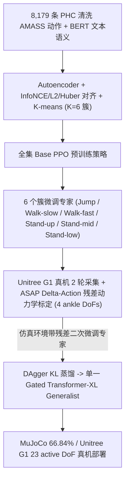

# From Experts to a Generalist: Toward General Whole-Body Control for Humanoid Robots (BumbleBee)

## 一句话定义

**BumbleBee（BB）**（`arXiv:2506.12779`，NeurIPS 2025 Spotlight）是智在无界（BeingBeyond）提出「从专家到通才」人形通用全身控制框架：先用运动编码+语义对齐将人类动作集聚为 **6 个行为簇**分别微调专家并在真机上用 **ASAP 残差动作动力学模型**标定后，再经 **DAgger** 蒸馏为具备长记忆能力的单一 **Gated Transformer-XL** 通用控制器。

## 英文缩写速查

| 缩写 | 英文全称 | 简要说明 |
|------|----------|----------|
| BB | BumbleBee | 本文提出的「分簇专家 -> 真机校正 -> 通才蒸馏」人形控制框架 |
| PHC | Perpetual Humanoid Control | 用于预过滤物理不可行/畸变运动帧的人形运动清洗基线 |
| ASAP | Aligning Simulation and Real-World Physics | 通过采集真机轨迹学习残差动作补偿 Sim2Real 动力学误差的方法 |
| DAgger | Dataset Aggregation | 在策略自身访问的状态分布上请求专家动作进行在线蒸馏的模仿算法 |

## 为什么重要

1. **化解多运动分布与跨动力学梯度冲突**：单一通用 RL 策略直接同时学高爆发跳跃、慢走与下蹲起立会产生严重的策略梯度相互抵消（如 Hover / OmniH2O 在多样测试集上仅 `15%–16%` 成功率）。BumbleBee 用行为聚类隔离矛盾，使每个簇专家先达到性能上限再蒸馏聚合。
2. **把「真机动力学残差标定」融入多专家扩展**：针对 Unitree G1 脚踝与接触耦合等真机电机/地面误差，用局部轻量残差网络先微调专家再蒸馏，避免真机微调单一通才导致的灾难性遗忘。

## 核心原理

1. **多模态运动聚类（K=6 行为簇）**：对 8,179 条经 PHC 物理过滤的人类动作轨迹提取运动 Autoencoder 嵌入并同 BERT 文本表征做 InfoNCE + L2 + Huber 联合对齐，以 K-means 聚类划分为语义物理一致的 **6 个簇**：`Jump`、`Walk-slow`、`Walk-fast`、`Stand-up`、`Stand-mid`、`Stand-low`。
2. **Base PPO + 分簇专家 + ASAP 真机残差对齐**：
   - 先在全量轨迹上训出共用初始化策略 Base PPO，再分化为 6 个簇专家；
   - 在真机 Unitree G1（29 DoF 中实际启用 **23 active DoF**，锁定未驱动腕部关节）收集 2 轮实际运行轨迹，构建面向关键关节（如脚踝 4 个 DoF）的 2 层 64 维 MLP **Delta-Action** 残差模型修正仿真物理器失配，随后在修正后的仿真器内二次强化各专家。
3. **Gated Transformer-XL 通才蒸馏**：利用 **DAgger（KL 散度损失）** 将 6 个真机对齐后的专家蒸馏为单个具有门控时序记忆的 **Gated Transformer-XL** 通用全身控制策略。

## 工程实践

- **硬件与控制自由度配置：** Unitree G1 共有 29 DoF，实际控制启用 **23 active DoF**（锁定未驱动腕部关节）；真机残差标定聚焦脚踝等 **4 个核心 DoF**，以 2 层 64 维 MLP 拟合 Delta-Action 修正仿真物理失配。
- **分阶段防遗忘实践：** 先在修正后的仿真器内二次微调各簇专家，再经 DAgger KL 蒸馏汇总进单一 Gated Transformer-XL 通才，避免在单一通才上直接做真机微调导致跨簇灾难性遗忘。
- **开源状态核查：** **源码运行时序图：不适用**（截至 2026-11-21，官方仓库 [BeingBeyond/BumbleBee](https://github.com/BeingBeyond/BumbleBee) commit `5aff81f` 仅包含占位 `README.md` 与 `docs/` 展示资源，README 声明 *"We will release our code soon."*，尚未释出训练与真机部署代码）。

## 实验与评测

- **数据与跨引擎评测设置：** 基于 **8,179 条** PHC 物理清洗后的 AMASS 动作轨迹（聚为 `K=6` 行为簇：`Jump`、`Walk-slow`、`Walk-fast`、`Stand-up`、`Stand-mid`、`Stand-low`），在独立物理引擎 **MuJoCo** 上测试零样本跨仿真器迁移，并在 **Unitree G1（23 active DoF）** 上开展真机闭环迭代测试。
- **MuJoCo 零样本迁移主结果：** BumbleBee 平均成功率达到 **66.84%**，跨过单一通用策略在异构动作簇间的性能瓶颈。
- **Unitree G1 真机两轮迭代残差标定增益：** 引入 2 轮真机数据采集与 ASAP Delta-Action 残差标定后，分簇平均成功率从 `Iter 0: 51.49%` 稳步提升至 `Iter 1: 60.33%`、`Iter 2: 70.37%`；最终经 DAgger KL 蒸馏得到的单一 **Gated Transformer-XL** 通才策略仍稳定保持在 **69%** 量级水平且无专家间干扰。

## 与其他工作对比

| 工作 | 训练与结构路线 | MuJoCo 零样本成功率 / 真机定位 | 核心差异与取舍 |
|---|---|---|---|
| **BumbleBee（本文，arXiv:2506.12779v3）** | AE+BERT K=6 聚类 → Base PPO → 簇专家 → 2 轮 ASAP Delta-Action 标定 → DAgger KL 蒸馏 Gated Transformer-XL | **66.84%**（真机迭代 `51.49% → 70.37%`，通才稳在 **~69%**） | 先分治隔离动作梯度冲突，再以轻量化残差标定专家后蒸馏合流；多阶段工程链路偏重 |
| **ExBody2** | 同阶段强全身控制对比基线 | **50.19%** | MuJoCo 零样本跨仿真迁移比 BumbleBee 低 16.65 个百分点 |
| **Hover** | 单一通用全身控制策略基线 | **16.12%** | 高爆发跳跃与慢走/蹲起混合分布下易发生梯度冲突 |
| **OmniH2O** | 通用人形全身控制策略基线 | **15.64%** | 在多簇高动态动作混合测试集上受限于单策略共训折中 |
| **[FAST](./cn-os-fast.md)** | 同团队后续演化：单阶段 MoE + CoM-Aware + Parseval 残差自适应 | 简化 BumbleBee 四步接力管线 | 避免多阶段专家重训与重构成本，适合需要单阶段快速自适应的场景 |

## 结论

**BumbleBee 通过「语义运动分簇专家化 -> 两轮真机残差动力学对齐 -> Transformer-XL 通才蒸馏」，在单一策略上首次跨越了高动态多簇人形动作与真机 Sim2Real 鸿沟。**
- 先分治后合并有效消除异构动作间的 RL 训练冲突；
- 轻量 ASAP delta-action 微调专家后再蒸馏，比直接微调单一通才更抗分布偏移与遗忘；
- 工程代价在于多阶段训练流程较长，后续 [FAST](cn-os-fast.md) 通过单阶段 MoE + CoM-Aware + Parseval 残差简化了这一管线。

## 局限与风险

1. **缺乏全局空间定位（VIO/GPS）**：控制观测聚焦本体关节与速度局部估计，长程复杂地形下根位置与朝向易出现累积漂移。
2. **多阶段工程链路偏重**：需要 Base PPO -> 6 个专家 -> 2 轮真机采集与残差模型 -> DAgger 蒸馏四步接力，新增动作簇重构成本高（已被 [FAST](cn-os-fast.md) 的残差适配策略改进）。
3. **代码未公开**：`5aff81f` 仓库尚未释出集群聚类及真机标定代码。

## 关联页面

- 所属机构实体：[智在无界（BeingBeyond）](beingbeyond.md)
- 同系列演化后续：[FAST：预训练与快速自适应通用人形全身控制](cn-os-fast.md)
- 协同上层运动生成：[RLPF](paper-notebook-rl-from-physical-feedback-aligning-large-motion.md) 与 [DemoHLM](paper-loco-manip-161-136-demohlm.md)

## 参考来源

- 一手论文：`arXiv:2506.12779v3`（NeurIPS 2025 Spotlight）全文归档（[bumblebee_arxiv_2506_12779.md](../../sources/papers/bumblebee_arxiv_2506_12779.md)）
- 论文精读笔记摘要：[humanoid_pnb_from-experts-to-a-generalist.md](../../sources/papers/humanoid_pnb_from-experts-to-a-generalist.md)

## 继续阅读

- [arXiv:2506.12779 论文页面](https://arxiv.org/abs/2506.12779)
- [BumbleBee 官方项目主页](https://beingbeyond.github.io/BumbleBee/)
- [BeingBeyond/BumbleBee GitHub 仓库](https://github.com/BeingBeyond/BumbleBee)
