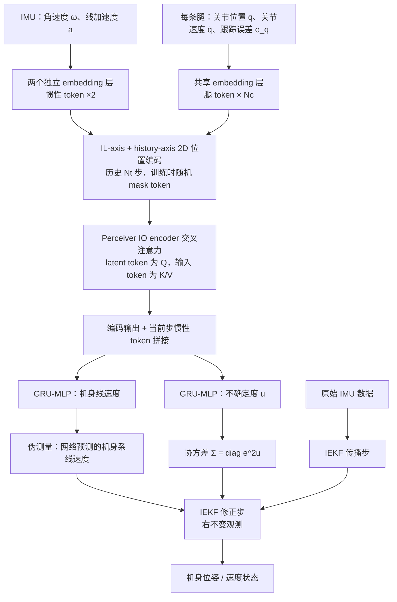

# GAIT

**GAIT: Legged Robot Proprioceptive State Estimation with Attention over Inertial-Leg Tokens**（arXiv:2606.14160v1，2026-06-12；KAIST）收录于 [Robot Learning Paper Notebooks](https://imchong.github.io/Robot_Learning_Paper_Notebooks/index.html)（分类：09_State_Estimation）。本页依据 **论文 PDF 全文** 整理（2026-11-06 通读正文，含方法、实验、结论与参考文献；论文无独立附录），深读笔记仅作交叉参考。

## 一句话定义

GAIT 把足式机器人的本体感知测量做成「惯性-腿部（Inertial-Leg, IL）分词」——IMU 的陀螺与加速度计各占一个 token，每条腿各占一个 token——再用轻量的 Perceiver IO 交叉注意力学习「哪路测量此刻更可信」，输出机身线速度与不确定度，作为伪测量交给 IEKF 做修正。因为一条腿只有触地时的前向运动学速度才可靠，注意力隐式学到了「按接触状态重新赋权」，不需要显式接触估计器。网络只用仿真 trot 数据训练，却在未见的 bound / pace / pronk 步态上误差低于 NMN 与接触辅助 IEKF。

## 英文缩写速查

| 缩写 | 英文全称 | 简要说明 |
|------|----------|----------|
| IMU | Inertial Measurement Unit | 惯性测量单元；本文取角速度 ω 与线加速度 a，各自成为一个惯性 token |
| IL | Inertial-Leg | 惯性-腿部分词：2 个惯性 token + N_c 个腿 token，即本文的输入结构 |
| IEKF | Invariant Extended Kalman Filter | 不变扩展卡尔曼滤波；状态 X_t ∈ SE₂(3)，用网络输出的机身速度做右不变观测修正 |
| SR | Slip Rejection | 打滑剔除；对比基线 IEKF w/ SR 中，打滑时增大接触相关协方差 |
| NMN | Neural Measurement Network | 对比基线（Youm et al.）：把传感器拼成一个向量，输出接触概率与机身速度；本文只取其速度输出 |
| Perceiver IO | Perceiver IO encoder cross-attention | 用 M 个可学习 latent 作 Q 对 N 个输入 token 做交叉注意力，复杂度 O(MND)，M < N |
| GRU | Gated Recurrent Unit | 门控循环单元；隐状态 64 维，负责时间维递推（GRU-MLP 模块） |
| PD | Proportional-Derivative | 比例-微分控制；训练数据中 10% 的 rollout 用随机 PD 目标让机器人近似静止 |
| MAE / ML | Mean Absolute Error / Maximum Likelihood | 两段式损失：前 400 迭代用 L_MAE，之后用高斯最大似然 L_ML 学习不确定度 |
| ATE / RE | Absolute Trajectory Error / Relative Error | 轨迹误差指标（定义取自 Zhang & Scaramuzza）；RE 按 5 s 子轨迹计算 |
| RMSE | Root Mean Square Error | 表 I 中的速度误差指标，给出全轨迹与打滑事件区间两种统计 |
| FLOPs | Floating-Point Operations | 每个推理步的浮点运算量；本文网络约 0.12 MFLOPs |

## 为什么重要

- **省掉接触估计器**：接触辅助 IEKF 的老问题是「接触判断错 → 约束错」。GAIT 让注意力隐式吸收接触信息、按权重重新分配，绕开了这条脆弱链路；论文的 IEKF 测量模型本身不含接触估计与零速度更新。
- **结构化输入范式**：按传感器语义分 token，相比把所有测量拍平成一个向量，网络能区分「哪条腿、哪类惯性量」。论文用 Go1 四足的消融证明了这种结构在跨地形、跨步态时的收益；对人形的迁移论文未验证（未核实）。
- **学习 + 滤波的清晰接口**：网络只负责输出「机身速度 + 不确定度」，位姿与几何一致性交给 IEKF，兼顾学习的表达力与滤波的结构。
- **计算开销低**：约 0.12 MFLOPs / 步，比同输入的标准自注意力低约 2.8×，比 NMN 低约 3.3×。

## 解决什么问题

足式机器人估计机身速度 / 位姿时，论文把现有 proprioceptive-only 方法归为两类，各有缺口：

1. **接触辅助 IEKF（模型驱动）**：靠「支撑足静止」假设做测量更新。打滑、软地或腾空时假设不成立，需要接触估计（本文对比基线由地面反力 GRF 估计接触）与打滑剔除来补救，且依赖启发式调参。
2. **学习式估计（如 NMN）**：把 IMU 与关节量拼成一个大向量输入网络，网络不知道某个分量来自哪条腿，只能隐式学习接触相关的可靠性。训练分布外的步态或地形下，误差会明显上升（见 [实验与评测](#实验与评测)）。

## 核心原理（方法栈）

### 流程总览

图依据：论文 §II 系统概述、§III-A/B（Fig.2）、§IV-B。

### 方法栈

1. **Inertial-Leg 分词（§III-A）**：ω_t、a_t 各一个惯性 token（两个独立 embedding，区分陀螺与加速度计），每条腿一个 token（共享 embedding，输入为 q_t、q̇_t、e_q,t = q_des − q_t）。共 N_c + 2 个 token。
2. **二维位置编码**：$PE(c,t) = e_c[c] + e_t[t]$，其中 $c$ 为 IL 轴（token 序号），$t$ 为历史轴（$N_t = 7$ 步）。训练时以 20% 概率随机屏蔽输入 token（借鉴 masked sensory modeling）。
3. **Perceiver IO 编码器（§III-B）**：2 个可学习 latent token 作为 Q，输入 token 作为 K/V；单层、2 个注意力头、每头维度 32。复杂度 $O(MND)$，低于自注意力的 $O(N^2 D)$。
4. **时间编码与输出头**：编码输出与当前步惯性 token 拼接后，分别送入两个 GRU–MLP（GRU 隐状态 64，MLP 一层 64），输出机身系线速度 $^B\bar v$ 与不确定度 $\bar u = [\bar u_x, \bar u_y, \bar u_z]$。
5. **两段式损失（§III-C）**：先用 $L_{MAE} = \frac{1}{n}\sum_i \lVert r_i \rVert_1$ 训练；随后用高斯最大似然
   $$L_{ML} = \frac{1}{n}\sum_i \left( \frac{1}{2}\log\det(\bar\Sigma_i) + \frac{1}{2}\lVert r_i\rVert^2_{\bar\Sigma_i} \right)$$
   其中 $r_i = {}^B v_i - {}^B\bar v_i$，$\bar\Sigma_i = \mathrm{diag}(e^{2\bar u_x}, e^{2\bar u_y}, e^{2\bar u_z})$。
6. **IEKF 接入（§IV）**：状态 $X_t \in SE_2(3)$（姿态、线速度、位置）；网络输出的机身速度作为右不变伪测量，测量噪声协方差由 $\bar\Sigma$ 构造。IMU 偏置在实现中一并传播，但论文未展开。测量模型不含接触估计，也不含零速度更新。

### 训练与噪声设计（§III-D）

- 数据：RaiSim 仿真中的 Unitree Go1，轨迹由 DynaFlow 运动控制器生成，**训练集只含 trot**（不含 bound / pace / pronk）。
- 10% 的 rollout 用随机 PD 目标让机器人近似静止，以覆盖近静止运动。
- 只对仿真 IMU 加零均值高斯噪声，运动学量无噪声。理由：IMU 同时用于滤波传播与网络输入，会造成传播与更新之间的相关性，违反卡尔曼滤波的独立性假设；这一做法沿用 TLIO 的思路。

## 实验与评测

实验平台为 Unitree Go1，关节与 IMU 数据 500 Hz 采集，真值为 10 台 Vicon 相机 200 Hz 插值到 500 Hz；每个场景重复 3 次。对比基线：w/o IL token（同 Perceiver 骨干、改用逐模态 embedding）、NMN、接触辅助 IEKF、IEKF w/ SR。

**(1) 地形（Table I，全轨迹速度 RMSE，m/s）**

| 地形 | Proposed | w/o IL token | NMN | IEKF |
|------|----------|--------------|-----|------|
| 橡胶（Rubber） | **0.098** | 0.103 | 0.126 | 0.128 |
| 打滑（Slippery） | 0.187 | **0.185** | 0.192 | 0.236 |
| 碎石（Debris，仿真未建模） | **0.187** | 0.203 | 0.194 | 0.235 |
| 圆周（Circular） | **0.146** | 0.151 | 0.154 | 0.177 |

打滑地形上 w/o IL token 略优（0.185 vs 0.187），论文将其归因于长时间打滑期间腿运动学难以反推机身速度，此时平衡惯性与全身关节信息更重要。

**(2) 未见步态（Table II，trot 训练，机身速度误差均值，m/s；† 为训练中未见的步态）**

| 步态 | Proposed | w/o IL token | NMN | IEKF |
|------|----------|--------------|-----|------|
| Trot（训练内） | **0.1052** | 0.1135 | 0.1353 | 0.1399 |
| Bound† | **0.3181** | 0.3485 | 0.4013 | 0.3401 |
| Pace† | **0.3181** | 0.5339 | 0.6766 | 0.4245 |
| Pronk† | **0.3629** | 0.4339 | 0.5656 | 0.4217 |

注：原表中 Bound 与 Pace 的 Proposed 均为 0.3181（标准差分别为 0.154 与 0.016），是否为排版问题（未核实）。

另外两组训练设定（Table III）：仅用 bound/pace/pronk 训练、测试 trot 时，Proposed / w/o IL / NMN 分别为 0.120 / 0.240 / 0.274；仅用 pace/pronk 训练、测试 trot/bound 时分别为 0.222 / 0.320 / 0.332。

**(3) 接入 IEKF 后的轨迹误差（Table IV，四地形均值）**

| 指标 | IEKF | IEKF w/ SR | NMN | w/o IL token | Proposed |
|------|------|------------|-----|--------------|----------|
| ATE_vel [m/s] | 0.1666 | 0.1519 | 0.1458 | 0.1414 | **0.1336** |
| RE_pos [m] | 0.2722 | 0.2847 | 0.2347 | 0.2870 | **0.1653** |
| RE_vel [m/s] | 0.2477 | 0.2207 | 0.2109 | 0.2007 | **0.1982** |
| ATE_rot [rad] | 0.1344 | 0.0986 | 0.0835 | **0.0803** | 0.0815 |

**(4) 计算开销**：约 0.12 MFLOPs / 步；AMD Ryzen 7 5800X 上 10 000 样本的推理耗时 0.70 ± 0.07 ms；训练约 1.2 h（RTX 3070）。

**(5) 注意力可解释性（Fig.4b、Fig.5）**：trot 与 bound 之间切换时，腿 token 的注意力从 RR–FL / RL–FR 对转向 RR–RL / FR–FL 对，与当前触地配对一致；pronk 的腾空相（四足速度同时升高）中，惯性 token 注意力（尤其加速度计）与预测不确定度同时上升。这些是定性的可视化证据，论文未给出因果检验。

## 与其他工作对比

- **相对接触辅助 IEKF**：在四种地形上，Proposed 的 ATE_vel 与 RE_pos 均值均低于 IEKF；在未见步态上，IEKF 的速度误差也高于 Proposed（Table II）。论文只用网络伪测量，不做显式接触估计。
- **相对 IEKF w/ SR**：论文认为学到的伪测量在接触模型频繁失效的场景中比打滑剔除更有效；Proposed 的 RE_pos 均值（0.1653）低于 IEKF w/ SR（0.2847）。
- **相对 NMN**：同一套 IEKF 接入方式下，Proposed 在 ATE_vel、RE_pos、RE_vel 均值上更优；ATE_rot 上与 NMN 基本持平（0.0815 vs 0.0835）。
- **相对 w/o IL token**：去掉 IL 分词后，RE_pos 均值从 0.1653 升至 0.2870（+73.6%），碎石地形上差距最大；但 w/o IL 在 ATE_rot 上略优（0.0803 vs 0.0815），且打滑地形上速度误差略低。
- **与相关工作的关系**：论文以 Youm et al.（NMN）为主要学习式对照，并借鉴 Liu et al.（TLIO）的噪声注入策略与 Sferrazza et al.（Body Transformer）的结构先验思路；未与 Lin et al.（学习接触事件的 IEKF）或 Lee & Kim（2026 注意力增强卡尔曼）做直接实验对比。

## 结论

**GAIT 的真正贡献不是又一个学习式状态估计器，而是把传感器语义写进网络输入结构，用注意力权重顶替显式接触估计这一环。**

1. **机制**：Inertial-Leg 分词 + Perceiver IO 交叉注意力让网络按触地状态重新赋权，省去了接触估计器与打滑剔除逻辑（论文 §V-C 的注意力可视化支持这一解释）。
2. **泛化证据在跨步态上**：仅用 trot 训练，在 bound / pace / pronk 上的速度误差低于 NMN 与 IEKF（Table II、III）。收益可以归因于结构，但论文未设计"同参数量、无结构"的严格对照，只有 w/o IL 这一组消融。
3. **分工边界**：网络只输出机身速度与不确定度，完整位姿仍由 IEKF 给出。把它当作端到端位姿估计器使用不符合论文设定。
4. **效果不是处处占优**：ATE_rot 上 w/o IL 与 Proposed 基本持平；打滑地形上 w/o IL 的速度 RMSE 略低。读数字时应以地形和指标分开看。
5. **部署数字**：0.12 MFLOPs、0.70 ms 是在桌面 CPU 上测得，论文没有在 Go1 机载计算单元上报告延迟。

## 工程实践

| 项目 | 内容 |
|------|------|
| 训练数据 | RaiSim 仿真 Go1；DynaFlow 控制器生成的 trot 轨迹；每迭代每环境采集 2 s；10% rollout 为随机 PD 近静止数据 |
| 关键超参 | $N_t = 7$ 历史步；仿真 1 kHz，估计器输入与标签 500 Hz；token 屏蔽概率 20%；地面摩擦 $U(0.3, 1.0)$；2 个 latent token、2 头注意力、1 层、头维度 32；GRU 隐状态 64；MLP 宽 64 |
| 优化 | Adam；学习率线性预热 100 迭代至 $5\times10^{-4}$ 后线性衰减；共 1000 迭代，前 400 用 $L_{MAE}$，其余用 $L_{ML}$ |
| 噪声注入 | 仅对仿真 IMU 加高斯噪声，运动学量保持无噪声（避免 IMU 在传播与更新之间相关） |
| 滤波设置 | 所有滤波方法使用相同的 IMU 传播与先验协方差；初始状态取真值，IMU 偏置置零 |
| 推理开销 | 约 0.12 MFLOPs / 步；0.70 ± 0.07 ms（AMD Ryzen 7 5800X，10 000 样本） |
| 调试指标 | 机身速度误差（RMSE / 均值 ± 标准差）；打滑事件区间的速度误差（滑移定义：接触估计判为触地且足端真值速度 > 0.5 m/s）；RE_pos / ATE_vel；注意力权重与不确定度随接触状态的变化 |
| 源码开放状态 | **未公开（截至 2026-11-06 未检到）**：arXiv 摘要页与论文 PDF 未给出官方代码或数据链接；深读笔记所在的 [Robot_Learning_Paper_Notebooks](https://github.com/ImChong/Robot_Learning_Paper_Notebooks) 是第三方笔记仓库，不是作者代码 |
| 源码运行时序图 | **不适用**（无可识别的官方可运行仓库；待作者发布代码后再补） |
| 机器人应用 | 论文只在 Unitree Go1 上做了实机实验，未报告人形或其他平台结果 |

## 局限与风险

- **平台与地形覆盖有限**：实机只用 Unitree Go1 四足，场景为橡胶、打滑、碎石与圆周，每场景重复 3 次，未报告统计检验。人形上的效果未验证。
- **训练数据单一**：训练只用仿真 trot，碎石地形（论文承认仿真未建模）是零样本泛化；论文没有分析仿真与真机在摩擦、接触刚度上的差距。
- **依赖地面真值与接触判断来定义滑移**：论文的「滑移事件」由接触估计器判定为触地、再用足端真值速度阈值（0.5 m/s）筛选，评测本身带有接触估计器的假设。
- **不确定度的一致性依赖工程手段**：论文通过训练时只给 IMU 加噪来减轻传播与更新的相关性，但没有给出一致性（NEES 等）的定量检验，也没有给出理论保证。
- **注意力解释是定性的**：Fig.4b、Fig.5 展示的注意力与触地/腾空的对应是观察性证据，不能直接当作"模型已学会接触估计"的因果结论。
- **常见误区**：
  - 不要把 IL 分词理解为显式接触估计；它不输出接触概率。
  - 不要把网络当作端到端位姿估计器；位姿由 IEKF 提供。
  - 不要以为「已开源」：截至入库日未检到官方代码，复现需从论文细节（网络规模、损失与噪声设计）自行实现。

## 关联页面

- 分类父节点：[paper-notebook-category-09-state-estimation](../overview/paper-notebook-category-09-state-estimation.md)
- 总索引：[humanoid-paper-notebooks-index.md](../overview/humanoid-paper-notebooks-index.md)
- 概念：[状态估计](../concepts/state-estimation.md)、[接触估计](../concepts/contact-estimation.md)、[GRU](../concepts/gru.md)、[多头注意力](../concepts/multi-head-attention.md)
- 对比基线（接触辅助 IEKF）：[paper-notebook-contact-aided-invariant-ekf-for-legged-robots](paper-notebook-contact-aided-invariant-ekf-for-legged-robots.md)
- IEKF 理论背景：[paper-notebook-the-invariant-extended-kalman-filter-as-a-stable](paper-notebook-the-invariant-extended-kalman-filter-as-a-stable.md)
- 仿真环境：[RaiSim](raisim.md)

## 参考来源

- [gait_arxiv_2606_14160.md](../../sources/papers/gait_arxiv_2606_14160.md)：论文原文归档（arXiv:2606.14160v1）
- [humanoid_pnb_gait.md](../../sources/papers/humanoid_pnb_gait.md)：深读笔记的 ingest 归档
- 论文：<https://arxiv.org/abs/2606.14160>（PDF：<https://arxiv.org/pdf/2606.14160>）
- 深读笔记：<https://imchong.github.io/Robot_Learning_Paper_Notebooks/papers/09_State_Estimation/GAIT__Legged_Robot_Proprioceptive_State_Estimation_with_Attention_over_Inertia/GAIT__Legged_Robot_Proprioceptive_State_Estimation_with_Attention_over_Inertia.html>
- 全文核对范围：PDF 正文 §I–§VI 与参考文献（8 页），含 Fig.1–5 与 Table I–IV；无附录

## 推荐继续阅读

- [Perceiver IO: A General Architecture for Structured Inputs & Outputs（arXiv:2107.14795）](https://arxiv.org/abs/2107.14795)：本文注意力骨干的出处
- [机器人论文阅读笔记：GAIT](https://imchong.github.io/Robot_Learning_Paper_Notebooks/papers/09_State_Estimation/GAIT__Legged_Robot_Proprioceptive_State_Estimation_with_Attention_over_Inertia/GAIT__Legged_Robot_Proprioceptive_State_Estimation_with_Attention_over_Inertia.html)：分类笔记，便于与同类页面对照阅读
