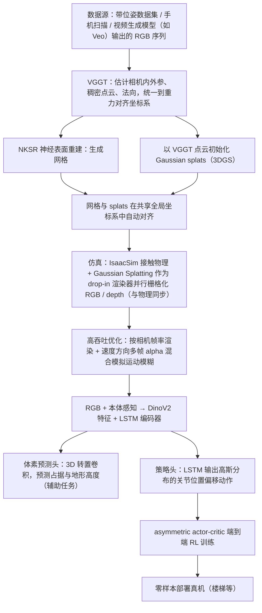

# GaussGym

**GaussGym: An open-source real-to-sim framework for learning locomotion from pixels** 已列入 [Robot Learning Paper Notebooks](https://imchong.github.io/Robot_Learning_Paper_Notebooks/index.html) 的 **PROGRESS.md 待深读** 清单（分类：05_Locomotion）。本页 **还没有深读笔记**：给出这篇论文的分类位置与原文入口，并在「流程总览」补了方法流程图，数据请直接看原文。

## 一句话定义

GaussGym 的人形机器人学习论文条目，当前处于 Paper Notebooks 阅读进度（待深读）阶段。

## 英文缩写速查

| 缩写 | 英文全称 | 简要说明 |
|------|----------|----------|
| RL | Reinforcement Learning | 通过与环境交互最大化长期回报来学习策略 |
| WBC | Whole-Body Control | 协调全身关节满足多任务/约束的控制基础设施 |
| Sim2Real | Simulation to Real | 把仿真中学到的策略迁移落地真机的工程主线 |

## 为什么重要

- 这篇已排进 Paper Notebooks 的待读清单，可以从 [机器人学习论文笔记总索引](../overview/humanoid-paper-notebooks-index.md) 与分类页找到同一批工作。
- 在笔记写出来之前，这里只保留分类位置、原文入口与「流程总览」，不给方法结论。

## 流程总览

图依据：论文 §3 GaussGym（Fig. 2 整体流水线，§3.1–3.3）、§4.2.1 Neural Architecture（Fig. 7）。

## 核心信息

| 字段 | 内容 |
|------|------|
| 分类 | 05_Locomotion |
| 深读状态 | 待撰写（[PROGRESS.md](https://github.com/ImChong/Robot_Learning_Paper_Notebooks/blob/main/papers/PROGRESS.md)） |
| 计划文件夹 | `papers/05_Locomotion/gaussgym-an-open-source-real-to-sim-framework-fo` |
| arXiv | <https://arxiv.org/abs/2510.15352> |

## 实验与评测

- 深读笔记尚未完成；量化 benchmark、消融与实机指标待笔记撰写后补充。

## 结论

**本页当前的价值不在于讲清 GaussGym 的方法，而在于先登记「开源 real-to-sim + 从像素学运动」这个待读条目。**

- 可确认的定位线索只有标题与分类：归入 **05_Locomotion**，主题是开源 real-to-sim 框架与从像素学习运动，与本库 Sim2Real 主线同向。
- 深读笔记尚未撰写，量化 benchmark、消融与实机指标一律缺席，**不要把本页当作方法性判断的来源**。
- 现阶段的可靠用途是检索入口与待读条目；细节请走 arXiv 原文与 PROGRESS.md 待深读清单。
- 笔记完成后本页应补成完整摘要，届时本节需整体重写。

## 与其他页面的关系

- 分类页：[paper-notebook-category-05-locomotion](../overview/paper-notebook-category-05-locomotion.md)
- 总索引：[humanoid-paper-notebooks-index.md](../overview/humanoid-paper-notebooks-index.md)
- 外观/真机对照（站内完整实体）：[R2S-EGO](./paper-r2s-ego.md) 以 GaussGym 为稀疏 Real-to-Sim 主基线（arXiv:2608.06827）
- [Sim2Real](../concepts/sim2real.md) — Real2Sim 资产与迁移总图

## 参考来源

- [humanoid_pnb_gaussgym-an-open-source-real-to-sim-framework-fo.md](../../sources/papers/humanoid_pnb_gaussgym-an-open-source-real-to-sim-framework-fo.md)
- [Robot Learning Paper Notebooks · PROGRESS.md](https://github.com/ImChong/Robot_Learning_Paper_Notebooks/blob/main/papers/PROGRESS.md)
- 论文：<https://arxiv.org/abs/2510.15352>
- [arXiv PDF](https://arxiv.org/pdf/2510.15352)：已通读方法部分（实验与附录以略读为准）：§1 贡献、§3 GaussGym（3.1–3.3）、§4.1–4.2 结果与神经网络结构、§5 局限

## 推荐继续阅读

- [Paper Notebooks 阅读进度（PROGRESS.md）](https://github.com/ImChong/Robot_Learning_Paper_Notebooks/blob/main/papers/PROGRESS.md)
