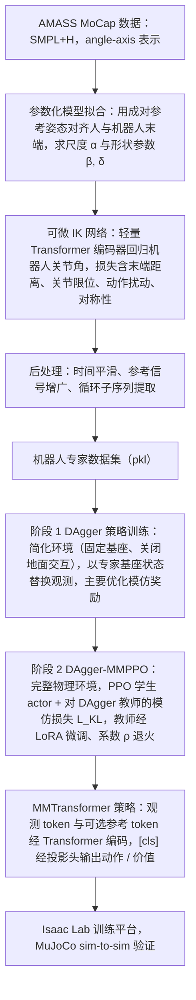

# GBC

**GBC: Generalized Behavior-Cloning Framework for Whole-Body Humanoid Imitation** 已列入 [Robot Learning Paper Notebooks](https://imchong.github.io/Robot_Learning_Paper_Notebooks/index.html) 的 **progress 待深读** 清单（分类：04_Loco-Manipulation_and_WBC）。本页 **还没有深读笔记**：只给出这篇论文的分类位置与原文入口，方法细节与数据请直接看原文。

## 一句话定义

GBC 的人形机器人学习论文条目，当前处于 Paper Notebooks 阅读进度（待深读）阶段。

## 英文缩写速查

| 缩写 | 英文全称 | 简要说明 |
|------|----------|----------|
| RL | Reinforcement Learning | 通过与环境交互最大化长期回报来学习策略 |
| WBC | Whole-Body Control | 协调全身关节满足多任务/约束的控制基础设施 |
| Sim2Real | Simulation to Real | 把仿真中学到的策略迁移落地真机的工程主线 |

## 为什么重要

- 这篇已排进 Paper Notebooks 的待读清单，可以从 [机器人学习论文笔记总索引](../overview/humanoid-paper-notebooks-index.md) 与分类页找到同一批工作。
- 在笔记写出来之前，这里只保留分类位置与原文入口；方法流程见下方「流程总览」，实验结论以论文为准。

## 流程总览

图依据：论文 §III-A（数据处理流水线）、§III-B（MMTransformer 与 DAgger-MMPPO，Algorithm 1–2）/ Fig. 1、Fig. 5、Fig. 7。

## 核心信息

| 字段 | 内容 |
|------|------|
| 分类 | 04_Loco-Manipulation_and_WBC |
| 深读状态 | 待撰写（[progress.json](https://github.com/ImChong/Robot_Learning_Paper_Notebooks/blob/main/progress.json)） |
| 计划文件夹 | `papers/04_Loco-Manipulation_and_WBC/GBC__Generalized_Behavior-Cloning_Framework_for_Whole-Body_Humanoid_Imitation` |

## 实验与评测

- 深读笔记尚未完成；量化 benchmark、消融与实机指标待笔记撰写后补充。

## 结论

**GBC 在本库当前只是「待读条目」而非结论性笔记：它标记了一个待深读的全身人形模仿行为克隆框架，真正的机制与数字还没整理进来。**

- 本页的价值只是登记——让 04_Loco-Manipulation_and_WBC 分类下不漏掉这一篇，而不是提供可引用的技术判断。
- 从标题可读出的定位是「面向全身人形模仿的通用行为克隆框架」，落在 loco-manipulation 与 WBC 这条脉络内。
- 适用边界很明确：量化 benchmark、消融与实机指标本页一概不提供，需以 progress.json 与后续深读笔记为准。
- 深读笔记完成前，不宜把本页当作方法对比的依据引用。

## 与其他页面的关系

- 分类页：[paper-notebook-category-04-loco-manipulation-and-wbc](../overview/paper-notebook-category-04-loco-manipulation-and-wbc.md)
- 总索引：[humanoid-paper-notebooks-index.md](../overview/humanoid-paper-notebooks-index.md)

## 参考来源

- [humanoid_pnb_gbc.md](../../sources/papers/humanoid_pnb_gbc.md)
- [Robot Learning Paper Notebooks · progress.json](https://github.com/ImChong/Robot_Learning_Paper_Notebooks/blob/main/progress.json)
- [arXiv PDF](https://arxiv.org/pdf/2508.09960)：已通读方法部分（实验与附录以略读为准）：摘要、§I 贡献、§III-A 可微 IK 与数据集流水线、§III-B MMTransformer 与 DAgger-MMPPO、§IV 训练平台开头

## 推荐继续阅读

- [Paper Notebooks 阅读进度（PROGRESS.md）](https://github.com/ImChong/Robot_Learning_Paper_Notebooks/blob/main/papers/PROGRESS.md)
