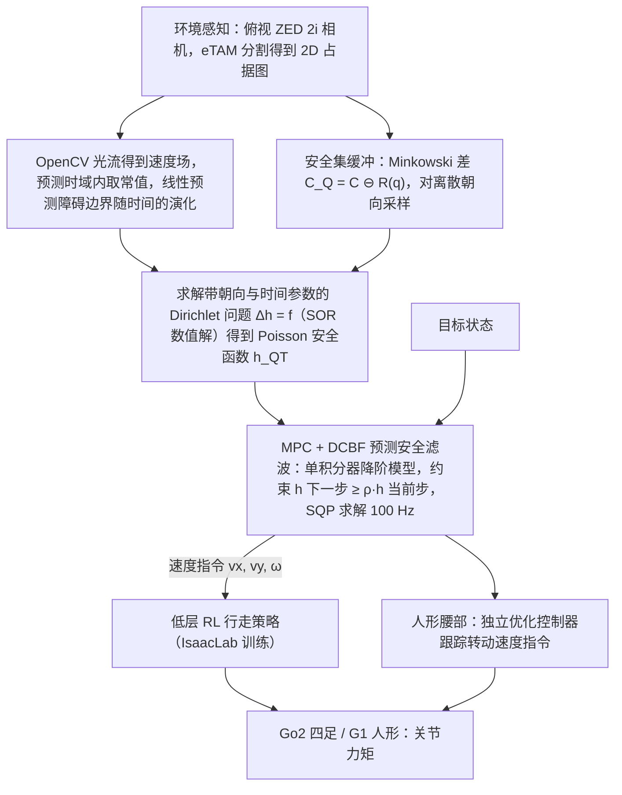

# Geometry-Aware Predictive Safety Filters on Humanoids

**Geometry-Aware Predictive Safety Filters on Humanoids** 已列入 [Robot Learning Paper Notebooks](https://imchong.github.io/Robot_Learning_Paper_Notebooks/index.html) 的 **PROGRESS.md 待深读** 清单（分类：05_Locomotion）。本页 **还没有深读笔记**：只给出这篇论文的分类位置与原文入口，方法细节与数据请直接看原文。

## 一句话定义

Geometry-Aware Predictive Safety Filters on Humanoids 的人形机器人学习论文条目，当前处于 Paper Notebooks 阅读进度（待深读）阶段。

## 英文缩写速查

| 缩写 | 英文全称 | 简要说明 |
|------|----------|----------|
| RL | Reinforcement Learning | 通过与环境交互最大化长期回报来学习策略 |
| WBC | Whole-Body Control | 协调全身关节满足多任务/约束的控制基础设施 |
| Sim2Real | Simulation to Real | 把仿真中学到的策略迁移落地真机的工程主线 |

## 为什么重要

- 这篇已排进 Paper Notebooks 的待读清单，可以从 [机器人学习论文笔记总索引](../overview/humanoid-paper-notebooks-index.md) 与分类页找到同一批工作。
- 在笔记写出来之前，这里只保留分类位置与原文入口；方法流程见下方「流程总览」，实验结论以论文为准。

## 流程总览

图依据：论文 §III（Poisson 安全函数的时间与几何扩展）、§IV 控制架构 / Fig. 1、Fig. 3、§V-A 实现细节。

## 核心信息

| 字段 | 内容 |
|------|------|
| 分类 | 05_Locomotion |
| 深读状态 | 待撰写（[PROGRESS.md](https://github.com/ImChong/Robot_Learning_Paper_Notebooks/blob/main/papers/PROGRESS.md)） |
| 计划文件夹 | `papers/05_Locomotion/geometry-aware-predictive-safety-filters-on-huma` |
| arXiv | <https://arxiv.org/abs/2508.11129> |

## 实验与评测

- 深读笔记尚未完成；量化 benchmark、消融与实机指标待笔记撰写后补充。

## 结论

**本页当前是一条待读记录，而不是对这篇论文的判断：它只登记了这篇属于 05_Locomotion，实质结论要等深读笔记完成后回填。**

- 页面现状：status 为 planned，正文只有分类归属与 PROGRESS.md 待深读状态，没有可供归纳的机制、指标或实验内容。
- 从标题能读出的定位仅限于「人形 + 几何感知的预测式安全滤波」，归类在 05_Locomotion；任何关于方法细节或效果的判断在本页都缺乏依据。
- 使用方式：把本页当检索入口——分类页 [paper-notebook-category-05-locomotion](../overview/paper-notebook-category-05-locomotion.md) 与 [机器人学习论文笔记总索引](../overview/humanoid-paper-notebooks-index.md)；要读实质内容请直接走 arXiv 原文。

## 与其他页面的关系

- 分类页：[paper-notebook-category-05-locomotion](../overview/paper-notebook-category-05-locomotion.md)
- 总索引：[humanoid-paper-notebooks-index.md](../overview/humanoid-paper-notebooks-index.md)

## 参考来源

- [humanoid_pnb_geometry-aware-predictive-safety-filters-on-huma.md](../../sources/papers/humanoid_pnb_geometry-aware-predictive-safety-filters-on-huma.md)
- [Robot Learning Paper Notebooks · PROGRESS.md](https://github.com/ImChong/Robot_Learning_Paper_Notebooks/blob/main/papers/PROGRESS.md)
- 论文：<https://arxiv.org/abs/2508.11129>
- [arXiv PDF](https://arxiv.org/pdf/2508.11129)：已通读方法部分（实验与附录以略读为准）：摘要、§III 扩展 Poisson 安全函数、§IV 控制架构、§V-A 实验设置与实现

## 推荐继续阅读

- [Paper Notebooks 阅读进度（PROGRESS.md）](https://github.com/ImChong/Robot_Learning_Paper_Notebooks/blob/main/papers/PROGRESS.md)
