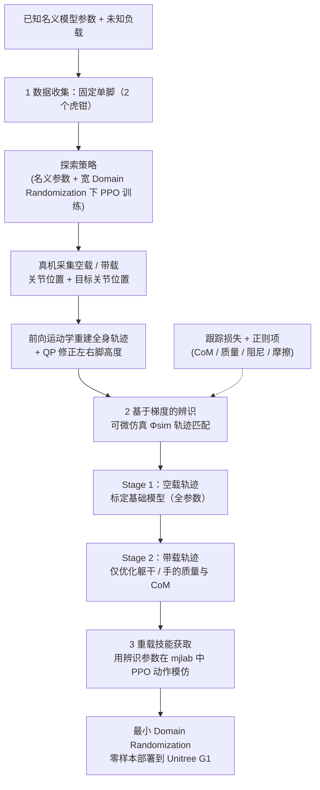

# HALO

**HALO: Closing Sim-to-Real Gap for Heavy-loaded Humanoid Agile Motion Skills via Differentiable Simulation** 已列入 [Robot Learning Paper Notebooks](https://imchong.github.io/Robot_Learning_Paper_Notebooks/index.html) 的 **PROGRESS.md 待深读** 清单（分类：10_Sim-to-Real）。本页 **还没有深读笔记**：只给出这篇论文的分类位置与原文入口，方法细节与数据请直接看原文。

## 一句话定义

HALO 的人形机器人学习论文条目，当前处于 Paper Notebooks 阅读进度（待深读）阶段。

## 英文缩写速查

| 缩写 | 英文全称 | 简要说明 |
|------|----------|----------|
| RL | Reinforcement Learning | 通过与环境交互最大化长期回报来学习策略 |
| WBC | Whole-Body Control | 协调全身关节满足多任务/约束的控制基础设施 |
| Sim2Real | Simulation to Real | 把仿真中学到的策略迁移落地真机的工程主线 |

## 为什么重要

- 这篇已排进 Paper Notebooks 的待读清单，可以从 [机器人学习论文笔记总索引](../overview/humanoid-paper-notebooks-index.md) 与分类页找到同一批工作。
- 在笔记写出来之前，这里只保留分类位置与原文入口，不给方法结论；方法流程见下方「流程总览」（仅据论文方法部分）。

## 流程总览

图依据：论文 §III（Fig. 2 方法总览；III-A 数据收集、III-B 梯度辨识与两阶段、III-C 技能获取）

## 核心信息

| 字段 | 内容 |
|------|------|
| 分类 | 10_Sim-to-Real |
| 深读状态 | 待撰写（[PROGRESS.md](https://github.com/ImChong/Robot_Learning_Paper_Notebooks/blob/main/papers/PROGRESS.md)） |
| 计划文件夹 | `papers/10_Sim-to-Real/HALO_Closing_Sim-to-Real_Gap_for_Heavy-loaded_Humanoid_Agile_Motion` |
| arXiv | <https://arxiv.org/abs/2603.15084> |

## 实验与评测

- 深读笔记尚未完成；量化 benchmark、消融与实机指标待笔记撰写后补充。

## 结论

**HALO 在本库的定位是「用可微仿真去补重载人形敏捷动作的 sim-to-real 缺口」这一待深读条目，但页面本身仍是待读。**

- 可确认的信息只有标题与分类：目标场景是**重载（heavy-loaded）人形敏捷动作技能**，手段是**可微仿真**，归入 10_Sim-to-Real。
- 深读笔记未完成，负载条件、对比基线与实机指标都不在本页，无法据此判断方法是否有效。
- 计划文件夹与 arXiv 链接已就位，适合作为后续 ingest 的起点；笔记完成后本节需重写。

## 与其他页面的关系

- 分类页：[paper-notebook-category-10-sim-to-real](../overview/paper-notebook-category-10-sim-to-real.md)
- 总索引：[humanoid-paper-notebooks-index.md](../overview/humanoid-paper-notebooks-index.md)

## 参考来源

- [humanoid_pnb_halo-closing-sim-to-real-gap-for-heavy-loaded-hu.md](../../sources/papers/humanoid_pnb_halo-closing-sim-to-real-gap-for-heavy-loaded-hu.md)
- [Robot Learning Paper Notebooks · PROGRESS.md](https://github.com/ImChong/Robot_Learning_Paper_Notebooks/blob/main/papers/PROGRESS.md)
- 论文：<https://arxiv.org/abs/2603.15084>
- [arXiv PDF](https://arxiv.org/pdf/2603.15084)：已通读方法部分（实验与附录以略读为准）：摘要、§I 引言、§II 相关工作、§III 方法、§IV 实验设定（Table II 略读）

## 推荐继续阅读

- [Paper Notebooks 阅读进度（PROGRESS.md）](https://github.com/ImChong/Robot_Learning_Paper_Notebooks/blob/main/papers/PROGRESS.md)
