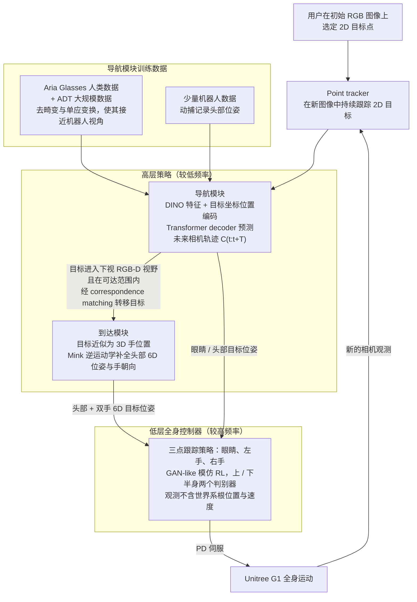

# Hand-Eye Autonomous Delivery

**Hand-Eye Autonomous Delivery: Learning Humanoid Navigation, Locomotion and Reaching** 收录于 [Robot Learning Paper Notebooks](https://imchong.github.io/Robot_Learning_Paper_Notebooks/index.html)（分类：08_Navigation）。本页依据 **原文全文**（arXiv:2508.03068v2，正文 §1–§6 与附录 A–C）编译，深读笔记作为对照来源；细节以论文为准。

## 一句话定义

HEAD（Hand-Eye Autonomous Delivery）是一个直接从人类动作与视觉感知数据学人形导航、运动与触达的框架。采用模块化：高层规划器下达人形手与眼的目标位置与朝向，由低层策略控制全身动作来实现。具体地，低层全身控制器从大规模人类动捕学习跟踪三个点（双眼、左手、右手）；高层策略从 Aria 眼镜采集的人类第一视角数据学习。这种模块化把第一视角视觉感知与物理动作解耦，促进高效学习与对新场景的可扩展性。在仿真与真实世界评测，展示了人形在为人类设计的复杂环境中导航与触达的能力。

## 英文缩写速查

| 缩写 | 含义 |
|---|---|
| HEAD | Hand-Eye Autonomous Delivery，本文框架名 |
| WBC | Whole-Body Controller，低层全身控制器，30 Hz 策略经 PD 伺服驱动 |
| GAN-like | 类 GAN 的模仿 RL：判别器集成给出模仿奖励，无需完整轨迹作输入 |
| PPO | Proximal Policy Optimization，训练 WBC 的强化学习算法 |
| PD | 比例-微分伺服，策略输出关节目标后由 PD 控制执行 |
| IK | 逆运动学，本文用 Mink 补全头部 6D 位姿与手朝向 |
| DINO | 导航模块的视觉特征提取器 |
| ADT | Aria Digital Twin 数据集，约 400 分钟第一视角室内活动 |
| MoCap | 动作捕捉，用于人类动作数据与机器人头部位姿记录 |
| Ego-centric | 第一视角（头戴/眼镜相机），高层导航的数据来源 |
| RGB-D | 彩色加深度相机，用于下视的触达相机 |

## 为什么重要

- **"眼+双手"三点是紧凑而强的全身目标表示**：抓住人类操作的关键端点，降低控制维度（论文 §1 指出三点目标稀疏，是训练难点之一）；
- **第一视角数据（Aria 眼镜）是高层策略的廉价来源**，呼应 ZeroWBC/EgoHumanoid 的第一视角路线；
- **感知-动作解耦**提升可扩展性，是模块化的经典收益；
- 把"导航 + 触达"统一在一个框架，贴近真实递送任务（论文 §2 指出 NaVILA 等工作把机器人当作 2D 质点，或缺少全身触达协调）。

## 核心原理

**输入 → 机制 → 输出**：

- **输入**：导航模块输入当前导航相机 RGB 图像与 2D 目标点（初始帧上用户选点，之后由点跟踪器 CoTracker3 在新帧中持续跟踪）；触达模块输入下视 RGB-D 相机中的目标；WBC 输入本体观测（G1 的 33 个 link 在根坐标系下两帧位姿、关节速度）加三点目标（头、左手、右手在未来三帧的位姿）。观测不含世界系根位置与线速度。
- **机制**：
  1. 导航：提取 DINO 特征，加上目标坐标的位置编码，经 Transformer decoder 预测未来相机轨迹 $C_{t:t+T}$（相对前一帧的位姿变换）。
  2. 切换：目标进入下视 RGB-D 视野且处于可达范围内，经对应匹配（引用 LoFTR [41]）把目标转到 RGB-D 坐标系，由触达模块接管；低层控制器持续运行以保证切换平滑。
  3. 触达：把目标近似为 3D 手位置，用 Mink 逆运动学求头部 6D 位姿与手朝向；IK 从当前机器人状态初始化，并加入使质心位置与骨盆朝向变化小的项。
  4. WBC：目标以相对变换表示，$g=[p^{tar}_{eye}\ominus p_{eye};\ p^{tar}_{l\text{-}hand}\ominus p_{l\text{-}hand};\ p^{tar}_{r\text{-}hand}\ominus p_{r\text{-}hand}]$，避免引入世界系目标。上半身与下半身各用一个判别器集成（每个 $N=32$ 个，ICCGAN 式，hinge loss + gradient penalty）：
$$r^{imit,i}_t=\frac{1}{N}\sum_{n=1}^{N}\mathrm{clip}\big(D^i_n(\bar s^i_t,\bar s^i_{t+1}),-1,1\big)$$
  目标跟踪奖励为 $r^{tg}=r_{tracking}+0.8\,r_{in\text{-}air}+0.5\,r_{sliding}+0.005\,r_{energy}$，其中跟踪项对左右手与头的位置、姿态误差取指数形式（附录 A.2）。多目标训练中两个模仿目标权重各 $0.2$，目标跟踪权重 $0.6$（附录 A）。
- **输出**：WBC 每 30 Hz 输出 27 维关节动作（腕、颈固定，腰仅 yaw 1 自由度），经 PD 伺服执行；导航模块输出未来相机轨迹，并以较低频率更新高层目标。

导航模块的训练数据（§3.2、附录 B）：Aria 眼镜人类数据经去畸变（110° 鱼眼 → 近似针孔）与俯仰角单应变换，使图像接近机器人 90°×67.5° 导航相机视角；人类目标由注视向量在静态点云上近似得到；机器人约比人慢 7 倍，因此对机器人视频降采样。

## 流程总览

图依据：论文 §3 / Fig.2、Fig.3、Fig.4

## 解决什么问题

人形要在**为人类设计的环境**里完成**递送**类任务，需要**导航 + 行走 + 触达**三种能力协同：

- 端到端学习高自由度全身 + 感知很难、数据贵；
- 想**复用海量人类数据**（动捕 + 第一视角）来学。

HEAD 要：用模块化把感知与动作解耦，**直接从人类数据**学出可导航、可触达的人形。

## 核心机制

1. **从人类数据学导航+运动+触达**：直接利用动捕与第一视角数据；
2. **模块化手眼框架**：高层下达手/眼目标、低层全身跟踪三点；
3. **感知-动作解耦**：提升学习效率与新场景可扩展性；
4. **仿真 + 真机**：人类环境中导航与触达验证。

方法拆解（深读笔记小节，与原文 §3 对应）：模块化手眼目标（§3）；低层：从动捕学三点跟踪（§3.1，双判别器 GAN-like RL，端到端训练，不走两阶段蒸馏）；高层：从 Aria 第一视角学导航（§3.2）与基于 IK 的触达（§3.3）；解耦的好处见 §4。

## 核心信息

| 字段 | 内容 |
|------|------|
| 分类 | 08_Navigation |
| 深读笔记 | <https://imchong.github.io/Robot_Learning_Paper_Notebooks/papers/08_Navigation/HEAD__Hand-Eye_Autonomous_Delivery_Humanoid_Navigation_Locomotion_and_Reaching/HEAD__Hand-Eye_Autonomous_Delivery_Humanoid_Navigation_Locomotion_and_Reaching.html> |
| arXiv | <https://arxiv.org/abs/2508.03068>（v2，2025-08-07） |
| 作者 | Sirui Chen、Yufei Ye、Zi-Ang Cao、Jennifer Lew、Pei Xu、C. Karen Liu（Stanford） |
| 发表 | arXiv 2025 年 8 月；会议或期刊信息（未核实） |
| 笔记阅读日期 | 2026-06-21 |
| 原文通读日期 | 2026-11-06（正文 §1–§6、附录 A–C；参考文献未逐条核对） |
| 代码 / 数据 | 论文称 "Dataset will be open source upon acceptance"；截至入库日论文与 arXiv 页未列代码仓库（见工程实践） |

## 实验与评测

数字均来自原文表格（表 2、3 为文本抽取后核对，个别格的行列对齐以 PDF 为准）。

- **真机整体（表 1）**：2 个房间（实验室 / 厨房）× 每房间 3 个布局 × 每布局 4 个未见物体，共 24 次。实验室 10/12 成功，厨房 7/12 成功，总计 17/24（约 71%）。7 次失败中 4 次为 misses（目标丢失或跟错），3 次为厨房中的碰撞。
- **WBC 设计消融（表 2）**，未见动作、1 分钟片段、重复 5 次；失败定义为头高偏离目标 ≥0.4 m：

| 配置 | Isaac Gym 位置误差 / 姿态误差 / 失败率 | MuJoCo sim2sim 位置误差 / 姿态误差 / 失败率 |
|---|---|---|
| Ours（双判别器） | 0.075 m / 0.120 rad / 0% | 0.153 m / 0.326 rad / 3% |
| 单判别器 | 0.149 m / 0.169 rad / 0% | 0.525 m / 1.015 rad / 13% |
| 无判别器 | 0.540 m / 1.138 rad / 97% | 1.127 m / 2.044 rad / 99% |

- **导航模块（表 3）**，开环 10 步预测，末端误差 ≤0.6 m 记为成功：实验室房间，仅人类数据 H-Lab 成功率 0.14；仅机器人数据 R-Lab 0.71；R-Lab + H-Lab + ADT（Ours）0.86（平均误差 0.380）。部署厨房（无该房间机器人数据）：R-Lab 零样本 0.35；加入 ADT 仍为 0.35；Ours 加入少量厨房人类数据 H-Kit 后为 0.60（误差 0.608）。结论是共训练人类与机器人数据、并加入大规模第一视角数据，对跨场景泛化最有帮助；共享解码分支（而非双分支）在导航上更好。

## 结论

**一句话总判：HEAD 的价值是用「头 + 双手」三点作为高层与低层之间的唯一接口，把导航与触达统一到一个手眼框架里，并让人类数据直接转成训练信号；原文消融真正验证的是双判别器设计与导航数据配比，而不是三点接口本身。**

1. **三点接口的部署好处** — WBC 的观测不含世界系根位置与线速度，因此理论上不依赖精确里程计；但真机实验为克服站位漂移，在头部贴了 mocap 标记并把相机轨迹变换到世界系做闭环（附录 C），部署时不能假设完全无外部定位。
2. **上下半身双判别器是关键设计** — 相比单判别器，Isaac Gym 未见动作上的位置误差由 0.149 m 降到 0.075 m；sim2sim 失败率由 13% 降到 3%，无判别器时达 99%。
3. **导航数据配比决定跨场景泛化** — 部署房间没有机器人数据时，加入大规模第一视角数据（ADT）与少量部署房间人类数据，成功率由 0.35 提升到 0.60。
4. **真机数字要小样本读** — 24 次试验 17 次成功，厨房（窄走廊、反光表面）为 58%，实验室为 83%；失败多来自运动模糊导致的目标丢失与跟错，以及人类数据中较激进路径导致的碰撞。
5. **模块化的代价** — 高低层只通过手/眼目标沟通；头和手的位姿对下半身意图有歧义（前倾还是前进），论文认为需要足部位姿等额外信息。
6. **与第一视角路线的区分点** — 与 ZeroWBC/EgoHumanoid 同用第一视角数据，本文的区别在于导航与触达共用同一手眼目标接口，低层 WBC 端到端训练。

## 与其他工作对比

- **对比 NaVILA（[paper-notebook-navila-legged-robot-vision-language-action-model.md](paper-notebook-navila-legged-robot-vision-language-action-model.md)）**：NaVILA 把足式机器人的导航做成 2D 路点，与运动分离且不含全身触达；HEAD 研究短程 3D 导航，并用全身控制完成触达（论文 §2）。
- **对比基于 VR 头手追踪的人形 WBC（HOVER、OmniH2O、Mobile-TeleVision 等，论文引用 [19–22]）**：同样以头与手作稀疏输入，但 HEAD 的输入是自主策略给出的目标而非人类实时遥操作，且额外跟踪头与手的朝向（论文 §2）。
- **对比两阶段蒸馏（HumanPlus [16]、Humanoid Policy ~ Human Policy [35]）**：HEAD 的 WBC 端到端 RL 训练、直接部署，不先训练教师再蒸馏（论文 §3.1）。
- **对比 ZeroWBC / EgoHumanoid（[paper-notebook-zerowbc.md](paper-notebook-zerowbc.md)）**：以下对比基于 wiki 既有页面的一般叙述，原文未直接比较这两篇，未在本次通读中逐一核对。
- **对比传统"移动底盘 + 机械臂"分离方案**：论文指出把机器人当 2D 质点的导航方法，以及只做上肢操作而与下肢脱节的方法，都难以协调 3D 导航与触达（论文 §1）。

## 局限与风险

- **控制接口的歧义**：仅用头与手的位姿控制全身，下半身意图不可辨（三点向前移动，无法区分是前倾还是行走），机器人可能犹豫（论文 §6）。
- **忽略身体其他部位**：没有考虑手臂、躯干与腿部的碰撞；遮挡严重的目标会让机器人过于保守，窄缝、跨越低障碍等人类会用全身协调的动作尚未覆盖（论文 §6）。
- **真机依赖外部定位**：实验中头部 mocap 标记用于世界系闭环（附录 C），与"无需世界坐标"的卖点之间存在差距。
- **样本量与统计**：真机仅 24 次试验；机器人导航数据仅实验室 38 段（训练 24、测试 14）与厨房 20 段（测试）；厨房场景本身有窄走廊与反光表面，结果对场景敏感。
- **感知域偏移的近似**：鱼眼到针孔的去畸变与仅匹配俯仰角的单应变换只是近似，未处理其他外参差异（附录 B）。
- **sim2real 技巧**：训练中在一半环境引入固定 1 步动作延迟，是为了防止真机抖动（附录 A.3）；换硬件或控制频率时需要重新标定。
- **运动模糊**：机器人运动造成的模糊会让点跟踪器丢失或跟错目标，进而误导导航（§4.2）。
- **代码与数据未核实**：论文称数据集在录用后开源，入库日未找到官方代码仓库。

## 工程实践

| 项 | 内容 |
|---|---|
| 硬件 | Unitree G1（27 个可控关节，腕与颈固定，腰仅 yaw 1 DoF）；导航相机为 USB 广角，90°×67.5°；触达相机为 G1 内置 RealSense D435 RGB-D；PC 为 RTX 4090 + i9-14900K，以太网控制（§4.1） |
| 控制频率 | 低层 WBC 策略 30 Hz，PD 伺服；物理仿真 120 Hz（附录 A，图 S1）；高层频率原文仅称"较低"，具体数值未核实 |
| 训练框架 | IsaacGym 训练 WBC；PPO，1024 个并行仿真实例，replay 1024×8，batch 256，5 epochs；Adam；策略 lr $5\times10^{-6}$，critic $10^{-4}$，判别器 $10^{-5}$；$\gamma=0.95$，GAE $\lambda=0.95$，clip $\epsilon=0.2$，梯度惩罚系数 10（附录 A，表 S1） |
| 运动数据 | 从 AMASS 与 OMOMO 人工挑选 1363 段 locomotion 与 loc-manipulation 动作，约 5 小时，经关键点匹配重定向到 G1 |
| 域随机化 | 基座质量 $[-3,3]$ kg；身体连杆摩擦 $[0.5,1.25]$；PD 的 $K_p$、$K_d$ 缩放 $[0.7,1.3]$；动作延迟施加于 50% 环境（附录 A.3，表 S2） |
| 导航数据 | Aria 眼镜人类数据每房间约 200 段；ADT 约 400 分钟；机器人 mocap 数据实验室 38 段、厨房 20 段；人类与机器人速度比约 7:1（§3.2、§4.4） |
| 调试指标 | WBC：位置与姿态跟踪误差，失败定义为头高偏离目标 ≥0.4 m；导航：10 步开环预测末端误差，≤0.6 m 记为成功（§4.3–§4.4） |
| 工程要点 | 保持观测与训练一致（只用本体信息与目标相对变换），不要在部署时加入世界系根位置；目标切换时保持低层控制器连续运行，减少跳变 |
| 开源状态 | **部分未开源（未核实）**：论文称数据集录用后开源；截至入库日 arXiv 摘要页与论文未列代码仓库；项目页未在 arXiv 页面中找到，深读笔记为第三方页面，不是项目页 |
| 源码运行时序图 | **不适用**（截至入库日未找到官方可运行代码，原因见上行） |

## 与其他页面的关系

- 分类父节点：[paper-notebook-category-08-navigation](../overview/paper-notebook-category-08-navigation.md)
- 总索引：[humanoid-paper-notebooks-index.md](../overview/humanoid-paper-notebooks-index.md)
- 第一视角人形路线：[paper-notebook-zerowbc.md](paper-notebook-zerowbc.md)
- 2D 路点导航对照：[paper-notebook-navila-legged-robot-vision-language-action-model.md](paper-notebook-navila-legged-robot-vision-language-action-model.md)
- 重定向与 IK 工具：[mink-ik.md](mink-ik.md)，仿真训练框架：[isaac-gym.md](isaac-gym.md)

## 参考来源

- [humanoid_pnb_head.md](../../sources/papers/humanoid_pnb_head.md)
- 深读笔记：<https://imchong.github.io/Robot_Learning_Paper_Notebooks/papers/08_Navigation/HEAD__Hand-Eye_Autonomous_Delivery_Humanoid_Navigation_Locomotion_and_Reaching/HEAD__Hand-Eye_Autonomous_Delivery_Humanoid_Navigation_Locomotion_and_Reaching.html>
- 论文：<https://arxiv.org/abs/2508.03068>
- [arXiv PDF](https://arxiv.org/pdf/2508.03068)：已通读全文（正文 §1–§6 与附录 A–C），参考文献未逐条核对

## 推荐继续阅读

- [机器人论文阅读笔记：Hand-Eye Autonomous Delivery](https://imchong.github.io/Robot_Learning_Paper_Notebooks/papers/08_Navigation/HEAD__Hand-Eye_Autonomous_Delivery_Humanoid_Navigation_Locomotion_and_Reaching/HEAD__Hand-Eye_Autonomous_Delivery_Humanoid_Navigation_Locomotion_and_Reaching.html)
- [arXiv:2508.03068 论文原文](https://arxiv.org/abs/2508.03068)
