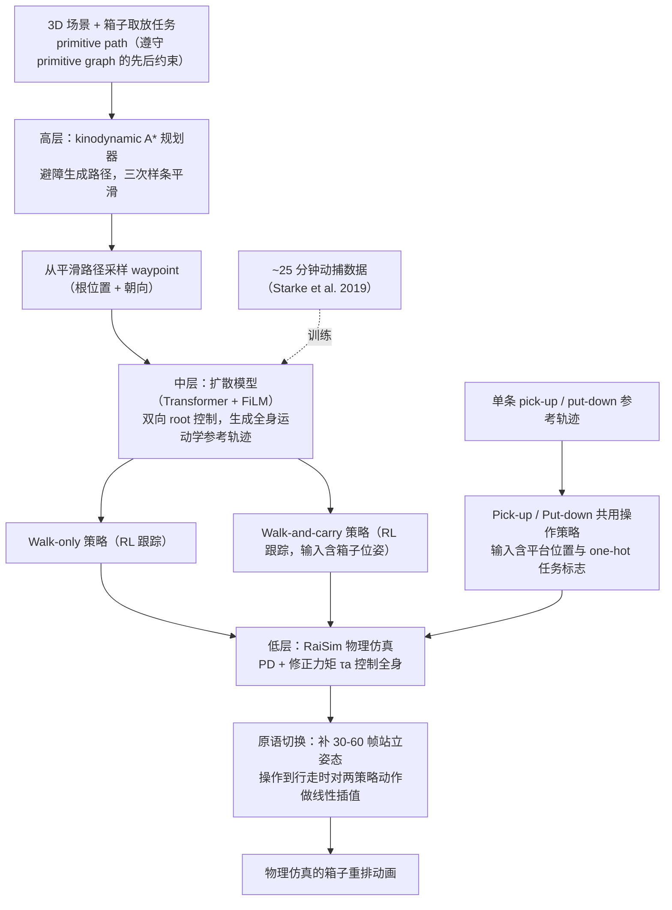

# Hierarchical Planning and Control for Box Loco-Manipulation

**Hierarchical Planning and Control for Box Loco-Manipulation** 已列入 [Robot Learning Paper Notebooks](https://imchong.github.io/Robot_Learning_Paper_Notebooks/index.html) 的 **PROGRESS.md 待深读** 清单（分类：13_Physics-Based_Animation）。本页 **还没有深读笔记**：只给出这篇论文的分类位置与原文入口，方法细节与数据请直接看原文。

## 一句话定义

Hierarchical Planning and Control for Box Loco-Manipulation 的人形机器人学习论文条目，当前处于 Paper Notebooks 阅读进度（待深读）阶段。

## 英文缩写速查

| 缩写 | 英文全称 | 简要说明 |
|------|----------|----------|
| RL | Reinforcement Learning | 通过与环境交互最大化长期回报来学习策略 |
| WBC | Whole-Body Control | 协调全身关节满足多任务/约束的控制基础设施 |
| Sim2Real | Simulation to Real | 把仿真中学到的策略迁移落地真机的工程主线 |

## 为什么重要

- 这篇已排进 Paper Notebooks 的待读清单，可以从 [机器人学习论文笔记总索引](../overview/humanoid-paper-notebooks-index.md) 与分类页找到同一批工作。
- 在笔记写出来之前，这里只保留分类位置与原文入口，不给方法结论；系统分层流程见下方「流程总览」。

## 流程总览

图依据：论文 §3 / Fig.2、§4–§6（运动原语、扩散模型、RL 策略、过渡与规划器）

## 核心信息

| 字段 | 内容 |
|------|------|
| 分类 | 13_Physics-Based_Animation |
| 深读状态 | 待撰写（[PROGRESS.md](https://github.com/ImChong/Robot_Learning_Paper_Notebooks/blob/main/papers/PROGRESS.md)） |
| 计划文件夹 | `papers/13_Physics-Based_Animation/hierarchical-planning-and-control-for-box-loco-m` |
| arXiv | <https://arxiv.org/abs/2306.09532> |

## 实验与评测

- 深读笔记尚未完成；量化 benchmark、消融与实机指标待笔记撰写后补充。

## 结论

**本条目被本库归到「物理动画」而不是控制或 loco-manipulation 分类，这本身就是理解它取向的最强线索；页面目前仍是待读。**

- 分类落在 **13_Physics-Based_Animation**，提示应把它与偏真机落地的 loco-manipulation 条目区分开来读。
- 页面无核心机制与实验区块：分层结构如何切分规划与控制、箱体搬运如何评测，都待笔记补齐。
- 现阶段用途限于待读条目，以及从分类页与总索引做交叉检索。

## 与其他页面的关系

- 分类页：[paper-notebook-category-13-physics-based-animation](../overview/paper-notebook-category-13-physics-based-animation.md)
- 总索引：[humanoid-paper-notebooks-index.md](../overview/humanoid-paper-notebooks-index.md)

## 参考来源

- [humanoid_pnb_hierarchical-planning-and-control-for-box-loco-m.md](../../sources/papers/humanoid_pnb_hierarchical-planning-and-control-for-box-loco-m.md)
- [Robot Learning Paper Notebooks · PROGRESS.md](https://github.com/ImChong/Robot_Learning_Paper_Notebooks/blob/main/papers/PROGRESS.md)
- 论文：<https://arxiv.org/abs/2306.09532>
- [arXiv PDF](https://arxiv.org/pdf/2306.09532)：已通读方法部分（实验与附录以略读为准）：摘要、§1、§3 系统概览、§4 行走、§5 操作、§6 规划器、§7 开头

## 推荐继续阅读

- [Paper Notebooks 阅读进度（PROGRESS.md）](https://github.com/ImChong/Robot_Learning_Paper_Notebooks/blob/main/papers/PROGRESS.md)
