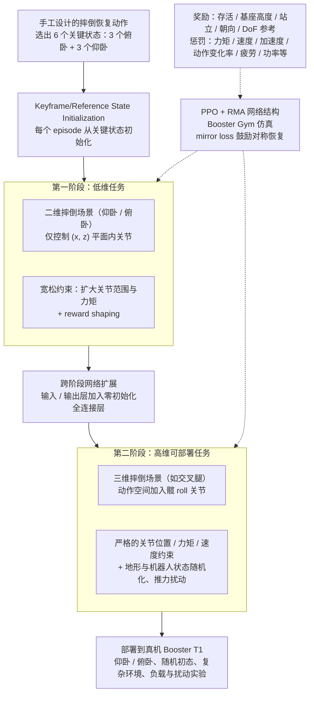

# HiFAR

**HiFAR: Multi-Stage Curriculum Learning for High-Dynamics Humanoid Fall Recovery** 已列入 [Robot Learning Paper Notebooks](https://imchong.github.io/Robot_Learning_Paper_Notebooks/index.html) 的 **progress 待深读** 清单（分类：04_Loco-Manipulation_and_WBC）。本页 **还没有深读笔记**：只给出这篇论文的分类位置与原文入口，方法细节与数据请直接看原文。

## 一句话定义

HiFAR 的人形机器人学习论文条目，当前处于 Paper Notebooks 阅读进度（待深读）阶段。

## 英文缩写速查

| 缩写 | 英文全称 | 简要说明 |
|------|----------|----------|
| RL | Reinforcement Learning | 通过与环境交互最大化长期回报来学习策略 |
| WBC | Whole-Body Control | 协调全身关节满足多任务/约束的控制基础设施 |
| Sim2Real | Simulation to Real | 把仿真中学到的策略迁移落地真机的工程主线 |

## 为什么重要

- 这篇已排进 Paper Notebooks 的待读清单，可以从 [机器人学习论文笔记总索引](../overview/humanoid-paper-notebooks-index.md) 与分类页找到同一批工作。
- 在深读笔记写出来之前，这里只保留分类位置与原文入口，不给方法结论；论文方法部分的模块与数据流见下方「流程总览」。

## 流程总览

图依据：论文 §III-A Framework and Curriculum Setup / Fig.1、§III-B Training Setup、§III-C Reference State Initialization、§III-D Reward Design、§V 真机实验设置。

## 核心信息

| 字段 | 内容 |
|------|------|
| 分类 | 04_Loco-Manipulation_and_WBC |
| 深读状态 | 待撰写（[progress.json](https://github.com/ImChong/Robot_Learning_Paper_Notebooks/blob/main/progress.json)） |
| 计划文件夹 | `papers/04_Loco-Manipulation_and_WBC/HiFAR__Multi-Stage_Curriculum_Learning_for_High-Dynamics_Humanoid_Fall_Recovery` |

## 实验与评测

- 深读笔记尚未完成；量化 benchmark、消融与实机指标待笔记撰写后补充。

## 结论

**本页当前是待读条目而非论文归纳：它只登记了 HiFAR 这条「高动态摔倒恢复」条目这一条，实质结论要等读完笔记。**

- 页面现状：status 为 planned，正文只有分类归属与 progress.json 待深读状态，没有可供提炼的机制、指标或实验内容。
- 从标题能读出的定位仅限于「多阶段课程学习 + 人形高动态摔倒恢复」，归入 04_Loco-Manipulation_and_WBC；课程分阶段方式见「流程总览」（依据论文方法部分），真机表现本页无依据。
- 使用方式：把本页当检索入口——分类页 [paper-notebook-category-04-loco-manipulation-and-wbc](../overview/paper-notebook-category-04-loco-manipulation-and-wbc.md) 与 [机器人学习论文笔记总索引](../overview/humanoid-paper-notebooks-index.md)；要读实质内容请直接走原文。

## 与其他页面的关系

- 分类页：[paper-notebook-category-04-loco-manipulation-and-wbc](../overview/paper-notebook-category-04-loco-manipulation-and-wbc.md)
- 总索引：[humanoid-paper-notebooks-index.md](../overview/humanoid-paper-notebooks-index.md)

## 参考来源

- [humanoid_pnb_hifar.md](../../sources/papers/humanoid_pnb_hifar.md)
- [Robot Learning Paper Notebooks · progress.json](https://github.com/ImChong/Robot_Learning_Paper_Notebooks/blob/main/progress.json)
- [arXiv PDF](https://arxiv.org/pdf/2502.20061)：已通读方法部分（实验与附录以略读为准）：§III Methods（A–E）、§V-A/B 硬件与实验设置

## 推荐继续阅读

- [Paper Notebooks 阅读进度（PROGRESS.md）](https://github.com/ImChong/Robot_Learning_Paper_Notebooks/blob/main/papers/PROGRESS.md)
