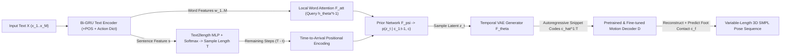

# Generating Diverse and Natural 3D Human Motions from Textual Descriptions

**Generating Diverse and Natural 3D Human Motions from Textual Descriptions** 收录于 [Robot Learning Paper Notebooks](https://imchong.github.io/Robot_Learning_Paper_Notebooks/index.html)（分类：14_Human_Motion）。本页为 **清单索引实体**，链向深读笔记与原始论文；详细机制待从笔记消化后补充。

## 一句话定义

HumanML3D 是目前最主流的 3D 人体运动 - 文本数据集之一，提供了近 1.5 万个动作剪辑和 4.5 万条对应的自然语言描述，是研究文本生成动作（Text-to-Motion）的基石。

## 英文缩写速查

| 缩写 | 英文全称 | 简要说明 |
|------|----------|----------|
| RL | Reinforcement Learning | 通过与环境交互最大化长期回报来学习策略 |
| WBC | Whole-Body Control | 协调全身关节满足多任务/约束的控制基础设施 |
| Sim2Real | Simulation to Real | 把仿真中学到的策略迁移落地真机的工程主线 |
| T2M | Text-to-Motion | 文本条件人体运动生成 |
| VAE | Variational Autoencoder | 变分自编码器，用于学习潜变量分布并随机生成动作 |
| SMPL | Skinned Multi-Person Linear Model | 参数化 3D 人体网格模型（HumanML3D 采用其 22 关节骨架） |
| FID | Fréchet Inception Distance | 生成分布与真实分布距离（越低越好） |

## 为什么重要

- 列入 Paper Notebooks 策展清单，便于与全库 [机器人学习论文笔记总索引](../overview/humanoid-paper-notebooks-index.md) 及分类父节点交叉检索。
- 构建了当时规模最大的 3D 动作–文本配对基准 **HumanML3D**（14,616 段动作、44,970 条文本、28.59 小时），解决了 KIT-ML 规模偏小（3,911 段动作）与偏向移动（locomotion）的瓶颈。
- 提出了首个支持**可变长度**与**随机一对多映射**的 Text2length + Temporal VAE 框架，验证了局部时序表征（Motion Snippet Codes）对长程语义对齐的关键作用。
- 后续工作如 [MoLingo](./paper-molingo.md) 仍以 HumanML3D 为训评锚点，并扩展 MARDM-67 / MS-272 / TMR-263 等多协议对照。

## 核心信息

| 字段 | 内容 |
|------|------|
| 分类 | 14_Human_Motion |
| 作者 / 机构 | Chuan Guo 等（University of Alberta） |
| 数据集规模 | 14,616 动作剪辑 · 44,970 文本描述 · 28.59 小时 · 词汇量 5,371 |
| 骨架与帧率 | SMPL 22 关节 · 20 FPS · 时长 2–10 秒（均长 7.1 秒） |
| 划分比例 | Train : Test : Val = 0.8 : 0.15 : 0.05（含左右镜像数据增强） |
| 深读笔记 | <https://imchong.github.io/Robot_Learning_Paper_Notebooks/papers/14_Human_Motion/HumanML3D/HumanML3D.html> |
| 论文 | <https://openaccess.thecvf.com/content/CVPR2022/papers/Guo_Generating_Diverse_and_Natural_3D_Human_Motions_From_Text_CVPR_2022_paper.pdf> |

## 核心机制（归纳）

> 注：以下机制与评测指标基于通读 CVPR 2022 原文全文核对补充（[CVPR 2022 PDF](https://openaccess.thecvf.com/content/CVPR2022/papers/Guo_Generating_Diverse_and_Natural_3D_Human_Motions_From_Text_CVPR_2022_paper.pdf)）。

1. **HumanML3D 数据集标准化与 263 维姿态表征（§4–§5）**：
   - 合并公开动捕库 **HumanAct12** 与 **AMASS**，覆盖日常动作、体育、杂技与舞蹈；所有动作统一重采样至 **20 FPS**（超过 10 秒随机裁剪至 10 秒）、重定向到默认 **SMPL 22 关节**骨架并旋转至初始朝向 **Z+ 方向**。
   - 通过 AMT 众包（通过率 >92% 母语标注员）为每段动作撰写 **3 条**不少于 5 词的描述并人工清洗；训练与评测时通过动作左右镜像及对应文本关键词替换（`left` ↔ `right`）扩增数据。
   - 每帧姿态定义为 $p = (\dot{r}_a, \dot{r}_x, \dot{r}_z, r_y, j^p, j^v, j^r, c^f)$：包含 Y 轴根角速度、XZ 平面根线速度、根高度、根局部空间关节位置/速度/6D 连续旋转，以及基于脚跟和脚尖速度阈值提取的 **4 维足部接触二值标签** $c^f \in \mathbb{R}^4$，用于抑制足底滑步。
2. **Motion Autoencoder 与 Motion Snippet Codes（§3.1）**：
   - 预处理阶段训练两层 1D 时序卷积自编码器（卷积核 4、步长 2），将 $T'$ 帧姿态序列压缩为长度 $T = T'/4$ 的 **Motion Snippet Codes** $C_s = (c_s^1, \dots, c_s^T)$；每个 snippet code 覆盖 **8 帧**感受野（20 FPS 下约 0.5 秒），捕获局部时序动作语义。
   - 反卷积解码器 $D$ 在重建姿态的同时额外预测足部接触标签 $c^f$，训练目标结合 $L_1$ 重建损失与编码 $L_1$ 稀疏性、相邻帧平滑性正则。
3. **两阶段随机生成：Text2length 采样 + Temporal VAE（§3.2–3.3）**：
   - **Text Encoder**：词嵌入融合 **POS（词性）标签**与四类手工动作词典特征（direction / body part / object / action），经双向 GRU 输出词级特征 $w_{1:M}$ 与句级特征 $s$。
   - **Text2length Sampling**：句级特征经 MLP + Softmax 预测离散片段长度 $T \in \{1, \dots, T_{\max}\}$ 的多项分布（$T_{\max}=50$，对应最长 200 帧 / 10 秒），以交叉熵训练并在推理时采样，打破既有确定性方法固定长度的限制。
   - **Text2motion Temporal VAE**：由先验网络 $F_\psi$、后验网络 $F_\phi$ 与生成器 $F_\theta$ 构成。每步利用 $h_\theta^{t-1}$ 对 $w_{1:M}$ 做**局部词注意力（$F_{att}$）**，并加入剩余步数 $(T-t)$ 的 **Time-to-Arrival 位置编码**。后验/先验均为学习到的高斯分布（先验 $p_\psi(z_t | c_s^{1:t-1}, c)$ 不依赖标准正态 $\mathcal{N}(0,I)$）；训练结合**课程学习**（从短长度 $T_{cur}$ 逐步增至 $T_{\max}$）与 **Scheduled Sampling**，总损失 $\mathcal{L} = \mathcal{L}_{rec}^{code} + \lambda_{mot}\mathcal{L}_{rec}^{mot} + \lambda_{KL}\mathcal{L}_{KL}$。

### 方法流程图

## 实验与评测

- **评测协议（§5.1）**：使用对比学习训练的运动/文本特征提取器评测 5 项指标（20 次重复取 95% 置信区间）；R-Precision 为 1 条真值文本与 31 条随机负例（共 32 候选）的欧氏距离检索准确率。
- **HumanML3D 测试集定量对比（Table 2）**：
  - `Real motions`（上限参考）：R-Precision Top-1 / Top-2 / Top-3 = **0.511±.003 / 0.703±.003 / 0.797±.002**，FID **0.002±.000**，MultiModal Dist **2.974±.008**，Diversity **9.503±.065**。
  - 最优基线 `Language2Pose`：Top-1 / Top-3 = 0.246 / 0.486，FID **11.02±.046**，MM Dist **5.296±.008**，Diversity **7.676±.058**；`Text2Gesture`：Top-1 0.165 / FID **7.664±.030**；`Seq2Seq`：Top-1 0.180 / FID **11.75±.035**。
  - `Ours w/ real length`：Top-1 / Top-2 / Top-3 = **0.457±.002 / 0.639±.003 / 0.740±.003**，FID **1.067±.002**，MM Dist **3.340±.008**，Diversity **9.188±.002**，MultiModality **2.090±.083**。
  - `Ours`（使用 Text2length 采样长度）：Top-1 / Top-2 / Top-3 = **0.455±.003 / 0.636±.003 / 0.736±.002**，FID **1.087±.021**，MM Dist **3.347±.008**，Diversity **9.175±.083**，MultiModality **2.219±.074**。
- **KIT-ML 测试集定量对比（Table 3）**：
  - `Real motions`：Top-1 **0.424±.005**，FID **0.031±.004**，Diversity **11.08±.097**。
  - `Ours w/ real length`：Top-1 **0.370±.005**，FID **2.770±.109**，Diversity **10.91±.119**（对比 `Language2Pose` Top-1 0.221 / FID 6.545）。
  - `Ours`：Top-1 **0.361±.006**，FID **3.022±.107**，Diversity **10.72±.145**，MultiModality **2.052±.107**。
- **核心消融（HumanML3D，Table 4）**：
  - 完整 `Ours`：Top-1 **0.455** / FID **1.087**。
  - 去掉 Motion Snippet Codes（`w/o SnC`）：Top-1 大幅跌至 **0.370**（FID 1.200）；去掉局部词注意力（`w/o Att`）：Top-1 跌至 **0.396**、FID 恶化至 **1.833**；去掉 POS 标签（`w/o PoS`）与位置编码（`w/o PoE`）影响相对温和（Top-1 分别为 **0.443** / **0.444**，FID **1.157** / **1.229**）。
- **主观用户评测（Fig. 5）**：50 条测试文本 × 5 位 AMT 评分者排序中，约 **72%** 的 `Ours` 生成动作被评为前二（与真实动作并列或仅次于真实动作）。

## 常见误区或局限

1. **评测协议不可跨特征提取器混比**：R-Precision 与 FID 依赖论文配套训练的对比检索模型；后续工作若切换为 MARDM-67、MS-272 或 TMR-263 等不同特征空间，数值不能直接并列比较。
2. **序列长度上限与运动范围限制**：数据重采样为 20 FPS 且单条上限裁剪为 **10 秒（200 帧）**，且源于 HumanAct12 / AMASS 的 22 关节全身骨架重定向，不包含手部灵巧操作或物理环境接触约束。
3. **部分失败案例未在正文展开**：正文第 5.1.4 节将 Text2length 分布细节、失败样例与局限性分析置于补充材料中，引用时需留意正文与附录边界。

## 结论

**HumanML3D 通过 14,616 段动作与 44,970 条自然语言描述奠定了 Text-to-Motion 的数据基座，并证明「Text2length 采样 + 基于 Motion Snippet Codes 的 Temporal VAE」可在可变长度与随机生成设定下显著超越确定性基线。**

- **数据集价值大于单篇基线**：28.59 小时、5,371 词的多样化配对数据加上 263 维姿态表征（含足部接触标签）成为后续 T2M 与人形运动预训练（如 [MoLingo](./paper-molingo.md)）的通用基座。
- **局部时序码与注意力最关键**：消融实验显示去掉 `SnC`（Top-1 0.455 → 0.370）和 `Att`（FID 1.087 → 1.833）惩罚最大，说明局部时序上下文与步级词对齐是避免动作中途“僵直或跑题”的核心。
- **跨论文对标前先锁协议**：引用 HumanML3D 基准数字时务必核对骨架维度（263 维 vs 其他衍生表征）与检索特征提取器版本。
- **文档定位**：本页保留 `stub` 状态并已依据 CVPR 2022 原文全文补齐核心机制、量化结果与流程图；更多细节可结合深读笔记扩展。

## 与其他页面的关系

- 分类父节点：[paper-notebook-category-14-human-motion](../overview/paper-notebook-category-14-human-motion.md)
- 总索引：[humanoid-paper-notebooks-index.md](../overview/humanoid-paper-notebooks-index.md)
- 近期 HumanML3D SOTA 方法例：[MoLingo](./paper-molingo.md)
- T2M 文献索引：[Awesome Text-to-Motion（Zilize）](./awesome-text-to-motion-zilize.md)

## 参考来源

- [humanoid_pnb_humanml3d.md](../../sources/papers/humanoid_pnb_humanml3d.md)
- 深读笔记：<https://imchong.github.io/Robot_Learning_Paper_Notebooks/papers/14_Human_Motion/HumanML3D/HumanML3D.html>
- 论文（CVPR 2022，无 arXiv 版）：<https://openaccess.thecvf.com/content/CVPR2022/papers/Guo_Generating_Diverse_and_Natural_3D_Human_Motions_From_Text_CVPR_2022_paper.pdf>
- 核对（2026-11-02）：原编号 2204.09419 对应《A Mid-infrared Study of Superluminous Supernovae》，该论文无 arXiv 版（作者项目页仅列 CVPR 2022 开放获取 PDF），已去掉 arxiv 字段、改引 CVPR 官方 PDF（依据：项目页 https://ericguo5513.github.io/text-to-motion/；arXiv API 标题/作者/日期：2204.09419 为 Sun, Xiao, Li 的天文论文）

## 推荐继续阅读

- [机器人论文阅读笔记：Generating Diverse and Natural 3D Human Motions from Textual Descriptions](https://imchong.github.io/Robot_Learning_Paper_Notebooks/papers/14_Human_Motion/HumanML3D/HumanML3D.html)
- [MoLingo（CVPR 2026）](./paper-molingo.md) — 在 HumanML3D 协议上的语义对齐连续 latent T2M
- [Awesome Text-to-Motion](./awesome-text-to-motion-zilize.md)
