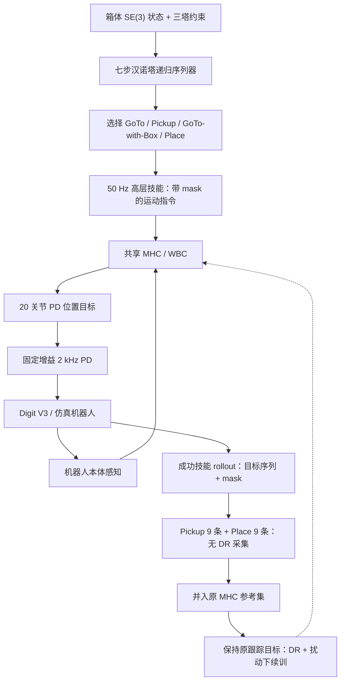
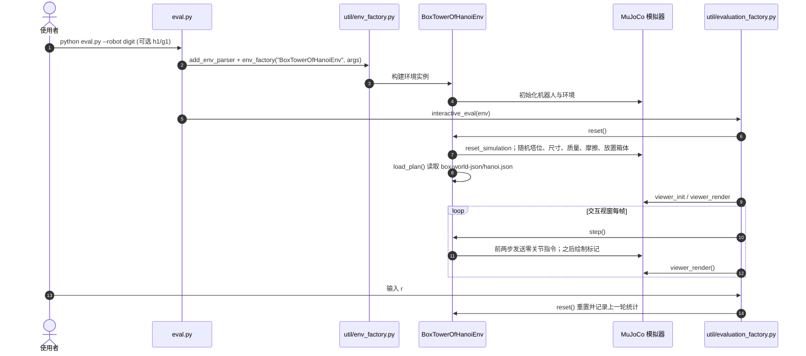

# Humanoid Hanoi：共享全身控制器与长时程人形搬箱重排（Investigating Shared Whole-Body Control for Skill-Based Box Rearrangement）

**论文：** [arXiv:2602.13850v4（2026-10-11）](https://arxiv.org/html/2602.13850) · **会议：** CoRL 2026 · **项目：** [官方主页](https://osudrl.github.io/Humanoid_Hanoi/) · **代码：** [osudrl/Humanoid_Hanoi](https://github.com/osudrl/Humanoid_Hanoi)（仅基准环境）。  
**作者：** Minku Kim、Kuan-Chia Chen（共同一作）、Aayam Shrestha、Li Fuxin、Stefan Lee、Alan Fern。**机构：** 俄勒冈州立大学（Oregon State University）。

## 一句话定义

**Humanoid Hanoi 用三箱汉诺塔式七步重排，检验“独立高层技能 → 单一共享全身控制器”在长时程闭环中的可靠性。** 核心发现不是共享控制器天然万能，而是持续扩充它对新技能产生的状态、掩码指令分布的覆盖，可以减少技能衔接造成的额外失效（论文 §1、§5–7）。

## 英文缩写速查

| 缩写 | 英文全称 | 简要说明 |
|---|---|---|
| WBC | Whole-Body Controller | 多个技能共用的全身执行层 |
| MHC | Masked Humanoid Controller | 使用目标运动及二值 mask 的预训练 WBC |
| PD | Proportional-Derivative | 固定增益关节目标跟踪器 |
| DR | Dynamics Randomization | 随机化动力学及扰动以测试鲁棒性 |
| PPO | Proximal Policy Optimization | 高层技能的强化学习训练算法 |
| PDDL | Planning Domain Definition Language | 已实现接口但未独立评估规划能力 |
| SE(3) | Special Euclidean Group in 3D | 箱体三维位姿的表达 |

## 为什么重要

- **长程可靠性不是单技能成功率的简单延伸。** 七次搬运、每次四技能，任何一次抓取、定位、放置的偏差都会成为下一次的初始条件。
- **同一个底层 WBC 可避免控制律切换。** 论文对比任务特定 Finetune、Residual、Joint；即使单技能指标提升，低层策略交接时的 PD 目标跳变仍可能扰动手中箱体（§6.4）。
- **维护已有技能基座比另训专用控制器更稳健。** Extended 只扩展预训练 MHC 的参考指令分布，延续原跟踪目标与控制接口（§5、附录 A.2）。

## 核心原理

1. **挑战任务：** 三个尺寸有序的箱体在三个塔位之间转移，遵循每次仅移动一箱、不得把大箱叠在小箱上的规则。一次完整执行为 **7 moves ×（GoTo → Pickup → GoTo-with-Box → Place）**，仿真每种方法 100 个相同随机实例；无障碍物避障要求（§3、§6.3）。
2. **两层策略：** 上层四个单独训练的 50 Hz LSTM 技能输出局部目标及 masked motion directives；下层预训练 **MHC** 结合本体状态输出 20 个关节 PD 目标，固定增益 PD 以 2 kHz 跟踪（§4、附录 A/B）。GoTo/带箱 GoTo 分别输出 3/8 维指令；Pickup/Place 为 10 维，**这些不是最终关节目标维数**。
3. **Reference coverage expansion：** 收集 **Pickup 和 Place 各 9 条成功指令序列**，收集时 **不做动力学随机化**；把记录的目标与掩码并入原有 AMASS/轨迹优化参考集，训练更新后的单一 WBC 时再施加原有 DR 与扰动，且沿用原跟踪目标、网络架构（§5、附录 A.2）。不等同于“在 DR 环境下收集 18 条 rollout”，也不是新 DAgger 算法。
4. **公平对照：** Base（冻结共享 WBC）；Finetune（每技能微调 WBC）；Residual（各技能低层残差）；Extended（共享 WBC 参考分布扩展）；Joint（同时学技能与输出关节 PD 的低层，改变接口）。除 Joint 外，仿真评测保持高层技能固定（§6.1）。
5. **交接机制验证：** 对非共享控制器的交接输出施加 10-step 线性插值、其余参数不变，三种非共享方法整任务成功率均提高，说明 controller handoff transient 是损失成因之一，但并非全部（§6.4）。

## 流程总览

**注意两种循环：** 上半部是论文描述的控制闭环；下半部是离线 WBC 更新，不表示运行时每步在线训练（§4–5、附录 A.2）。

## 源码运行时序图

官方 GitHub 实际放出的是 **MuJoCo 环境评估/交互入口，而非论文的训练栈或四技能策略 checkpoint**。下图严格对应已公开的 `eval.py`、`util/env_factory.py`、`util/evaluation_factory.py` 和 `env/tasks/boxtowerofhanoienv/boxtowerofhanoienv.py`：

**复现边界：** `eval.py` 展示环境交互和基准状态；当前公开 `Env.step()` 不负责调用论文训练出的四个技能策略，不能把打开视窗视为复现了 47% 的整任务成绩。可选 `--robot digit|g1|h1` 与 `--offscreen`；训练代码未公开（[源码归档](../../sources/repos/humanoid-hanoi.md)）。

## 工程实践

| 环节 | 可用操作与核对依据 |
|---|---|
| 环境安装 | 官方 `bash setup.bash`：Conda 环境，另安装 MuJoCo 2.1.0；注意依赖版本和显卡/驱动兼容 |
| 基准入口 | `python eval.py --robot digit`（也支持 `g1`、`h1`），`r` 复位；并非训练/论文策略推理 |
| 任务生成 | `BoxTowerOfHanoiEnv.reset` 随机塔位与箱体参数；`load_plan()` 从 `box-world-json/hanoi.json` 读预设动作计划 |
| 论文控制 | 四种技能 50 Hz、20 关节 PD 目标、底层 PD 2 kHz；**属于论文描述，非公开仓库可运行训练链** |
| 硬件感知 | Digit V3 顶部两台 D455，AprilTag 估计箱体/塔位，本体 IMU 里程计在 marker 缺失时补充；NUC 经 UDP 发 PD 目标 |
| 验收指标 | 长程整任务成功率、每次技能失败/过渡次数、箱体最终位姿误差、姿态/接触扰动，优先区分仿真 DR 与实机 |

## 实验与评测

**论文 §6.3–6.4 / Fig. 4，仿真有动力学随机化：**

| 方法 | 七步完整任务成功率 | 单技能乘积估算 |
|---|---:|---:|
| Base（冻结共享） | 24% | 21.45% |
| Finetune（非共享） | 21% | 37.13% |
| Residual（非共享） | 19% | 30.87% |
| Joint（无共享 WBC 接口） | 16% | 29.56% |
| **Extended（扩展共享）** | **47%** | **48.44%** |

- **单技能（表 1）：** Extended 的 Pickup / Place 在 DR 全高度分布中为 **96.92% / 93.03%**；Base 为 89.43% / 89.75%。低箱高度小于 0.2 m 时，Extended Pickup 95.03%、Place 91.50%。
- **交接平滑对照：** Finetune **21→32%**、Residual **19→32%**、Joint **16→38%**；只更改非共享控制器过渡的 10 步插值（§6.4）。
- **真机（§7，附录 E）：** Digit V3 三配置各 5 轮，Extended **3/5、2/5、1/5，合计 6/15=40%**；其他基线 0/15。成功的七次搬运约需 **5 分钟**。精简两塔布局连续完成 5 次三箱堆叠，但不是完整三塔基准。
- **评测解释：** 附录 C.3 比较相同成功子集的箱体误差后，未发现 Extended 在位置/偏航精度上始终占优；主要收益是**长程完成可靠性**，非单次堆放精度必然最高。

## 局限与风险

1. **论文结果不是仓库可直接复现的运行成绩。** 公开仓库明确称仅提供环境、不含训练代码；目前没有公开的 MHC 更新训练、技能策略权重或论文完整评估脚本。
2. **感知边界。** 仿真使用状态式策略与真值箱体状态，不是视觉端到端学习；真机 AprilTag/IMU 的标记丢失、偏航定位误差属于额外瓶颈（§8、附录 E）。
3. **长程失败仍集中于 Place。** 箱体俯仰、放置后迈步碰箱、抓取偏心误差与交接位姿偏差会累计；GoTo 不感知物体，回退旋转也可能碰到已堆放的塔（附录 C.4）。
4. **比较范围有限。** 本文比较的是所设定的几种非共享适配方法，不能外推为任何切换控制器的系统都不适合长程操作。当前基准不覆盖障碍物、遮挡与精细视觉对准。

## 结论

**在这套人形七步搬箱任务里，共享 WBC 的价值是保证低层控制连续性；当新技能超出预训练覆盖时，维持原目标的数据聚合能明显提升长程可靠性。**

1. 先报告**完整任务存活曲线**，不要只用 Pickup/Place 单技能成功率推断长程表现。
2. 在策略切换前后记录 PD 目标、关节响应、箱体俯仰和质心姿态，专门诊断控制器 handoff。
3. 扩展 WBC 时记录技能发出的 **directive + mask**，验证分布扩展能否在 DR 下保持原跟踪能力。
4. 做 Sim2Real 时单独测 AprilTag 掉帧、IMU 漂移、抓取定位和 Place 后的回退避碰。
5. 开源复现应从环境构造开始，训练基线与真实控制器结果仍需自己实现，不能假设 README 包含完整模型。

## 关联页面

- [移动操作任务谱系](../tasks/loco-manipulation.md) / [全身控制](../concepts/whole-body-control.md)
- [纵深路线：移动操作 Stage 1](../../roadmap/depth-loco-manipulation.md) — 共享底层与控制器交接
- [论文笔记分类 04](../overview/paper-notebook-category-04-loco-manipulation-and-wbc.md) / [人形论文总索引](../overview/humanoid-paper-notebooks-index.md)

## 参考来源

- [论文全文 v4（§1–8 + Appendix A–E）归档](../../sources/papers/humanoid_pnb_humanoid-hanoi.md)
- [官方项目主页与开源状态](../../sources/sites/humanoid-hanoi.md)
- [官方 MuJoCo 环境源码与真实运行入口](../../sources/repos/humanoid-hanoi.md)
- [原有完整深读笔记](https://imchong.github.io/Robot_Learning_Paper_Notebooks/papers/04_Loco-Manipulation_and_WBC/Humanoid_Hanoi__Investigating_Shared_Whole-Body_Control_for_Skill-Based_Box_Rearrangement/Humanoid_Hanoi__Investigating_Shared_Whole-Body_Control_for_Skill-Based_Box_Rearrangement.html)

## 推荐继续阅读

- [arXiv 论文 v4 HTML](https://arxiv.org/html/2602.13850)
- [官方项目页（Demo）](https://osudrl.github.io/Humanoid_Hanoi/)
- [开源环境（仅 benchmark，非训练代码）](https://github.com/osudrl/Humanoid_Hanoi)
