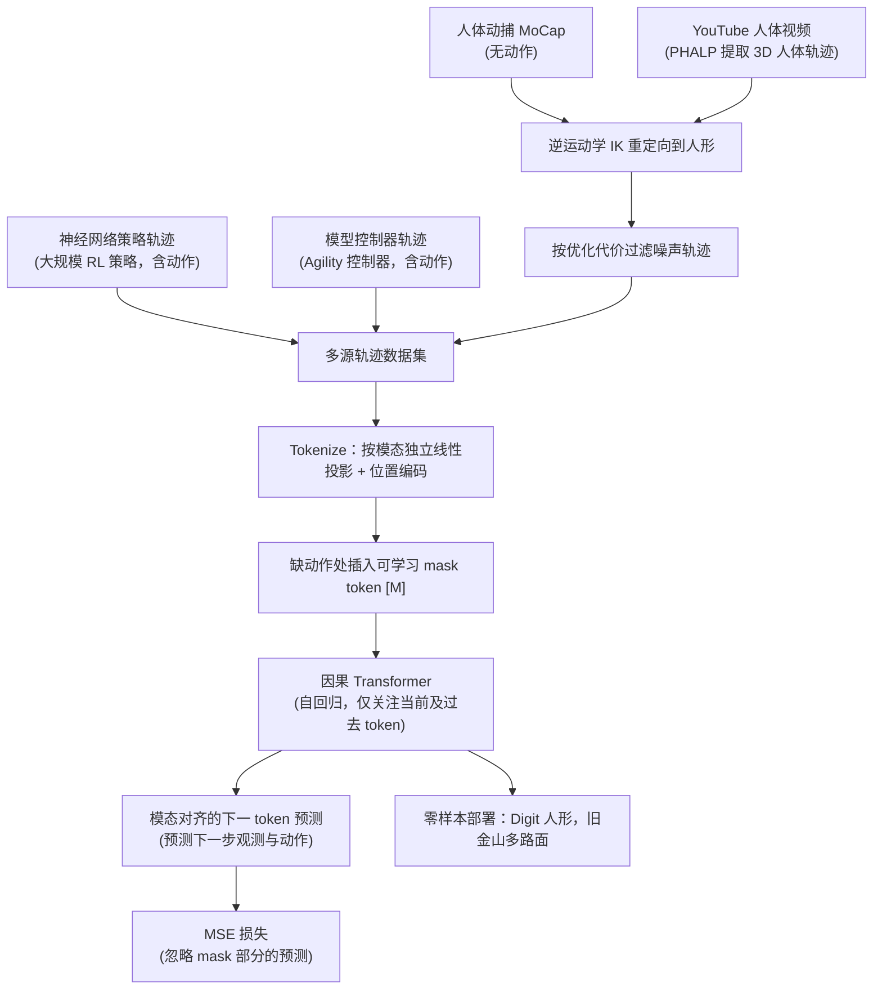

# Humanoid Locomotion as Next Token Prediction

**Humanoid Locomotion as Next Token Prediction** 收录于 [Robot Learning Paper Notebooks](https://imchong.github.io/Robot_Learning_Paper_Notebooks/index.html)（分类：03_High_Impact_Selection）。本页为 **清单索引实体**，链向深读笔记与原始论文；详细机制待从笔记消化后补充。

## 一句话定义

把真实人形 locomotion 写成「下一词预测」：用 因果 Transformer 对 传感–动作 token 序列 做自回归拟合，模态对齐 地预测下一 token；对缺动作的轨迹用 可学习 mask token 统一格式，从而吃进 RL 策略轨迹、MPC 观测、动捕与 YouTube 人体视频。仅用约 27 小时量级行走数据 训练即可 零样本 在旧金山多路面部署，并能泛化到如 后退行走 等训练外指令。

## 英文缩写速查

| 缩写 | 英文全称 | 简要说明 |
|------|----------|----------|
| RL | Reinforcement Learning | 通过与环境交互最大化长期回报来学习策略 |
| WBC | Whole-Body Control | 协调全身关节满足多任务/约束的控制基础设施 |
| Sim2Real | Simulation to Real | 把仿真中学到的策略迁移落地真机的工程主线 |

## 为什么重要

- 列入 Paper Notebooks 策展清单，便于与全库 [机器人学习论文笔记总索引](../overview/humanoid-paper-notebooks-index.md) 及分类父节点交叉检索。
- 深读笔记提供比摘要更贴近实现的阅读路径，适合作为后续 ingest 深化起点。

## 流程总览

图依据：论文 §3.1–3.5、§4 / Fig.2–4。

## 核心信息

| 字段 | 内容 |
|------|------|
| 分类 | 03_High_Impact_Selection |
| 深读笔记 | <https://imchong.github.io/Robot_Learning_Paper_Notebooks/papers/03_High_Impact_Selection/Humanoid_Locomotion_as_Next_Token_Prediction/Humanoid_Locomotion_as_Next_Token_Prediction.html> |
| arXiv | <https://arxiv.org/abs/2402.19469> |

## 实验与评测

- 本页为 **策展清单索引** 摘要；量化 benchmark、消融与实机指标以 **深读笔记与论文 PDF** 为准（链接见 [参考来源](#参考来源)）。

## 结论

**这篇工作的关键取舍是把 locomotion 当序列建模而不是控制问题：只要传感与动作能统一成 token 序列，异构、甚至缺动作标签的数据都能进同一条自回归训练管线。**

- 真正起作用的机制是 **模态对齐的下一 token 预测** 加 **可学习 mask token**：后者把缺动作的轨迹补成统一格式，于是 RL 策略轨迹、MPC 观测、动捕与 YouTube 人体视频可以混在一起训练。
- 最有说服力的证据是数据效率与泛化：约 27 小时量级行走数据即可零样本部署到旧金山多路面，并泛化到后退行走等训练外指令。
- 适用边界：本页为清单索引实体，机制描述停留在摘要层；量化 benchmark、消融与实机指标须以深读笔记与论文 PDF 为准（见[参考来源](#参考来源)）。
- 在本库的位置属于 03_High_Impact_Selection，可经[分类父节点](../overview/paper-notebook-category-03-high-impact-selection.md)与[机器人学习论文笔记总索引](../overview/humanoid-paper-notebooks-index.md)与同类工作交叉检索。

## 与其他页面的关系

- 分类父节点：[paper-notebook-category-03-high-impact-selection](../overview/paper-notebook-category-03-high-impact-selection.md)
- 总索引：[humanoid-paper-notebooks-index.md](../overview/humanoid-paper-notebooks-index.md)
- 跑酷向序列建模对照：[ParkourFormer](./paper-parkourformer.md) — RL 环内显式未来两步监督，而非只做下一 token 拟合

## 参考来源

- [humanoid_pnb_humanoid-locomotion-as-next-token-prediction.md](../../sources/papers/humanoid_pnb_humanoid-locomotion-as-next-token-prediction.md)
- 深读笔记：<https://imchong.github.io/Robot_Learning_Paper_Notebooks/papers/03_High_Impact_Selection/Humanoid_Locomotion_as_Next_Token_Prediction/Humanoid_Locomotion_as_Next_Token_Prediction.html>
- 论文：<https://arxiv.org/abs/2402.19469>
- [arXiv PDF](https://arxiv.org/pdf/2402.19469)：已通读方法部分（实验与附录以略读为准）：§1 引言、§3 方法（目标/缺失模态/对齐预测/联合训练/模型结构）、§4 数据集、§5.1 实验设定

## 推荐继续阅读

- [机器人论文阅读笔记：Humanoid Locomotion as Next Token Prediction](https://imchong.github.io/Robot_Learning_Paper_Notebooks/papers/03_High_Impact_Selection/Humanoid_Locomotion_as_Next_Token_Prediction/Humanoid_Locomotion_as_Next_Token_Prediction.html)
