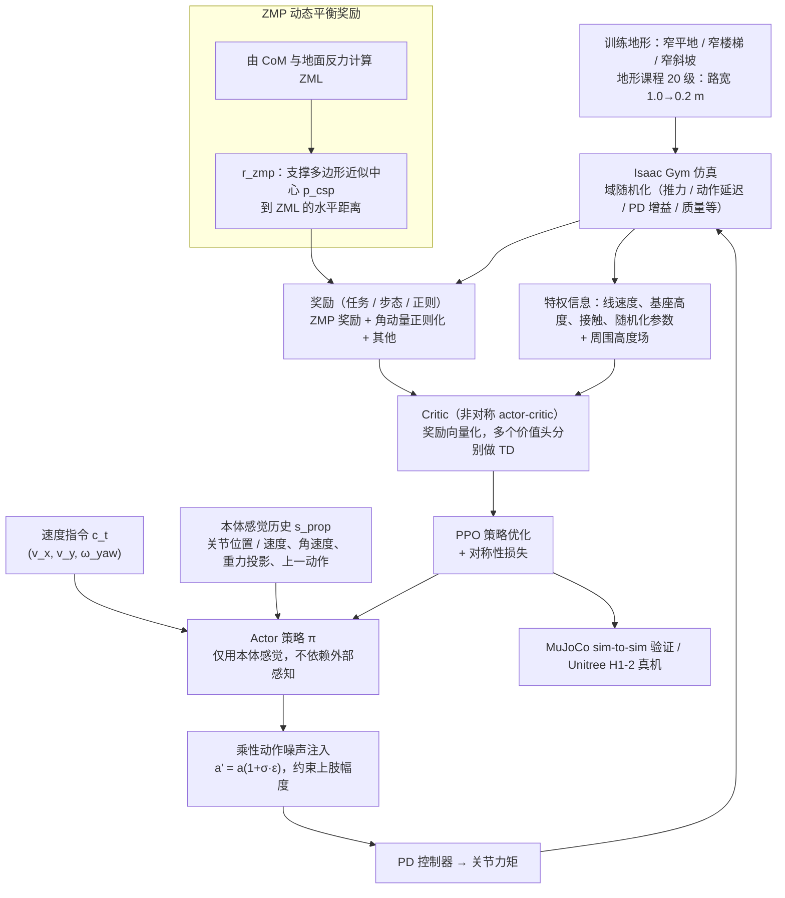

# Humanoid Whole-Body Locomotion on Narrow Terrain via Dynamic Balance and Reinforcement Learning

**Humanoid Whole-Body Locomotion on Narrow Terrain via Dynamic Balance and Reinforcement Learning** 已列入 [Robot Learning Paper Notebooks](https://imchong.github.io/Robot_Learning_Paper_Notebooks/index.html) 的 **PROGRESS.md 待深读** 清单（分类：05_Locomotion）。本页 **还没有深读笔记**：只给出这篇论文的分类位置与原文入口，方法细节与数据请直接看原文。

## 一句话定义

Humanoid Whole-Body Locomotion on Narrow Terrain via Dynamic Balance and Reinforcement Learning 的人形机器人学习论文条目，当前处于 Paper Notebooks 阅读进度（待深读）阶段。

## 英文缩写速查

| 缩写 | 英文全称 | 简要说明 |
|------|----------|----------|
| RL | Reinforcement Learning | 通过与环境交互最大化长期回报来学习策略 |
| WBC | Whole-Body Control | 协调全身关节满足多任务/约束的控制基础设施 |
| Sim2Real | Simulation to Real | 把仿真中学到的策略迁移落地真机的工程主线 |

## 为什么重要

- 这篇已排进 Paper Notebooks 的待读清单，可以从 [机器人学习论文笔记总索引](../overview/humanoid-paper-notebooks-index.md) 与分类页找到同一批工作。
- 在深读笔记写出来之前，这里只保留分类位置与原文入口，不给方法结论；论文方法部分的模块与数据流见下方「流程总览」。

## 流程总览

图依据：论文 §III Method（Fig.2 整体训练流程、§III-A ZMP-based Dynamic Balance、§III-B Whole-Body Locomotion、§III-C Policy Learning Details）与 §IV 实验设置。

## 核心信息

| 字段 | 内容 |
|------|------|
| 分类 | 05_Locomotion |
| 深读状态 | 待撰写（[PROGRESS.md](https://github.com/ImChong/Robot_Learning_Paper_Notebooks/blob/main/papers/PROGRESS.md)） |
| 计划文件夹 | `papers/05_Locomotion/humanoid-whole-body-locomotion-on-narrow-terrain` |
| arXiv | <https://arxiv.org/abs/2502.17219> |

## 实验与评测

- 深读笔记尚未完成；量化 benchmark、消融与实机指标待笔记撰写后补充。

## 结论

**本页当前是待读条目而非论文归纳：它只登记了这条「窄地形全身行走」条目这一条，实质结论要等读完笔记。**

- 页面现状：status 为 planned，正文只有分类归属与 PROGRESS.md 待深读状态，没有可供提炼的机制、指标或实验内容。
- 从标题能读出的定位仅限于「动态平衡 + 强化学习，用于人形在窄地形上的全身运动」，归入 05_Locomotion；平衡判据的定义见「流程总览」（依据论文方法部分），真机验证到什么程度本页无依据。
- 使用方式：把本页当检索入口——分类页 [paper-notebook-category-05-locomotion](../overview/paper-notebook-category-05-locomotion.md) 与 [机器人学习论文笔记总索引](../overview/humanoid-paper-notebooks-index.md)；要读实质内容请直接走 arXiv 原文。

## 与其他页面的关系

- 分类页：[paper-notebook-category-05-locomotion](../overview/paper-notebook-category-05-locomotion.md)
- 总索引：[humanoid-paper-notebooks-index.md](../overview/humanoid-paper-notebooks-index.md)

## 参考来源

- [humanoid_pnb_humanoid-whole-body-locomotion-on-narrow-terrain.md](../../sources/papers/humanoid_pnb_humanoid-whole-body-locomotion-on-narrow-terrain.md)
- [Robot Learning Paper Notebooks · PROGRESS.md](https://github.com/ImChong/Robot_Learning_Paper_Notebooks/blob/main/papers/PROGRESS.md)
- 论文：<https://arxiv.org/abs/2502.17219>
- [arXiv PDF](https://arxiv.org/pdf/2502.17219)：已通读方法部分（实验与附录以略读为准）：§III Method（A–C）、§IV 实验设置与 §IV-D 真机实验设置

## 推荐继续阅读

- [Paper Notebooks 阅读进度（PROGRESS.md）](https://github.com/ImChong/Robot_Learning_Paper_Notebooks/blob/main/papers/PROGRESS.md)
