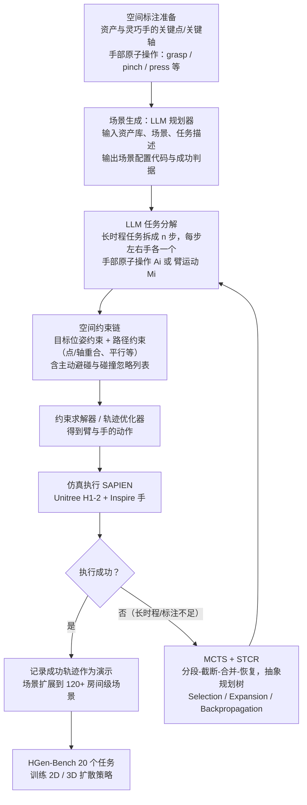

# HumanoidGen

**HumanoidGen: Data Generation for Bimanual Dexterous Manipulation via LLM Reasoning** 收录于 [Robot Learning Paper Notebooks](https://imchong.github.io/Robot_Learning_Paper_Notebooks/index.html)（分类：11_Simulation_Benchmark），深读笔记已完成。本页是 **笔记摘要**：要点编译自深读笔记，细节以笔记原文与论文 PDF 为准。

## 一句话定义

现有机器人数据集与仿真基准多面向机械臂平台；对装备双臂 + 灵巧手的人形，仿真任务与高质量演示明显匮乏。双手灵巧操作更复杂——需协调臂运动与手操作，自主采集难。HumanoidGen 是一个自动化任务创建与演示采集框架，利用原子灵巧操作与 LLM 推理生成关系约束。具体：基于原子操作为资产与灵巧手提供空间标注，再用 LLM 规划器依据物体可供性（affordance）与场景生成一串可执行的臂运动空间约束；并用蒙特卡洛树搜索（MCTS）变体增强 LLM 在长时程任务与标注不足下的推理。实验里新建一个含增强场景的基准评估数据质量，结果显示 2D 与 3D 扩散策略的性能可随生成数据规模提升。

## 英文缩写速查

| 缩写 | 含义 |
|---|---|
| Bimanual Dexterous | 双手灵巧（操作） |
| Atomic Operation | 原子操作，可复用的基本灵巧动作 |
| Affordance | 可供性，物体可被如何操作 |
| LLM Planner | 大模型规划器，生成空间约束链 |
| MCTS | 蒙特卡洛树搜索，增强长时程推理 |
| Diffusion Policy | 扩散策略（2D/3D） |

## 为什么重要

- **自动数据生成是双手灵巧操作的关键瓶颈解法**：自主采集难，LLM 规划 + 仿真生成是出路；
- **可供性 + 空间约束**把语义规划接到底层动作；
- **MCTS 补 LLM 长时程推理**是实用组合；
- 与 DexMimicGen、HumanoidGen 等数据生成工作共同壮大人形操作数据。

## 流程总览

图依据：论文 §2（Fig. 1、Fig. 3）、§2.1 至 §2.3

## 解决什么问题

人形**双手灵巧操作**缺数据： - 现有数据/基准多为**单臂**； - 双手灵巧需**协调臂 + 手**，**自主采集难**； - 缺高质量演示来训策略。

HumanoidGen 要：**自动**生成双手灵巧任务与高质量演示。

## 核心机制

1. **人形双手灵巧数据生成框架**：自动任务创建 + 演示采集；
2. **LLM 规划生成空间约束链**：依可供性/场景把双手协作显式化；
3. **MCTS 增强**：应对长时程与稀疏标注；
4. **数据有效性**：新基准上 2D/3D 扩散策略随数据规模提升。

方法拆解（深读笔记小节）：原子操作 + 空间标注；LLM 规划器生成空间约束链；MCTS 增强长时程推理；基准与结果；🧭 整体流程（mermaid）。

## 核心信息

| 字段 | 内容 |
|------|------|
| 分类 | 11_Simulation_Benchmark |
| 深读笔记 | <https://imchong.github.io/Robot_Learning_Paper_Notebooks/papers/11_Simulation_Benchmark/HumanoidGen__Data_Generation_for_Bimanual_Dexterous_Manipulation_via_LLM_Reasoning/HumanoidGen__Data_Generation_for_Bimanual_Dexterous_Manipulation_via_LLM_Reasoning.html> |
| arXiv | <https://arxiv.org/abs/2507.00833> |
| 作者 | Zhi Jing、Siyuan Yang、Jicong Ao、Ting Xiao、Yu-Gang Jiang、Chenjia Bai |
| 发表 | 2025 年 7 月 |
| 笔记阅读日期 | 2026-06-21 |

## 实验与评测

- 本页是深读笔记的摘要，没有搬运原文的量化结果；量化 benchmark、消融与实机指标以 **深读笔记与论文 PDF** 为准（链接见 [参考来源](#参考来源)）。

## 结论

**HumanoidGen 解决的不是「策略怎么学」，而是「双手灵巧的演示从哪来」：把 LLM 当空间约束的规划器，用原子操作把语义意图接到臂–手协调的可执行层，从而绕开自主采集难的瓶颈。**

- 真正起作用的是 **两级衔接**：原子操作为资产与灵巧手提供空间标注（下层可执行性），LLM 规划器依可供性与场景生成臂运动的空间约束链（上层语义）。
- **MCTS 变体是补丁而非主角**：它专门针对 LLM 在长时程任务与标注不足时的推理失稳，反过来说明纯 LLM 规划在这一设定下并不可靠。
- 有效性判据落在 **下游数据规模–性能曲线**：新建基准上 2D 与 3D 扩散策略的表现随生成数据规模提升，而不是生成轨迹本身好不好看。
- 适用边界是 **仿真内的任务创建与演示采集**；本页只支持「生成数据可训练策略」这一结论，不涉及真机迁移。
- 定位上与 DexMimicGen 等数据生成工作同属「壮大人形操作数据」这条线，本页只给定性定位，未做跨方法定量对照。

## 与其他页面的关系

- 分类父节点：[paper-notebook-category-11-simulation-benchmark](../overview/paper-notebook-category-11-simulation-benchmark.md)
- 总索引：[humanoid-paper-notebooks-index.md](../overview/humanoid-paper-notebooks-index.md)

## 参考来源

- [humanoid_pnb_humanoidgen.md](../../sources/papers/humanoid_pnb_humanoidgen.md)
- 深读笔记：<https://imchong.github.io/Robot_Learning_Paper_Notebooks/papers/11_Simulation_Benchmark/HumanoidGen__Data_Generation_for_Bimanual_Dexterous_Manipulation_via_LLM_Reasoning/HumanoidGen__Data_Generation_for_Bimanual_Dexterous_Manipulation_via_LLM_Reasoning.html>
- 论文：<https://arxiv.org/abs/2507.00833>
- [arXiv PDF](https://arxiv.org/pdf/2507.00833)：已通读方法部分（实验与附录以略读为准）：§1 引言、§2 Method（空间标注与场景生成、LLM 任务规划、MCTS/STCR、场景扩展）

## 推荐继续阅读

- [机器人论文阅读笔记：HumanoidGen](https://imchong.github.io/Robot_Learning_Paper_Notebooks/papers/11_Simulation_Benchmark/HumanoidGen__Data_Generation_for_Bimanual_Dexterous_Manipulation_via_LLM_Reasoning/HumanoidGen__Data_Generation_for_Bimanual_Dexterous_Manipulation_via_LLM_Reasoning.html)
