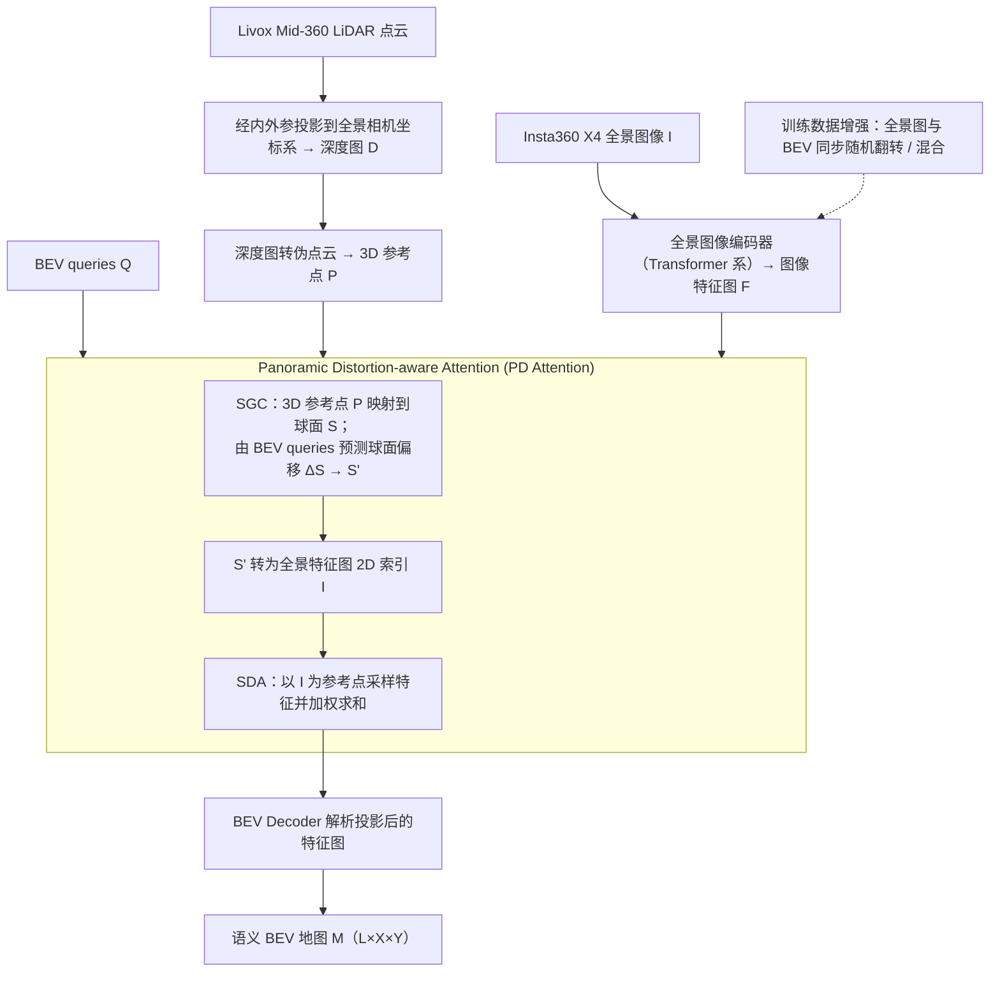

# HumanoidPano

**HumanoidPano: Hybrid Spherical Panoramic-LiDAR Cross-Modal Perception for Humanoid Robots** 已列入 [Robot Learning Paper Notebooks](https://imchong.github.io/Robot_Learning_Paper_Notebooks/index.html) 的 **PROGRESS.md 待深读** 清单（分类：08_Navigation）。本页 **还没有深读笔记**：只给出这篇论文的分类位置与原文入口，方法细节与数据请直接看原文。

## 一句话定义

HumanoidPano 的人形机器人学习论文条目，当前处于 Paper Notebooks 阅读进度（待深读）阶段。

## 英文缩写速查

| 缩写 | 英文全称 | 简要说明 |
|------|----------|----------|
| RL | Reinforcement Learning | 通过与环境交互最大化长期回报来学习策略 |
| WBC | Whole-Body Control | 协调全身关节满足多任务/约束的控制基础设施 |
| Sim2Real | Simulation to Real | 把仿真中学到的策略迁移落地真机的工程主线 |

## 为什么重要

- 这篇已排进 Paper Notebooks 的待读清单，可以从 [机器人学习论文笔记总索引](../overview/humanoid-paper-notebooks-index.md) 与分类页找到同一批工作。
- 深读笔记尚未写出；方法流程见下方「流程总览」（依据论文方法部分），其余结论以论文为准。

## 流程总览

图依据：论文 §3.1 Problem Formulation、§3.2 Overall Architecture（PD Attention、Panoramic-LiDAR Cross-Modal Perception）、§3.3 Data Augmentation / Fig.2、Fig.3。

## 核心信息

| 字段 | 内容 |
|------|------|
| 分类 | 08_Navigation |
| 深读状态 | 待撰写（[PROGRESS.md](https://github.com/ImChong/Robot_Learning_Paper_Notebooks/blob/main/papers/PROGRESS.md)） |
| 计划文件夹 | `papers/08_Navigation/humanoidpano-hybrid-spherical-panoramic-lidar-cr` |
| arXiv | <https://arxiv.org/abs/2503.09010> |

## 实验与评测

- 深读笔记尚未完成；量化 benchmark、消融与实机指标待笔记撰写后补充。

## 结论

**HumanoidPano 在本库是导航分类下的待读条目：它标记了「球面全景 + LiDAR 跨模态感知」这条人形感知路线，但页面尚不提供机制细节。**

- 本页的作用是保证 08_Navigation 分类下该论文节点不缺失，而非给出可引用的技术判断。
- 从标题可读出的定位是面向人形机器人的混合球面全景-LiDAR 跨模态感知。
- 量化 benchmark、消融与实机指标待深读笔记撰写后补充；当前需要细节应直接查 arXiv 原文。

## 与其他页面的关系

- 分类页：[paper-notebook-category-08-navigation](../overview/paper-notebook-category-08-navigation.md)
- 总索引：[humanoid-paper-notebooks-index.md](../overview/humanoid-paper-notebooks-index.md)

## 参考来源

- [humanoid_pnb_humanoidpano-hybrid-spherical-panoramic-lidar-cr.md](../../sources/papers/humanoid_pnb_humanoidpano-hybrid-spherical-panoramic-lidar-cr.md)
- [Robot Learning Paper Notebooks · PROGRESS.md](https://github.com/ImChong/Robot_Learning_Paper_Notebooks/blob/main/papers/PROGRESS.md)
- 论文：<https://arxiv.org/abs/2503.09010>
- [arXiv PDF](https://arxiv.org/pdf/2503.09010)：已通读方法部分（实验与附录以略读为准）：§3 HumanoidPano（3.1 问题定义、3.2 总体架构与 PD Attention、跨模态感知、3.3 数据增强）、§4 引言与 4.4 部署（略读）

## 推荐继续阅读

- [机器人论文阅读笔记：HumanoidPano](https://imchong.github.io/Robot_Learning_Paper_Notebooks/papers/08_Navigation/HumanoidPano__Hybrid_Spherical_Panoramic-LiDAR_Cross-Modal_Perception/HumanoidPano__Hybrid_Spherical_Panoramic-LiDAR_Cross-Modal_Perception.html)
- [Paper Notebooks 阅读进度（PROGRESS.md）](https://github.com/ImChong/Robot_Learning_Paper_Notebooks/blob/main/papers/PROGRESS.md)
