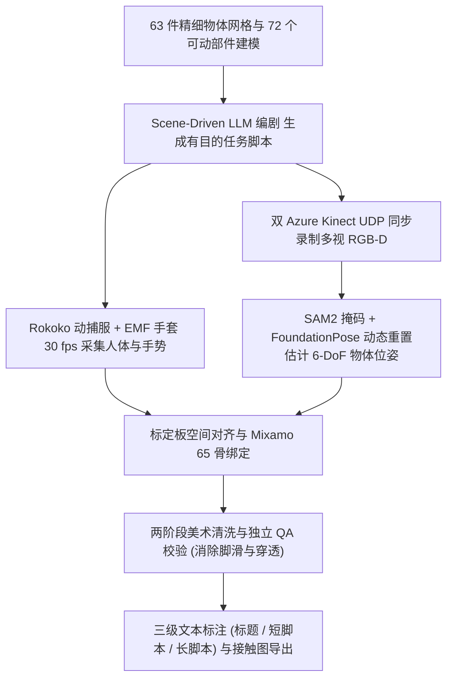
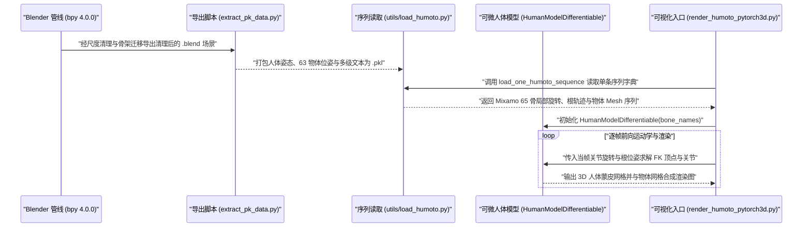

# HUMOTO

**HUMOTO: A 4D Dataset of Mocap Human Object Interactions** 收录于 [Robot Learning Paper Notebooks](https://imchong.github.io/Robot_Learning_Paper_Notebooks/index.html)（分类：14_Human_Motion）。本页已对照 arXiv 原文（arXiv:2504.10414 v2，ICCV 2025）与官方代码仓库 `Jiaxin-Lu/humoto` 通读核对并编译。

## 一句话定义

HUMOTO 是一个兼具任务逻辑连贯性与高物理一致性的人-物交互（HOI）4D 动捕数据集，涵盖 735 段（Fig. 11 统计 736 段）、约 7,875 秒 30 fps 的高精度全身/手部动作、63 件含铰接部件物体轨迹及三级文本脚本。

## 英文缩写速查

| 缩写 | 英文全称 | 简要说明 |
|---|---|---|
| HOI | Human-Object Interaction | 人-物交互，关注人体/灵巧手与三维物体接触与联合运动 |
| Mocap | Motion Capture | 动作捕捉，本文采用 Rokoko 惯性动捕服与 EMF 电磁手套方案 |
| 4D | Four-Dimensional (3D + Time) | 随时间演化的三维人体骨架/网格与物体 6-DoF 运动序列 |
| MSNR | Motion Signal-to-Noise Ratio | 运动信噪比（dB），用于衡量清洗后序列的轨迹平滑性 |
| CoACD | Approximate Convex Decomposition for 3D Meshes | 近似凸分解算法，论文附录 A 用于 PyBullet 物理接触与碰撞校验 |
| LLM | Large Language Model | 大语言模型，本文用于按房间物体组合生成有任务目的的表演脚本 |

## 为什么重要

- **填补「有目的长交互 + 高接触精度」空白**：以往数据集多为孤立抓取或单步摆拍，HUMOTO 通过 LLM 按房型编排连贯日常任务，提供贴近人类意图的全身-手-物长时程协同先验。
- **物理一致性优于纯视觉重建**：双 Kinect 视觉辅助 + FoundationPose 动态重置 + 两阶段美术人工精修将脚滑压到 0.958 cm、穿透压到 0.0068 cm，减少向人形全身操纵（loco-manipulation）策略迁移时的不良动力学样本。
- **Mixamo 绑定与可微 FK 工具链就绪**：数据采用 65 骨 Mixamo 标准骨架并开源 `HumanModelDifferentiable` 与 Blender 导出脚本，便于经由骨架重定向（retargeting）管线进一步映射至 SMPL-X 或人形机器人 URDF。

## 核心原理

### 数据集规模、模态与采集管线

- **规模与统计口径**：论文摘要与正文记为 **735 段序列、7,875 秒（30 fps，约 2.2 小时）**、**63 件专业建模日常物体**（其中多个铰接物体分解为 **72 个可动/功能部件**，单场景最多包含 15 件物体），均由 1 名穿戴动捕设备的表演者完成；另注论文 Fig. 11 直方图统计显示为 **736 段、7,874.4 秒（131.2 min）**，单段时长分布在 3.0–32.0 秒。
- **模态构成**：包含 65 骨骼（`human_model/bone_names.py`）Mixamo 铰接人体 4D 运动、高精手部手指姿态、物体及铰接部件 6-DoF 轨迹、PyBullet 接触图信号，以及 3 个粒度的文本描述（动作标题、短脚本、长脚本）。
- **抗遮挡混合动捕架构（§3.1–§3.2）**：
  1. **场景驱动 LLM 编剧**：给定物体清单构建虚拟房间概念，由 LLM 生成逻辑连贯的交互剧本。
  2. **混合传感器捕捉**：Rokoko Smartsuit Pro II 惯性动捕服 + 抗电磁干扰 EMF 手套以 30 fps 记录全身与手部姿态（规避纯光学标记在近身遮挡下的丢点），同时用两台 Azure Kinect 以 UDP 触发同步录制 RGB-D 视角。
  3. **物体 6-DoF 跟踪与时空对齐**：利用 SAM2 与人工掩码结合 FoundationPose 估计物体位姿，基于掩码像素差异触发动态重置抑制遮挡漂移；通过标定板与起始标定站姿建立共同世界坐标系。
  4. **两阶段 QA 美术精修（§3.3）**：第一阶段专业美术师逐帧修补手物穿透、脚滑与惯性漂移；第二阶段独立审核团队按抖动与穿透规则核验打回直至达标。

图依据：论文 §3.1–§3.3（Fig. 2、Fig. 4–5）以及 `human_model/bone_names.py`、`scripts/extract_pk_data.py` 源码。

## 实验与对比评测

论文从物理指标、主观评估与下游模型任务三方面评测数据质量与实用性（Table 1–2 与附录 A）：

**1. 物理一致性与运动质量（Table 1，与同类 HOI 数据集指标体系对照）**：

| 指标 | HUMOTO 实测表现 | 物理含义 |
|---|---|---|
| Foot Sliding（脚滑） | **0.958 cm** | 支撑脚掌在接触期间的残余水平漂移 |
| Penetration（手物穿透） | **0.0068 cm** | 手部/身体网格侵入刚体或铰接物体的深度误差 |
| Jerk / Object Jerk | **1.87 / 1.13** | 人体与物体加速度时间导数，反映平滑度 |
| MSNR（运动信噪比） | **9.42 dB** | 高频抖动抑制程度 |
| Coherence / Diversity | **0.653 / 0.956** | 语义一致度与场景内动作丰富度 |
| Contact Entropy / State Consistency | **1.4587 / 0.5061** | 接触状态分布熵与物体铰接/位姿前后自洽性 |

**2. 主观研究与下游可迁移性验证（§5–§6、附录 A）**：

- **26 人用户研究（User Study）**：在物理真实感、接触准确性与语言对齐度评价中相比对照基线数据集获得显著偏好。
- **物理引擎与生成/重建基准检验**：通过 PyBullet 结合 CoACD 凸分解验证物体接触支撑稳定性；并作为测试/微调基座评测了 MotionGPT（文本驱动人体动作生成）、4D Humans 与 TRAM（单目 4D 重建）以及 Affordance Diffusion 等前沿模型。

## 结论

**HUMOTO 是一套典型的「质量优先于绝对规模」的 4D HOI 数据资产：它通过混合动捕硬件选型与昂贵但严格的两阶段专业美术清洗，把脚滑（0.958 cm）与穿模（0.0068 cm）压到可直接喂给物理接触敏感型下游任务的可用水平。**

1. **抗遮挡 + 人工清洗才是核心壁垒**：LLM 编剧赋予序列任务连贯性，但真正拉开物理可用性差距的是 EMF 手套防近距干扰、FoundationPose 像素差重置以及独立团队打回重修的 QA 闭环。
2. **机器人向重定向需跨两道骨链差异**：原生数据集采用 65 骨 Mixamo 人体格式而非机器人常用的 SMPL-X 拓扑；用于人形机器人在环训练或模仿学习前，需先通过骨架重定向将 Mixamo 映射至目标机器人运动学链，并叠加物理稳定性滤波。
3. **代码工具链已可用于数据读取与可视化**：官方仓库提供 `load_one_humoto_sequence`、`HumanModelDifferentiable` 与 PyTorch3D 渲染脚本；数据本体分「公开子集（`adobe-research/humoto`）」与「完整版申请」两层分发。
4. **体量与采集者单一性构成扩展上限**：仅约 2.2 小时总长与 1 名表演者决定了它更适合做高质量精调集或评测基准，而非独立支撑大规模预训练底座。

## 源码运行时序图

以下时序依据 `README.md`、`scripts/extract_pk_data.py`、`utils/load_humoto.py`、`human_model/human_model.py`、`human_model/bone_names.py` 与 `render_humoto_pytorch3d.py` 实读源码绘制：

## 工程实践

| 工程维度 | 论文与官方仓库核对细节 |
|---|---|
| 数据集规模与分辨率 | 735 段（Fig. 11 为 736 段）、约 7,875 s、30 fps；63 件刚/铰接物体（72 部件） |
| 人体骨架与可微模块 | 65 骨 Mixamo 拓扑（`human_model/bone_names.py`），非 SMPL-X；PyTorch 可微类 `HumanModelDifferentiable` |
| 核心依赖与脚本入口 | `bpy==4.0.0`（数据清洗导出）、PyTorch + PyTorch3D；验证入口 `render_humoto_pytorch3d.py` |
| 许可证与获取路径 | 代码仓库无根目录 `LICENSE` 文件；数据受官方门户 `adobe-research.github.io/humoto` 条款约束，区分公开子集与完整版申请 |
| 重定向与人形接入 | 数据为运动学精修几何网格（非真机控制轨迹），接入人形模仿学习前需运行 GMR 等骨架重定向器并做地面/足底接触校正 |

## 常见误区与局限

- **单一表演者与体量有限**：全库动作仅由 1 名动捕演员采集，身高、臂展与操作习惯多样性受限，总时长 2.2 小时难以独立覆盖开放世界泛化需求。
- **人工清洗成本高昂、难以自动化复刻**：两阶段美术修复虽保证了 0.0068 cm 低穿透，但使该数据管线难以低成本扩充至万条规模。
- **无动力学力矩与触觉真值**：数据集记录运动学姿态、物体位姿及 PyBullet 推理接触，不含真机抓取力/力矩传感器读数，面向力控或紧致插装任务时需额外引入物理仿真或力交互建模。
- **许可与代码文件完整度注意**：`Jiaxin-Lu/humoto` 根目录缺少独立 `LICENSE` 文件，商用或二次分发前必须核对 `adobe-research/humoto` 数据发布协议；另论文摘要（735 段）与 Fig. 11（736 段）存在 1 条样本数统计差异。

## 关联页面

- 分类父节点：[paper-notebook-category-14-human-motion](../overview/paper-notebook-category-14-human-motion.md)
- 总索引：[humanoid-paper-notebooks-index.md](../overview/humanoid-paper-notebooks-index.md)
- 评测选型：[具身评测与基准选型闭环](../queries/embodied-eval-benchmark-selection-loop.md)
- 重定向技术栈：[运动重定向概念](../concepts/motion-retargeting.md) · [重定向管线](../concepts/motion-retargeting-pipeline.md) · [三类重定向路线](../queries/motion-retargeting-three-routes-landscape.md)
- 参数化人体与全身操纵：[SMPL-X 概念页](../concepts/smpl-x.md) · [Loco-Manipulation 任务页](../tasks/loco-manipulation.md)

## 参考来源

- [humoto_reading.md](../../sources/papers/humoto_reading.md)（arXiv:2504.10414 v2 与深读笔记归档）
- [humanoid_pnb_humoto.md](../../sources/papers/humanoid_pnb_humoto.md)（Robot Learning Paper Notebooks 原条索引归档）
- [jiaxin_lu_humoto.md](../../sources/repos/jiaxin_lu_humoto.md)（GitHub 官方仓库源码核对归档）
- 论文：<https://arxiv.org/abs/2504.10414>（ICCV 2025）
- 项目与数据获取：<https://jiaxin-lu.github.io/humoto/> · <https://adobe-research.github.io/humoto/>
- 源码仓库：<https://github.com/Jiaxin-Lu/humoto>

## 推荐继续阅读

- [HUMOTO 论文 PDF（arXiv:2504.10414）](https://arxiv.org/pdf/2504.10414)：精读 §3 抗遮挡动捕同步细节与附录 A PyBullet CoACD 检验
- [HUMOTO 官方开源工具链（Jiaxin-Lu/humoto）](https://github.com/Jiaxin-Lu/humoto)：参考 `render_humoto_pytorch3d.py` 与 `utils/load_humoto.py`
- [机器人论文阅读笔记：HUMOTO](https://imchong.github.io/Robot_Learning_Paper_Notebooks/papers/14_Human_Motion/HUMOTO__A_4D_Dataset_of_Mocap_Human_Object_Interactions/HUMOTO__A_4D_Dataset_of_Mocap_Human_Object_Interactions.html)
