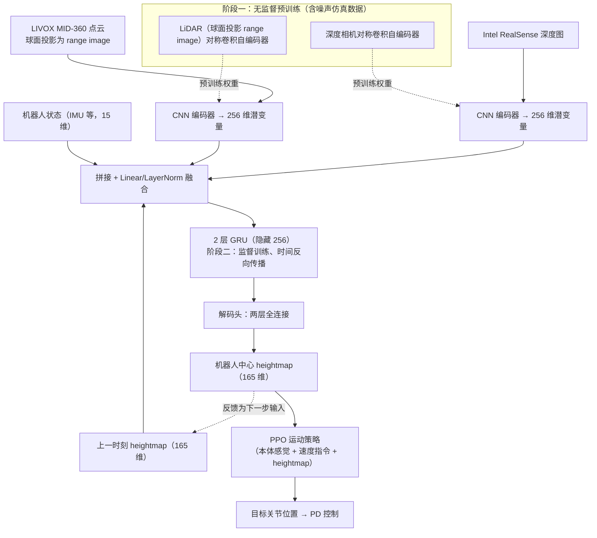

# A Hybrid Autoencoder for Robust Heightmap Generation from Fused Lidar and Depth Data for Humanoid Robot Locomotion

**A Hybrid Autoencoder for Robust Heightmap Generation from Fused Lidar and Depth Data for Humanoid Robot Locomotion** 收录于 [Robot Learning Paper Notebooks](https://imchong.github.io/Robot_Learning_Paper_Notebooks/index.html)（分类：05_Locomotion）。本页为 **清单索引实体**，链向深读笔记与原始论文；详细机制待从笔记消化后补充。

## 一句话定义

人形 perceptive locomotion 的"上游 = 地形感知"长期被「单传感器手工管线（深度图 / 体素栅格 / 占据图）」卡住——深度相机视场窄、近距离精但远处糊，LiDAR 反过来；本文提出用一个 hybrid Encoder-Decoder（CNN 抽空间 + GRU 维持时序）把深度图 + LiDAR（球面投影） + IMU 三路数据直接学到一个以机器人为中心的统一 2.5D 高度图上，让下游 locomotion 策略只面对一种规范化的地形表征，融合相比单模态把重建误差降了 7.2–9.9 %，3.2 s 时序窗口把地图漂移也压了下来。

## 英文缩写速查

| 缩写 | 英文全称 | 简要说明 |
|------|----------|----------|
| RL | Reinforcement Learning | 通过与环境交互最大化长期回报来学习策略 |
| WBC | Whole-Body Control | 协调全身关节满足多任务/约束的控制基础设施 |
| Sim2Real | Simulation to Real | 把仿真中学到的策略迁移落地真机的工程主线 |

## 为什么重要

- 列入 Paper Notebooks 策展清单，便于与全库 [机器人学习论文笔记总索引](../overview/humanoid-paper-notebooks-index.md) 及分类父节点交叉检索。
- 深读笔记提供比摘要更贴近实现的阅读路径，适合作为后续 ingest 深化起点。

## 流程总览

图依据：论文 §2、§3.1–3.3、Fig. 4

## 核心信息

| 字段 | 内容 |
|------|------|
| 分类 | 05_Locomotion |
| 深读笔记 | <https://imchong.github.io/Robot_Learning_Paper_Notebooks/papers/05_Locomotion/Hybrid_Autoencoder_for_Robust_Heightmap_from_Fused_Lidar_and_Depth_Data/Hybrid_Autoencoder_for_Robust_Heightmap_from_Fused_Lidar_and_Depth_Data.html> |
| arXiv | <https://arxiv.org/abs/2602.05855> |

## 实验与评测

- 本页为 **策展清单索引** 摘要；量化 benchmark、消融与实机指标以 **深读笔记与论文 PDF** 为准（链接见 [参考来源](#参考来源)）。

## 结论

**这篇工作的定位是把 perceptive locomotion 的上游从「单传感器手工管线」换成一个学出来的统一表征：下游策略只需面对一种以机器人为中心的 2.5D 高度图。**

- 起作用的是传感器互补性而非模型新意：深度相机近处精、视场窄，LiDAR 恰好反过来，两路加 IMU 融合后重建误差比单模态降 **7.2–9.9%**。
- 时序是第二个杠杆：CNN 抽空间 + GRU 维持时序，**3.2 s** 窗口用来压住地图漂移——说明这是「感知表征」问题，不只是单帧融合问题。
- 边界：本页只覆盖到地形表征这一层，融合后对下游 locomotion 策略成功率的实际影响、以及真机部署代价，需回到深读笔记与论文 PDF。

## 与其他页面的关系

- 分类父节点：[paper-notebook-category-05-locomotion](../overview/paper-notebook-category-05-locomotion.md)
- 总索引：[humanoid-paper-notebooks-index.md](../overview/humanoid-paper-notebooks-index.md)

## 参考来源

- [humanoid_pnb_hybrid-autoencoder-for-robust-heightmap-from-fus.md](../../sources/papers/humanoid_pnb_hybrid-autoencoder-for-robust-heightmap-from-fus.md)
- 深读笔记：<https://imchong.github.io/Robot_Learning_Paper_Notebooks/papers/05_Locomotion/Hybrid_Autoencoder_for_Robust_Heightmap_from_Fused_Lidar_and_Depth_Data/Hybrid_Autoencoder_for_Robust_Heightmap_from_Fused_Lidar_and_Depth_Data.html>
- 论文：<https://arxiv.org/abs/2602.05855>
- [arXiv PDF](https://arxiv.org/pdf/2602.05855)：已通读方法部分（实验与附录以略读为准）：§1 引言、§2 运动策略与 heightmap、§3 编码器-解码器结构（3.1–3.3）、§4 实验设定；§4 结果略读

## 推荐继续阅读

- [机器人论文阅读笔记：A Hybrid Autoencoder for Robust Heightmap Generation from Fused Lidar and Depth Data for Humanoid Robot Locomotion](https://imchong.github.io/Robot_Learning_Paper_Notebooks/papers/05_Locomotion/Hybrid_Autoencoder_for_Robust_Heightmap_from_Fused_Lidar_and_Depth_Data/Hybrid_Autoencoder_for_Robust_Heightmap_from_Fused_Lidar_and_Depth_Data.html)
