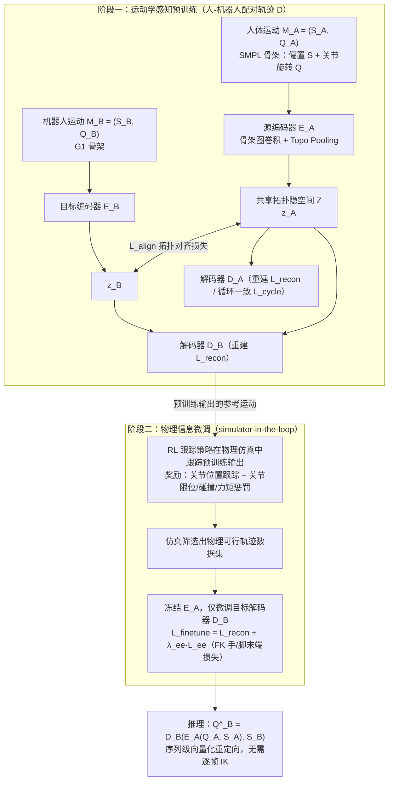

# Implicit Kinodynamic Motion Retargeting for Human-to-humanoid Imitation Learning

**Implicit Kinodynamic Motion Retargeting for Human-to-humanoid Imitation Learning** 已列入 [Robot Learning Paper Notebooks](https://imchong.github.io/Robot_Learning_Paper_Notebooks/index.html) 的 **progress 待深读** 清单（分类：04_Loco-Manipulation_and_WBC）。本页 **还没有深读笔记**：只给出这篇论文的分类位置与原文入口，方法细节与数据请直接看原文。

## 一句话定义

Implicit Kinodynamic Motion Retargeting for Human-to-humanoid Imitation Learning 的人形机器人学习论文条目，当前处于 Paper Notebooks 阅读进度（待深读）阶段。

## 英文缩写速查

| 缩写 | 英文全称 | 简要说明 |
|------|----------|----------|
| RL | Reinforcement Learning | 通过与环境交互最大化长期回报来学习策略 |
| WBC | Whole-Body Control | 协调全身关节满足多任务/约束的控制基础设施 |
| Sim2Real | Simulation to Real | 把仿真中学到的策略迁移落地真机的工程主线 |

## 为什么重要

- 这篇已排进 Paper Notebooks 的待读清单，可以从 [机器人学习论文笔记总索引](../overview/humanoid-paper-notebooks-index.md) 与分类页找到同一批工作。
- 在笔记写出来之前，这里只保留分类位置与原文入口；方法流程见下方「流程总览」，不含实验结论。

## 流程总览

图依据：论文 §III-A–D / Fig.3–5，式 (1)–(10)。

## 核心信息

| 字段 | 内容 |
|------|------|
| 分类 | 04_Loco-Manipulation_and_WBC |
| 深读状态 | 待撰写（[progress.json](https://github.com/ImChong/Robot_Learning_Paper_Notebooks/blob/main/progress.json)） |
| 计划文件夹 | `papers/04_Loco-Manipulation_and_WBC/Implicit_Kinodynamic_Motion_Retargeting_for_Human-to-humanoid_Imitation_Learning` |

## 实验与评测

- 深读笔记尚未完成；量化 benchmark、消融与实机指标待笔记撰写后补充。

## 结论

**本页是这项「隐式运动学-动力学重定向」工作的阅读进度待读，不是方法归纳：页面里可确定的只有分类归属与计划文件夹，人到人形的重定向如何隐式建模待深读笔记补齐。**

- 页面正文未给出任何方法、指标或消融，「实验与评测」已明确标注待笔记完成后补充。
- 适用边界：可用于按 04_Loco-Manipulation_and_WBC 分类检索与追踪阅读进度，不可当作该工作的结论来引用。
- 深读笔记完成后，本页会补上笔记链接与实质要点。

## 与其他页面的关系

- 分类页：[paper-notebook-category-04-loco-manipulation-and-wbc](../overview/paper-notebook-category-04-loco-manipulation-and-wbc.md)
- 总索引：[humanoid-paper-notebooks-index.md](../overview/humanoid-paper-notebooks-index.md)

## 参考来源

- [humanoid_pnb_implicit-kinodynamic-motion-retargeting-for-huma.md](../../sources/papers/humanoid_pnb_implicit-kinodynamic-motion-retargeting-for-huma.md)
- [Robot Learning Paper Notebooks · progress.json](https://github.com/ImChong/Robot_Learning_Paper_Notebooks/blob/main/progress.json)
- [arXiv PDF](https://arxiv.org/pdf/2509.15443)：已通读方法部分（实验与附录以略读为准）：§III 方法（III-A–D）；§IV 实验略读

## 推荐继续阅读

- [Paper Notebooks 阅读进度（PROGRESS.md）](https://github.com/ImChong/Robot_Learning_Paper_Notebooks/blob/main/papers/PROGRESS.md)
