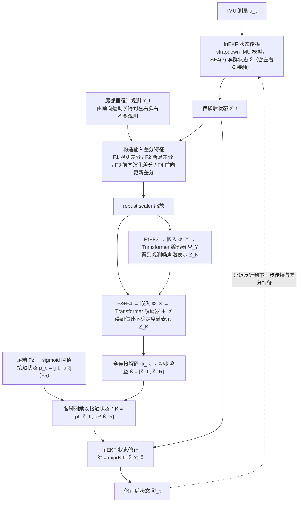

# InEKFormer

**InEKFormer: A Hybrid State Estimator for Humanoid Robots** 收录于 [Robot Learning Paper Notebooks](https://imchong.github.io/Robot_Learning_Paper_Notebooks/index.html)（分类：09_State_Estimation）。本页为 **清单索引实体**，链向深读笔记与原始论文；详细机制待从笔记消化后补充。

## 一句话定义

InEKFormer 把经典 不变扩展卡尔曼滤波（InEKF） 的几何结构保留下来，但让 Transformer 从一段「状态 / 观测残差」的历史里隐式输出噪声相关的修正量，从而绕开「手调噪声协方差 Q/R」这件让所有滤波工程师头大的活；在 RH5 真机数据上跟 InEKF / KalmanNet 两条基线对照，验证了 Transformer 在人形高维状态估计里的可行性，同时也点出了「自回归训练不鲁棒就会爆」的现实问题。

## 英文缩写速查

| 缩写 | 英文全称 | 简要说明 |
|------|----------|----------|
| RL | Reinforcement Learning | 通过与环境交互最大化长期回报来学习策略 |
| WBC | Whole-Body Control | 协调全身关节满足多任务/约束的控制基础设施 |
| Sim2Real | Simulation to Real | 把仿真中学到的策略迁移落地真机的工程主线 |

## 为什么重要

- 列入 Paper Notebooks 策展清单，便于与全库 [机器人学习论文笔记总索引](../overview/humanoid-paper-notebooks-index.md) 及分类父节点交叉检索。
- 深读笔记提供比摘要更贴近实现的阅读路径，适合作为后续 ingest 深化起点。

## 流程总览

图依据：论文 §III-A 至 §III-C / Fig.2-3。

## 核心信息

| 字段 | 内容 |
|------|------|
| 分类 | 09_State_Estimation |
| 深读笔记 | <https://imchong.github.io/Robot_Learning_Paper_Notebooks/papers/09_State_Estimation/InEKFormer__A_Hybrid_State_Estimator_for_Humanoid_Robots/InEKFormer__A_Hybrid_State_Estimator_for_Humanoid_Robots.html> |
| arXiv | <https://arxiv.org/abs/2511.16306> |

## 实验与评测

- 本页为 **策展清单索引** 摘要；量化 benchmark、消融与实机指标以 **深读笔记与论文 PDF** 为准（链接见 [参考来源](#参考来源)）。

## 结论

**InEKFormer 的取舍是「保几何、换调参」：InEKF 的不变性结构原样保留，只把手调噪声协方差 Q/R 这件苦活换成 Transformer 从残差历史里隐式给出的修正量。**

- 起作用的输入是一段**状态 / 观测残差的历史**；网络输出的是噪声相关的**修正量**而非状态本身，几何结构因此不被破坏。
- 验证放在 **RH5 真机数据**上，对照 **InEKF 与 KalmanNet** 两条基线——一条经典、一条学习式滤波，比较位置摆得比较公允。
- 已暴露的失败模式很具体：**自回归训练不做鲁棒化就会发散**，这是混合式估计器落地前必须先解决的现实问题。
- 本工作的定位是可行性验证——证明 Transformer 能进人形高维状态估计，而非宣称已经超越经典滤波。
- 本页仅清单索引：具体误差数字与消融以深读笔记与论文 PDF 为准。

## 与其他页面的关系

- 分类父节点：[paper-notebook-category-09-state-estimation](../overview/paper-notebook-category-09-state-estimation.md)
- 总索引：[humanoid-paper-notebooks-index.md](../overview/humanoid-paper-notebooks-index.md)

## 参考来源

- [humanoid_pnb_inekformer.md](../../sources/papers/humanoid_pnb_inekformer.md)
- 深读笔记：<https://imchong.github.io/Robot_Learning_Paper_Notebooks/papers/09_State_Estimation/InEKFormer__A_Hybrid_State_Estimator_for_Humanoid_Robots/InEKFormer__A_Hybrid_State_Estimator_for_Humanoid_Robots.html>
- 论文：<https://arxiv.org/abs/2511.16306>
- [arXiv PDF](https://arxiv.org/pdf/2511.16306)：已通读方法部分（实验与附录以略读为准）：§III-A 至 §III-C（含 Fig.2-3）、§IV-A/B 数据与训练设定

## 推荐继续阅读

- [机器人论文阅读笔记：InEKFormer](https://imchong.github.io/Robot_Learning_Paper_Notebooks/papers/09_State_Estimation/InEKFormer__A_Hybrid_State_Estimator_for_Humanoid_Robots/InEKFormer__A_Hybrid_State_Estimator_for_Humanoid_Robots.html)
