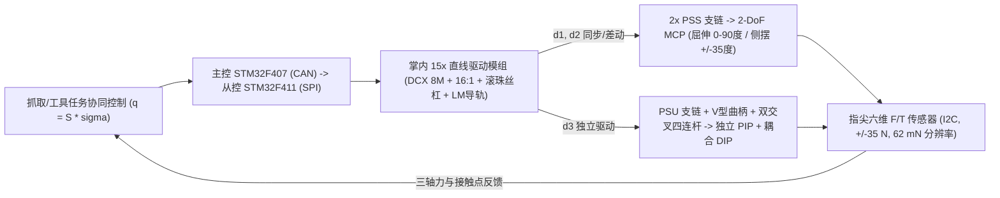

# Integrated linkage-driven dexterous anthropomorphic robotic hand

**Integrated linkage-driven dexterous anthropomorphic robotic hand**（Uikyum Kim, Dawoon Jung 等，Ajou University / KIMM / Korea University / SKKU，Nature Communications 2021）研制了全集成连杆驱动拟人灵巧手 **ILDA Hand**，在无额外前臂驱动箱的前提下同时实现 15 主动自由度、34 N 指尖力与六维触觉感知。条目收录于 [Robot Learning Paper Notebooks](https://imchong.github.io/Robot_Learning_Paper_Notebooks/index.html)（分类：12_Hardware_Design）。

## 一句话定义

一种将 15 组微型电机–滚珠丝杠直线驱动器与控制电路全部内嵌于手掌、单指融合**并联 2-DoF MCP + 串联连杆 1-DoF PIP（耦合 DIP）**并配备指尖六维力传感器的五指拟人灵巧手（15 DoF / 20 关节、1.1 kg、34 N）。

## 英文缩写速查

| 缩写 | 英文全称 | 简要说明 |
|------|----------|----------|
| RL | Reinforcement Learning | 通过与环境交互最大化长期回报来学习策略 |
| WBC | Whole-Body Control | 协调全身关节满足多任务/约束的控制基础设施 |
| Sim2Real | Simulation to Real | 把仿真中学到的策略迁移落地真机的工程主线 |
| ILDA | Integrated Linkage-Driven Dexterous Anthropomorphic (Hand) | 本文研制的掌内全集成连杆驱动五指灵巧手 |
| MCP / PIP / DIP | Metacarpophalangeal / Proximal / Distal Interphalangeal | 手指从近端到远端的掌指关节、近端指间关节与远端指间关节 |
| PSS / PSU | Prismatic-Spherical-Spherical / Prismatic-Spherical-Universal | 驱动单指掌指与指间关节的三条平面/空间连杆运动支链 |
| F/T | Force / Torque | 安装在每个指尖的六维力与力矩触觉传感器 |

## 为什么重要

- 传统高自由度拟人灵巧手存在明显的架构三难问题：**腱绳驱动**（如 Robonaut、Shadow Hand）需占用庞大前臂安装电机且易断绳/摩擦迟滞；**电机直驱手指**受限于微型电机成本、远端惯量与狭小布线空间；**纯连杆驱动**（如 Schunk SVH）虽坚固易维护，却长期难以在指节狭窄包络内实现单指独立 3-DoF 运动。
- ILDA Hand 通过「掌内直线推杆 + 串并联混合连杆 + 掌内 PCB 堆叠」打破这一权衡，无需外接前臂即可通过单根 4-pin 接口（供电+CAN）直接挂载商用工业机械臂（如 UR-5）完成剪纸、镊子夹取 0.9 mm 芯片等精细工具操作，是[机器人学习论文笔记总索引](../overview/humanoid-paper-notebooks-index.md)硬件设计分支的经典参考平台。

## 核心信息

| 字段 | 内容 |
|------|------|
| 作者与机构 | Uikyum Kim, Dawoon Jung, Heeyoen Jeong, Jongwoo Park, Hyun-Mok Jung, Joono Cheong, Hyouk Ryeol Choi, Hyunmin Do, Chanhun Park（Ajou Univ. / KIMM / Korea Univ. / SKKU） |
| 出处 | Nature Communications (2021) 12:7177 |
| DOI / 原文 | <https://doi.org/10.1038/s41467-021-27261-0> |
| 整手规格 | 5 指，**15 主动 DoF / 20 关节**，质量 **1.1 kg**，最大手长 **218 mm**（含安装法兰总长 **261 mm**），负载 **18 kg** |
| 驱动与电控 | 15× Maxon DCX 8M (8 mm, 12V) + GPX8 (16:1) + ENX 8 mag + KSS SR0401K 滚珠丝杠 + IKO LWL3 直线导轨；主控 STM32F407 + 8× STM32F411 从控 + 8× A3909 |
| 分类 | 12_Hardware_Design（[PROGRESS.md](https://github.com/ImChong/Robot_Learning_Paper_Notebooks/blob/main/papers/PROGRESS.md) 待深读） |
| 计划文件夹 | `papers/12_Hardware_Design/integrated-linkage-driven-dexterous-anthropomorp` |

## 核心机制

1. **单指串并联混合 3-DoF 连杆机构**：每根手指由 3 组并联布置于手掌底面的直线推杆（位移 $d_1, d_2, d_3$）驱动，除拇指和小指指节长度不同外其余模块化通用：
   - **2-DoF MCP（并联机构）**：两条前置 **PSS**（移动–球铰–球铰）支链与中央万向节构成虚拟三角形。$d_1, d_2$ 同向等量移动驱动 MCP 屈伸（$0\text{–}90^\circ$），反向移动驱动侧摆外展/内收（$\pm 35^\circ$）；采用球面杆端轴承（rod end）取代常规球轴承以在大摆角下保持高承载刚度。
   - **1-DoF 独立 PIP + 耦合 DIP（串联四连杆）**：中央 **PSU**（移动–球铰–万向节）支链穿过三角形内部连接 V 形曲柄（bell-crank），再串联交叉四连杆驱动 PIP 独立屈伸（$0\text{–}90^\circ$，不受 MCP 运动干涉），并通过第二组交叉四连杆将 DIP 与 PIP 机械耦合。全机构拥有**解析闭式逆运动学**。
2. **抗扭直线导轨与掌内全集成电控**：滚珠丝杠螺母固定在 IKO LWL3 直线导轨滑块上以抵消杆端轴承传回的寄生扭矩并免除丝杠顶端支撑；8 颗从控 MCU（SPI 通信）、电机驱动板与主控 MCU（对外 CAN 总线、DC 15 V / 最大 2 A）全部堆叠于掌心下部，传感器布线穿过连杆空隙直连掌内采集板，无外部前臂。
3. **指尖六维 F/T 触觉感知与协同控制（Hand Synergy）**：每个指尖内嵌微型六维力/力矩传感器（外覆 KE-1300 硅胶增摩），实时解算接触点位置与三轴接触力。控制层采用基于主成分分析（PCA）的人手姿势协同映射 $q = S\sigma$（覆盖 Feix 抓握分类 33 类中的 14 种核心抓握类型与示教动作分离的 PC 基元）。

### 方法流程图

## 实验与评测

| 测试项目 | 实测关键指标（Table 1 & 正文） |
|---------|------------------------------|
| 可达工作空间 | 单指可达空间体积 **188,740 mm³**（同指长人类手指为 **119,800 mm³**） |
| 关节速度与反驱力矩 | 关节转速 **53 / 103 / 81 °/s**（$q_1, q_2, q_3$）；反驱启动力矩 MCP **25.9 mNm**、PIP **6.3 mNm** |
| 指尖输出力与负载 | 最大指尖力 **28 N**（伸直姿态）/ **34 N**（弯曲姿态）；整手握持 **18 kg** 哑铃成功提起 |
| 六维触觉力精度（对比 ATI Nano25） | 量程 **±35 N**，分辨率 **62 mN**；阶梯静态力平均误差 **0.9 N**，5 s 周期 21 N 正弦动态力平均误差 **0.53 N** |
| 典型抓取与破坏/精细对比 | 强力抓握压碎铝制易拉罐（单指 **25 N**）、无损轻握生鸡蛋、覆盖 YCB 常见多形状物体 |
| 机械臂挂载工具操作（UR-5） | 使用日常普通剪刀手内变姿协同剪纸；手持家用镊子调整姿态并剥离/夹取 **0.9 mm × 6 mm** 微型方形芯片（通过指尖力波动确认夹持状态） |

## 与其他工作对比

- **相比腱绳驱动高自由度手（Robonaut 2、DLR David、Shadow Hand）**：ILDA 将全部 15 个驱动与电控收进 218 mm 手掌（仅 1.1 kg），无需长达半米的专用前臂，可直接安装至常规工业机械臂；同时避免腱绳断丝、预紧摩擦损耗与弹簧单向复位力控难题。
- **相比直驱式拟人手（Johns Hopkins MPL v2.0）**：在手指内不放置电机，大幅降低远端连杆惯量并留出内部走线与指尖六维传感器空间，采用高强度 SUS303 钢与 6061 铝机加工件及商用标准轴承/丝杠，显著降低制造成本与维护难度。
- **相比既往连杆驱动手（Schunk SVH 等）**：首次在手指包络尺寸内通过 PSS+PSU+交叉四连杆混合构型实现单指独立 3-DoF（2-DoF MCP + 独立 PIP）运动，而非仅靠欠驱动或 1–2 DoF 耦合弯曲。

## 常见误区或局限

1. **DIP 并非独立自由度且存在满屈侧摆干涉**：每指仅有 3 个主动 DoF（4 关节中 DIP 通过四连杆机械从动于 PIP）；当 MCP 处于 $90^\circ$ 满屈姿态时，近端指节会触及两侧滚珠丝杠顶端，导致侧摆（abduction/adduction）自由度降至 $0^\circ$（与人手生理包络特性相似）。
2. **工具操作依赖预示教协同轨迹，非自主视觉闭环策略**：剪纸与镊子夹取实验基于先验动作示教分离的协同主成分（PC）与任务脚本完成，论文亦指出剪纸效率难以精确量化，尚未结合视觉/RL 端到端策略。
3. **微型电机与位置控制模式约束**：8 mm 直径电机（最大堵转电流 0.13 A/颗，整手 1.95 A）依赖位置控制器驱动滚珠丝杠，精细力交互需依赖指尖六维 F/T 传感器闭环，而非仅靠电机电流估力。

## 结论

**ILDA Hand 的核心工程突破在于用「掌内 15 组直线推杆 + PSS/PSU 串并联混合连杆」同时兼得了高自由度（15 DoF）、高指尖力（34 N）与无外置前臂的一体化紧凑封装（1.1 kg / 218 mm）。**

1. **一体化封装对工业臂集成最友好**：4-pin 供电与 CAN 总线接口使之能直接挂接 UR-5 等标准机械臂（18 kg 负载能力远超 5 kg 机械臂本体上限），规避了腱绳手的专用前臂改造门槛。
2. **纯机械可维护性显著优于腱绳方案**：连杆与杆端轴承具备双向驱动能力、闭式解析逆解与低反驱阻力（MCP 25.9 mNm / PIP 6.3 mNm），损坏件易于拆换。
3. **指尖六维触觉补齐了连杆传动的力控短板**：62 mN 分辨率与 0.53 N 动态误差使位置控制的滚珠丝杠手指也能感知夹持微芯片（0.9 mm × 6 mm）与易碎鸡蛋的精细接触状态。
4. **注意定位边界**：本工作聚焦灵巧手本体机构、电控与示教协同验证，若用于自主操作研究，仍需在上层补全视觉–触觉反馈控制或学习策略。

## 与其他页面的关系

- 分类页：[paper-notebook-category-12-hardware-design](../overview/paper-notebook-category-12-hardware-design.md)
- 总索引：[humanoid-paper-notebooks-index.md](../overview/humanoid-paper-notebooks-index.md)

## 参考来源

- [humanoid_pnb_integrated-linkage-driven-dexterous-anthropomorp.md](../../sources/papers/humanoid_pnb_integrated-linkage-driven-dexterous-anthropomorp.md)
- [Robot Learning Paper Notebooks · PROGRESS.md](https://github.com/ImChong/Robot_Learning_Paper_Notebooks/blob/main/papers/PROGRESS.md)
- 论文原文：Uikyum Kim et al., *Integrated linkage-driven dexterous anthropomorphic robotic hand*, Nature Communications 2021, [DOI:10.1038/s41467-021-27261-0](https://doi.org/10.1038/s41467-021-27261-0)

## 推荐继续阅读

- [Paper Notebooks 阅读进度（PROGRESS.md）](https://github.com/ImChong/Robot_Learning_Paper_Notebooks/blob/main/papers/PROGRESS.md)
- [Nature Communications 原文](https://doi.org/10.1038/s41467-021-27261-0)
