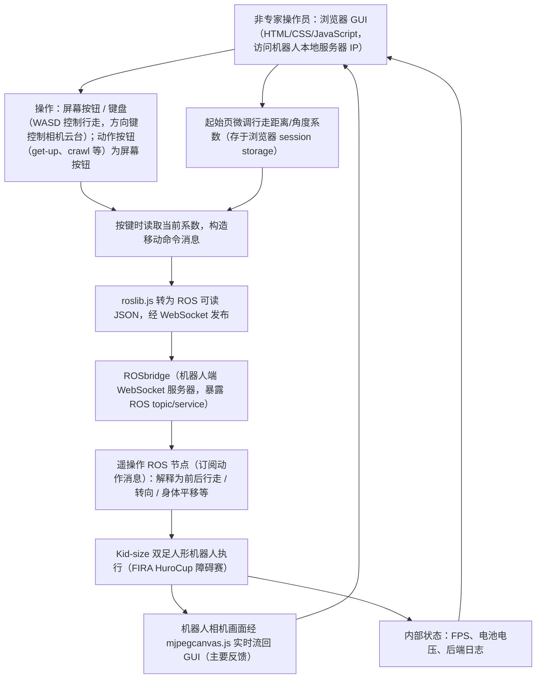

# Development of an Intuitive GUI for Non-Expert Teleoperation of Humanoid Robots

**Development of an Intuitive GUI for Non-Expert Teleoperation of Humanoid Robots** 收录于 [Robot Learning Paper Notebooks](https://imchong.github.io/Robot_Learning_Paper_Notebooks/index.html)（分类：07_Teleoperation），深读笔记已完成。本页是 **笔记摘要**：要点编译自深读笔记，细节以笔记原文与论文 PDF 为准。

## 一句话定义

大多数人形机器人遥操作系统都把精力放在控制算法上，操作界面又难用又"只有写代码的人才会用"。这篇论文反其道而行：它不碰底层控制，而是专门做一个面向非专家的图形界面（GUI）——以摄像头画面为核心、清晰呈现机器人状态、布局简单可扩展，目标是让任何普通人都能凭这个界面，把人形机器人开过 FIRA HuroCup 的障碍赛道。

## 英文缩写速查

| 缩写 | 全称 | 解释 |
|---|---|---|
| GUI | Graphical User Interface | 图形用户界面 |
| UI | User Interface | 用户界面（设计） |
| HRI | Human-Robot Interaction | 人机交互 |
| FIRA | Federation of International Robot-soccer Association | 国际机器人足球联合会 |
| HuroCup | Humanoid Robot World Cup | FIRA 旗下的人形机器人综合竞赛项目 |

## 为什么重要

- **降低操作门槛**：让非专业人士也能遥操作人形机器人，对教育、科普、应急/救援等"操作员未必是工程师"的场景很重要
- **HRI / UI 视角补位**：提醒社区：遥操作的瓶颈不只在算法，**人能不能看懂、能不能控好界面**同样关键
- **与算法路线互补**：与本模块 [SEW-Mimic](https://imchong.github.io/Robot_Learning_Paper_Notebooks/papers/07_Teleoperation/SEW-Mimic__Closed-Form_Geometric_Retargeting_Solver_for_Upper_Body_Humanoid_Teleoperation/SEW-Mimic__Closed-Form_Geometric_Retargeting_Solver_for_Upper_Body_Humanoid_Teleoperation.html)（重定向算法）、[ExtremControl](https://imchong.github.io/Robot_Learning_Paper_Notebooks/papers/07_Teleoperation/ExtremControl__Low-Latency_Humanoid_Teleoperation_with_Direct_Extremity_Control/ExtremControl__Low-Latency_Humanoid_Teleoperation_with_Direct_Extremity_Control.html)（低延迟控制）形成"算法 ↔ 界面"两端的互补
- **竞赛驱动研究**：展示了 FIRA 这类机器人竞赛如何反哺学术研究与人才培养

## 流程总览

图依据：论文 §4.1 System Architecture and Communication、§4.2 GUI development process；这是系统通信架构图，非学习算法流程（"状态回流到 GUI"依据 §3.2 / §4.2 对相机与内部反馈的描述）

## 解决什么问题

人形机器人遥操作的研究，绝大多数集中在**"怎么把人的动作映射到机器人"**这类控制/重定向算法上（VR、外骨骼、运动捕捉……）。但有一个被长期忽视的环节：**操作界面本身**。

现实中的遥操作界面往往是： - **为开发者而生**：满屏调试参数、命令行、各种专业术语，非专家根本看不懂； - **状态不透明**：机器人现在是站着还是要摔了？电量、姿态、和障碍物的距离——这些关键信息散落各处或干脆没有； - **不可扩展**：每换一个任务/机器人就得重写界面。

## 核心机制

1. **把"界面"当成一等公民**：在人人研究控制算法的遥操作领域，专门补上"非专家可用的 GUI"这块短板。
2. **以摄像头 + 状态可读性为核心的设计准则**：给出一套面向人形遥操作的实用界面设计取舍。
3. **可扩展架构**：界面与任务/机器人解耦，不只服务 HuroCup。
4. **真实竞赛任务驱动**：以 FIRA HuroCup 障碍赛作为可量化、可复现的评测场景。

方法拆解（深读笔记小节）：设计原则（来自 UI / HRI 实践）；任务载体：FIRA HuroCup 遥操作障碍赛；评估方式。

## 核心信息

| 字段 | 内容 |
|------|------|
| 分类 | 07_Teleoperation |
| 深读笔记 | <https://imchong.github.io/Robot_Learning_Paper_Notebooks/papers/07_Teleoperation/Intuitive_GUI_for_Non-Expert_Teleoperation_of_Humanoid_Robots/Intuitive_GUI_for_Non-Expert_Teleoperation_of_Humanoid_Robots.html> |
| arXiv | <https://arxiv.org/abs/2510.13594> |
| 机构 | Laurentian University，Bharti School of Engineering and Computer Science（加拿大）· Laurentian Intelligent Mobile Robotics Lab（LIMRL） |
| 作者 | **Austin Barrett**, **Meng Cheng Lau** |
| 发表 | 2025-10-15 (arXiv) |
| 源码 | 截至当前未见公开仓库（论文未给出 GitHub 链接） |
| 笔记阅读日期 | 2026-06-16 |

## 实验与评测

- 本页是深读笔记的摘要，没有搬运原文的量化结果；量化 benchmark、消融与实机指标以 **深读笔记与论文 PDF** 为准（链接见 [参考来源](#参考来源)）。

## 结论

**这篇工作刻意不碰底层控制，而是把「非专家看不看得懂、控不控得好界面」当成遥操作的独立瓶颈来处理。**

- 设计取舍集中在三点：以摄像头画面为核心、把机器人状态清晰暴露、界面与任务/机器人解耦以便扩展——正对着开发者向界面「满屏调试参数、状态不透明、换个任务就重写」的老问题。
- 评测载体是 FIRA HuroCup 遥操作障碍赛，好处是可量化可复现，代价是结论绑定竞赛场景，不能直接外推到临床、应急救援等高风险遥操作。
- 定位是补位而非替代：与本模块的 SEW-Mimic（重定向算法）、ExtremControl（低延迟控制）构成「算法 ↔ 界面」两端互补；把它当作控制方案来比较是误读。
- 落地状态：截至当前未见公开仓库，界面细节与用户评估结果需回到深读笔记与论文 PDF。

## 与其他页面的关系

- 分类父节点：[paper-notebook-category-07-teleoperation](../overview/paper-notebook-category-07-teleoperation.md)
- 总索引：[humanoid-paper-notebooks-index.md](../overview/humanoid-paper-notebooks-index.md)

## 参考来源

- [humanoid_pnb_intuitive-gui-for-non-expert-teleoperation-of-hu.md](../../sources/papers/humanoid_pnb_intuitive-gui-for-non-expert-teleoperation-of-hu.md)
- 深读笔记：<https://imchong.github.io/Robot_Learning_Paper_Notebooks/papers/07_Teleoperation/Intuitive_GUI_for_Non-Expert_Teleoperation_of_Humanoid_Robots/Intuitive_GUI_for_Non-Expert_Teleoperation_of_Humanoid_Robots.html>
- 论文：<https://arxiv.org/abs/2510.13594>
- [arXiv PDF](https://arxiv.org/pdf/2510.13594)：已通读方法部分（实验与附录以略读为准）：§3 Methodology、§4.1–4.3 Implementation（§5 结果略读）

## 推荐继续阅读

- [机器人论文阅读笔记：Development of an Intuitive GUI for Non-Expert Teleoperation of Humanoid Robots](https://imchong.github.io/Robot_Learning_Paper_Notebooks/papers/07_Teleoperation/Intuitive_GUI_for_Non-Expert_Teleoperation_of_Humanoid_Robots/Intuitive_GUI_for_Non-Expert_Teleoperation_of_Humanoid_Robots.html)
