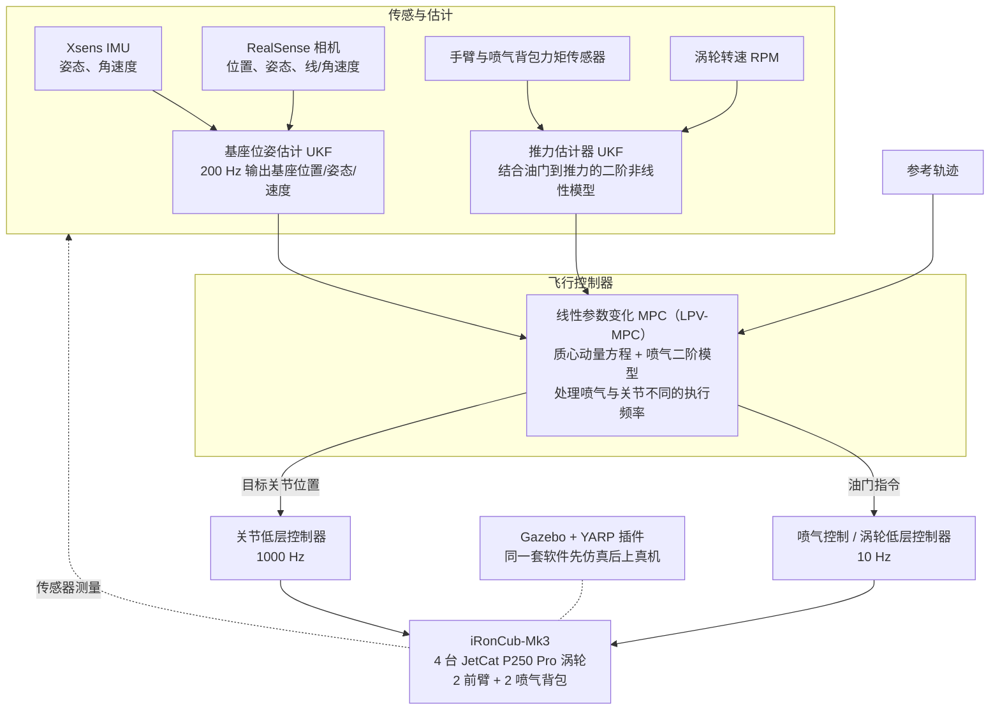

# iRonCub 3

**iRonCub 3: The Jet-Powered Flying Humanoid Robot** 已列入 [Robot Learning Paper Notebooks](https://imchong.github.io/Robot_Learning_Paper_Notebooks/index.html) 的 **PROGRESS.md 待深读** 清单（分类：12_Hardware_Design）。本页 **还没有深读笔记**：只给出这篇论文的分类位置与原文入口，方法细节与数据请直接看原文。

## 一句话定义

iRonCub 3 的人形机器人学习论文条目，当前处于 Paper Notebooks 阅读进度（待深读）阶段。

## 英文缩写速查

| 缩写 | 英文全称 | 简要说明 |
|------|----------|----------|
| RL | Reinforcement Learning | 通过与环境交互最大化长期回报来学习策略 |
| WBC | Whole-Body Control | 协调全身关节满足多任务/约束的控制基础设施 |
| Sim2Real | Simulation to Real | 把仿真中学到的策略迁移落地真机的工程主线 |

## 为什么重要

- 这篇已排进 Paper Notebooks 的待读清单，可以从 [机器人学习论文笔记总索引](../overview/humanoid-paper-notebooks-index.md) 与分类页找到同一批工作。
- 在笔记写出来之前，这里只保留分类位置与原文入口，不给方法结论；论文方法的模块流程见下方「流程总览」。

## 流程总览

图依据：论文 §II-B–F / Fig. 6

## 核心信息

| 字段 | 内容 |
|------|------|
| 分类 | 12_Hardware_Design |
| 深读状态 | 待撰写（[PROGRESS.md](https://github.com/ImChong/Robot_Learning_Paper_Notebooks/blob/main/papers/PROGRESS.md)） |
| 计划文件夹 | `papers/12_Hardware_Design/ironcub-3-the-jet-powered-flying-humanoid-robot` |
| arXiv | <https://arxiv.org/abs/2506.01125> |

## 实验与评测

- 深读笔记尚未完成；量化 benchmark、消融与实机指标待笔记撰写后补充。

## 结论

**iRonCub 3 在本库被归入硬件设计而非控制分类，这提示其重心是「喷气推进人形」这一整机形态本身；页面目前仍是待读。**

- 可确认的只有标题与分类：**喷气动力飞行人形**，归入 12_Hardware_Design。
- 深读笔记未撰写，推力配置、飞行控制方案与实机验证数据均不在本页，任何性能判断都无依据。
- 现阶段用途是待读条目与交叉检索；细节请回到 arXiv 原文与 PROGRESS.md 待深读清单。

## 与其他页面的关系

- 分类页：[paper-notebook-category-12-hardware-design](../overview/paper-notebook-category-12-hardware-design.md)
- 总索引：[humanoid-paper-notebooks-index.md](../overview/humanoid-paper-notebooks-index.md)

## 参考来源

- [humanoid_pnb_ironcub-3-the-jet-powered-flying-humanoid-robot.md](../../sources/papers/humanoid_pnb_ironcub-3-the-jet-powered-flying-humanoid-robot.md)
- [Robot Learning Paper Notebooks · PROGRESS.md](https://github.com/ImChong/Robot_Learning_Paper_Notebooks/blob/main/papers/PROGRESS.md)
- 论文：<https://arxiv.org/abs/2506.01125>
- [arXiv PDF](https://arxiv.org/pdf/2506.01125)：已通读方法部分（实验与附录以略读为准）：§I 引言、§II 方法（§II-A 机械设计、§II-B 软件架构、§II-C 推力估计与喷气控制、§II-D 基座位姿估计、§II-E 飞行控制器、§II-F 仿真环境）；§III 实验区域与 §IV 结果略读

## 推荐继续阅读

- [Paper Notebooks 阅读进度（PROGRESS.md）](https://github.com/ImChong/Robot_Learning_Paper_Notebooks/blob/main/papers/PROGRESS.md)
