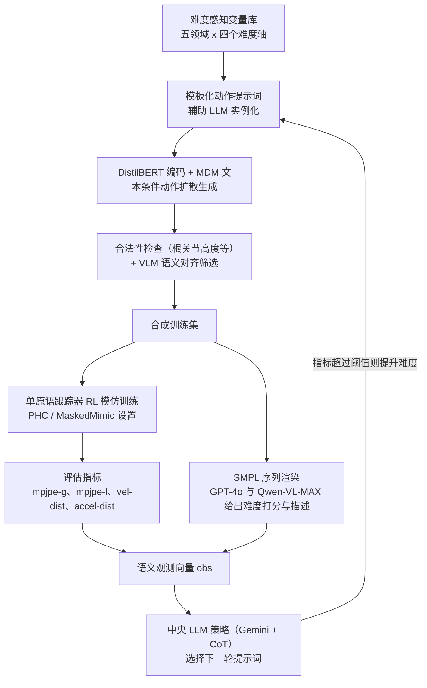

# Iterative Closed-Loop Motion Synthesis for Scaling the Capabilities of Humanoid Control

**Iterative Closed-Loop Motion Synthesis for Scaling the Capabilities of Humanoid Control** 收录于 [Robot Learning Paper Notebooks](https://imchong.github.io/Robot_Learning_Paper_Notebooks/index.html)（分类：13_Physics-Based_Animation）。本页为 **清单索引实体**，链向深读笔记与原始论文；详细机制待从笔记消化后补充。

## 一句话定义

物理人形跟踪策略训练受限于「数据集难度上限」——动捕昂贵、难度分布固定；CLAIMS 把「文本→动作扩散合成 → 控制器训练 → 多模态 Agent 失败诊断 → 提示词进化」串成一个闭环 + 迭代的流水线，让数据集随着控制器一起"越练越难"，覆盖武术、舞蹈、格斗、体育、体操五大专业动作域。

## 英文缩写速查

| 缩写 | 英文全称 | 简要说明 |
|------|----------|----------|
| RL | Reinforcement Learning | 通过与环境交互最大化长期回报来学习策略 |
| WBC | Whole-Body Control | 协调全身关节满足多任务/约束的控制基础设施 |
| Sim2Real | Simulation to Real | 把仿真中学到的策略迁移落地真机的工程主线 |

## 为什么重要

- 列入 Paper Notebooks 策展清单，便于与全库 [机器人学习论文笔记总索引](../overview/humanoid-paper-notebooks-index.md) 及分类父节点交叉检索。
- 深读笔记提供比摘要更贴近实现的阅读路径，适合作为后续 ingest 深化起点。

## 流程总览

图依据：论文 §3.1-§3.5（Fig. 3、Fig. 4、Fig. 5）。

## 核心信息

| 字段 | 内容 |
|------|------|
| 分类 | 13_Physics-Based_Animation |
| 深读笔记 | <https://imchong.github.io/Robot_Learning_Paper_Notebooks/papers/13_Physics-Based_Animation/Iterative_Closed-Loop_Motion_Synthesis/Iterative_Closed-Loop_Motion_Synthesis.html> |
| arXiv | <https://arxiv.org/abs/2602.21599> |

## 实验与评测

- 本页为 **策展清单索引** 摘要；量化 benchmark、消融与实机指标以 **深读笔记与论文 PDF** 为准（链接见 [参考来源](#参考来源)）。

## 结论

**CLAIMS 把「数据集难度」当成可以和控制器一起训练的变量：与其买更贵的动捕，不如让合成动作随控制器能力迭代变难。**

- 闭环的四个环节缺一不可——文本→动作扩散合成、控制器训练、多模态 Agent 失败诊断、提示词进化；其中诊断与提示词进化才是把「控制器现在打不过什么」翻译回数据生成的接口，也是它区别于一次性合成数据集的地方。
- 它针对的是动捕数据「昂贵 + 难度分布固定」这个上限问题，覆盖武术、舞蹈、格斗、体育、体操五大专业动作域，属于用生成数据扩能力边界而非改跟踪算法。
- 边界：本页为笔记摘要，且条目归在 13_Physics-Based_Animation——结论目前落在物理仿真人形跟踪，真机迁移与量化指标需回到深读笔记与论文 PDF。

## 与其他页面的关系

- 分类父节点：[paper-notebook-category-13-physics-based-animation](../overview/paper-notebook-category-13-physics-based-animation.md)
- 总索引：[humanoid-paper-notebooks-index.md](../overview/humanoid-paper-notebooks-index.md)

## 参考来源

- [humanoid_pnb_iterative-closed-loop-motion-synthesis.md](../../sources/papers/humanoid_pnb_iterative-closed-loop-motion-synthesis.md)
- 深读笔记：<https://imchong.github.io/Robot_Learning_Paper_Notebooks/papers/13_Physics-Based_Animation/Iterative_Closed-Loop_Motion_Synthesis/Iterative_Closed-Loop_Motion_Synthesis.html>
- 论文：<https://arxiv.org/abs/2602.21599>
- [arXiv PDF](https://arxiv.org/pdf/2602.21599)：已通读方法部分（实验与附录以略读为准）：§1 引言、§3.1-§3.5 方法

## 推荐继续阅读

- [机器人论文阅读笔记：Iterative Closed-Loop Motion Synthesis for Scaling the Capabilities of Humanoid Control](https://imchong.github.io/Robot_Learning_Paper_Notebooks/papers/13_Physics-Based_Animation/Iterative_Closed-Loop_Motion_Synthesis/Iterative_Closed-Loop_Motion_Synthesis.html)
