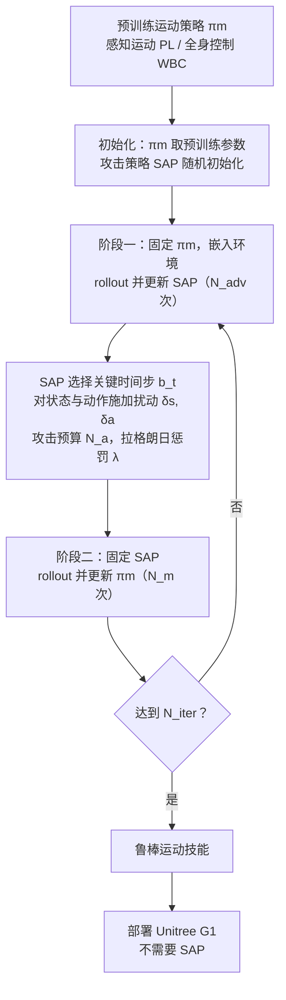

# Keep on Going

**Keep on Going: Learning Robust Humanoid Motion Skills via Selective Adversarial Training** 已列入 [Robot Learning Paper Notebooks](https://imchong.github.io/Robot_Learning_Paper_Notebooks/index.html) 的 **progress 待深读** 清单（分类：04_Loco-Manipulation_and_WBC）。本页 **还没有深读笔记**：只给出这篇论文的分类位置与原文入口，方法细节与数据请直接看原文。

## 一句话定义

Keep on Going 的人形机器人学习论文条目，当前处于 Paper Notebooks 阅读进度（待深读）阶段。

## 英文缩写速查

| 缩写 | 英文全称 | 简要说明 |
|------|----------|----------|
| RL | Reinforcement Learning | 通过与环境交互最大化长期回报来学习策略 |
| WBC | Whole-Body Control | 协调全身关节满足多任务/约束的控制基础设施 |
| Sim2Real | Simulation to Real | 把仿真中学到的策略迁移落地真机的工程主线 |

## 为什么重要

- 这篇已排进 Paper Notebooks 的待读清单，可以从 [机器人学习论文笔记总索引](../overview/humanoid-paper-notebooks-index.md) 与分类页找到同一批工作。
- 深读笔记写出来之前，方法流程见下方「流程总览」（依据论文方法部分），其余方法结论暂不给。

## 流程总览

图依据：论文 Methods（Selective Adversarial Attacks、Non-Zero-Sum Adversarial Training）/ Fig. 2、Algorithm 1

## 核心信息

| 字段 | 内容 |
|------|------|
| 分类 | 04_Loco-Manipulation_and_WBC |
| 深读状态 | 待撰写（[progress.json](https://github.com/ImChong/Robot_Learning_Paper_Notebooks/blob/main/progress.json)） |
| 计划文件夹 | `papers/04_Loco-Manipulation_and_WBC/Keep_on_Going__Learning_Robust_Humanoid_Motion_Skills_via_Selective_Adversarial_` |

## 实验与评测

- 深读笔记尚未完成；量化 benchmark、消融与实机指标待笔记撰写后补充。

## 结论

**Keep on Going 在本库是待读：标题指向用「选择性对抗训练」提升人形运动技能的鲁棒性，机制细节尚未进入本页。**

- 本页只是 04_Loco-Manipulation_and_WBC 分类下的子节点。
- 从标题可读出的定位是鲁棒性导向的运动技能学习，手段是选择性对抗训练。
- 量化 benchmark、消融与实机指标待深读笔记撰写后补充，当前请以 progress.json 与原文为准。

## 与其他页面的关系

- 分类页：[paper-notebook-category-04-loco-manipulation-and-wbc](../overview/paper-notebook-category-04-loco-manipulation-and-wbc.md)
- 总索引：[humanoid-paper-notebooks-index.md](../overview/humanoid-paper-notebooks-index.md)

## 参考来源

- [humanoid_pnb_keep-on-going.md](../../sources/papers/humanoid_pnb_keep-on-going.md)
- [Robot Learning Paper Notebooks · progress.json](https://github.com/ImChong/Robot_Learning_Paper_Notebooks/blob/main/progress.json)
- [arXiv PDF](https://arxiv.org/pdf/2507.08303)：已通读方法部分（实验与附录以略读为准）：Preliminaries、Methods（Selective Adversarial Attacks、Non-Zero-Sum Adversarial Training、Algorithm 1）、Experiments 设定

## 推荐继续阅读

- [Paper Notebooks 阅读进度（PROGRESS.md）](https://github.com/ImChong/Robot_Learning_Paper_Notebooks/blob/main/papers/PROGRESS.md)
