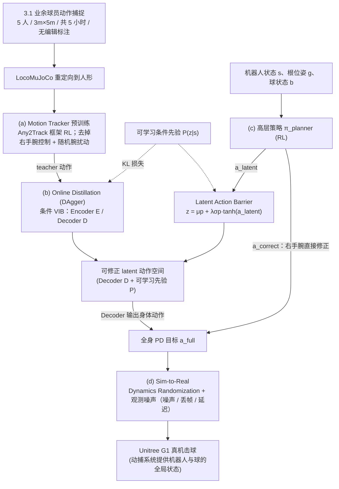
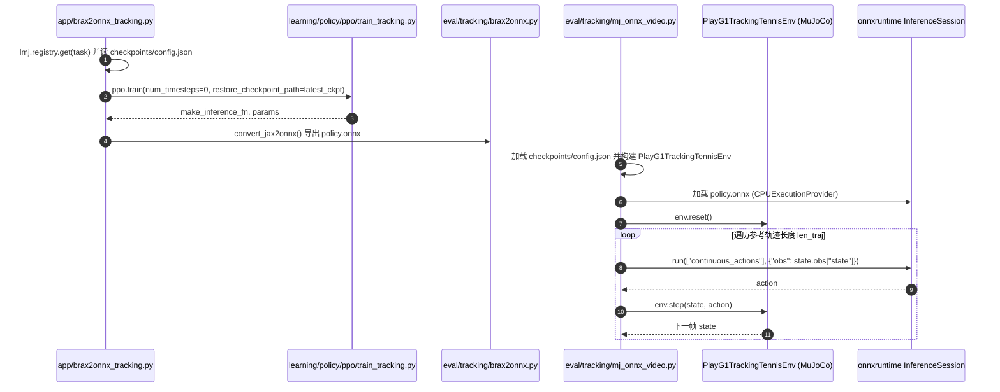

# LATENT

**LATENT: Learning Athletic Humanoid Tennis Skills from Imperfect Human Motion Data**（[arXiv:2603.12686](https://arxiv.org/abs/2603.12686)，[项目页](https://zzk273.github.io/LATENT/)，[代码](https://github.com/GalaxyGeneralRobotics/LATENT)，**IROS 2026 最佳娱乐与游乐论文**）收录于 [Robot Learning Paper Notebooks](https://imchong.github.io/Robot_Learning_Paper_Notebooks/index.html)（分类：04_Loco-Manipulation_and_WBC）。

## 一句话定义

LATENT 只用 5 小时、3 × 5 米小场地采集的"业余网球动作碎片"，就把 Unitree G1 训练成会在真人对打下完成连续多拍回合的"人形网球手"——核心办法是先用动作跟踪器学出一个可修正的 latent 动作空间，再让高层策略在该空间里做 "修正 + 组合"，并用 Latent Action Barrier (LAB) 约束策略别跑出先验分布。

## 英文缩写速查

| 缩写 | 英文全称 | 简要说明 |
|------|----------|----------|
| RL | Reinforcement Learning | 通过与环境交互最大化长期回报来学习策略 |
| WBC | Whole-Body Control | 协调全身关节满足多任务/约束的控制基础设施 |
| Sim2Real | Simulation to Real | 把仿真中学到的策略迁移落地真机的工程主线 |

## 为什么重要

- 列入 Paper Notebooks 策展清单，便于与全库 [机器人学习论文笔记总索引](../overview/humanoid-paper-notebooks-index.md) 及分类父节点交叉检索。
- 深读笔记提供比摘要更贴近实现的阅读路径，适合作为后续 ingest 深化起点。

## 流程总览

图依据：论文 §3.1–3.3、§4 / Fig. 2（LATENT 总览）、Fig. 4（LAB）、式 (4)

## 核心信息

| 字段 | 内容 |
|------|------|
| 分类 | 04_Loco-Manipulation_and_WBC |
| 机构 | 清华大学 · 北京大学 · 银河通用（Galbot）· 上海期智 · 上海 AI Lab |
| 深读笔记 | <https://imchong.github.io/Robot_Learning_Paper_Notebooks/papers/04_Loco-Manipulation_and_WBC/LATENT__Learning_Athletic_Humanoid_Tennis_Skills_from_Imperfect_Human_Motion_Dat/LATENT__Learning_Athletic_Humanoid_Tennis_Skills_from_Imperfect_Human_Motion_Dat.html> |
| arXiv | <https://arxiv.org/abs/2603.12686>（v1） |
| 项目页 / 代码 | <https://zzk273.github.io/LATENT/> · <https://github.com/GalaxyGeneralRobotics/LATENT>（部分开源） |

## 核心原理

LATENT 针对**“不精确（手腕挥拍失真）”**与**“不完整（缺乏比赛组合策略）”**的 5 小时业余网球动作碎片（$3\,\text{m}\times 5\,\text{m}$ 动捕、LocoMuJoCo 重定向到 29-DoF G1），分三阶段构建高动态击球控制：

1. **抗扰低层动作跟踪与去腕部耦合（§3.2.1）：** 基于 [Any2Track](../methods/any2track.md) 在 MuJoCo JAX（2000 Hz 物理仿真 / 50 Hz 控制）训练基础跟踪器 $\pi_{tracker}$，训练时**显式移除持拍右手腕控制并注入随机腕部扰动**，使全身在外部腕部修正下保持平衡。
2. **条件变分信息瓶颈（VIB）与可学习先验（§3.2.2）：** 通过 DAgger 在线蒸馏得到编码器 $E(z_t^q|s_t,\tilde{s}_{t+1})$、解码器 $D(\hat{a}_t^{body}|s_t,z_t^q)$，并用**状态条件先验** $P(z_t^p|s_t)=\mathcal{N}(\mu_p(s_t),\sigma_p(s_t))$ 代替固定单峰高斯先验，区分侧移步与挥拍等差异巨大的动作分布。
3. **动作修正 + Latent Action Barrier（LAB，§3.3）：** 高层策略 $\pi_{planner}(s_t, g_t, b_t)$ 同时输出潜动作 $a_t^{latent}$ 与右手腕直接控制量 $a_t^{correct}$；为防高层策略在自由潜空间中出现 policy hacking（频繁切换原语引发高频抖动），LAB 按条件先验标准差 $\sigma_t^p$ 在马氏距离意义下限制残差探索边界：$a_t^{full}=[D(s_t,\mu_t^p+\lambda\sigma_t^p\cdot\tanh(a_t^{latent})), a_t^{correct}]$。

## 源码运行时序图

官方仓库 `GalaxyGeneralRobotics/LATENT@a931da5` **当前仅开源了第一阶段的运动跟踪环境、ONNX 导出与 MuJoCo 回放评估代码**（DAgger 隐空间蒸馏、高层网球策略与真机部署仍在 TODO 未发布），且 README 所写 `train_ppo_track_tennis` 训练脚本在当前提交树中缺省；下图描绘仓库内实际可核实的 ONNX 导出与 MuJoCo 评测链路（`brax2onnx_tracking.py` → `mj_onnx_video.py`）：

图依据：`GalaxyGeneralRobotics/LATENT@a931da5` 的 `README.md`、`latent_mj/app/brax2onnx_tracking.py`、`latent_mj/eval/tracking/mj_onnx_video.py` 与 `latent_mj/learning/policy/ppo/train_tracking.py`；仅通读源码，未在本地下载数据或运行。

## 实验与评测

- **仿真回球性能（Table 3，10,000 次随机发球试验，峰值球速 >15 m/s，2.5 m 落点阈值）：** 正手 SR **96.52%**（DE 1.32 m）、反手 **82.10%**（1.89 m）、前场 **86.35%**（1.73 m）、后场 **89.80%**（1.55 m），显著高于 PULSE（71.85% / 63.38% / 74.52% / 72.94%）、ASE（63.47% / 55.22% / 71.36% / 68.59%）与 AMP；Vanilla PPO 与 MotionVAE 未能收敛。
- **核心设计消融（Table 4）：** 去除右手腕直接修正（w/o Corr.）反手 SR 从 82.10% 跌至 **68.94%**；去除 LAB（w/o LAB）关节加速度平滑度指标从 25.61 恶化至 **37.64**、平均力矩从 7.40 升至 **12.53**。
- **真机连续对打（Table 5 & 附录 A.2）：** 20 场人机连续对打（Unitree G1，有效回球落入对方半场）正手 **90.90%**、反手 **77.78%**、前场 **88.89%**、后场 **81.82%**（去掉球动力学随机化后跌至 14.29%–28.57%）；仿真双机自博弈 50 局最高连续 **25 拍**回合。

## 与其他工作对比

| 方法 / 路线 | 正手 SR | 反手 SR | 前场 SR | 后场 SR | 核心机制差异与表现读法 |
|---|---|---|---|---|---|
| **LATENT（本文，Table 3 仿真）** | **96.52%** | **82.10%** | **86.35%** | **89.80%** | 可修正条件 VIB 隐空间 + 右手腕直接修正 + LAB 马氏界限约束 |
| **PULSE** | 71.85% | 63.38% | 74.52% | 72.94% | 现有潜空间运动先验，未针对不完美数据手腕失真与 LAB 抖动抑制做解耦修正 |
| **ASE** | 63.47% | 55.22% | 71.36% | 68.59% | 无监督技能先验发现；高精度来球回击落点成功率低于 LATENT |
| **AMP / Vanilla PPO / MotionVAE** | 低于 LATENT / 不收敛 | 低于 LATENT / 不收敛 | 低于 LATENT / 不收敛 | 低于 LATENT / 不收敛 | Vanilla PPO 与 MotionVAE 在高速动态网球回击设定下未收敛 |

- **vs [LHBS](./paper-notebook-learning-human-like-badminton-skills-for-humanoi.md)（人形羽毛球，EngineAI PM01）：** LHBS 基于干净专业 MoCap 经四阶段 Imitation-to-Interaction（DAgger + AMP + 羽毛球流形扩展）实现零样本挑球；LATENT 针对 5 小时业余不完美网球动作碎片，在可修正 VIB 潜空间内叠加腕部残差直控与 LAB 约束完成真人多拍对打。
- **vs [SoccerBot（Latent Motion Priors）](./paper-soccerbot-latent-motion-priors.md)：** 同属潜动作先验驱动的人形体育技能路线，SoccerBot 聚焦足球方向潜先验与多技能组合。

## 结论

**LATENT 真正解决的不是「打网球」，而是怎样用 5 小时、3 × 5 米小场地采到的不完美业余动作碎片，撑起真人对打下的连续多拍回合。**

- 起作用的是**可修正隐空间 + 混合动作输出**：低层跟踪与 VIB 蒸馏刻意剥离右手腕控制并注入腕扰动，使高层策略既能用 $a_t^{latent}$ 组合全身步法与挥拍先验，又能用 $a_t^{correct}$ 直接补偿精准腕角（去修正反手掉 13.16 个百分点）。
- **Latent Action Barrier (LAB)** 是让这套结构不崩的关键约束——按状态条件先验标准差 $\sigma_t^p$ 在马氏尺度上限制残差探索，既压住策略钻空子抖动（平滑度 25.61 vs 37.64），又保留适应来球的速度空间。
- Sim2Real 依赖**对网球气动阻力/弹跳/摩擦的域随机化 + 4 帧滑窗速度滤波**（去球动力学随机化真机成功率暴跌 60+ 个百分点）。
- **载体与实验条件绑定**：硬件为 **Unitree G1（拆右手 3D 打印接球拍）**，且真机全局状态与来球位置依赖 **$19\,\text{m}\times 15\,\text{m}$ 场地 50+ 台 120 Hz 光学动捕相机**。
- **开源状态边界**：`GalaxyGeneralRobotics/LATENT@a931da5` 目前仅开放第一阶段跟踪环境、ONNX 导出与 MuJoCo 评估及少量示例数据；隐空间蒸馏、高层网球策略与真机代码尚未发布。

## 工程实践

1. **当前可运行边界（`@a931da5`）：** 可按 README 用 `uv sync -i https://pypi.org/simple`、初始化 `.env` 与 `python latent_mj/app/mj_playground_init.py` 拉起 MuJoCo-MJX 资产，下载 Google Drive 网球片段至 `storage/data/mocap/Tennis/` 后，使用 `latent_mj.app.brax2onnx_tracking` 与 `latent_mj.eval.tracking.mj_onnx_video` 验证网球跟踪评估流。
2. **代码入口注意项：** README 所列 `python -m latent_mj.learning.train.train_ppo_track_tennis` 在 `a931da5` 提交树中尚未合入（缺失 `latent_mj/learning/train/`）；DAgger 蒸馏、LAB 高层规划训练与真机接口均需等待后续 release。
3. **真机工程代价参考：** README 披露原论文真机测试采用第三方动捕场地（50+ 台 2048×2048 @ 120 Hz 相机，19×15 m 区域），3 周场地及动捕系统租赁成本约 35 万元人民币（约 5 万美元），球面贴反光膜、机体表面做漫反射处理并加固了末端腕关节连接件。

## 局限与风险

- **外部光学动捕强依赖：** 原文 §6 明确指出当前真机部署仍依赖全场地光学动捕实时提供机器人 6D 位姿与高速网球状态，尚未切换至纯机载主动视觉。
- **单向喂球设定而非对抗博弈：** 实验任务为连续回击随机发球至目标落区（非真实双人博弈对抗），尚未融入多智能体自博弈训练以应对对手骗招与策略博弈。
- **开源不完整导致论文主体尚不可复现：** 截至 2026-11-21，仓库仅公开跟踪基础环境与少量动作片段，核心的 VIB 蒸馏、LAB 高层网球训练与真机部署代码仍属未发布 TODO。

## 关联页面

- 分类父节点：[paper-notebook-category-04-loco-manipulation-and-wbc](../overview/paper-notebook-category-04-loco-manipulation-and-wbc.md)
- 总索引：[humanoid-paper-notebooks-index.md](../overview/humanoid-paper-notebooks-index.md)
- 后续多技能扩展：[SoccerBot（Latent Motion Priors）](./paper-soccerbot-latent-motion-priors.md)
- 底层跟踪框架：[Any2Track / OpenTrack](../methods/any2track.md)
- 同领域任务：[Loco-Manipulation](../tasks/loco-manipulation.md)

## 参考来源

- [LATENT 论文原文归档（arXiv:2603.12686）](../../sources/papers/humanoid_pnb_latent.md)
- [LATENT 源码归档](../../sources/repos/latent.md)（<https://github.com/GalaxyGeneralRobotics/LATENT>，commit `a931da5`）
- [IROS 2026 九篇获奖盘点（公众号）](../../sources/blogs/wechat_iros_2026_awards_9_papers_2026-10-02.md)
- 深读笔记：<https://imchong.github.io/Robot_Learning_Paper_Notebooks/papers/04_Loco-Manipulation_and_WBC/LATENT__Learning_Athletic_Humanoid_Tennis_Skills_from_Imperfect_Human_Motion_Dat/LATENT__Learning_Athletic_Humanoid_Tennis_Skills_from_Imperfect_Human_Motion_Dat.html>
- 论文：<https://arxiv.org/abs/2603.12686>

## 推荐继续阅读

- [LATENT 官方论文（arXiv:2603.12686）](https://arxiv.org/abs/2603.12686)
- [LATENT 项目主页](https://zzk273.github.io/LATENT/)
- [LATENT 官方仓库](https://github.com/GalaxyGeneralRobotics/LATENT)
- [机器人论文阅读笔记：LATENT](https://imchong.github.io/Robot_Learning_Paper_Notebooks/papers/04_Loco-Manipulation_and_WBC/LATENT__Learning_Athletic_Humanoid_Tennis_Skills_from_Imperfect_Human_Motion_Dat/LATENT__Learning_Athletic_Humanoid_Tennis_Skills_from_Imperfect_Human_Motion_Dat.html)
