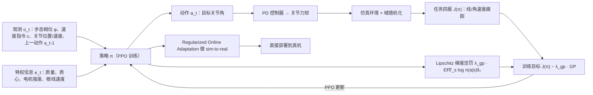

# Learning Smooth Humanoid Locomotion through Lipschitz-Constrained Policies

**Learning Smooth Humanoid Locomotion through Lipschitz-Constrained Policies (LCP)** 收录于 [Robot Learning Paper Notebooks](https://imchong.github.io/Robot_Learning_Paper_Notebooks/index.html)（分类：01_Foundational_RL）。本页为 **清单索引实体**，链向深读笔记与原始论文；方法流程见 [流程总览](#流程总览)；笔记细节待从深读笔记消化后补充。

## 一句话定义

LCP 的核心主张很硬：与其在 reward 里拧各种“平滑惩罚”旋钮，或者在输出后面再塞低通滤波器，不如直接约束策略本身对输入的敏感度——用一个可微的梯度惩罚，把策略训练成“天生不抖”。

## 英文缩写速查

| 缩写 | 英文全称 | 简要说明 |
|------|----------|----------|
| RL | Reinforcement Learning | 通过与环境交互最大化长期回报来学习策略 |
| WBC | Whole-Body Control | 协调全身关节满足多任务/约束的控制基础设施 |
| Sim2Real | Simulation to Real | 把仿真中学到的策略迁移落地真机的工程主线 |

## 为什么重要

- 列入 Paper Notebooks 策展清单，便于与全库 [机器人学习论文笔记总索引](../overview/humanoid-paper-notebooks-index.md) 及分类父节点交叉检索。
- 深读笔记提供比摘要更贴近实现的阅读路径，适合作为后续 ingest 深化起点。

## 流程总览

图依据：论文 §IV（式 7 梯度惩罚）、§V（观测/动作/训练设置）。

## 核心信息

| 字段 | 内容 |
|------|------|
| 分类 | 01_Foundational_RL |
| 深读笔记 | <https://imchong.github.io/Robot_Learning_Paper_Notebooks/papers/01_Foundational_RL/LCP_Sim-to-Real_Action_Smoothing/LCP_Sim-to-Real_Action_Smoothing.html> |
| arXiv | <https://arxiv.org/abs/2410.11825> |

## 实验与评测

- 本页为 **策展清单索引** 摘要；量化 benchmark、消融与实机指标以 **深读笔记与论文 PDF** 为准（链接见 [参考来源](#参考来源)）。

## 结论

**LCP 把动作平滑从「事后修补」改成「训练时的结构约束」：不在 reward 里拧平滑惩罚旋钮，也不在输出端塞低通滤波器，而是直接限制策略对输入的敏感度。**

- 真正起作用的是那个可微的梯度惩罚（Lipschitz 约束）——它让策略「天生不抖」，而不是在推理链路上再挂一级处理。
- 相对 reward shaping，省掉了一堆需要手调的平滑惩罚项；相对低通滤波，策略输出后不再需要额外的后处理环节。
- 定位在 01_Foundational_RL，是 sim-to-real 落地阶段的通用训练手段，而非针对某一任务的方法。
- 本页为策展清单索引实体，方法流程见 [流程总览](#流程总览)；量化结果待从深读笔记消化，以笔记与论文 PDF 为准。

## 与其他页面的关系

- 分类父节点：[paper-notebook-category-01-foundational-rl](../overview/paper-notebook-category-01-foundational-rl.md)
- 总索引：[humanoid-paper-notebooks-index.md](../overview/humanoid-paper-notebooks-index.md)

## 参考来源

- [humanoid_pnb_lcp-sim-to-real-action-smoothing.md](../../sources/papers/humanoid_pnb_lcp-sim-to-real-action-smoothing.md)
- 深读笔记：<https://imchong.github.io/Robot_Learning_Paper_Notebooks/papers/01_Foundational_RL/LCP_Sim-to-Real_Action_Smoothing/LCP_Sim-to-Real_Action_Smoothing.html>
- 论文：<https://arxiv.org/abs/2410.11825>
- [arXiv PDF](https://arxiv.org/pdf/2410.11825)：已通读方法部分（实验与附录以略读为准）：§III 背景、§IV 方法、§V 训练设置、§VI 实验设置与基线对比

## 推荐继续阅读

- [机器人论文阅读笔记：Learning Smooth Humanoid Locomotion through Lipschitz-Constrained Policies](https://imchong.github.io/Robot_Learning_Paper_Notebooks/papers/01_Foundational_RL/LCP_Sim-to-Real_Action_Smoothing/LCP_Sim-to-Real_Action_Smoothing.html)
