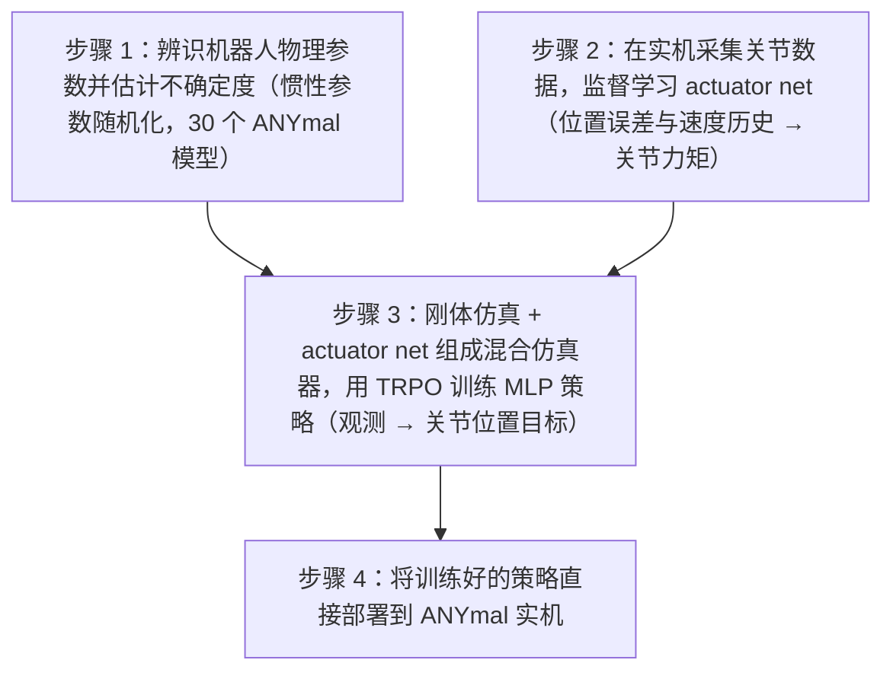

# Learning Agile and Dynamic Motor Skills for Legged Robots

**Learning Agile and Dynamic Motor Skills for Legged Robots** 收录于 [Robot Learning Paper Notebooks](https://imchong.github.io/Robot_Learning_Paper_Notebooks/index.html)（分类：03_High_Impact_Selection）。本页为 **清单索引实体**，链向深读笔记与原始论文；详细机制待从笔记消化后补充。

## 一句话定义

把"电机 + 减速箱 + 控制器 + 通信延迟"全部用一个 MLP 致动器网络（actuator network，3 层隐层×32 单元，输入位置误差与速度的短历史、输出关节力矩；依据 arXiv:1901.08652 Materials and Methods）离线辨识，然后在「刚体动力学仿真 + actuator net」的混合仿真器（论文称 in-house simulator，页面此前所称 RaiSim 论文未直接写明）里做高速 RL 训练，最终把策略零样本搬到 ANYmal 上，让它能跟随速度指令、奔跑（最高 1.5 m/s，比厂家 MPC 快 25%）以及从任意倒地姿态自主翻身爬起——首次系统性证明 sim-to-real RL 可以在真实四足上稳定落地。

## 英文缩写速查

| 缩写 | 英文全称 | 简要说明 |
|------|----------|----------|
| RL | Reinforcement Learning | 通过与环境交互最大化长期回报来学习策略 |
| WBC | Whole-Body Control | 协调全身关节满足多任务/约束的控制基础设施 |
| Sim2Real | Simulation to Real | 把仿真中学到的策略迁移落地真机的工程主线 |

## 为什么重要

- 列入 Paper Notebooks 策展清单，便于与全库 [机器人学习论文笔记总索引](../overview/humanoid-paper-notebooks-index.md) 及分类父节点交叉检索。
- 深读笔记提供比摘要更贴近实现的阅读路径，适合作为后续 ingest 深化起点。

## 流程总览

图依据：论文 Fig.1（四步流程）与 Materials and Methods（Modeling rigid-body dynamics / Modeling the actuation / Policy training details）。

## 核心信息

| 字段 | 内容 |
|------|------|
| 分类 | 03_High_Impact_Selection |
| 深读笔记 | <https://imchong.github.io/Robot_Learning_Paper_Notebooks/papers/03_High_Impact_Selection/Learning_Agile_and_Dynamic_Motor_Skills_for_Legged_Robots/Learning_Agile_and_Dynamic_Motor_Skills_for_Legged_Robots.html> |
| arXiv | <https://arxiv.org/abs/1901.08652> |

## 实验与评测

- 本页为 **策展清单索引** 摘要；量化 benchmark、消融与实机指标以 **深读笔记与论文 PDF** 为准（链接见 [参考来源](#参考来源)）。

## 结论

**这篇工作真正的贡献不是又一个 RL 算法，而是把 sim-to-real 的瓶颈定位到「致动器」，用数据驱动的 MLP 致动器网络补上这一环，让零样本迁移在真实四足上第一次系统性成立。**

- 起作用的机制是把电机、减速箱、控制器与通信延迟整体当黑箱、用 MLP 离线辨识，而不是继续精修刚体动力学模型。
- 训练侧的取舍是速度优先：混合仿真器中刚体部分仍由刚体动力学仿真计算，仅致动器部分由 actuator net 替代，整体约 500K 步/秒，换来高速 RL 迭代（依据论文 Introduction 与 Method）。
- 结果覆盖三类能力（速度指令跟随、最高 1.5 m/s 奔跑、任意倒地姿态自主翻身爬起），其中奔跑比厂家 MPC 快 25%，说明学习式控制器已能在同一硬件上超过调好的传统方案。
- 适用边界：结论建立在 ANYmal 这一具体平台的致动器辨识之上，换硬件需要重新采数据、重训致动器网络。
- 本页为策展笔记摘要，量化 benchmark、消融与实机指标以深读笔记与论文 PDF 为准，不要把本页当数据来源引用。

## 与其他页面的关系

- 分类父节点：[paper-notebook-category-03-high-impact-selection](../overview/paper-notebook-category-03-high-impact-selection.md)
- 总索引：[humanoid-paper-notebooks-index.md](../overview/humanoid-paper-notebooks-index.md)

## 参考来源

- [humanoid_pnb_learning-agile-and-dynamic-motor-skills-for-legg.md](../../sources/papers/humanoid_pnb_learning-agile-and-dynamic-motor-skills-for-legg.md)
- 深读笔记：<https://imchong.github.io/Robot_Learning_Paper_Notebooks/papers/03_High_Impact_Selection/Learning_Agile_and_Dynamic_Motor_Skills_for_Legged_Robots/Learning_Agile_and_Dynamic_Motor_Skills_for_Legged_Robots.html>
- 论文：<https://arxiv.org/abs/1901.08652>
- [arXiv PDF](https://arxiv.org/pdf/1901.08652)：已通读方法部分（实验与附录以略读为准）：引言、Fig.1 方法概述、Materials and Methods（刚体建模、actuator net、策略训练与部署细节）；结果与补充材料仅略读
- 核对（2026-11-02）：对照 arXiv:1901.08652 Introduction 与 Method（Modeling the actuation），actuator net 为 MLP 而非 LSTM、仿真器为刚体仿真 + actuator net 的混合仿真器；已修正一句话定义、summary、结论；流程总览图与论文一致，未改。

## 推荐继续阅读

- [机器人论文阅读笔记：Learning Agile and Dynamic Motor Skills for Legged Robots](https://imchong.github.io/Robot_Learning_Paper_Notebooks/papers/03_High_Impact_Selection/Learning_Agile_and_Dynamic_Motor_Skills_for_Legged_Robots/Learning_Agile_and_Dynamic_Motor_Skills_for_Legged_Robots.html)
