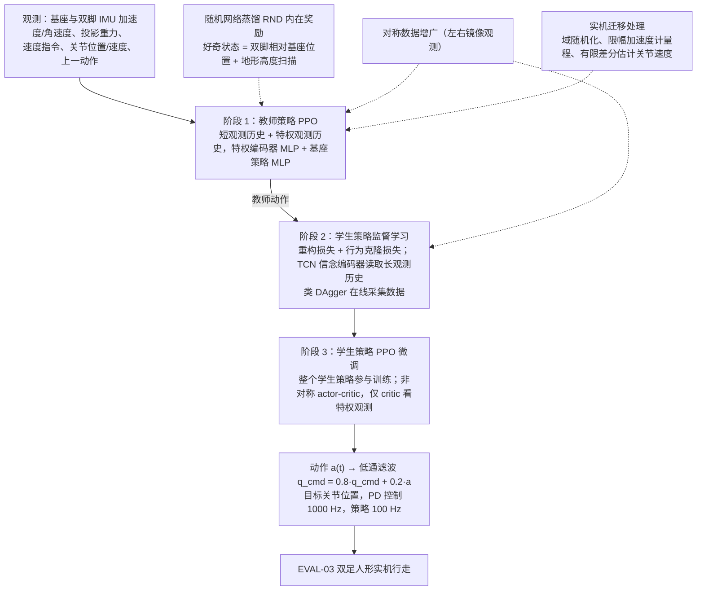

---

type: entity
tags: [paper, humanoid-paper-notebooks, paper-notebook-planned, nvidia]
status: planned
updated: 2026-09-15
arxiv: "2504.00614"
related:
  - ../overview/paper-notebook-category-05-locomotion.md
  - ../overview/humanoid-paper-notebooks-index.md
sources:
  - ../../sources/papers/humanoid_pnb_learning-bipedal-locomotion-on-gear-driven-human.md
summary: "Learning Bipedal Locomotion on Gear-Driven Humanoid Robot Using Foot-Mounted IMUs：列入 Paper Notebooks PROGRESS.md 待深读清单；深读笔记完成后补成完整摘要。"
---

# Learning Bipedal Locomotion on Gear-Driven Humanoid Robot Using Foot-Mounted IMUs

**Learning Bipedal Locomotion on Gear-Driven Humanoid Robot Using Foot-Mounted IMUs** 已列入 [Robot Learning Paper Notebooks](https://imchong.github.io/Robot_Learning_Paper_Notebooks/index.html) 的 **PROGRESS.md 待深读** 清单（分类：05_Locomotion）。本页 **还没有深读笔记**：除分类位置与原文入口外，仅给出依据论文方法部分的「流程总览」图，方法细节与数据请直接看原文。

## 一句话定义

Learning Bipedal Locomotion on Gear-Driven Humanoid Robot Using Foot-Mounted IMUs 的人形机器人学习论文条目，当前处于 Paper Notebooks 阅读进度（待深读）阶段。

## 英文缩写速查

| 缩写 | 英文全称 | 简要说明 |
|------|----------|----------|
| RL | Reinforcement Learning | 通过与环境交互最大化长期回报来学习策略 |
| WBC | Whole-Body Control | 协调全身关节满足多任务/约束的控制基础设施 |
| Sim2Real | Simulation to Real | 把仿真中学到的策略迁移落地真机的工程主线 |

## 为什么重要

- 这篇已排进 Paper Notebooks 的待读清单，可以从 [机器人学习论文笔记总索引](../overview/humanoid-paper-notebooks-index.md) 与分类页找到同一批工作。
- 在笔记写出来之前，这里只保留分类位置与原文入口，不给方法结论。

## 流程总览

图依据：论文 §III-A 至 §III-E（Fig. 2、Fig. 3、Eq. 1–3）

## 核心信息

| 字段 | 内容 |
|------|------|
| 分类 | 05_Locomotion |
| 深读状态 | 待撰写（[PROGRESS.md](https://github.com/ImChong/Robot_Learning_Paper_Notebooks/blob/main/papers/PROGRESS.md)） |
| 计划文件夹 | `papers/05_Locomotion/learning-bipedal-locomotion-on-gear-driven-human` |
| arXiv | <https://arxiv.org/abs/2504.00614> |

## 实验与评测

- 深读笔记尚未完成；量化 benchmark、消融与实机指标待笔记撰写后补充。

## 结论

**本页是「齿轮传动人形 + 足部 IMU」这条线索的待读条目，而不是一份可引用的技术结论。**

- 目前唯一可核验的是元信息：分类 05_Locomotion、arXiv 2504.00614、计划笔记文件夹路径与 PROGRESS.md 中的待深读状态。
- 标题给出的线索（齿轮传动人形、足部安装 IMU）在正文中尚未展开，机制、消融与实机指标全部空缺。
- 适用边界：只适合作为检索入口（分类页 / 总索引），任何技术判断都应回到 PROGRESS.md 与论文原文。
- 深读笔记完成后，本页会补上笔记链接与实质要点。

## 与其他页面的关系

- 分类页：[paper-notebook-category-05-locomotion](../overview/paper-notebook-category-05-locomotion.md)
- 总索引：[humanoid-paper-notebooks-index.md](../overview/humanoid-paper-notebooks-index.md)

## 参考来源

- [humanoid_pnb_learning-bipedal-locomotion-on-gear-driven-human.md](../../sources/papers/humanoid_pnb_learning-bipedal-locomotion-on-gear-driven-human.md)
- [Robot Learning Paper Notebooks · PROGRESS.md](https://github.com/ImChong/Robot_Learning_Paper_Notebooks/blob/main/papers/PROGRESS.md)
- 论文：<https://arxiv.org/abs/2504.00614>
- [arXiv PDF](https://arxiv.org/pdf/2504.00614)：已通读方法部分（实验与附录以略读为准）：§III 方法（A 观测与动作、B 仿真到实机处理、C 对称数据增广、D 师生训练与微调、E RND）；§IV 实验设置与 §V 实验结果仅略读

## 推荐继续阅读

- [Paper Notebooks 阅读进度（PROGRESS.md）](https://github.com/ImChong/Robot_Learning_Paper_Notebooks/blob/main/papers/PROGRESS.md)
