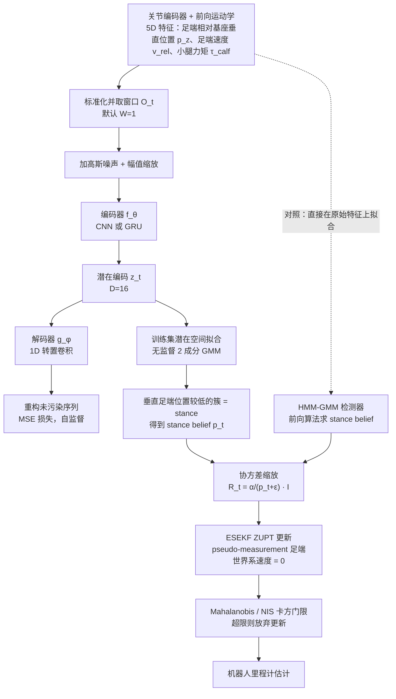

# Learning Contact Representation for Leg Odometry

**Learning Contact Representation for Leg Odometry** 已列入 [Robot Learning Paper Notebooks](https://imchong.github.io/Robot_Learning_Paper_Notebooks/index.html) 的 **PROGRESS.md 待深读** 清单（分类：09_State_Estimation）。本页 **还没有深读笔记**：只给出这篇论文的分类位置与原文入口，方法细节与数据请直接看原文。

## 一句话定义

Learning Contact Representation for Leg Odometry 的人形机器人学习论文条目，当前处于 Paper Notebooks 阅读进度（待深读）阶段。

## 英文缩写速查

| 缩写 | 英文全称 | 简要说明 |
|------|----------|----------|
| RL | Reinforcement Learning | 通过与环境交互最大化长期回报来学习策略 |
| WBC | Whole-Body Control | 协调全身关节满足多任务/约束的控制基础设施 |
| Sim2Real | Simulation to Real | 把仿真中学到的策略迁移落地真机的工程主线 |

## 为什么重要

- 这篇已排进 Paper Notebooks 的待读清单，可以从 [机器人学习论文笔记总索引](../overview/humanoid-paper-notebooks-index.md) 与分类页找到同一批工作。
- 在深读笔记写出来之前，这里只保留分类位置与原文入口；方法流程见下方「流程总览」（依据论文方法部分）。

## 流程总览

图依据：论文 §3.1、§3.2.1、§3.2.2 / Fig.1。

## 核心信息

| 字段 | 内容 |
|------|------|
| 分类 | 09_State_Estimation |
| 深读状态 | 待撰写（[PROGRESS.md](https://github.com/ImChong/Robot_Learning_Paper_Notebooks/blob/main/papers/PROGRESS.md)） |
| 计划文件夹 | `papers/09_State_Estimation/Learning_Contact_Representation_for_Leg_Odometry` |
| arXiv | <https://arxiv.org/abs/2606.05501> |

## 实验与评测

- 深读笔记尚未完成；量化 benchmark、消融与实机指标待笔记撰写后补充。

## 结论

**本页当前是一条待读记录，而不是对这篇论文的归纳：它只登记了这篇属于 09_State_Estimation，实质内容要等深读笔记补齐。**

- 页面可确证的只有三件事：分类归属 09_State_Estimation、PROGRESS.md 上的「待深读」状态、arXiv 编号 2606.05501；核心机制、量化指标与消融均无记录。
- 适用边界：可用于按分类检索与待读链接，不能当作该工作的技术依据或引用来源。
- 主要风险是被误读成已完成的摘要；深读状态以上游 PROGRESS.md 为准，笔记撰写完成后本页需按完整索引实体重写。

## 与其他页面的关系

- 分类页：[paper-notebook-category-09-state-estimation](../overview/paper-notebook-category-09-state-estimation.md)
- 总索引：[humanoid-paper-notebooks-index.md](../overview/humanoid-paper-notebooks-index.md)

## 参考来源

- [humanoid_pnb_learning-contact-representation-for-leg-odometry.md](../../sources/papers/humanoid_pnb_learning-contact-representation-for-leg-odometry.md)
- [Robot Learning Paper Notebooks · PROGRESS.md](https://github.com/ImChong/Robot_Learning_Paper_Notebooks/blob/main/papers/PROGRESS.md)
- 论文：<https://arxiv.org/abs/2606.05501>
- [arXiv PDF](https://arxiv.org/pdf/2606.05501)：已通读方法部分（实验与附录以略读为准）：§3.1、§3.2（含 3.2.1、3.2.2）、§4 开头实验设定、Fig.1

## 推荐继续阅读

- [Paper Notebooks 阅读进度（PROGRESS.md）](https://github.com/ImChong/Robot_Learning_Paper_Notebooks/blob/main/papers/PROGRESS.md)
