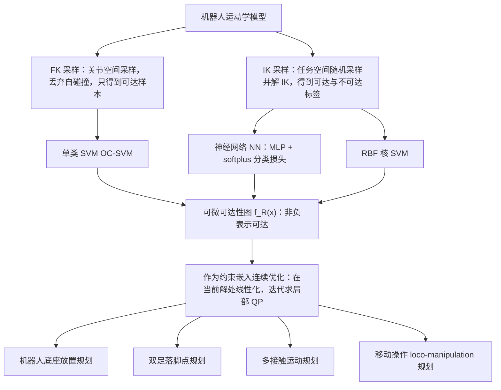

# Learning Differentiable Reachability Maps for Optimization-based Humanoid Motion Generation

**Learning Differentiable Reachability Maps for Optimization-based Humanoid Motion Generation** 已列入 [Robot Learning Paper Notebooks](https://imchong.github.io/Robot_Learning_Paper_Notebooks/index.html) 的 **PROGRESS.md 待深读** 清单（分类：14_Human_Motion）。本页 **还没有深读笔记**：只给出这篇论文的分类位置与原文入口，方法细节与数据请直接看原文。

## 一句话定义

Learning Differentiable Reachability Maps for Optimization-based Humanoid Motion Generation 的人形机器人学习论文条目，当前处于 Paper Notebooks 阅读进度（待深读）阶段。

## 英文缩写速查

| 缩写 | 英文全称 | 简要说明 |
|------|----------|----------|
| RL | Reinforcement Learning | 通过与环境交互最大化长期回报来学习策略 |
| WBC | Whole-Body Control | 协调全身关节满足多任务/约束的控制基础设施 |
| Sim2Real | Simulation to Real | 把仿真中学到的策略迁移落地真机的工程主线 |

## 为什么重要

- 这篇已排进 Paper Notebooks 的待读清单，可以从 [机器人学习论文笔记总索引](../overview/humanoid-paper-notebooks-index.md) 与分类页找到同一批工作。
- 在笔记写出来之前，这里只保留分类位置与原文入口；方法流程见下方「流程总览」，实验结论以论文为准。

## 流程总览

图依据：论文 §III（可微可达性图与样本生成）、§V（带可达性约束的运动生成）、§VI / Fig. 2–5。

## 核心信息

| 字段 | 内容 |
|------|------|
| 分类 | 14_Human_Motion |
| 深读状态 | 待撰写（[PROGRESS.md](https://github.com/ImChong/Robot_Learning_Paper_Notebooks/blob/main/papers/PROGRESS.md)） |
| 计划文件夹 | `papers/14_Human_Motion/learning-differentiable-reachability-maps-for-op` |
| arXiv | <https://arxiv.org/abs/2508.11275> |

## 实验与评测

- 深读笔记尚未完成；量化 benchmark、消融与实机指标待笔记撰写后补充。

## 结论

**本页是「可微可达性映射」这篇工作的待读条目节点：它现在能提供的是分类位置与溯源入口，而不是可引用的方法结论。**

- 页面可确认的信息只有三项：分类 14_Human_Motion、arXiv 2508.11275、深读状态「待撰写」；标题给出的唯一机制线索是把可达性映射做成可微形式、服务于基于优化的人形运动生成。
- 适用边界很窄：可当检索入口与知识待读条目用，不能当技术判断依据——本页「实验与评测」已明确量化 benchmark、消融与实机指标都要等深读笔记完成后才补。
- 主要风险是把待读条目误读成结论页；深读笔记完成后本页会补上笔记链接并重写，分类入口仍是 [paper-notebook-category-14-human-motion](../overview/paper-notebook-category-14-human-motion.md)。

## 与其他页面的关系

- 分类页：[paper-notebook-category-14-human-motion](../overview/paper-notebook-category-14-human-motion.md)
- 总索引：[humanoid-paper-notebooks-index.md](../overview/humanoid-paper-notebooks-index.md)

## 参考来源

- [humanoid_pnb_learning-differentiable-reachability-maps-for-op.md](../../sources/papers/humanoid_pnb_learning-differentiable-reachability-maps-for-op.md)
- [Robot Learning Paper Notebooks · PROGRESS.md](https://github.com/ImChong/Robot_Learning_Paper_Notebooks/blob/main/papers/PROGRESS.md)
- 论文：<https://arxiv.org/abs/2508.11275>
- [arXiv PDF](https://arxiv.org/pdf/2508.11275)：已通读方法部分（实验与附录以略读为准）：摘要、§II 相关工作与贡献、§III 可微可达性图、§IV-A/B 数值评估、§V 运动生成、§VI 应用、§VII 讨论开头

## 推荐继续阅读

- [Paper Notebooks 阅读进度（PROGRESS.md）](https://github.com/ImChong/Robot_Learning_Paper_Notebooks/blob/main/papers/PROGRESS.md)
