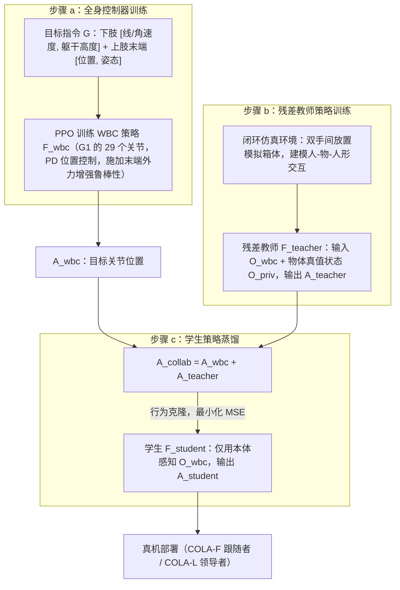

# Learning Human-Humanoid Coordination for Collaborative Object Carrying

**Learning Human-Humanoid Coordination for Collaborative Object Carrying** 已列入 [Robot Learning Paper Notebooks](https://imchong.github.io/Robot_Learning_Paper_Notebooks/index.html) 的 **progress 待深读** 清单（分类：04_Loco-Manipulation_and_WBC）。本页 **还没有深读笔记**：给出这篇论文的分类位置与原文入口，并在「流程总览」补了方法流程图，数据请直接看原文。

## 一句话定义

Learning Human-Humanoid Coordination for Collaborative Object Carrying 的人形机器人学习论文条目，当前处于 Paper Notebooks 阅读进度（待深读）阶段。

## 英文缩写速查

| 缩写 | 英文全称 | 简要说明 |
|------|----------|----------|
| RL | Reinforcement Learning | 通过与环境交互最大化长期回报来学习策略 |
| WBC | Whole-Body Control | 协调全身关节满足多任务/约束的控制基础设施 |
| Sim2Real | Simulation to Real | 把仿真中学到的策略迁移落地真机的工程主线 |

## 为什么重要

- 这篇已排进 Paper Notebooks 的待读清单，可以从 [机器人学习论文笔记总索引](../overview/humanoid-paper-notebooks-index.md) 与分类页找到同一批工作。
- 在笔记写出来之前，这里只保留分类位置、原文入口与「流程总览」，不给方法结论。

## 流程总览

图依据：论文 §III Methodology（A. Overview 三步训练、B. Whole-body Control Policy、C. Residual Teacher Policy、D. Knowledge Distillation；Fig. 2）。

## 核心信息

| 字段 | 内容 |
|------|------|
| 分类 | 04_Loco-Manipulation_and_WBC |
| 深读状态 | 待撰写（[progress.json](https://github.com/ImChong/Robot_Learning_Paper_Notebooks/blob/main/progress.json)） |
| 计划文件夹 | `papers/04_Loco-Manipulation_and_WBC/Learning_Human-Humanoid_Coordination_for_Collaborative_Object_Carrying` |

## 实验与评测

- 深读笔记尚未完成；量化 benchmark、消融与实机指标待笔记撰写后补充。

## 结论

**本页是 04_Loco-Manipulation_and_WBC 分类下的待读条目，尚不构成对这篇工作的归纳：它方便你按分类找到它，内容深化留给深读笔记。**

- 页面可确证的信息仅限分类归属、progress.json 上的「待深读」状态与计划文件夹路径；人-人形协同搬运的机制、评测与实机结果均未记录。
- 适用边界：适合按分类或总索引检索时的落点，不适合作为技术依据引用。
- 主要风险是把待读条目当成已完成摘要；深读状态以上游 progress.json 为准，笔记完成后本页会补上笔记链接并重写。

## 与其他页面的关系

- 分类页：[paper-notebook-category-04-loco-manipulation-and-wbc](../overview/paper-notebook-category-04-loco-manipulation-and-wbc.md)
- 总索引：[humanoid-paper-notebooks-index.md](../overview/humanoid-paper-notebooks-index.md)

## 参考来源

- [humanoid_pnb_learning-human-humanoid-coordination-for-collabo.md](../../sources/papers/humanoid_pnb_learning-human-humanoid-coordination-for-collabo.md)
- [Robot Learning Paper Notebooks · progress.json](https://github.com/ImChong/Robot_Learning_Paper_Notebooks/blob/main/progress.json)
- [arXiv PDF](https://arxiv.org/pdf/2510.14293)：已通读方法部分（实验与附录以略读为准）：§III 方法（A–D）、§IV 实现细节（训练设置、闭环训练环境）

## 推荐继续阅读

- [Paper Notebooks 阅读进度（PROGRESS.md）](https://github.com/ImChong/Robot_Learning_Paper_Notebooks/blob/main/papers/PROGRESS.md)
