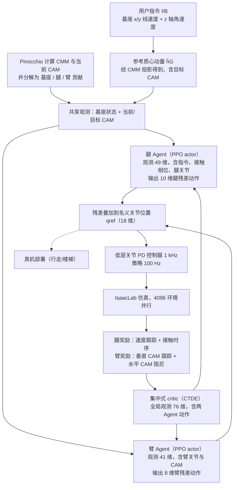

# Learning Humanoid Arm Motion via Centroidal Momentum Regularized Multi-Agent Reinforcement Learning

**Learning Humanoid Arm Motion via Centroidal Momentum Regularized Multi-Agent Reinforcement Learning** 已列入 [Robot Learning Paper Notebooks](https://imchong.github.io/Robot_Learning_Paper_Notebooks/index.html) 的 **PROGRESS.md 待深读** 清单（分类：05_Locomotion）。本页 **还没有深读笔记**：只给出这篇论文的分类位置与原文入口，方法细节与数据请直接看原文。

## 一句话定义

Learning Humanoid Arm Motion via Centroidal Momentum Regularized Multi-Agent Reinforcement Learning 的人形机器人学习论文条目，当前处于 Paper Notebooks 阅读进度（待深读）阶段。

## 英文缩写速查

| 缩写 | 英文全称 | 简要说明 |
|------|----------|----------|
| RL | Reinforcement Learning | 通过与环境交互最大化长期回报来学习策略 |
| WBC | Whole-Body Control | 协调全身关节满足多任务/约束的控制基础设施 |
| Sim2Real | Simulation to Real | 把仿真中学到的策略迁移落地真机的工程主线 |

## 为什么重要

- 这篇已排进 Paper Notebooks 的待读清单，可以从 [机器人学习论文笔记总索引](../overview/humanoid-paper-notebooks-index.md) 与分类页找到同一批工作。
- 深读笔记写出来之前，方法流程见下方「流程总览」（依据论文方法部分），其余方法结论暂不给。

## 流程总览

图依据：论文 §III、§IV-A、§IV-B / Fig. 2

## 核心信息

| 字段 | 内容 |
|------|------|
| 分类 | 05_Locomotion |
| 深读状态 | 待撰写（[PROGRESS.md](https://github.com/ImChong/Robot_Learning_Paper_Notebooks/blob/main/papers/PROGRESS.md)） |
| 计划文件夹 | `papers/05_Locomotion/learning-humanoid-arm-motion-via-centroidal-mome` |
| arXiv | <https://arxiv.org/abs/2507.04140> |

## 实验与评测

- 深读笔记尚未完成；量化 benchmark、消融与实机指标待笔记撰写后补充。

## 结论

**这条目最值得注意的是归类信号：一篇讲「手臂动作」的论文被放进 05_Locomotion，标题把手臂运动与质心动量正则化绑在一起；但本页仍处于待深读，这一读法尚无正文证据支撑。**

- 可确认信息只有分类 05_Locomotion、arXiv 2507.04140 与深读状态「待撰写」；机制线索仅为「质心动量正则化的多智能体强化学习用于人形手臂动作」。
- 分类与标题只能作为线索，不能替代结论：智能体如何划分、质心动量正则项怎么起作用，本页都无法回答。
- 因此当前唯一正当用途是待读与交叉检索——本页「实验与评测」已声明 benchmark 与实机指标待笔记补充，引用前应回到 arXiv 原文或等 [humanoid-paper-notebooks-index.md](../overview/humanoid-paper-notebooks-index.md) 下的深读笔记落地。

## 与其他页面的关系

- 分类页：[paper-notebook-category-05-locomotion](../overview/paper-notebook-category-05-locomotion.md)
- 总索引：[humanoid-paper-notebooks-index.md](../overview/humanoid-paper-notebooks-index.md)

## 参考来源

- [humanoid_pnb_learning-humanoid-arm-motion-via-centroidal-mome.md](../../sources/papers/humanoid_pnb_learning-humanoid-arm-motion-via-centroidal-mome.md)
- [Robot Learning Paper Notebooks · PROGRESS.md](https://github.com/ImChong/Robot_Learning_Paper_Notebooks/blob/main/papers/PROGRESS.md)
- 论文：<https://arxiv.org/abs/2507.04140>
- [arXiv PDF](https://arxiv.org/pdf/2507.04140)：已通读方法部分（实验与附录以略读为准）：§III 质心动量建模、§IV 肢体级多智能体 RL（臂 Agent、腿 Agent）、§V-B CTDE 对比与 §V-C 硬件实验

## 推荐继续阅读

- [Paper Notebooks 阅读进度（PROGRESS.md）](https://github.com/ImChong/Robot_Learning_Paper_Notebooks/blob/main/papers/PROGRESS.md)
