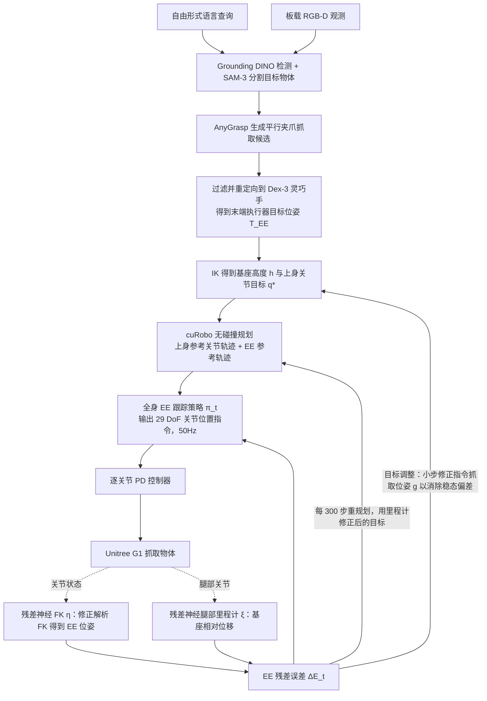

# HERO

**HERO: Learning Humanoid End-Effector Control for Open-Vocabulary Visual Loco-Manipulation** 收录于 [Robot Learning Paper Notebooks](https://imchong.github.io/Robot_Learning_Paper_Notebooks/index.html)（分类：04_Loco-Manipulation_and_WBC）。本页为 **清单索引实体**，链向深读笔记与原始论文；详细机制待从笔记消化后补充。

## 一句话定义

HERO (Humanoid End-effector ContROl) 结合了大型视觉模型的开放词汇识别能力与高精度仿真训练的全身控制，实现了人形机器人对任意现实物体的"边走边抓"。

## 英文缩写速查

| 缩写 | 英文全称 | 简要说明 |
|------|----------|----------|
| RL | Reinforcement Learning | 通过与环境交互最大化长期回报来学习策略 |
| WBC | Whole-Body Control | 协调全身关节满足多任务/约束的控制基础设施 |
| Sim2Real | Simulation to Real | 把仿真中学到的策略迁移落地真机的工程主线 |

## 为什么重要

- 列入 Paper Notebooks 策展清单，便于与全库 [机器人学习论文笔记总索引](../overview/humanoid-paper-notebooks-index.md) 及分类父节点交叉检索。
- 深读笔记提供比摘要更贴近实现的阅读路径，适合作为后续 ingest 深化起点。

## 流程总览

图依据：论文 §3（Fig. 3、Fig. 4）、§4（Fig. 2、Fig. 5）。

## 核心信息

| 字段 | 内容 |
|------|------|
| 分类 | 04_Loco-Manipulation_and_WBC |
| 深读笔记 | <https://imchong.github.io/Robot_Learning_Paper_Notebooks/papers/04_Loco-Manipulation_and_WBC/Learning_Humanoid_End-Effector_Control_for_Open-Vocabulary_Visual_Loco-Manipulation/Learning_Humanoid_End-Effector_Control_for_Open-Vocabulary_Visual_Loco-Manipulation.html> |
| arXiv | <https://arxiv.org/abs/2602.16705> |

## 实验与评测

- 本页为 **策展清单索引** 摘要；量化 benchmark、消融与实机指标以 **深读笔记与论文 PDF** 为准（链接见 [参考来源](#参考来源)）。

## 结论

**HERO 的定位是把「开放词汇视觉识别」与「仿真训练出的全身控制」接成一条链路，让人形不再只在预定义物体清单上作业，而能对任意现实物体边走边抓。**

- 起作用的是两段能力的组合：上游用大型视觉模型拿到开放词汇的目标识别，下游用高精度仿真训练的全身控制把移动与抓取合成同一个动作。
- 「边走边抓」意味着 loco-manipulation 不被拆成先走后抓两段，这也是它被归入 04_Loco-Manipulation_and_WBC 的原因。
- 适用边界同时受制于上游视觉模型的识别能力与仿真到真机的差距，本页未给出量化证据来界定这条边界。
- 本页为策展笔记摘要，量化 benchmark、消融与实机指标以深读笔记与论文 PDF 为准。

## 与其他页面的关系

- 分类父节点：[paper-notebook-category-04-loco-manipulation-and-wbc](../overview/paper-notebook-category-04-loco-manipulation-and-wbc.md)
- 总索引：[humanoid-paper-notebooks-index.md](../overview/humanoid-paper-notebooks-index.md)

## 参考来源

- [humanoid_pnb_learning-humanoid-end-effector-control-for-open.md](../../sources/papers/humanoid_pnb_learning-humanoid-end-effector-control-for-open.md)
- 深读笔记：<https://imchong.github.io/Robot_Learning_Paper_Notebooks/papers/04_Loco-Manipulation_and_WBC/Learning_Humanoid_End-Effector_Control_for_Open-Vocabulary_Visual_Loco-Manipulation/Learning_Humanoid_End-Effector_Control_for_Open-Vocabulary_Visual_Loco-Manipulation.html>
- 论文：<https://arxiv.org/abs/2602.16705>
- [arXiv PDF](https://arxiv.org/pdf/2602.16705)：已通读方法部分（实验与附录以略读为准）：§1 引言（系统概述）、§3 HERO（3.1-3.3）、§4 开放词汇抓取系统

## 推荐继续阅读

- [机器人论文阅读笔记：HERO](https://imchong.github.io/Robot_Learning_Paper_Notebooks/papers/04_Loco-Manipulation_and_WBC/Learning_Humanoid_End-Effector_Control_for_Open-Vocabulary_Visual_Loco-Manipulation/Learning_Humanoid_End-Effector_Control_for_Open-Vocabulary_Visual_Loco-Manipulation.html)

- 核对（2026-11-02）：原 arXiv 编号 2501.17173 对应的是另一篇论文，已按 arXiv 官方记录（API 标题、作者、提交日期）更正为 2602.16705。
