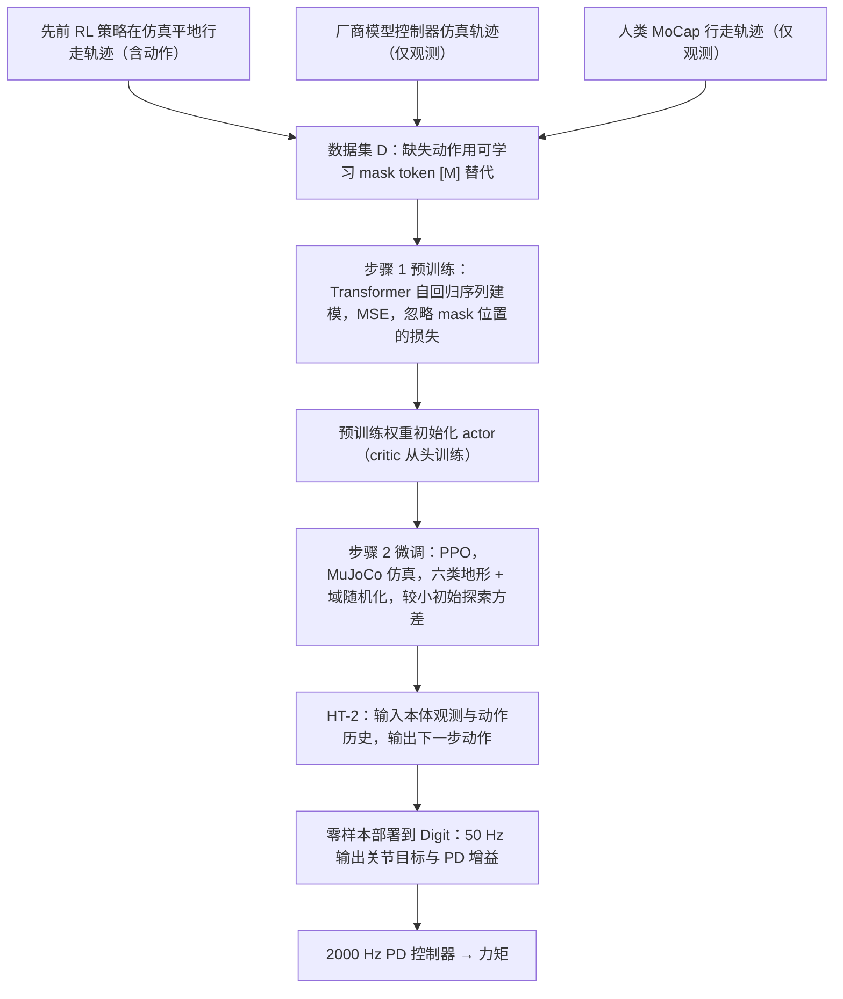

# Learning Humanoid Locomotion over Challenging Terrain

**Learning Humanoid Locomotion over Challenging Terrain** 已列入 [Robot Learning Paper Notebooks](https://imchong.github.io/Robot_Learning_Paper_Notebooks/index.html) 的 **PROGRESS.md 待深读** 清单（分类：05_Locomotion）。本页 **还没有深读笔记**：只给出这篇论文的分类位置与原文入口，方法流程见 [流程总览](#流程总览)，数据与指标请直接看原文。

## 一句话定义

Learning Humanoid Locomotion over Challenging Terrain 的人形机器人学习论文条目，当前处于 Paper Notebooks 阅读进度（待深读）阶段。

## 英文缩写速查

| 缩写 | 英文全称 | 简要说明 |
|------|----------|----------|
| RL | Reinforcement Learning | 通过与环境交互最大化长期回报来学习策略 |
| WBC | Whole-Body Control | 协调全身关节满足多任务/约束的控制基础设施 |
| Sim2Real | Simulation to Real | 把仿真中学到的策略迁移落地真机的工程主线 |

## 为什么重要

- 这篇已排进 Paper Notebooks 的待读清单，可以从 [机器人学习论文笔记总索引](../overview/humanoid-paper-notebooks-index.md) 与分类页找到同一批工作。
- 在笔记写出来之前，这里只保留分类位置、原文入口与依据论文方法部分绘制的 [流程总览](#流程总览)，不给性能结论。

## 流程总览

图依据：论文 Materials and Methods（Pre-training with sequence modeling、Fine-tuning with reinforcement learning、Sim-to-real transfer）及 Fig. 8（Method）。

## 核心信息

| 字段 | 内容 |
|------|------|
| 分类 | 05_Locomotion |
| 深读状态 | 待撰写（[PROGRESS.md](https://github.com/ImChong/Robot_Learning_Paper_Notebooks/blob/main/papers/PROGRESS.md)） |
| 计划文件夹 | `papers/05_Locomotion/learning-humanoid-locomotion-over-challenging-te` |
| arXiv | <https://arxiv.org/abs/2410.03654> |

## 实验与评测

- 深读笔记尚未完成；量化 benchmark、消融与实机指标待笔记撰写后补充。

## 结论

**本页是「复杂地形人形行走」这一条目的待读条目，结论性内容需等深读笔记落地后才成立。**

- 目前只有元信息可用：分类 05_Locomotion、arXiv 2410.03654、计划笔记文件夹路径与 PROGRESS.md 待深读状态。
- 方法流程（预训练 + RL 微调）见 [流程总览](#流程总览)；地形适应的具体表现本页未给出依据，以论文为准。
- 适用边界：作为 05_Locomotion 分类页下的连边节点存在；量化 benchmark、消融与实机指标以论文原文为准。

## 与其他页面的关系

- 分类页：[paper-notebook-category-05-locomotion](../overview/paper-notebook-category-05-locomotion.md)
- 总索引：[humanoid-paper-notebooks-index.md](../overview/humanoid-paper-notebooks-index.md)

## 参考来源

- [humanoid_pnb_learning-humanoid-locomotion-over-challenging-te.md](../../sources/papers/humanoid_pnb_learning-humanoid-locomotion-over-challenging-te.md)
- [Robot Learning Paper Notebooks · PROGRESS.md](https://github.com/ImChong/Robot_Learning_Paper_Notebooks/blob/main/papers/PROGRESS.md)
- 论文：<https://arxiv.org/abs/2410.03654>
- [arXiv PDF](https://arxiv.org/pdf/2410.03654)：已通读方法部分（实验与附录以略读为准）：引言、Results 概述、Materials and Methods（问题设定、模型架构、预训练、RL 微调、sim-to-real）

## 推荐继续阅读

- [Paper Notebooks 阅读进度（PROGRESS.md）](https://github.com/ImChong/Robot_Learning_Paper_Notebooks/blob/main/papers/PROGRESS.md)
