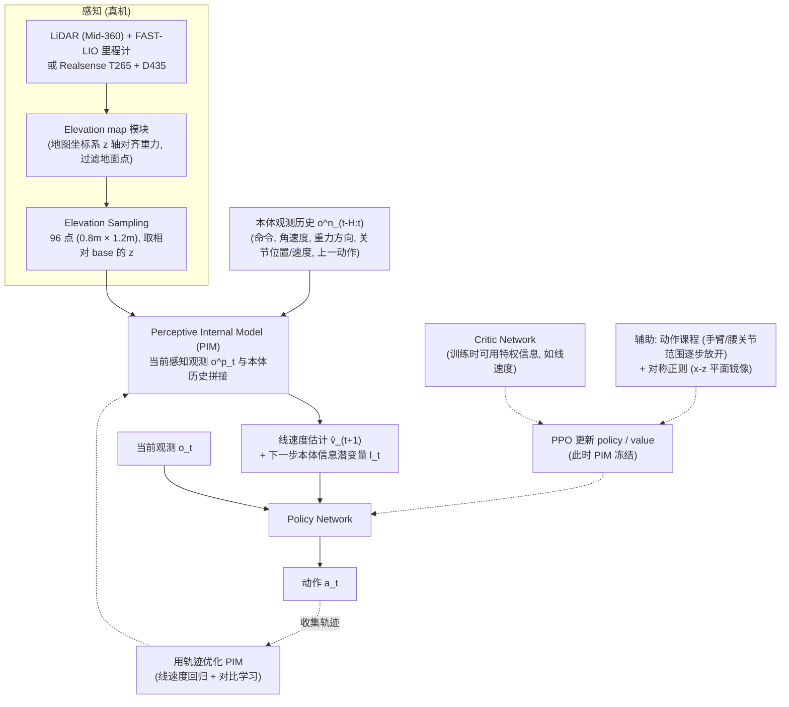

# Learning Humanoid Locomotion with Perceptive Internal Model

**Learning Humanoid Locomotion with Perceptive Internal Model** 已列入 [Robot Learning Paper Notebooks](https://imchong.github.io/Robot_Learning_Paper_Notebooks/index.html) 的 **PROGRESS.md 待深读** 清单（分类：05_Locomotion）。本页 **还没有深读笔记**：只给出这篇论文的分类位置与原文入口，方法细节与数据请直接看原文。

## 一句话定义

Learning Humanoid Locomotion with Perceptive Internal Model 的人形机器人学习论文条目，当前处于 Paper Notebooks 阅读进度（待深读）阶段。

## 英文缩写速查

| 缩写 | 英文全称 | 简要说明 |
|------|----------|----------|
| RL | Reinforcement Learning | 通过与环境交互最大化长期回报来学习策略 |
| WBC | Whole-Body Control | 协调全身关节满足多任务/约束的控制基础设施 |
| Sim2Real | Simulation to Real | 把仿真中学到的策略迁移落地真机的工程主线 |

## 为什么重要

- 这篇已排进 Paper Notebooks 的待读清单，可以从 [机器人学习论文笔记总索引](../overview/humanoid-paper-notebooks-index.md) 与分类页找到同一批工作。
- 在笔记写出来之前，这里只保留分类位置与原文入口，不给方法结论（论文方法模块与数据流见下方「流程总览」）。

## 流程总览

图依据：论文 §III-A 框架概览（Fig.2）、§III-B 观测、§III-C/D PIM 与 elevation map、§III-E/F 动作课程与对称正则、§III-G 训练过程。

## 核心信息

| 字段 | 内容 |
|------|------|
| 分类 | 05_Locomotion |
| 深读状态 | 待撰写（[PROGRESS.md](https://github.com/ImChong/Robot_Learning_Paper_Notebooks/blob/main/papers/PROGRESS.md)） |
| 计划文件夹 | `papers/05_Locomotion/learning-humanoid-locomotion-with-perceptive-int` |
| arXiv | <https://arxiv.org/abs/2411.14386> |

## 实验与评测

- 深读笔记尚未完成；量化 benchmark、消融与实机指标待笔记撰写后补充。

## 结论

**本页目前只承担「实体存在性」这一件事：把这篇论文挂进 05_Locomotion 分类，技术归纳整体待深读笔记补齐。**

- 页面可确证的只有分类归属、PROGRESS.md 上的「待深读」状态与 arXiv 编号 2411.14386；指标与消融均未记录（方法模块流程见「流程总览」）。
- 适用边界：可用于按分类检索，不能作为该工作的技术依据或引用来源。
- 同分类下并列着多篇同样处于待深读状态的 locomotion 条目，本页的相对价值取决于笔记撰写顺序，不宜据此判断重要性。

## 与其他页面的关系

- 分类页：[paper-notebook-category-05-locomotion](../overview/paper-notebook-category-05-locomotion.md)
- 总索引：[humanoid-paper-notebooks-index.md](../overview/humanoid-paper-notebooks-index.md)
- 同组后续：[VB-Com](./paper-notebook-vb-com-learning-vision-blind-composite-humanoid.md) — 在 PIM 式高程图上加视觉/盲策略切换（ICRA 2026，站内已有独立页）

## 参考来源

- [humanoid_pnb_learning-humanoid-locomotion-with-perceptive-int.md](../../sources/papers/humanoid_pnb_learning-humanoid-locomotion-with-perceptive-int.md)
- [Robot Learning Paper Notebooks · PROGRESS.md](https://github.com/ImChong/Robot_Learning_Paper_Notebooks/blob/main/papers/PROGRESS.md)
- 论文：<https://arxiv.org/abs/2411.14386>
- [arXiv PDF](https://arxiv.org/pdf/2411.14386)：已通读方法部分（实验与附录以略读为准）：§III Methodology（A–G）

## 推荐继续阅读

- [Paper Notebooks 阅读进度（PROGRESS.md）](https://github.com/ImChong/Robot_Learning_Paper_Notebooks/blob/main/papers/PROGRESS.md)
