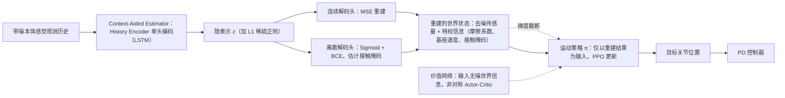

# Learning Humanoid Locomotion with World Model Reconstruction

**Learning Humanoid Locomotion with World Model Reconstruction** 已列入 [Robot Learning Paper Notebooks](https://imchong.github.io/Robot_Learning_Paper_Notebooks/index.html) 的 **PROGRESS.md 待深读** 清单（分类：05_Locomotion）。本页 **还没有深读笔记**：只给出这篇论文的分类位置与原文入口，方法细节与数据请直接看原文。

## 一句话定义

Learning Humanoid Locomotion with World Model Reconstruction 的人形机器人学习论文条目，当前处于 Paper Notebooks 阅读进度（待深读）阶段。

## 英文缩写速查

| 缩写 | 英文全称 | 简要说明 |
|------|----------|----------|
| RL | Reinforcement Learning | 通过与环境交互最大化长期回报来学习策略 |
| WBC | Whole-Body Control | 协调全身关节满足多任务/约束的控制基础设施 |
| Sim2Real | Simulation to Real | 把仿真中学到的策略迁移落地真机的工程主线 |

## 为什么重要

- 这篇已排进 Paper Notebooks 的待读清单，可以从 [机器人学习论文笔记总索引](../overview/humanoid-paper-notebooks-index.md) 与分类页找到同一批工作。
- 在笔记写出来之前，这里只保留分类位置与原文入口；方法结构见上方「流程总览」，不给实验结论。

## 流程总览

图依据：论文 §IV-A（World Model Reconstruction，Fig. 2）与附录 E（网络结构）；估计器与策略由同一优化器联合训练，总损失 L = L_recon + λv·Lv + λπ·Lπ，二者之间梯度被截断。

## 核心信息

| 字段 | 内容 |
|------|------|
| 分类 | 05_Locomotion |
| 深读状态 | 待撰写（[PROGRESS.md](https://github.com/ImChong/Robot_Learning_Paper_Notebooks/blob/main/papers/PROGRESS.md)） |
| 计划文件夹 | `papers/05_Locomotion/learning-humanoid-locomotion-with-world-model-re` |
| arXiv | <https://arxiv.org/abs/2502.16230> |

## 实验与评测

- 深读笔记尚未完成；量化 benchmark、消融与实机指标待笔记撰写后补充。

## 结论

**这是一条「世界模型重建 + 人形行走」的待读条目：标题指向用重建式世界模型辅助 locomotion 学习，机制见「流程总览」（依据论文方法部分），但本页没有搬运任何实验指标。**

- 可确认的事实只有三项：分类 05_Locomotion、arXiv 2502.16230、深读状态「待撰写」。
- 页面自己给出的定位就是「方便你按分类找到它」的待读条目——功能是溯源与检索，不是技术结论。
- 边界很明确：关于实验结果与 sim2real 表现的判断无本页依据，必须回到 arXiv 原文，或等 PROGRESS.md 上的深读笔记完成后再引用。

## 与其他页面的关系

- 分类页：[paper-notebook-category-05-locomotion](../overview/paper-notebook-category-05-locomotion.md)
- 总索引：[humanoid-paper-notebooks-index.md](../overview/humanoid-paper-notebooks-index.md)

## 参考来源

- [humanoid_pnb_learning-humanoid-locomotion-with-world-model-re.md](../../sources/papers/humanoid_pnb_learning-humanoid-locomotion-with-world-model-re.md)
- [Robot Learning Paper Notebooks · PROGRESS.md](https://github.com/ImChong/Robot_Learning_Paper_Notebooks/blob/main/papers/PROGRESS.md)
- 论文：<https://arxiv.org/abs/2502.16230>
- [arXiv PDF](https://arxiv.org/pdf/2502.16230)：已通读方法部分（实验与附录以略读为准）：§III 问题定义、§IV-A 至 §IV-B（含 Fig. 2）与附录 D/E；实验与讨论以略读为准

## 推荐继续阅读

- [Paper Notebooks 阅读进度（PROGRESS.md）](https://github.com/ImChong/Robot_Learning_Paper_Notebooks/blob/main/papers/PROGRESS.md)
