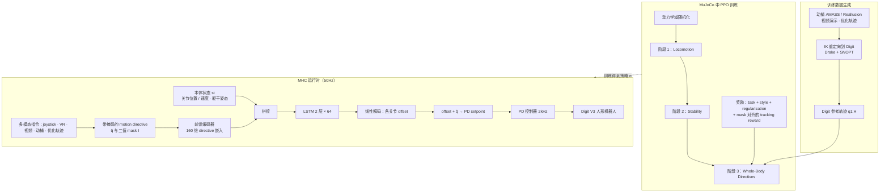

# Learning Multi-Modal Whole-Body Control for Real-World Humanoid Robots

**Learning Multi-Modal Whole-Body Control for Real-World Humanoid Robots** 已列入 [Robot Learning Paper Notebooks](https://imchong.github.io/Robot_Learning_Paper_Notebooks/index.html) 的 **PROGRESS.md 待深读** 清单（分类：04_Loco-Manipulation_and_WBC）。本页 **还没有深读笔记**：只给出这篇论文的分类位置与原文入口，方法细节与数据请直接看原文。

## 一句话定义

Learning Multi-Modal Whole-Body Control for Real-World Humanoid Robots 的人形机器人学习论文条目，当前处于 Paper Notebooks 阅读进度（待深读）阶段。

## 英文缩写速查

| 缩写 | 英文全称 | 简要说明 |
|------|----------|----------|
| RL | Reinforcement Learning | 通过与环境交互最大化长期回报来学习策略 |
| WBC | Whole-Body Control | 协调全身关节满足多任务/约束的控制基础设施 |
| Sim2Real | Simulation to Real | 把仿真中学到的策略迁移落地真机的工程主线 |

## 为什么重要

- 这篇已排进 Paper Notebooks 的待读清单，可以从 [机器人学习论文笔记总索引](../overview/humanoid-paper-notebooks-index.md) 与分类页找到同一批工作。
- 在笔记写出来之前，这里只保留分类位置与原文入口；方法流程见上方「流程总览」（依据论文方法部分），不含结论性判断。

## 流程总览

图依据：论文 Problem Formulation、Masked Humanoid Controller 各小节（Motion Data Generation / Network Architecture / Curriculum / Domain Randomization / Reward Design）。

## 核心信息

| 字段 | 内容 |
|------|------|
| 分类 | 04_Loco-Manipulation_and_WBC |
| 深读状态 | 待撰写（[PROGRESS.md](https://github.com/ImChong/Robot_Learning_Paper_Notebooks/blob/main/papers/PROGRESS.md)） |
| 计划文件夹 | `papers/04_Loco-Manipulation_and_WBC/learning-multi-modal-whole-body-control-for-real` |
| arXiv | <https://arxiv.org/abs/2408.07295> |

## 实验与评测

- 深读笔记尚未完成；量化 benchmark、消融与实机指标待笔记撰写后补充。

## 结论

**本页只是「真机人形多模态全身控制」条目的待读条目，尚不承载任何机制或指标结论。**

- 可核验信息仅有分类 04_Loco-Manipulation_and_WBC、arXiv 2408.07295 与计划笔记文件夹路径。
- 「多模态」具体指哪些模态、如何与 WBC 结合，正文完全未展开，属于待深读的空白。
- 适用边界：仅用于检索，避免在综述或横向对比中把本页当作已消化的证据。

## 与其他页面的关系

- 分类页：[paper-notebook-category-04-loco-manipulation-and-wbc](../overview/paper-notebook-category-04-loco-manipulation-and-wbc.md)
- 总索引：[humanoid-paper-notebooks-index.md](../overview/humanoid-paper-notebooks-index.md)

## 参考来源

- [humanoid_pnb_learning-multi-modal-whole-body-control-for-real.md](../../sources/papers/humanoid_pnb_learning-multi-modal-whole-body-control-for-real.md)
- [Robot Learning Paper Notebooks · PROGRESS.md](https://github.com/ImChong/Robot_Learning_Paper_Notebooks/blob/main/papers/PROGRESS.md)
- 论文：<https://arxiv.org/abs/2408.07295>
- [arXiv PDF](https://arxiv.org/pdf/2408.07295)：已通读方法部分（实验与附录以略读为准）：Problem Formulation 与 Masked Humanoid Controller 方法各小节；实验设定与结果略读

## 推荐继续阅读

- [Paper Notebooks 阅读进度（PROGRESS.md）](https://github.com/ImChong/Robot_Learning_Paper_Notebooks/blob/main/papers/PROGRESS.md)
