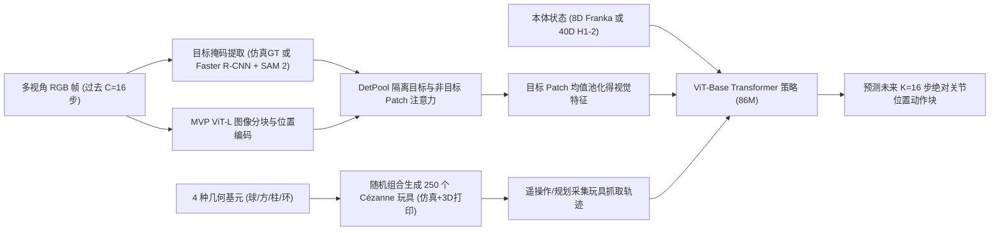

# Learning to Grasp Anything by Playing with Random Toys

**Learning to Grasp Anything by Playing with Random Toys**（方法名 **LEGO**：LEarning to Grasp from tOys，UC Berkeley 等，发表于 **ICLR 2026**）提出：无需大规模真实物体或互联网数据预训练，仅通过 4 种基础几何基元随机组合而成的分布外「Cézanne 玩具」与目标中心化检测池化机制 **DetPool**，即可学到强泛化力的零样本通用抓取策略。本条目收录于 [Robot Learning Paper Notebooks](https://imchong.github.io/Robot_Learning_Paper_Notebooks/index.html)（分类：06_Manipulation）。

## 一句话定义

LEGO 通过仅在球体、长方体、圆柱体、圆环四种基元随机拼装的「Cézanne 玩具」上采集演示，并结合限制 ViT 注意力仅在目标掩码区域内交互的 DetPool 表征，使 86M 参数策略实现向真实 YCB 物体与人形灵巧手的零样本抓取泛化。

## 英文缩写速查

| 缩写 | 英文全称 | 简要说明 |
|------|----------|----------|
| LEGO | LEarning to Grasp from tOys | 本文框架：仅用随机几何基元组合玩具训练通用抓取策略 |
| DetPool | Detection Pooling | 在 ViT 中用目标掩码屏蔽背景/前景交叉注意力并仅对目标 patch 做均值池化 |
| MVP | Masked Visual Pre-training | 本文采用的预训练 ViT-L 视觉编码器骨干 |
| SAM 2 | Segment Anything Model 2 | 真机部署时结合 Faster R-CNN 检测框提取目标分割掩码的视觉基础模型 |
| OOD | Out-of-Distribution | 分布外设置：训练集为合成几何玩具，测试集为完全未见的真实日常物体 |
| VLA | Vision-Language-Action | 对比基线类型（如 $\pi_0$-FAST、OpenVLA-OFT、DexGraspVLA） |

## 为什么重要

- 当前机器人操作泛化主要依赖大规模遥操作数据集或十亿级参数 VLA 预训练，但仍面临高数据成本与跨构型（如人形灵巧手）迁移困难的问题。
- 受发展心理学（婴儿玩简单玩具即可泛化抓取复杂物体）与塞尚几何分解思想启发，LEGO 证明了**几何基元组合 + 目标中心化视觉表征**是一条低样本、轻量化的通用抓取路径（86M 策略参数在 1,500 条真机演示上击败 7B OpenVLA-OFT 与零样本 3B $\pi_0$-FAST）。
- 本页对应 [机器人学习论文笔记总索引](../overview/humanoid-paper-notebooks-index.md) 与 [操作分类页](../overview/paper-notebook-category-06-manipulation.md) 的抓握泛化主线。

## 核心信息

| 字段 | 内容 |
|------|------|
| 分类 | 06_Manipulation |
| 发表会议 | ICLR 2026 |
| 作者与机构 | Dantong Niu, Yuvan Sharma, Baifeng Shi, Trevor Darrell, Jitendra Malik, Roei Herzig 等（UC Berkeley, Sapienza Univ. of Rome 等） |
| 项目主页与代码 | <https://lego-grasp.github.io/>（摘要声明提供视频、代码、权重与数据集） |
| 深读状态 | 原文已核对（[PROGRESS.md](https://github.com/ImChong/Robot_Learning_Paper_Notebooks/blob/main/papers/PROGRESS.md)） |
| 计划文件夹 | `papers/06_Manipulation/learning-to-grasp-anything-by-playing-with-rando` |

## 核心机制

1. **Cézanne 玩具数据集生成（4 基元随机组合）**：
   - 仅使用 4 种基元：**球体**（直径 1–8 cm）、**长方体**（宽 2–7.2 cm / 高 1–20 cm / 长 2–28 cm）、**圆柱体**（直径 4–7 cm / 高 4–12 cm）、**圆环**（外径 6–20 cm / 壁厚 0.6–1.8 cm / 高 2–6 cm），随机分配红/绿/蓝/黄 4 种颜色。
   - 每次采样 1–5 个基元，依次将新基元质心放置在已有基元内部以确保物理连通并赋予随机 3D 旋转，生成 **250 个** 独特玩具（含 46 个长方体、18 个球、20 个圆柱、19 个圆环，以及 27/35/38/47 个 2/3/4/5 基元组合体）。
   - 使用 SAPIEN/ManiSkill 仿真并用 8 台 Bambu P1P 3D 打印机以 PLA 打印实物；共采集 **2,500 条**仿真轨迹（每玩具 10 条）、**1,500 条**真机 Franka + Robotiq 2F-85 轨迹（Meta Quest 3 遥操作）及 **500 条** Unitree H1-2 + Inspire RH56DFTP 灵巧手轨迹（Apple Vision Pro 遥操作）。
2. **检测池化 DetPool（Detection Pooling）**：
   - 仿真直接使用真值分割掩码；真机用 200 张玩具标注训练 Faster R-CNN（ResNet-101）给出边界框，再输入 **SAM 2** 生成目标掩码。
   - 将掩码映射为 **MVP（ViT-L）** 的 patch 级注意力掩码：**严格禁止目标 patch token 与非目标 patch token 之间的注意力交互**（同时保留位置编码以维持空间位置感知），最后仅对输出的目标 patch token 做 **Mean Pooling**，过滤背景与干扰物特征。
3. **Transformer 动作块策略（Action Chunking Policy）**：
   - 将过去 $C=16$ 步的双桌面相机 DetPool 视觉嵌入与本体状态（Franka 为 8 维绝对关节角+夹爪；H1-2 为 40 维含关节与前馈力矩）拼接后经 MLP 投影。
   - 输入 **ViT-Base（86M 参数）** 主干网络，预测未来 $K=16$ 步**绝对关节位置**动作块，采用行为克隆 $\ell_1$ 损失训练（8× A6000 GPU，900 epochs，AdamW，lr=$5\times 10^{-4}$，batch size 512）。

### 方法流程图

## 实验与评测

1. **ManiSkill 仿真零样本评测（65 个 YCB 物体 × 16 网格位姿，Table 1 & 12）**：
   - 在 2,500 条玩具演示训练下，LEGO（DetPool）零样本成功率达 **80.00%**（250/500/1000/1500/2000 条演示下分别为 56.63%、68.17%、71.15%、74.62%、76.83%）。
   - 显著超越其他池化基线：Attn Pooling **51.63%**、CLS Pooling **49.81%**、Mean Pooling **40.58%**（DetPool 带来 +28.37 至 +39.42 个百分点提升，跨不同演示规模提升 22–48%）。
   - 超越微调后的 VLA 与其他目标中心化基线（2,500 条演示）：OpenVLA-OFT (7B) **12.79%**（500 条时曾达 36.35%，随后过拟合退化）、$\pi_0$-FAST (3B) **4.13%**、GROOT **1.54%**、DexGraspVLA **48.85%**。
2. **真机 Franka Emika Panda + Robotiq 2F-85（64 个 YCB 物体 × 16 网格位姿，Table 2）**：
   - 仅用 1,500 条真机玩具演示从头训练：LEGO 达 **66.67%**（论文摘要简记 67%），大幅超越微调 OpenVLA-OFT（7B, OXE 预训练，**9.47%**）、免训练 LLM 分解方法 ShapeGrasp（GPT-4o，**26.56%**）以及零样本 $\pi_0$-FAST（3B, $\pi$+75K DROID 预训练，**61.82%**），仅低于在玩具上微调后的 $\pi_0$-FAST（**76.56%**）。
3. **真机 Unitree H1-2 人形 + Inspire RH56DFTP 灵巧手（13 件日常物品 × 5 次试验，500 条玩具演示，Table 3）**：
   - LEGO 取得 **50.77%** 平均成功率，远超同批数据微调的 $\pi_0$-FAST（**26.15%**）与 OpenVLA-OFT（**18.46%**），验证了跨构型（无预训练数据覆盖的人形灵巧手）下的小样本泛化优势。
4. **关键消融与鲁棒性（Section 4.5, Appendix B–C）**：
   - **演示数量 vs 玩具数量**：当独特玩具数 $\ge 15$ 个后，增加总演示条数比继续堆叠玩具种类更关键；策略规模在 ViT-Base（86M）饱和（优于 5.7M/22M 且不逊于 307M ViT-Large）。
   - **基元与复杂度**：移除**球体**对 1,000 条演示性能伤害最大（由 ~72% 降至 **63.08%**）；2 基元玩具比 5 基元玩具贡献更大（250 条演示时 **44.42%** vs 10.19%）。
   - **几何相似度无关性（Table 6）**：按与训练集最近玩具的 Chamfer Distance 分桶，Easy / Medium / Hard 成功率分别为 **75.6%** / **83.0%** / **81.5%**，说明性能不依赖测试物体与训练玩具的形状接近度。
   - **控制空间选择（Table 16）**：**绝对关节控制**在 2,500 条演示下达 **80.00%**，而增量（Delta）控制停滞在 **37.02%**。
   - **干扰鲁棒性（Table 8–11, 14）**：40% 光照下保持 **78.65%**；2–5 物体杂乱桌面达 **67.21%**；60% IoU 掩码噪声下达 **77.98%**；在非抓取的 Push-to-Target 任务（2,500 演示）达 **81.83%**（OpenVLA 为 75.77%）。

## 与其他工作对比

| 模型 | 参数量 | 预训练数据 | 仿真 YCB (2500 demos) | 真机 Franka YCB (1500 demos) | 真机 H1-2 灵巧手 (500 demos) |
|------|--------|-----------|----------------------|----------------------------|----------------------------|
| **LEGO (Ours)** | 86M | 无动作预训练（仅 MVP 视觉） | **80.00%** | 66.67% | **50.77%** |
| $\pi_0$-FAST (Finetuned) | 3B | $\pi$ Dataset + 75K DROID | 4.13% | **76.56%** | 26.15% |
| $\pi_0$-FAST (Zero-shot) | 3B | $\pi$ Dataset + 75K DROID | — | 61.82% | — |
| OpenVLA-OFT (Finetuned) | 7B | OXE | 12.79% | 9.47% | 18.46% |
| DexGraspVLA | — | 视觉基础模型 | 48.85% | — | — |
| ShapeGrasp | GPT-4o | 互联网多模态 | — | 26.56% | — |

## 结论

**LEGO 证明了通用抓取的跨物体泛化瓶颈可以不靠十亿级动作预训练，而通过「四类几何基元随机组合 + ViT 注意力隔离的 DetPool 目标中心化表征」高效突破。**

1. **DetPool 是泛化的核心开关** — 与传统只在输出端池化（Attn/CLS/Mean Pooling）相比，在 ViT 内部用注意力掩码隔断前景与背景交互，直接带来 28–39 个百分点（2,500 条演示下）的零样本抓取跃升。
2. **演示规模重于极高玩具多样性** — 当玩具数量达到 15–250 个并覆盖 4 种基元（尤其是球体与 2 基元组合）后，优先增加每类抓取位姿演示数收益高于盲目生成上千种复杂玩具。
3. **绝对关节控制显著优于 Delta 控制** — 在长序列动作块（$K=16$）预测中，绝对关节目标避免误差累积，仿真成功率比增量控制高出 40 个百分点以上（80.00% vs 37.02%）。
4. **跨本体小样本迁移优势突出** — 当面对预训练 VLA 未见过的构型（如 Unitree H1-2 + Inspire 灵巧手）且仅 500 条演示时，轻量级 86M LEGO（50.77%）能大幅反超易过拟合的 3B/7B 大模型。

## 常见误区或局限

1. **只靠随机玩具并不能自动泛化**：消融实验表明，若去掉 DetPool 改用常规 Mean/CLS/Attn Pooling，同一玩具数据集上的零样本成功率会骤降 28–40 个百分点。
2. **物理属性与任务范围受限**：训练玩具全部为刚体 PLA 3D 打印件，论文明确指出模型对物理属性差异较大的物体（如易碎、柔性变形、铰接物体）可能退化，且当前主要针对单步抓取（及简单推物），尚未覆盖叠衣、动态场景等长周期灵巧任务。
3. **推理依赖外部检测与分割管线**：真机端需要 Faster R-CNN + SAM 2 提供目标掩码，同时 ViT-L + ViT-B 双骨干的计算开销对算力受限的端侧硬件仍具挑战。
4. **H1-2 实验存在硬件约束**：附录 I.3 说明试验期间 Inspire 灵巧手双侧拇指关节曾出现无响应故障，因此 H1-2 仅在左臂及 13 个日常物品上完成评测。

## 与其他页面的关系

- 分类页：[paper-notebook-category-06-manipulation](../overview/paper-notebook-category-06-manipulation.md)
- 总索引：[humanoid-paper-notebooks-index.md](../overview/humanoid-paper-notebooks-index.md)

## 关联页面

- [机器人操作](../tasks/manipulation.md)：了解抓取与操作任务。
- [机器人策略学习](../methods/robot-policy-learning.md)：对照策略训练与零样本评估。

## 参考来源

- [humanoid_pnb_learning-to-grasp-anything-by-playing-with-rando.md](../../sources/papers/humanoid_pnb_learning-to-grasp-anything-by-playing-with-rando.md)
- [Robot Learning Paper Notebooks · PROGRESS.md](https://github.com/ImChong/Robot_Learning_Paper_Notebooks/blob/main/papers/PROGRESS.md)
- 论文原文：Dantong Niu et al., *Learning to Grasp Anything by Playing with Random Toys*, ICLR 2026 (<https://lego-grasp.github.io/>)

## 推荐继续阅读

- [机器人论文阅读笔记：Learning to Grasp Anything by Playing with Random Toys](https://imchong.github.io/Robot_Learning_Paper_Notebooks/papers/06_Manipulation/LEGO__Learning_to_Grasp_Anything_by_Playing_with_Random_Toys/LEGO__Learning_to_Grasp_Anything_by_Playing_with_Random_Toys.html)
- [Paper Notebooks 阅读进度（PROGRESS.md）](https://github.com/ImChong/Robot_Learning_Paper_Notebooks/blob/main/papers/PROGRESS.md)
- [LEGO 项目主页](https://lego-grasp.github.io/)
