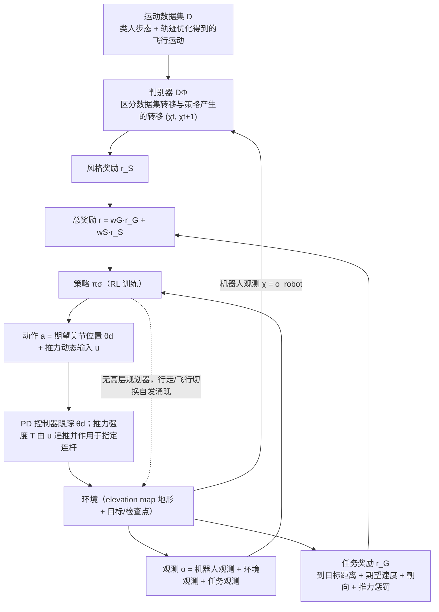

# Learning to Walk and Fly with Adversarial Motion Priors

**Learning to Walk and Fly with Adversarial Motion Priors** 已列入 [Robot Learning Paper Notebooks](https://imchong.github.io/Robot_Learning_Paper_Notebooks/index.html) 的 **PROGRESS.md 待深读** 清单（分类：05_Locomotion）。本页 **还没有深读笔记**：只给出这篇论文的分类位置与原文入口，方法细节与数据请直接看原文（方法部分的流程见下方「流程总览」）。

## 一句话定义

Learning to Walk and Fly with Adversarial Motion Priors 的人形机器人学习论文条目，当前处于 Paper Notebooks 阅读进度（待深读）阶段。

## 英文缩写速查

| 缩写 | 英文全称 | 简要说明 |
|------|----------|----------|
| RL | Reinforcement Learning | 通过与环境交互最大化长期回报来学习策略 |
| WBC | Whole-Body Control | 协调全身关节满足多任务/约束的控制基础设施 |
| Sim2Real | Simulation to Real | 把仿真中学到的策略迁移落地真机的工程主线 |

## 为什么重要

- 这篇已排进 Paper Notebooks 的待读清单，可以从 [机器人学习论文笔记总索引](../overview/humanoid-paper-notebooks-index.md) 与分类页找到同一批工作。
- 在笔记写出来之前，这里只保留分类位置与原文入口，方法部分的流程见「流程总览」，不给方法结论与实验数字。

## 流程总览

图依据：论文 §III-A/B/C、Fig. 2。

## 核心信息

| 字段 | 内容 |
|------|------|
| 分类 | 05_Locomotion |
| 深读状态 | 待撰写（[PROGRESS.md](https://github.com/ImChong/Robot_Learning_Paper_Notebooks/blob/main/papers/PROGRESS.md)） |
| 计划文件夹 | `papers/05_Locomotion/learning-to-walk-and-fly-with-adversarial-motion` |
| arXiv | <https://arxiv.org/abs/2309.12784> |

## 实验与评测

- 深读笔记尚未完成；量化 benchmark、消融与实机指标待笔记撰写后补充。

## 结论

**本页是 05_Locomotion 分类下的待读条目：先登记这一条，AMP 相关的机制与评测整体留白。**

- 页面可确证的只有分类归属、PROGRESS.md 上的「待深读」状态与 arXiv 编号 2309.12784；对抗式动作先验如何统一行走与飞行，仅在「流程总览」中给出方法部分的流程。
- 适用边界：可用于分类检索与待读链接，不能作为该工作的技术依据或引用来源。
- 深读状态以上游 PROGRESS.md 为准；笔记完成后本页需补成完整摘要并深化归纳。

## 与其他页面的关系

- 分类页：[paper-notebook-category-05-locomotion](../overview/paper-notebook-category-05-locomotion.md)
- 总索引：[humanoid-paper-notebooks-index.md](../overview/humanoid-paper-notebooks-index.md)

## 参考来源

- [humanoid_pnb_learning-to-walk-and-fly-with-adversarial-motion.md](../../sources/papers/humanoid_pnb_learning-to-walk-and-fly-with-adversarial-motion.md)
- [Robot Learning Paper Notebooks · PROGRESS.md](https://github.com/ImChong/Robot_Learning_Paper_Notebooks/blob/main/papers/PROGRESS.md)
- 论文：<https://arxiv.org/abs/2309.12784>
- [arXiv PDF](https://arxiv.org/pdf/2309.12784)：已通读方法部分（实验与附录以略读为准）：§III-A 对抗运动先验（风格/任务奖励）、§III-B 观测与动作空间、§III-C 判别器观测空间

## 推荐继续阅读

- [Paper Notebooks 阅读进度（PROGRESS.md）](https://github.com/ImChong/Robot_Learning_Paper_Notebooks/blob/main/papers/PROGRESS.md)
