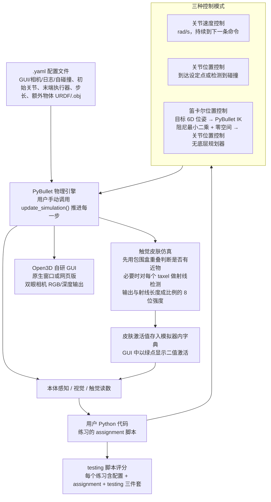

# Learning with pyCub

**Learning with pyCub: A Simulation and Exercise Framework for Humanoid Robotics** 收录于 [Robot Learning Paper Notebooks](https://imchong.github.io/Robot_Learning_Paper_Notebooks/index.html)（分类：11_Simulation_Benchmark），深读笔记已完成。本页是 **笔记摘要**：要点编译自深读笔记，细节以笔记原文与论文 PDF 为准。

## 一句话定义

pyCub 是一个开源、基于物理的 iCub 人形仿真，并配套练习用于教学生人形机器人学基础。相比已有 iCub 仿真器（iCub SIM、iCub Gazebo）需要 C++ 代码与 YARP 中间件，pyCub 无需 YARP、用 Python 即可。它完整仿真了带全部关节的机器人，含眼部双相机与 iCub 独特的敏感皮肤（体表 4000 个感受器）。练习从速度/关节/笛卡尔空间的基础控制，到注视、抓取、反应式控制等更复杂任务；整套用 Python 编写与控制，即使编程基础很少的人也能用，练习可分级到不同难度。作者在两轮人形机器人课程中验证了该框架。

## 英文缩写速查

| 缩写 | 含义 |
|---|---|
| pyCub | 本文的 Python iCub 仿真框架 |
| iCub | 一款知名人形研究平台 |
| YARP | iCub 传统中间件（本文免去） |
| Cartesian Control | 笛卡尔空间控制 |
| Tactile Skin | 触觉皮肤（4000 感受器） |
| Exercise Framework | 练习框架，分级教学任务 |

## 为什么重要

- **降低教学/上手门槛**对扩大人形研究社区很重要；
- **触觉皮肤仿真**为接触/灵巧研究提供少见的教学资源；
- **纯 Python 生态**契合当下 RL/IL 工具链，利于教学到科研衔接；
- 与重型仿真（Isaac、MuJoCo）互补，定位"教学友好"。

## 流程总览

图依据：论文 §2.1–2.3 / §3 开头 / Fig. 2

## 解决什么问题

人形机器人学**教学门槛高**： - 现有 iCub 仿真需 **C++ + YARP**，对学生不友好； - 缺**纯 Python、低门槛**且涵盖触觉皮肤等特性的教学仿真与练习。

pyCub 要：一个**纯 Python、免 YARP、带分级练习**的 iCub 教学仿真框架。

## 核心机制

1. **纯 Python、免 YARP 的 iCub 仿真**：大幅降低使用门槛；
2. **完整仿真含触觉皮肤**：双相机 + 4000 感受器，覆盖 iCub 特色；
3. **分级练习框架**：从基础控制到注视/抓取/反应式；
4. **教学验证 + 开源**：两轮课程实测，开源含 Docker。

方法拆解（深读笔记小节）：纯 Python、免 YARP 的 iCub 物理仿真；分级练习；低门槛 + 课程验证；🧭 整体流程（mermaid）。

## 核心信息

| 字段 | 内容 |
|------|------|
| 分类 | 11_Simulation_Benchmark |
| 深读笔记 | <https://imchong.github.io/Robot_Learning_Paper_Notebooks/papers/11_Simulation_Benchmark/Learning_with_pyCub__A_Simulation_and_Exercise_Framework_for_Humanoid_Robotics/Learning_with_pyCub__A_Simulation_and_Exercise_Framework_for_Humanoid_Robotics.html> |
| arXiv | <https://arxiv.org/abs/2506.01756> |
| 作者 | Lukas Rustler、Matej Hoffmann（捷克理工大学 CTU） |
| 发表 | 2025 年 6 月 |
| 源码 | 开源，含文档与 Docker 支持 |
| 笔记阅读日期 | 2026-06-21 |

## 实验与评测

- 本页是深读笔记的摘要，没有搬运原文的量化结果；量化 benchmark、消融与实机指标以 **深读笔记与论文 PDF** 为准（链接见 [参考来源](#参考来源)）。

## 结论

**pyCub 的取舍是「教学可达性优先」：用纯 Python、免 YARP 换掉 C++ 中间件门槛，把 iCub 连同它特有的触觉皮肤一起做成可分级的课程资产。**

- 真正起作用的不是仿真本身，而是「免 YARP 的 Python 接口 + 分级练习」这一组合：练习从速度/关节/笛卡尔空间的基础控制一路排到注视、抓取、反应式控制，可按难度分级。
- 差异化资产是 iCub 独有的敏感皮肤（体表 4000 个感受器）与眼部双相机，这让接触/灵巧方向的教学有了少见的可用素材。
- 适用边界明确在「教学友好」：与 Isaac、MuJoCo 这类重型仿真是互补而非替代关系，本页未给出保真度或吞吐方面的对比。
- 证据强度以两轮人形机器人课程的教学实测为主，属课程验证而非基准评测；量化结论以深读笔记与论文 PDF 为准。
- 工程落地侧已开源，含文档与 Docker 支持，编程基础较少的使用者也能上手。

## 与其他页面的关系

- 分类父节点：[paper-notebook-category-11-simulation-benchmark](../overview/paper-notebook-category-11-simulation-benchmark.md)
- 总索引：[humanoid-paper-notebooks-index.md](../overview/humanoid-paper-notebooks-index.md)

## 关联页面

- [Robot in a crib（mobile paradigm 偶联学习）](./paper-robot-in-crib-sensorimotor-contingency.md) — 同 iCub 平台的早期认知/发展机器人实验。
- [ergoCub Shared Embodied Intelligence](./paper-ergocub-shared-embodied-intelligence.md) — iCub 系硬件演化对照。

## 参考来源

- [humanoid_pnb_learning-with-pycub.md](../../sources/papers/humanoid_pnb_learning-with-pycub.md)
- 深读笔记：<https://imchong.github.io/Robot_Learning_Paper_Notebooks/papers/11_Simulation_Benchmark/Learning_with_pyCub__A_Simulation_and_Exercise_Framework_for_Humanoid_Robotics/Learning_with_pyCub__A_Simulation_and_Exercise_Framework_for_Humanoid_Robotics.html>
- 论文：<https://arxiv.org/abs/2506.01756>
- [arXiv PDF](https://arxiv.org/pdf/2506.01756)：已通读方法部分（实验与附录以略读为准）：§1 引言、§2 仿真环境（§2.1 技术细节、§2.2 控制模式、§2.3 人工皮肤）、§3 练习（§3.1–3.5 各练习）、§4 结论

## 推荐继续阅读

- [机器人论文阅读笔记：Learning with pyCub](https://imchong.github.io/Robot_Learning_Paper_Notebooks/papers/11_Simulation_Benchmark/Learning_with_pyCub__A_Simulation_and_Exercise_Framework_for_Humanoid_Robotics/Learning_with_pyCub__A_Simulation_and_Exercise_Framework_for_Humanoid_Robotics.html)
