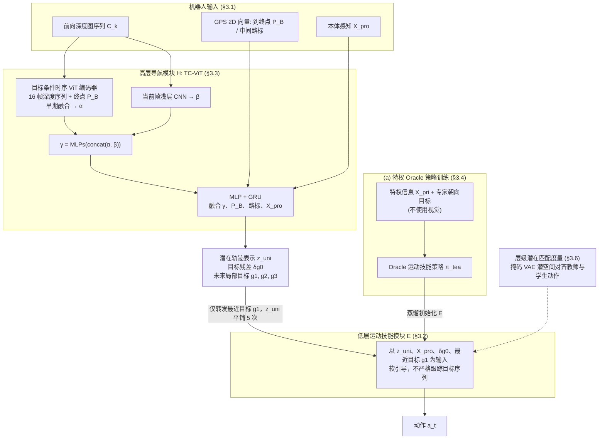

# Let Humanoids Hike! Integrative Skill Development on Complex Trails

**Let Humanoids Hike! Integrative Skill Development on Complex Trails** 已列入 [Robot Learning Paper Notebooks](https://imchong.github.io/Robot_Learning_Paper_Notebooks/index.html) 的 **PROGRESS.md 待深读** 清单（分类：05_Locomotion）。本页 **还没有深读笔记**：只给出这篇论文的分类位置与原文入口，方法细节与数据请直接看原文。

## 一句话定义

Let Humanoids Hike! Integrative Skill Development on Complex Trails 的人形机器人学习论文条目，当前处于 Paper Notebooks 阅读进度（待深读）阶段。

## 英文缩写速查

| 缩写 | 英文全称 | 简要说明 |
|------|----------|----------|
| RL | Reinforcement Learning | 通过与环境交互最大化长期回报来学习策略 |
| WBC | Whole-Body Control | 协调全身关节满足多任务/约束的控制基础设施 |
| Sim2Real | Simulation to Real | 把仿真中学到的策略迁移落地真机的工程主线 |

## 为什么重要

- 这篇已排进 Paper Notebooks 的待读清单，可以从 [机器人学习论文笔记总索引](../overview/humanoid-paper-notebooks-index.md) 与分类页找到同一批工作。
- 在深读笔记写出来之前，这里只保留分类位置与原文入口；方法流程见「流程总览」（依据论文方法部分），结论与指标以论文为准。

## 流程总览

图依据：论文 §3.2–3.6 / Fig.3、Fig.4（部分内容来自图注，细节以原文为准）。

## 核心信息

| 字段 | 内容 |
|------|------|
| 分类 | 05_Locomotion |
| 深读状态 | 待撰写（[PROGRESS.md](https://github.com/ImChong/Robot_Learning_Paper_Notebooks/blob/main/papers/PROGRESS.md)） |
| 计划文件夹 | `papers/05_Locomotion/let-humanoids-hike-integrative-skill-development` |
| arXiv | <https://arxiv.org/abs/2505.06218> |

## 实验与评测

- 深读笔记尚未完成；量化 benchmark、消融与实机指标待笔记撰写后补充。

## 结论

**本页目前只是「让人形去徒步」这条复杂地形 locomotion 线索的待读条目：坐标已定，方法结论未定。**

- 可确认的只有索引层信息——arXiv 2505.06218、分类 05_Locomotion 与计划中的笔记文件夹；标题强调的是「在复杂步道上做整合式技能培养」，即多技能协同而非单一步态，但整合方式页内未展开。
- 适用边界：可作为检索入口，经[分类页](../overview/paper-notebook-category-05-locomotion.md)与[机器人学习论文笔记总索引](../overview/humanoid-paper-notebooks-index.md)与其他 locomotion 工作交叉定位；不足以支撑地形泛化能力的横向比较。
- 风险提示：量化 benchmark、消融与实机指标本页均无，深读状态以 PROGRESS.md 为准，结论须回到 arXiv 原文核对。

## 与其他页面的关系

- 分类页：[paper-notebook-category-05-locomotion](../overview/paper-notebook-category-05-locomotion.md)
- 总索引：[humanoid-paper-notebooks-index.md](../overview/humanoid-paper-notebooks-index.md)

## 参考来源

- [humanoid_pnb_let-humanoids-hike-integrative-skill-development.md](../../sources/papers/humanoid_pnb_let-humanoids-hike-integrative-skill-development.md)
- [Robot Learning Paper Notebooks · PROGRESS.md](https://github.com/ImChong/Robot_Learning_Paper_Notebooks/blob/main/papers/PROGRESS.md)
- 论文：<https://arxiv.org/abs/2505.06218>
- [arXiv PDF](https://arxiv.org/pdf/2505.06218)：已通读方法部分（实验与附录以略读为准）：§3 LEGO-H 方法（§3.1–§3.4 与 Fig.3、Fig.4）；§3.5–§3.6、§4 实验与附录以略读为准

## 推荐继续阅读

- [Paper Notebooks 阅读进度（PROGRESS.md）](https://github.com/ImChong/Robot_Learning_Paper_Notebooks/blob/main/papers/PROGRESS.md)
