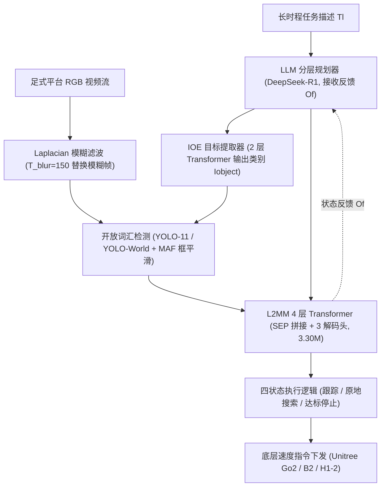
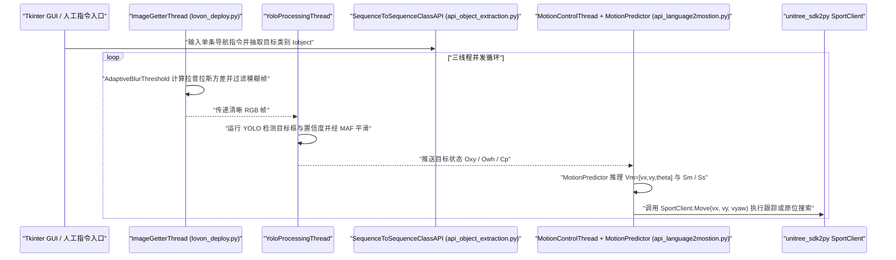

# LOVON

**LOVON: Legged Open-Vocabulary Object Navigator** 收录于 [Robot Learning Paper Notebooks](https://imchong.github.io/Robot_Learning_Paper_Notebooks/index.html)（分类：08_Navigation）。本页已对照 arXiv 原文全文（arXiv:2507.06747）与官方代码仓库 `DaojiePENG/LOVON` 通读核对并编译。

## 一句话定义

LOVON 是一个面向四足与人形机器人的开放词汇长时程目标导航框架，把大语言模型（LLM）子任务规划、拉普拉斯运动模糊稳像、开放词汇目标检测与轻量语言-运动模型（L2MM）解耦串联，在不依赖端到端大模型重训的前提下完成复杂导航任务。

## 英文缩写速查

| 缩写 | 英文全称 | 简要说明 |
|---|---|---|
| LLM | Large Language Model | 大语言模型（论文用 DeepSeek-R1），按反馈动态分解长时程任务为原子指令 |
| IOE | Instruction Object Extractor | 指令目标提取器，2 层 Transformer 将自然语言指令映射为检测类别词 |
| L2MM | Language to Motion Model | 语言到运动模型，4 层 Transformer 编码器（3.30M 参数）联合输出速度与状态 |
| MAF | Moving Average Filter | 滑动平均滤波器，平滑检测框中心与宽高输出以抑制足式步态抖动 |
| EL / SR | Episode Length / Success Rate | 导航回合步长效率指标与任务完成成功率 |

## 为什么重要

- **拆解开放词汇与长时程耦合难点**：不靠千亿参数多模态大模型直接吐底层速度，而是用推理型 LLM + 2 层 IOE + 轻量 3.30M 参数 L2MM 把语义规划和低延迟运动控制清晰分层。
- **直面足式行走的感知退化**：四足与双足步态伴随明显周期性俯仰/偏航抖动，拉普拉斯方差阈值滤波配合 MAF 与原位旋转找回机制显著降低真实行走中的丢框与超时失败。
- **极端高性价比的合成训练范式**：L2MM 依靠纯数值/几何状态生成的 1M 合成导航轨迹即可训练（i9-12900KF 生成耗时 <15 min，模型总训练约 1.5 h），避免昂贵真机 VLN 采集。
- **同一套上层策略跨本体部署**：在 Unitree Go2、B2（四足）与 H1-2（人形）上统一通过底层速度接口驱动，已开源 MIT 许可部署工程。

## 核心原理

### 分层规划与视觉稳像前端

1. **LLM 长时程任务规划**：输入系统提示 $I_{\text{sys}}$、长任务描述 $T_l$ 与底层反馈状态 $O_f$（DeepSeek-R1），动态输出当前原子导航指令 $I_i$。
2. **指令目标提取（IOE）**：2 层 Transformer 从 $I_i$ 中抽取标准化检测类别文本 $I_{\text{object}}$ 喂给开放词汇检测器（论文采用 YOLO-11 / YOLO-World）。
3. **Laplacian 方差模糊滤波与框平滑**：对前置相机（RealSense D435i 或本体相机）RGB 帧计算拉普拉斯方差，低于阈值 $T_{\text{blur}}=150$（源码部署采用 `AdaptiveBlurThreshold` 自适应阈值）的运动模糊帧直接以上一清晰帧替换，使有效清晰帧占比提升 +25%；检测输出 $(O_m, C_p, O_{xy}, O_{wh})$ 经滑动平均（MAF）降噪。

### L2MM 模型与四状态鲁棒执行逻辑

- **输入拼接与网络结构**：`LOVON-Base`（3.30M 参数）采用 4 层 Transformer 编码器，以 `[SEP]` 分隔拼接当前与上一条指令、MAF 平滑后的检测结果以及上一时刻任务/搜索状态 $(S_m, S_s)$。
- **三解码头与训练损失**：解码输出三维运动向量 $V_m=[v_x, v_y, \theta]$、任务状态 $S_m$（`running`/`success`/`searching`）与搜索状态 $S_s$；联合优化加权 MSE 损失（$\beta=10$）与交叉熵损失（CE），在 1M 合成数据集（8:2 切分）上完成监督训练。
- **执行状态机**：处于 `running` 时直接下发 $V_m=[v_x, 0, \theta_{\text{corr}}]$；目标进入盲区或短暂丢失时触发原地旋转搜索（$\pm 0.3$ rad/s）；检测框尺度 $O_{wh}$ 达成功阈值时切入 `success` 停机并回传 $O_f$ 给规划层。

图依据：论文 §III–§VI、Fig. 2、Table I。注：公开仓库 `lovon_deploy.py` 目前以 GUI 手动指令驱动，未接入在线 LLM 循环。

## 实验与对比评测

**1. 仿真导航基准（Table II，Gym-Unreal 四场景）**：

| 指标 / 维度 | LOVON 表现 | 对照基准（TrackVLA） |
|---|---|---|
| Mean EL / Mean SR | **499.75 EL / 1.00 SR（100% 成功率）** | 相同场景基准下训练周期大幅拉长 |
| 端到端训练时间成本 | **约 1.5 小时**（含 <15 min 合成数据生成） | **360 小时** |

**2. 结构与损失消融（Table III）**：

- **参数与数据规模甜点**：`LOVON-Base`（3.30M 参数）配合合成数据量 $N_{ds}=0.4\text{M}$ 即可取得稳健泛化；速度头权重 $\beta=10$ 为 MSE 与状态分类 CE 之间的最佳折中；移除输入序列中的 `[SEP]` 标记会造成明显指标下滑。

**3. 真机实测与消融（Table IV，Unitree Go2 6 m 背包寻物；Go2 / B2 / H1-2 部署）**：

| 真机配置（Go2 6 m 背包搜索） | 平均搜索时间 $T_s$ | 平均搜索/重试次数 $N_s$ |
|---|---|---|
| 基线（缺少完整状态机/模糊抑制） | 178 s | 5.95 次 |
| **LOVON（四状态逻辑 + Laplacian 滤波）** | **32.57 s（降幅 >81%）** | **1.00 次（一次到位）** |

- 跨本体实机均搭载 NVIDIA Jetson Orin + RealSense D435i / 机身内建相机，成功复现于四足 Go2、B2 与双足人形 H1-2。

## 结论

**LOVON 证明了「推理型 LLM 规划 + 轻量数值合成训练的 L2MM + 针对步态模糊与盲区丢失的经典工程滤波/状态机」可以在 1.5 小时低算力成本下，打通四足与人形机器人的开放词汇导航闭环。**

1. **轻量 L2MM 与百万级低成本合成数据是效率杠杆**：把视觉语义识别交给现成开放词汇检测器、把长时程推理交给上层 LLM，使核心导航策略网络压缩到 3.30M 参数，仅靠数值合成轨迹（<15 min 生成）就能跨真机本体迁移。
2. **真机增益高度依赖步态稳像与状态机**：Table IV 显示加入 Laplacian 模糊过滤和四状态丢框恢复后，6 m 寻物耗时从 178 s 骤降至 32.57 s，工程鲁棒性比堆砌大模型更立竿见影。
3. **注意论文闭环与开源代码现状的落差**：已开源的 MIT 仓库已覆盖三线程部署、`AdaptiveBlurThreshold`、IOE 与 L2MM（`MotionPredictor`），但 `README.md` TODO 明确标出在线 LLM 多阶段规划部署仍未勾选接入，当前代码处于单指令/人工 GUI 触发形态。
4. **能力止步于到达停止**：LOVON 解决「找到目标并走到近前（达 $O_{wh}$ 阈值）」，不负责到点后的抓握、开门或全身操作（loco-manipulation）。

## 源码运行时序图

以下时序严格依据开源仓库实读代码 `deploy/lovon_deploy.py`、`models/api_object_extraction.py`、`models/api_language2mostion.py`（注意文件名为 `mostion`）与 `README.md` 绘制；虚线标注论文有设计而源码 TODO 尚未接线的在线 LLM 层：

## 工程实践

| 工程项 | 论文 / 官方源码核对值 |
|---|---|
| 开源协议与平台 | MIT；板载 NVIDIA Jetson Orin + RealSense D435i / 机身相机，底层通过 `unitree_sdk2py` 控制 |
| 关键模块入口 | `deploy/lovon_deploy.py`、`models/api_object_extraction.py`、`models/api_language2mostion.py` |
| 核心超参 | $T_{\text{blur}}=150$（部署版启用 `AdaptiveBlurThreshold`）；`LOVON-Base` 3.30M 参数；合成数据 1M（$N_{ds}=0.4\text{M}$ 已充分），$\beta=10$ |
| 源码排查注意点 | (1) `README.md` 中 `- [ ] Deployment with LLM` 尚未完成，需自行对接 DeepSeek-R1 API 循环才可跑长时程多子目标；(2) 模型文件实际命名为 `api_language2mostion.py`（非 `motion`）；(3) 若机器人在原地反复打转或误停，优先检查 `AdaptiveBlurThreshold` 与 `Owh` 成功阈值 |

## 常见误区与局限

- **开源代码尚未包含自动多阶段 LLM 重规划**：如上所述，公开代码仅开放单阶段/GUI 指令切换版运行时，完整自主长时程循环需要基于论文 §IV-A 与 `Of` 反馈协议二次开发。
- **二维前向目标假定与无三维避障语义图**：策略主要依赖当前视角 RGB 框大小 $O_{wh}$ 判定接近程度与单步转向速度，缺少全局建图、跨房间拓扑记忆或高复杂三维狭窄通道规划。
- **检测器开放词汇上限受限于前端权重**：虽然框架声称开放词汇，实际准确率高度依赖前端所挂接检测器（YOLO-World / YOLO-11）的零样本召回，面对遮挡、逆光或细长物体仍会成为短板。
- **仅涵盖导航而不包含操作**：抵达目标前即进入 `success` 停机状态，与抓取/开门等末端操作串联需对接全身操控策略。

## 关联页面

- 分类父节点：[paper-notebook-category-08-navigation](../overview/paper-notebook-category-08-navigation.md)
- 总索引：[humanoid-paper-notebooks-index.md](../overview/humanoid-paper-notebooks-index.md)
- 评测与感知选型：[具身评测与基准选型闭环](../queries/embodied-eval-benchmark-selection-loop.md) · [机器人感知栈选型闭环](../queries/robot-perception-stack-selection-loop.md)
- 导航任务与对照：[Vision-Language Navigation](../tasks/vision-language-navigation.md) · [Zero-Shot Object Navigation](../tasks/zero-shot-object-navigation.md) · [Legged VLN Barrier Caging](paper-legged-vln-barrier-caging.md)
- 部署通信底盘：[Unitree SDK2](unitree-sdk2.md)

## 参考来源

- [lovon_reading.md](../../sources/papers/lovon_reading.md)（arXiv:2507.06747 全文与深读笔记归档）
- [humanoid_pnb_lovon.md](../../sources/papers/humanoid_pnb_lovon.md)（Robot Learning Paper Notebooks 原条索引归档）
- [daojiepeng_lovon.md](../../sources/repos/daojiepeng_lovon.md)（GitHub 官方仓库源码核对归档）
- 论文：<https://arxiv.org/abs/2507.06747>
- 项目主页：<https://daojiepeng.github.io/LOVON/>
- 源码仓库：<https://github.com/DaojiePENG/LOVON>

## 推荐继续阅读

- [LOVON 论文 PDF（arXiv:2507.06747）](https://arxiv.org/pdf/2507.06747)：查阅 Table II–IV 消融与合成轨迹生成细节
- [LOVON 官方代码仓库（DaojiePENG/LOVON）](https://github.com/DaojiePENG/LOVON)：阅读 `deploy/lovon_deploy.py` 三线程状态管理实现
- [机器人论文阅读笔记：LOVON](https://imchong.github.io/Robot_Learning_Paper_Notebooks/papers/08_Navigation/LOVON__Legged_Open-Vocabulary_Object_Navigator/LOVON__Legged_Open-Vocabulary_Object_Navigator.html)
